# 01 · OpenCode 架构总览

在 OpenCode 输入「核查这份 ISO 9001 证书」，TUI 可以先显示你刚发出的消息。同一时刻，Server 可能刚把它记录到 Inbox，模型还没有收到它。把这几个时点分开，就能理解为什么 OpenCode 要有客户端、会话运行时和事件流。

本章按原版提交 `ee5fe34e13` 走读。图中的请求、执行和事件通知是运行时的关系。包之间的依赖要另看一层。Schema 提供共用数据结构，Core 和 Protocol 使用 Schema，Server 组合 Core 和 Protocol。Client 使用 Schema 和 Protocol，嵌入式 SDK 在宿主侧组合 Client、Core 和 Server。这样，普通客户端只需要理解 API 和事件，也能接入同一套会话能力。[仓库依赖约定](https://github.com/anomalyco/opencode/blob/ee5fe34e136488a1839ac73bcca8321c51a31b75/AGENTS.md#L1-L4) · [嵌入式 SDK](https://github.com/anomalyco/opencode/blob/ee5fe34e136488a1839ac73bcca8321c51a31b75/packages/sdk/src/promise.ts#L34-L62)

## 一条请求，各层分别负责什么

| 层 | 负责的事 | ISO 9001 案例里可以观测到什么 |
|---|---|---|
| 客户端与 Client | TUI、Web、桌面或非交互 CLI 收集输入，通过 Client 调用 Server，订阅事件更新界面。 | TUI 乐观显示消息，请求失败时回滚。界面已经出现文字时，Core 仍可能在等待交付。 |
| Protocol 与 Server | Protocol 定义请求和响应。Server 组合 handler、认证和会话 Location 中间件。 | `POST /api/session/:sessionID/prompt` 通过 handler 把核查指令交给 Core。 |
| Core 会话运行时 | 接收输入、控制交付顺序、加载历史和可见工具，再决定是否开始下一步。 | 一条核查指令先等待交付，随后变成用户消息。Runner 到了可执行边界才把它装进请求。 |
| AI 适配层 | 连接不同模型服务，把服务商的流式帧解码成 Runner 能消费的事件。 | 模型建议读取证书。Runner 收到工具调用事件后执行工具，并把结果纳入会话。 |
| 数据库与事件 | 持久事件和查询投影保存在数据库。Bus 在持久提交后通知订阅者，Server 通过 SSE 发出实时事件。 | 会话历史可在下一步重新加载。客户端可以实时看到助手输出和工具状态。 |

沿请求走一遍，可以依次打开客户端提交、Protocol 路由、Server handler 和 Core 的 `Session.prompt()`。沿返回方向，则从 Bus 到 Server 的 SSE handler，再看客户端如何维护连接。[TUI 提交](https://github.com/anomalyco/opencode/blob/ee5fe34e136488a1839ac73bcca8321c51a31b75/packages/tui/src/component/prompt/index.tsx#L1370) · [Protocol 路由](https://github.com/anomalyco/opencode/blob/ee5fe34e136488a1839ac73bcca8321c51a31b75/packages/protocol/src/groups/session.ts#L342) · [Server handler](https://github.com/anomalyco/opencode/blob/ee5fe34e136488a1839ac73bcca8321c51a31b75/packages/server/src/handlers/session.ts#L290) · [Core 接收](https://github.com/anomalyco/opencode/blob/ee5fe34e136488a1839ac73bcca8321c51a31b75/packages/core/src/session/session.ts#L153) · [AI 事件解码](https://github.com/anomalyco/opencode/blob/ee5fe34e136488a1839ac73bcca8321c51a31b75/packages/ai/src/route/client.ts#L352) · [持久提交](https://github.com/anomalyco/opencode/blob/ee5fe34e136488a1839ac73bcca8321c51a31b75/packages/core/src/bus.ts#L451-L483) · [SSE 入口](https://github.com/anomalyco/opencode/blob/ee5fe34e136488a1839ac73bcca8321c51a31b75/packages/server/src/handlers/event.ts#L8-L27)

## 启动方式为什么值得单独看

1. **默认 TUI**。CLI 先解析连接目标，再启动界面。显式 `--server` 连接指定地址，`--standalone` 启动私有实例，默认分支通过本机后台服务管理层连接。CLI 的职责包括决定去哪里发请求。[TUI 入口](https://github.com/anomalyco/opencode/blob/ee5fe34e136488a1839ac73bcca8321c51a31b75/packages/cli/src/commands/handlers/default.ts#L49) · [连接目标选择](https://github.com/anomalyco/opencode/blob/ee5fe34e136488a1839ac73bcca8321c51a31b75/packages/cli/src/services/server-connection.ts#L27)
2. **非交互 CLI 与桌面端**。`opencode run` 经 Client 提交 prompt。桌面端在 Electron 主进程中管理后台连接。这些入口可以面向同一套 Session API。仓库里还有 Rust CLI/TUI 客户端，可顺着它的 README 对照原生入口。[非交互提交](https://github.com/anomalyco/opencode/blob/ee5fe34e136488a1839ac73bcca8321c51a31b75/packages/cli/src/run/noninteractive.ts#L217) · [桌面后台服务](https://github.com/anomalyco/opencode/blob/ee5fe34e136488a1839ac73bcca8321c51a31b75/packages/desktop/src/main/service/background-service.ts#L57) · [Rust CLI](https://github.com/anomalyco/opencode/blob/ee5fe34e136488a1839ac73bcca8321c51a31b75/packages/cli-rs/README.md#L3)
3. **嵌入式 SDK**。宿主进程创建 Server 路由，SDK 把宿主提供的 `fetch` 交给 Client。这条路径仍运行会话和工具机制，省去由外部 CLI 进程转发请求这一环节。它为比较运行开销提供了一条实际可读的源码路径。[进程内 Client](https://github.com/anomalyco/opencode/blob/ee5fe34e136488a1839ac73bcca8321c51a31b75/packages/sdk/src/promise.ts#L34-L62) · [进程内路由](https://github.com/anomalyco/opencode/blob/ee5fe34e136488a1839ac73bcca8321c51a31b75/packages/server/src/fetch.ts#L43)

独立 Server 先监听，再组装路由并启动后台服务，完成装配后才标记就绪。路由层把同一份 Protocol 契约和服务层接起来。这里的「Server 就绪」表达的是 API 可提供服务。具体 Session 哪些插件能力已经可用，要看它所在位置的加载情况。[Server 启动过程](https://github.com/anomalyco/opencode/blob/ee5fe34e136488a1839ac73bcca8321c51a31b75/packages/server/src/process.ts#L53-L137) · [路由组合](https://github.com/anomalyco/opencode/blob/ee5fe34e136488a1839ac73bcca8321c51a31b75/packages/server/src/routes.ts#L214-L227)

## 容易混在一起的五个对象

| 对象 | 请记住一个问题 |
|---|---|
| **Agent** | 当这次工作要发给模型时，使用哪套角色指令、工具边界和运行配置？ |
| **Session** | 输入、消息历史和后续交付状态属于哪一个会话？ |
| **Step** | 此处的一次逻辑模型调用，用的是哪份请求，如何处理流式结果？发生特定失败时，Runner 可以为同一个逻辑 Step 再安排一次尝试。 |
| **Tool** | 模型提出了什么动作？运行时应如何验证输入和权限、执行并记录结果？ |
| **Job** | 一项后台工作由谁驱动、怎样记录终态和恢复信息？子 Agent 的 Job 可以驱动自己的子 Session。 |

Agent 可以理解为执行配置，Session 则持有任务推进所需的会话状态。插件在两者之间提供扩展点，可注册 Agent 模板、工具和 Hooks。Core 在准备模型请求时，解析当前 Agent，再按照权限和条件选取工具快照。同一个 Agent 可以参与多个 Session。同一个 Session 也可以调整之后执行所用的 Agent。[原生 Agent 定义](https://github.com/anomalyco/opencode/blob/ee5fe34e136488a1839ac73bcca8321c51a31b75/packages/core/src/plugin/agent.ts#L52) · [内置插件装配](https://github.com/anomalyco/opencode/blob/ee5fe34e136488a1839ac73bcca8321c51a31b75/packages/core/src/plugin/internal.ts#L264) · [会话上下文选择](https://github.com/anomalyco/opencode/blob/ee5fe34e136488a1839ac73bcca8321c51a31b75/packages/core/src/session/context.ts#L148-L206) · [选择 Agent](https://github.com/anomalyco/opencode/blob/ee5fe34e136488a1839ac73bcca8321c51a31b75/packages/core/src/session/session.ts#L96)

### 执行位置和运行职责

Location 表示会话实际在哪个目录及工作区运行。Session 的协调器以 Session ID 为键管理执行。开始一次 drain 时，它读取 Session，再从 Location 取得对应的运行服务。模型、插件、工具和文件环境因此可以按位置选择。同一个 Server 能接住来自不同项目的会话，又允许这些会话各自使用合适的项目配置。[Location 的字段](https://github.com/anomalyco/opencode/blob/ee5fe34e136488a1839ac73bcca8321c51a31b75/packages/core/src/location.ts#L20-L34) · [执行时绑定服务](https://github.com/anomalyco/opencode/blob/ee5fe34e136488a1839ac73bcca8321c51a31b75/packages/core/src/session/execution.ts#L105-L138)

子 Agent 把这些对象连起来。父模型提出派发请求，工具建立父子关系，Job 驱动子 Session，子会话自己走模型和工具循环。结果随后作为输入送到父会话 Inbox，再由父会话在自己的安全边界处理。以后读多 Agent 流程，可以先分别找到两个 Session 的执行边界，再追 Job 如何交接结果。[子任务派发](https://github.com/anomalyco/opencode/blob/ee5fe34e136488a1839ac73bcca8321c51a31b75/packages/core/src/tool/plugin/subagent.ts#L171-L216) · [Job 驱动子 Session](https://github.com/anomalyco/opencode/blob/ee5fe34e136488a1839ac73bcca8321c51a31b75/packages/core/src/session/subagent-job.ts#L17-L40) · [结果交给父 Inbox](https://github.com/anomalyco/opencode/blob/ee5fe34e136488a1839ac73bcca8321c51a31b75/packages/core/src/session/execution/subagent-report.ts#L75-L96)

## 观察与自测

1. **沿请求走一遍。** 如果从 TUI 改用嵌入式 SDK 提交同一句核查指令，哪些环节换了入口？沿链接确认，两种方式都可以走同一套 API 路由与会话机制。
2. **看清三个时点。** 写下「TUI 显示已发送」「Inbox 持久接收」「模型第一次看到消息」各自由哪一层产生。后面的消息闭环样章会把第二、第三个时点按事件顺序展开。
3. **找出子任务的所有者。** 现在把核查拆成证书持有人核对和有效期核对。指出父 Session、子 Session 和后台 Job 各自保存哪些状态，再预测父 Agent 在什么时候会收到结果。

