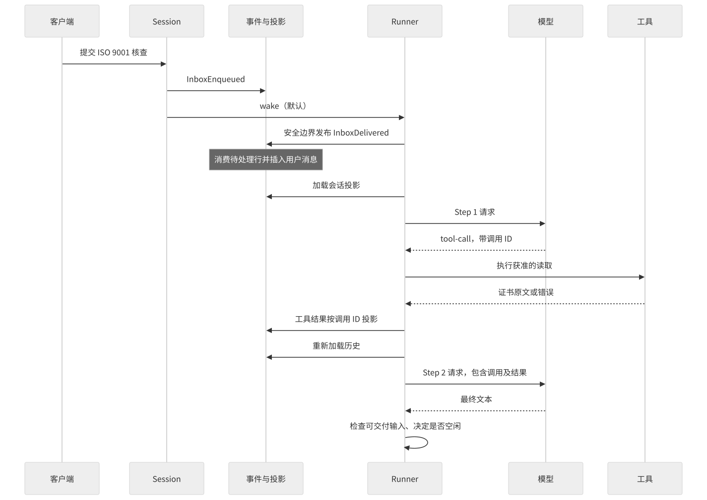

# 04 · 一条消息怎样跑完

假设你说「核查这份 ISO 9001 证书是否由投标人持有，且在投标截止日仍有效」。指令里只有任务要求。投标人、截止日和证书原文在附件材料里。这个案例要回答三个问题：**消息何时成为模型输入，模型怎么拿到证据，程序凭什么继续或停止。**

图中为简洁只画了一次读取。实际可能先搜索再读取，也可能在一次模型响应里请求多个工具。本章的 ISO 9001 轨迹是**教学数据**。

## 1 · 接收是一项数据库事实

Server 的 `session.prompt` handler 将请求交给 Core。Core 取得或生成 `messageID`，首次提交用 `SessionPrompt.prepare` 整理输入，再调用 `admission.admit`。后者发布 `InboxEnqueued`，投影在 `session_inbox` 中保存待交付记录。默认在这之后才调用 `execution.wake(sessionID)`。如果请求带 `resume: false`，这次提交只完成接收，稍后仍可由其它执行机会交付。[服务端入口](https://github.com/anomalyco/opencode/blob/ee5fe34e136488a1839ac73bcca8321c51a31b75/packages/server/src/handlers/session.ts#L290) · [Admission](https://github.com/anomalyco/opencode/blob/ee5fe34e136488a1839ac73bcca8321c51a31b75/packages/core/src/session/session.ts#L153) · [入队投影](https://github.com/anomalyco/opencode/blob/ee5fe34e136488a1839ac73bcca8321c51a31b75/packages/core/src/session/projector.ts#L1040)

这个边界让「我接收过这条输入」和「模型已读到这条输入」可以分别核实。拿着同一个 `messageID`，你可以沿着待交付记录追到用户消息。

## 2 · 运行者决定什么时候交付

`SessionExecution` 按 Session 找到它所在的 Location 和 Runner。同一个 Session 的执行由协调器串行管理，额外 wake 可以合并。Runner 到了安全边界，先准备上下文，然后调用 `SessionInbox.promote`。普通对话路径下，`steer` 可在当前工作进行中的安全步骤边界交付，`queue` 则等到会话原本要进入空闲时再逐条交付。移动、压缩等控制项还有优先级，图里只画普通输入。[执行入口](https://github.com/anomalyco/opencode/blob/ee5fe34e136488a1839ac73bcca8321c51a31b75/packages/core/src/session/execution.ts#L105) · [协调器](https://github.com/anomalyco/opencode/blob/ee5fe34e136488a1839ac73bcca8321c51a31b75/packages/core/src/session/run-coordinator.ts#L135) · [交付选择](https://github.com/anomalyco/opencode/blob/ee5fe34e136488a1839ac73bcca8321c51a31b75/packages/core/src/session/inbox.ts#L567)

`InboxDelivered` 的投影在同一事务里消费 inbox 行，并用原 ID 插入 `type: "user"` 的消息。随后才加载会话历史。这两个动作的顺序解释了为什么新输入可以出现在紧接着的模型请求里。[交付投影](https://github.com/anomalyco/opencode/blob/ee5fe34e136488a1839ac73bcca8321c51a31b75/packages/core/src/session/projector.ts#L1011) · [先交付再读取](https://github.com/anomalyco/opencode/blob/ee5fe34e136488a1839ac73bcca8321c51a31b75/packages/core/src/session/runner/llm.ts#L191)

## 3 · Step 是一次逻辑模型调用

`runStep` 取到当前 Agent、模型、指令、工具和历史，组装主请求。一次尝试由 `step.ts` 发起一次 `llm.stream()`。重试由上层处理，因此同一个逻辑 Step 在出错后可能经历多次尝试。假设模型请求读取证书所在页，它发出工具名、参数与调用 ID。对于本地执行的调用，OpenCode 先发布调用事件，再执行工具，把结果与原 ID 一起记录到会话中。模型服务商已执行的工具走自己的结果路径。[主请求准备](https://github.com/anomalyco/opencode/blob/ee5fe34e136488a1839ac73bcca8321c51a31b75/packages/core/src/session/runner/llm.ts#L237) · [模型流和本地执行](https://github.com/anomalyco/opencode/blob/ee5fe34e136488a1839ac73bcca8321c51a31b75/packages/core/src/session/runner/step.ts#L137) · [本地结果发布](https://github.com/anomalyco/opencode/blob/ee5fe34e136488a1839ac73bcca8321c51a31b75/packages/core/src/session/runner/publish-llm-event.ts#L582)

下一步加载新历史，`to-llm-message.ts` 把存好的调用及其结果转换成请求消息。此时模型才获得证书持有人和有效日期，可以继续查投标人和截止日，或者作出有依据的结论。[调用与结果转换](https://github.com/anomalyco/opencode/blob/ee5fe34e136488a1839ac73bcca8321c51a31b75/packages/core/src/session/runner/to-llm-message.ts#L105)

## 4 · 局部步骤与整次会话有不同的完成条件

正常完成时，Step 会根据工具记录判断 `needsContinuation`。外层收到这个值后再次走安全边界。即使模型已经给出最终文本，仍可能存在待交付输入，或者 idle Hook 会追加工作。反过来，工具拒绝、执行中断、输出受限、重试和步数上限都走各自的分支。[续跑来源](https://github.com/anomalyco/opencode/blob/ee5fe34e136488a1839ac73bcca8321c51a31b75/packages/core/src/session/runner/publish-llm-event.ts#L615) · [空闲判断](https://github.com/anomalyco/opencode/blob/ee5fe34e136488a1839ac73bcca8321c51a31b75/packages/core/src/session/runner/llm.ts#L177) · [主循环](https://github.com/anomalyco/opencode/blob/ee5fe34e136488a1839ac73bcca8321c51a31b75/packages/core/src/session/runner/llm.ts#L216)

## 在 Notebook 里看两条轨迹

1. **原版测试的期望事件与录制响应。** 上游测试提交的是 `Say hello in one short sentence.`，带 `resume: false`，随后显式 resume。Notebook 从原版 TypeScript 测试提取事件断言，并逐帧打开原版录制的 HTTP 流。这里能分别看到「运行时预期记录什么」和「上游模型真实返回过什么」。[原版测试](https://github.com/anomalyco/opencode/blob/ee5fe34e136488a1839ac73bcca8321c51a31b75/packages/core/test/session-runner-recorded.test.ts#L225)
2. **ISO 9001 教学轨迹。** 同一条核查指令经过接收、交付、调用工具、结果回传和最终作答。切换观察时点，看看 inbox、历史和工具结果中已经有了什么。教学数据与前面的真实 HTTP 录制分别标注。

**自测。** 如果你能看到证书的工具结果，但暂时没看到最终结论，系统可能已经完成了什么？根据前面的图，解释工具结果为什么要保留原调用 ID，以及下一步怎样拿到它。
