# 05 · 子 Agent 与任务分派

假设 Build 在调查 TypeScript 的日期边界故障。它可以请 Explore 找出测试与调用位置，自己继续检查日期表示和边界条件。这个分工的关键是**谁决定派发、子任务带走什么上下文、父会话什么时候能继续**。本章以 OpenCode `ee5fe34e13` 为基准。

## 从角色到执行单元

| 对象 | 在派发中负责什么 |
|---|---|
| **Agent** | 角色配置，包括可运行的模式、系统指令、工具权限和模型偏好 |
| **父 Session** | 保存原任务和派发记录，通过工具输出中的子会话 ID 关联后续工作 |
| **子 Session** | 保存自己收到的任务、工具结果和答复。同一个子 Session 可以收到后续指令 |
| **Job** | 驱动子 Session 的后台执行。子会话有新的工作时，Job 管理这次执行 |

Build 是默认主角色。General 是可分派的通用角色，内置权限拒绝 `question` 和进一步调用 `subagent`。Explore 的角色指令定位为搜索和分析，授权规则列出搜索、读取、网络等操作。内置规则也允许 `shell`，其只读行为由专门角色指令约束。看角色能力时要分别读**提示词**和**权限规则**。Agent 配置的 `mode` 有 `primary`、`subagent` 和 `all` 三种。[内置角色与授权](https://github.com/anomalyco/opencode/blob/ee5fe34e136488a1839ac73bcca8321c51a31b75/packages/core/src/plugin/agent.ts#L52-L94) · [Explore 指令](https://github.com/anomalyco/opencode/blob/ee5fe34e136488a1839ac73bcca8321c51a31b75/packages/core/src/plugin/agent.ts#L7-L17) · [Agent schema](https://github.com/anomalyco/opencode/blob/ee5fe34e136488a1839ac73bcca8321c51a31b75/packages/schema/src/agent.ts#L23-L37)

新子会话有自己的历史。它继承父会话的 Location，默认继承会话级 metadata 和 permissions。也就是说，两个 Agent 可以在同一个项目位置工作，各自保有消息上下文。派发日期故障时，给 Explore 的任务应自行交代哪条断言失败、需要查哪些文件，以及你希望收到哪些证据。[子会话创建](https://github.com/anomalyco/opencode/blob/ee5fe34e136488a1839ac73bcca8321c51a31b75/packages/core/src/session.ts#L292-L321) · [工具对新上下文的说明](https://github.com/anomalyco/opencode/blob/ee5fe34e136488a1839ac73bcca8321c51a31b75/packages/core/src/tool/plugin/subagent.ts#L51-L57)

## 入口一 · 模型通过 `subagent` 工具分派

模型给出 `agent`、短标题 `description` 和具体任务 `prompt`。省略 `sessionID` 表示新建子会话，传入已有 ID 则向同一子会话追加任务。可选的 `model` 是显式覆盖。新建时模型选择顺序为指定模型、目标 Agent 配置、父会话模型。工具描述会根据选中角色的权限列出可用子 Agent，真正执行时还会校验目标、权限和子会话归属。[工具参数](https://github.com/anomalyco/opencode/blob/ee5fe34e136488a1839ac73bcca8321c51a31b75/packages/core/src/tool/plugin/subagent.ts#L30-L49) · [校验与新建](https://github.com/anomalyco/opencode/blob/ee5fe34e136488a1839ac73bcca8321c51a31b75/packages/core/src/tool/plugin/subagent.ts#L111-L180) · [请求前生成的候选角色](https://github.com/anomalyco/opencode/blob/ee5fe34e136488a1839ac73bcca8321c51a31b75/packages/core/src/tool/plugin/subagent.ts#L240-L267)

权限检查把目标 Agent ID 当资源。将别的父会话创建的子 Session ID 交给当前工具，会在归属校验处被拒绝。工具还会检查嵌套深度，默认允许从顶层向下创建一层。增大深度只改变这个上限，仍需满足工具权限和目标角色要求。[权限及归属校验](https://github.com/anomalyco/opencode/blob/ee5fe34e136488a1839ac73bcca8321c51a31b75/packages/core/src/tool/plugin/subagent.ts#L118-L154) · [默认深度](https://github.com/anomalyco/opencode/blob/ee5fe34e136488a1839ac73bcca8321c51a31b75/packages/core/src/session/subagent-depth.ts#L8-L20)

首次分派先把任务写到子会话的 inbox，对尚未运行的子会话用 `resume: false`，随后由 `SubagentJob.start` 接管启动。这个顺序把任务接收和 Job 驱动分开，作业能先登记执行边界。工具很快返回 `sessionID` 和 `status: "running"`，此时**父会话的工具调用已完成，子任务仍在后台运行**。如果子会话正在运行，再用原 ID 发后续指令会将输入交给当前执行；可以用它继续缩小日期问题的调查范围。[子会话入队与 Job 启动](https://github.com/anomalyco/opencode/blob/ee5fe34e136488a1839ac73bcca8321c51a31b75/packages/core/src/tool/plugin/subagent.ts#L187-L222) · [后续任务原版测试](https://github.com/anomalyco/opencode/blob/ee5fe34e136488a1839ac73bcca8321c51a31b75/packages/core/test/tool-subagent.test.ts#L541-L585)

## 入口二 · 用户通过自定义命令指定分派

例如，为评审变更配置 `/review`。用户提交命令后，配置插件展开模板再决定投递位置。优先读 `subagent`，缺省时读旧字段 `subtask`，两者都缺省才依据配置中 Agent 的模式判断。选择子会话时，命令创建带 `parentID` 的 Session，把模板结果送进子 inbox，再启动同一种 Job。选择父会话时，命令可按配置切换当前 Agent 或模型，把消息投到原 Session。[命令执行实现](https://github.com/anomalyco/opencode/blob/ee5fe34e136488a1839ac73bcca8321c51a31b75/packages/core/src/config/plugin/command.ts#L50-L109)

两条入口的差别在于**决策来自哪一层**。模型工具调用由模型选任务和角色，OpenCode 在执行时施加工具权限和目标约束。用户发出的自定义命令按配置决定投递位置，可以显式要求某角色在子 Session 运行。原版测试甚至用 `subagent: true` 把 Build 放进子 Session，说明命令路径和模型工具路径的角色校验不同。这个测试场景里，父会话本身的 Agent、模型和历史均保留。[显式命令的测试矩阵](https://github.com/anomalyco/opencode/blob/ee5fe34e136488a1839ac73bcca8321c51a31b75/packages/core/test/config/command-subagent.test.ts#L55-L105)

## 跑原版 · 代码评审、运行中追加与归属校验

| 案例 | 跑原版时看什么 |
|---|---|
| **命令发起代码评审** | `command-subagent.test.ts` 让子会话的模型停在测试闸门。命令已返回，父会话尚未收到消息。打开闸门后，父会话收到带子 ID 的 `synthetic` 结果。另一个用例用 `subagent: false` 把改写后的评审指令送回当前会话。[后台评审](https://github.com/anomalyco/opencode/blob/ee5fe34e136488a1839ac73bcca8321c51a31b75/packages/core/test/config/command-subagent.test.ts#L79-L105) · [原会话对照](https://github.com/anomalyco/opencode/blob/ee5fe34e136488a1839ac73bcca8321c51a31b75/packages/core/test/config/command-subagent.test.ts#L110-L123) |
| **安排背景调查，再增加核对范围** | `tool-subagent.test.ts` 先验证新会话的父 ID、Location、模型和入队内容，再验证传回同一子 ID 时只有一个子会话、具有两条待处理指令。运行中追加的用例还验证原 Job 继续运行。[创建并返回句柄](https://github.com/anomalyco/opencode/blob/ee5fe34e136488a1839ac73bcca8321c51a31b75/packages/core/test/tool-subagent.test.ts#L422-L478) · [同一会话后续任务](https://github.com/anomalyco/opencode/blob/ee5fe34e136488a1839ac73bcca8321c51a31b75/packages/core/test/tool-subagent.test.ts#L484-L535) |
| **提交属于另一个父会话的 ID** | 同一工具测试分别传入不存在的 ID、格式不合法的 ID、父会话自身 ID，以及另一个父会话的子 ID。观察哪些在参数解码时失败，哪些在查找与归属检查时失败。[归属与参数错误](https://github.com/anomalyco/opencode/blob/ee5fe34e136488a1839ac73bcca8321c51a31b75/packages/core/test/tool-subagent.test.ts#L648-L718) |

这些原版测试使用受控的模型响应或既定工具调用，以便重现后台时序。日期边界故障是阅读场景。上游测试中实际执行的是评审命令、子会话派发及后续指令等用例。

**自测。** 父会话看到 `status: "running"` 后，为什么可以继续查日期逻辑？如果要让 Explore 把输出缩小到特定测试文件，哪一个 ID 能把新指令送进原来的调查？哪些信息应该写进第一次委派的任务里？
