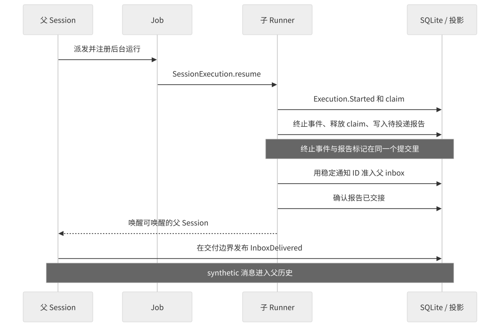

# 06 · 后台 Job 与结果回传

你让主 Agent 派一名 reviewer 跑测试，自己继续解释当前改动。派发工具已经返回，reviewer 说「测试已启动」，Shell 却还在跑。此时谁算完成？如果服务重启，应该继续 reviewer 的工作，还是只补送它已经写好的报告？

OpenCode 给这几个问题各自留了依据。**子会话保存对话与执行位置，Job 管理后台工作，会话认领标记保存恢复依据，父会话 Inbox 接收报告。** 读完本章，你能从这些状态判断下一步该运行谁、该投递什么。

## 1 · 派发返回之后，谁负责运行

`subagent` 把任务提交到子会话。新建或当前空闲的子会话用 `resume: false` 接收入参，让随后启动的 Job 接管执行。已有子会话正在工作时，追加指令沿会话的普通 Inbox 路径进入。工具返回的子会话 ID 和 `running` 状态是回执，主 Agent 可以继续运行。Job 把启动信息写入持久表后，才在自己的作用域中运行 `SessionExecution.resume(childID)`。同一 ID 的活跃 Job 通常复用，若旧的一批已开始结算，新任务会取得新的 generation。这样旧任务的收尾有自己的归属。[子 Agent 派发](https://github.com/anomalyco/opencode/blob/ee5fe34e136488a1839ac73bcca8321c51a31b75/packages/core/src/tool/plugin/subagent.ts#L187-L223) · [SubagentJob](https://github.com/anomalyco/opencode/blob/ee5fe34e136488a1839ac73bcca8321c51a31b75/packages/core/src/session/subagent-job.ts#L17-L52) · [Job 启动与复用](https://github.com/anomalyco/opencode/blob/ee5fe34e136488a1839ac73bcca8321c51a31b75/packages/core/src/job.ts#L370-L426)

| 标识或状态 | 实际用途 |
|---|---|
| 子会话 ID | 找到对话历史、接收后续指令和驱动该 Session。子代理 Job 也用它作为逻辑 ID。 |
| Job generation | 进程内区分同一个逻辑 Job 的不同批次。会话从忙到闲时，结算逻辑用它匹配自己观察到的取消或运行状态。 |
| `notificationID` | 持久 Job 行的主键，也是父会话通知的消息 ID。同一份报告重投时保持一致。同一个子会话后续再次完成工作可以产生新通知。 |
| 执行认领 `time_suspended` | 和 Session 启动事件一起写入的恢复标记。服务停止或进程崩溃后，它提供尚待恢复的依据。它不保存执行栈。 |

[Job 表](https://github.com/anomalyco/opencode/blob/ee5fe34e136488a1839ac73bcca8321c51a31b75/packages/core/src/job/sql.ts#L7-L25) · [generation 匹配](https://github.com/anomalyco/opencode/blob/ee5fe34e136488a1839ac73bcca8321c51a31b75/packages/core/src/job.ts#L661-L700) · [启动时绑定](https://github.com/anomalyco/opencode/blob/ee5fe34e136488a1839ac73bcca8321c51a31b75/packages/core/src/session/execution.ts#L138-L151) · [认领写入](https://github.com/anomalyco/opencode/blob/ee5fe34e136488a1839ac73bcca8321c51a31b75/packages/core/src/session/store.ts#L256-L274)

## 2 · 一份结果如何跨过两个事务

**先结算子会话。** `SubagentReport.prepare` 为这段忙碌期取得报告上下文。成功时按启动事件序号查找本期最后一个已完成、无错误的 assistant 消息，汇集文本部分。失败、用户取消各有对应终态。终态事件、释放子会话的认领、保存待投递报告在同一个事务里提交。测试故意阻止插入 Job 行时，子会话的空闲状态和认领释放也一起回滚。[选择本期结果](https://github.com/anomalyco/opencode/blob/ee5fe34e136488a1839ac73bcca8321c51a31b75/packages/core/src/session/execution/subagent-report.ts#L56-L73) · [查找已完成消息](https://github.com/anomalyco/opencode/blob/ee5fe34e136488a1839ac73bcca8321c51a31b75/packages/core/src/session/store.ts#L207-L232) · [原子结算](https://github.com/anomalyco/opencode/blob/ee5fe34e136488a1839ac73bcca8321c51a31b75/packages/core/src/session/execution/subagent-report.ts#L150-L187) · [写入失败回滚测试](https://github.com/anomalyco/opencode/blob/ee5fe34e136488a1839ac73bcca8321c51a31b75/packages/core/test/subagent-report.test.ts#L482-L504)

**再投递给父会话。** 提交后，运行时用同一个 `notificationID` 把报告作为 `synthetic`、`steer` 项写入父 Inbox，收到持久接收结果后清除 outbox 行。父会话存在且没有暂存 revert 时，投递会唤醒父会话。报告进入父历史的时点仍遵循上一章的安全边界。父会话已删除时可以清理报告，通知 ID 与其他输入冲突时则保留，留待后续诊断。[投递到父 Inbox](https://github.com/anomalyco/opencode/blob/ee5fe34e136488a1839ac73bcca8321c51a31b75/packages/core/src/session/execution/subagent-report.ts#L75-L129) · [报告接收后确认](https://github.com/anomalyco/opencode/blob/ee5fe34e136488a1839ac73bcca8321c51a31b75/packages/core/src/session/subagent-completion.ts#L75-L85) · [revert 测试](https://github.com/anomalyco/opencode/blob/ee5fe34e136488a1839ac73bcca8321c51a31b75/packages/core/test/subagent-report.test.ts#L546-L600)

这个设计让结果在进程故障后仍能追溯。若事务已提交、投递还没开始，恢复程序用完成态 outbox 补发通知。若父 Inbox 已接收、清理还没完成，重放仍使用原 ID。测试验证了父会话最终只见到同一份报告一次。[启动时重放结果](https://github.com/anomalyco/opencode/blob/ee5fe34e136488a1839ac73bcca8321c51a31b75/packages/core/src/session/execution/restart.ts#L390-L419) · [投递后、确认前的重放测试](https://github.com/anomalyco/opencode/blob/ee5fe34e136488a1839ac73bcca8321c51a31b75/packages/core/test/tool-subagent.test.ts#L225-L306)

## 3 · 当前会话空闲时，后台工作还能继续

代码检查案例复用上游的「后台 Shell 跑测试」。reviewer 第一次交还控制权时说 `Started tests`。其本期 Job 已完成，报告的元数据 `state` 是 `completed`。报告正文面向父模型的 `<background-result>` 同时写 `state="running"`，附带仍在运行的 Shell。Shell 完成后，reviewer 再运行一段，返回 `Tests green`，父会话看到第二份带新 ID 的报告。**“这一期有结果”和“整项工作已经结束”需要分别判断。** [报告状态装配](https://github.com/anomalyco/opencode/blob/ee5fe34e136488a1839ac73bcca8321c51a31b75/packages/core/src/session/subagent-completion.ts#L38-L85) · [两次回传的原版端到端测试](https://github.com/anomalyco/opencode/blob/ee5fe34e136488a1839ac73bcca8321c51a31b75/packages/core/test/subagent-idle-e2e.test.ts#L405-L454)

有孙级任务时，通知每次只向直属父会话投递。中间会话可以向上汇报孙级仍在运行的工作，顶层拿到的报告仍由直属子会话发出。这让每级 Agent 负责解释自己观察到的进展。[逐级回传测试](https://github.com/anomalyco/opencode/blob/ee5fe34e136488a1839ac73bcca8321c51a31b75/packages/core/test/subagent-idle-e2e.test.ts#L544-L625)

## 4 · 取消、关机与恢复怎样分流

| 发生了什么 | 持久状态与下一步 |
|---|---|
| 子会话正常完成或失败 | 写入终态，释放认领。若有待投递报告，提交后送给父会话。 |
| 明确取消 | 运行中的 Job 记录调用方取消并中断工作。子会话进入用户中断的结算路径，释放认领并按需报告取消。若进程恰在持久化取消之后退出，恢复流程也会读取取消状态。 |
| 服务关机或进程退出时仍在执行 | 关机分支保留认领和运行中的 Job 行，这次无需报告完成。进程崩溃留下的认领同样可作为恢复依据。启动时为仍需继续的子会话计算恢复次数，并按恢复策略重启其 Job。 |
| 退出时已经有完成态 outbox | 只重放报告。无需重新请求子 Agent 模型。 |
| 达到恢复预算上限 | 子会话落失败终态并释放认领，父会话得到一份错误通知。 |

[取消记录](https://github.com/anomalyco/opencode/blob/ee5fe34e136488a1839ac73bcca8321c51a31b75/packages/core/src/job.ts#L553-L590) · [关机与终态分支](https://github.com/anomalyco/opencode/blob/ee5fe34e136488a1839ac73bcca8321c51a31b75/packages/core/src/session/execution.ts#L155-L175) · [持久取消恢复测试](https://github.com/anomalyco/opencode/blob/ee5fe34e136488a1839ac73bcca8321c51a31b75/packages/core/test/session-execution.test.ts#L328-L370) · [已完成报告的恢复测试](https://github.com/anomalyco/opencode/blob/ee5fe34e136488a1839ac73bcca8321c51a31b75/packages/core/test/subagent-idle-e2e.test.ts#L630-L674) · [恢复预算耗尽测试](https://github.com/anomalyco/opencode/blob/ee5fe34e136488a1839ac73bcca8321c51a31b75/packages/core/test/session-execution.test.ts#L1808-L1857)

恢复还得处理父子竞态。实现先对需要恢复的父会话计算当次恢复预算，再启动它们的后台子任务。这样，一个很快结束的子 Agent 唤醒父会话时，父会话已经纳入恢复检查。[恢复排序](https://github.com/anomalyco/opencode/blob/ee5fe34e136488a1839ac73bcca8321c51a31b75/packages/core/src/session/execution/restart.ts#L502-L539)

## 在 Notebook 里看什么

1. **代码测试回传。** 运行上游 Shell 案例。第一份报告出现时找两个不同语境里的状态，第二份报告出现时对比通知 ID。上游测试使用脚本化模型响应和实际测试 Shell。  
2. **暂停一次投递。** 走上游 outbox 故障案例。在父会话还没收到消息时，检查子会话认领、待投递行和模型请求数。恢复后再比对三项，验证补的是报告。  
3. **同样中断，两种意图。** 对照用户取消与服务关闭。预测哪一种会释放认领，哪一种仍能恢复。最后看达到预算上限时父会话能拿到什么。

**自测。** 子 Agent 已输出「检查进行中」，报告正文的状态为 `running`。这对父 Agent 判断「是否等测试完成」意味着什么？如果再收到一份完成报告，你会用什么信息确认它与前一份报告来自同一个子会话？
