# 07 · /goal 怎样判断何时继续工作

一个编码 Agent 说「日期解析修好了」，Session 已经没有下一条输入，运行时准备进入空闲。此时可以追问两件事：**这次执行结束了吗？“让测试套件通过”这个目标达成了吗？** `/goal` 让 OpenCode 在即将空闲时再检查目标，通过事件和消息驱动下一轮。第 05、06 章的子 Agent 和 Job 可以提供证据，是否继续工作由持有目标的 Session 决定。

## 1 · 目标绑定在哪个 Session

`/goal <objective>` 由内置插件 `opencode.goal` 注册。命令把目标写到插件自己的存储，键为 `session:<id>`。状态包含目标文本、状态、最后原因、续跑计数、停滞计数和启动它的服务器进程标识。每次写入都会尝试发布 `changed`，TUI 也可以通过 `get` 拉取当前目标。子 Session 和 fork 从各自的键开始，仍可以通过任务参数收到父级给出的工作要求。目标状态和传给下游 Agent 的指令是两个信息来源。[目标存储和 RPC](https://github.com/anomalyco/opencode/blob/ee5fe34e136488a1839ac73bcca8321c51a31b75/packages/core/src/plugin/goal.ts#L40) · [状态定义](https://github.com/anomalyco/opencode/blob/ee5fe34e136488a1839ac73bcca8321c51a31b75/packages/schema/src/goal.ts#L7) · [TUI 如何订阅目标变更](https://github.com/anomalyco/opencode/blob/ee5fe34e136488a1839ac73bcca8321c51a31b75/packages/tui/src/feature-plugins/prompt/goal.tsx#L8)

设置目标时，插件记录 `active` 和 `rounds: 0`，再投递启动提示词。普通启动是一条带 `goalID` 的 `synthetic` 消息，时间线可用简短说明展示它。有文件、Agent 或 Skill 附件时改用用户 prompt 路径携带原附件。两种方式都复用 Session 的输入链路，因此新增目标也可以带上原有的投递方式。**目标先成为 Session 的状态，再通过已有输入机制驱动工作。** [命令实现](https://github.com/anomalyco/opencode/blob/ee5fe34e136488a1839ac73bcca8321c51a31b75/packages/core/src/plugin/goal.ts#L347) · [启动和附件分支](https://github.com/anomalyco/opencode/blob/ee5fe34e136488a1839ac73bcca8321c51a31b75/packages/core/src/plugin/goal.ts#L392) · [合成消息入队](https://github.com/anomalyco/opencode/blob/ee5fe34e136488a1839ac73bcca8321c51a31b75/packages/core/src/session/synthetic.ts#L15)

## 2 · 为什么在空闲边界做评审

第 04 章的 Step 负责一次逻辑模型调用。Runner 做完当前工作、没有可交付输入且确实执行过模型步骤后，才会触发 `experimental.idle`。这时工具调用和结果已经能成为评审的证据。如果 Hook 新增了输入，Runner 会再次检查 Inbox，有工作就沿用当前执行继续跑。源码测试验证了「先评审为继续，再评审为完成」的案例最终只记录一次 Session idle。[Runner 空闲边界](https://github.com/anomalyco/opencode/blob/ee5fe34e136488a1839ac73bcca8321c51a31b75/packages/core/src/session/runner/llm.ts#L177) · [注册 idle Hook](https://github.com/anomalyco/opencode/blob/ee5fe34e136488a1839ac73bcca8321c51a31b75/packages/core/src/plugin/goal.ts#L209) · [同一次执行继续的测试](https://github.com/anomalyco/opencode/blob/ee5fe34e136488a1839ac73bcca8321c51a31b75/packages/core/test/plugin/goal.test.ts#L60)

评审器通过 `Session.generate` 发起一条独立模型请求。它复用会话上下文，并附加目标评审提示词，要求根据已经出现的命令输出、工具结果和材料判断，而不是采信助手宣称已完成。生成响应的正文不会作为一次助手答复写进会话历史，模型用量仍会记录。JSON 判定可从代码围栏中提取并经 Schema 校验。**这里让模型理解证据，让运行时负责状态转换。** [评审提示词](https://github.com/anomalyco/opencode/blob/ee5fe34e136488a1839ac73bcca8321c51a31b75/packages/core/src/plugin/goal/judge.txt#L1) · [评审调用和解析](https://github.com/anomalyco/opencode/blob/ee5fe34e136488a1839ac73bcca8321c51a31b75/packages/core/src/plugin/goal.ts#L104) · [生成请求及用量](https://github.com/anomalyco/opencode/blob/ee5fe34e136488a1839ac73bcca8321c51a31b75/packages/core/src/session/generate.ts#L30)

## 3 · 后台在运行时，谁来唤醒目标

当当前 Session 直接拥有的子 Agent、图片、视频或 Code Mode Job 仍在运行时，目标 Hook 先让出执行，不发评审请求。Job 的回报能唤醒所有者，届时再评审。孙 Session 的 Job 结果会回到自己的父级，当前 Session 不会把这种间接工作当作自己的唤醒来源。当前 Session 自己的后台 Shell 走另一条分支：仍然请求评审，并传上命令清单。只有清单非空时才接受 `wait`，模型可指出目标需要等哪条命令结果。[后台判定](https://github.com/anomalyco/opencode/blob/ee5fe34e136488a1839ac73bcca8321c51a31b75/packages/core/src/plugin/goal.ts#L140) · [Shell 等待判定](https://github.com/anomalyco/opencode/blob/ee5fe34e136488a1839ac73bcca8321c51a31b75/packages/core/src/plugin/goal.ts#L109) · [直接子任务测试](https://github.com/anomalyco/opencode/blob/ee5fe34e136488a1839ac73bcca8321c51a31b75/packages/core/test/plugin/goal.test.ts#L178) · [后代所有权测试](https://github.com/anomalyco/opencode/blob/ee5fe34e136488a1839ac73bcca8321c51a31b75/packages/core/test/plugin/goal.test.ts#L216)

这解释了一个常见现象：**父 Session 已经空闲，目标仍然是 active，子 Job 也可能仍在运行**。三种状态各自回答一个问题：

| 看哪个状态 | 它回答的问题 |
|---|---|
| Session 的执行状态 | 当前有没有模型和工具步骤正在推进？ |
| 子 Agent Job 的状态 | 派出去的具体工作还在运行吗，回报要交给哪个 Session？ |
| `/goal` 的状态 | 在这个 Session 下，目标仍可继续、已暂停，还是已经被评审为完成？ |

## 4 · 一个 verdict 如何变成一次状态变更

| 评审输出或防护条件 | 运行时行为 |
|---|---|
| `done` | 记录 `complete` 和证据理由，当前目标停止追加输入。 |
| `continue` | 先检查有无进展。继续时更新状态，再注入带 `goalID` 的 `synthetic` 续跑消息，携带目标、评审理由和可选下一步。 |
| `blocked` 或 `paused` | 记录 `paused` 和原因，让用户接手或稍后恢复。 |
| `wait` | 有本 Session 的后台 Shell 时保持 active，等待新的执行机会。 |
| 连续无有效判定 | 普通无效响应再问一次，仍无法解析便暂停。评审上下文溢出时，每轮允许先压缩一次再次评审，仍溢出便暂停。 |

进展检查采用两个信号：评审理由经过去空白、统一大小写等归一化后是否重复，以及上一次启动或续跑以来是否出现工具调用。连续三轮满足任一停滞条件就暂停。历史压缩后如果找不到进度起点，源码按有进展处理。默认 50 个续跑轮次是另一个上限，这个数字统计续跑计数，不能直接换算成模型请求量。一轮工作内可能已经调用模型多次，评审本身也有单独的调用。压缩让目标片段暂时消失时，`context` Hook 可在请求尾部附近补入提醒，该提醒不落入会话历史。[判定和续跑](https://github.com/anomalyco/opencode/blob/ee5fe34e136488a1839ac73bcca8321c51a31b75/packages/core/src/plugin/goal.ts#L166) · [进展信号](https://github.com/anomalyco/opencode/blob/ee5fe34e136488a1839ac73bcca8321c51a31b75/packages/core/src/plugin/goal.ts#L89) · [理由归一化](https://github.com/anomalyco/opencode/blob/ee5fe34e136488a1839ac73bcca8321c51a31b75/packages/core/src/plugin/goal.ts#L459) · [上限常量](https://github.com/anomalyco/opencode/blob/ee5fe34e136488a1839ac73bcca8321c51a31b75/packages/core/src/plugin/goal.ts#L15) · [压缩后的提醒](https://github.com/anomalyco/opencode/blob/ee5fe34e136488a1839ac73bcca8321c51a31b75/packages/core/src/plugin/goal.ts#L222)

## 5 · 人能暂停，重启也有明确的边界

`/goal pause` 将 active 目标标为 paused。`/goal resume` 恢复同一个目标 ID，把续跑消息作为新预算的第一轮。`/goal clear` 移除目标。如果评审期间用户暂停、清除或更换目标，插件会重读目标并丢弃过时的评审结果。写入逻辑也会核对目标 ID、更新时间和状态。目标命令改变的是目标状态。用户直接停止 Session 时，插件另接收中断事件并暂停目标。[命令控制](https://github.com/anomalyco/opencode/blob/ee5fe34e136488a1839ac73bcca8321c51a31b75/packages/core/src/plugin/goal.ts#L358) · [写入前的检查](https://github.com/anomalyco/opencode/blob/ee5fe34e136488a1839ac73bcca8321c51a31b75/packages/core/src/plugin/goal.ts#L61) · [运行中暂停的测试](https://github.com/anomalyco/opencode/blob/ee5fe34e136488a1839ac73bcca8321c51a31b75/packages/core/test/plugin/goal.test.ts#L264) · [处理执行失败及用户中断](https://github.com/anomalyco/opencode/blob/ee5fe34e136488a1839ac73bcca8321c51a31b75/packages/core/src/plugin/goal.ts#L277)

等待后台时，目标会进入监测。以一次 Session 执行成功结束为起点，如果没有新的执行或后代步骤活动，等待约 30 分钟后暂停。作用域限定在当前 Session 与它下面的会话树。重启时，原版会比较进程标识，在启动扫描或下次 idle 时将旧进程留下的 active 目标标为 paused。第 06 章的后台 Job 恢复有自己的生命周期。目标在重启后等待用户用 `/goal resume` 恢复。[等待监测](https://github.com/anomalyco/opencode/blob/ee5fe34e136488a1839ac73bcca8321c51a31b75/packages/core/src/plugin/goal.ts#L237) · [启动扫描](https://github.com/anomalyco/opencode/blob/ee5fe34e136488a1839ac73bcca8321c51a31b75/packages/core/src/plugin/goal.ts#L318) · [旧进程目标防护](https://github.com/anomalyco/opencode/blob/ee5fe34e136488a1839ac73bcca8321c51a31b75/packages/core/src/plugin/goal.ts#L144) · [模拟时钟验证](https://github.com/anomalyco/opencode/blob/ee5fe34e136488a1839ac73bcca8321c51a31b75/packages/core/test/plugin/goal-watchdog.test.ts#L134)

## 在 Notebook 里观察四种原版行为

| 案例 | 读哪条原版断言 | 可观察的结果 |
|---|---|---|
| **让测试套件通过** | 日期解析仍失败时返 `continue`，下一次返 `done`。[原版案例](https://github.com/anomalyco/opencode/blob/ee5fe34e136488a1839ac73bcca8321c51a31b75/packages/core/test/plugin/goal.test.ts#L60) | 两次评审，一次续跑，最后一次 idle，目标 complete。 |
| **等调研报告** | 正在运行的直接子 Agent 推迟评审。测试夹具释放 Job 后，主动注入模拟的完成通知来唤醒父会话。[原版案例](https://github.com/anomalyco/opencode/blob/ee5fe34e136488a1839ac73bcca8321c51a31b75/packages/core/test/plugin/goal.test.ts#L178) | 等待时评审次数为 0，唤醒后评审一次并完成。第 06 章另观察真实报告投递链。 |
| **修复偶发测试** | 连续回报不同理由却没有工具调用，或反复回报同一理由。原版用两种情况构造停滞。[原版案例](https://github.com/anomalyco/opencode/blob/ee5fe34e136488a1839ac73bcca8321c51a31b75/packages/core/test/plugin/goal.test.ts#L104) | 第三个连续停滞候选触发暂停，没有再追加该轮续跑。 |
| **发布目标遇到停机或长期等待** | 启动时读到旧进程的目标，或用模拟时钟推进等待时间。[原版案例](https://github.com/anomalyco/opencode/blob/ee5fe34e136488a1839ac73bcca8321c51a31b75/packages/core/test/plugin/goal-watchdog.test.ts#L115) | 旧 active 目标暂停；持续活动的后代可刷新等待，无关 Session 不刷新。 |

这些案例运行的是原版目标插件。会话集成测试用 `TestLLM` 预设模型回答，便于固定确切的判定次数。等待监测测试用测试宿主和模拟时钟控制事件。这里验证的是**给定判定和事件时，原版怎样编排**。例如测试中的评审返回「All 12 tests pass」，这句话是输入给插件的预设判定。[评审回复夹具](https://github.com/anomalyco/opencode/blob/ee5fe34e136488a1839ac73bcca8321c51a31b75/packages/core/test/plugin/goal.test.ts#L485) · [测试宿主接口](https://github.com/anomalyco/opencode/blob/ee5fe34e136488a1839ac73bcca8321c51a31b75/packages/core/test/plugin/goal-watchdog.test.ts#L96)

**自测。** 一个父 Session 正在等待报表 Job，界面显示当前执行已经结束，目标仍然 active。先找出完成通知之后会唤醒谁，再判断什么时候才需要新的评审请求。如果读取了全部证据，模型仍连续给出相同的「需要更多检查」，哪个层负责止住重复续跑？

