# 08 · 事件总线：什么应该被记住

OpenCode 正在显示助手的流式答复。同一时间，另一个 Session 正把刚提交的文件检查请求写进 Inbox。前者需要频繁刷新界面，后者需要留下能查询和处理的记录。从这两种操作出发，可以追问**哪些变化需要持久语义、何时可以告诉订阅者，以及断线后怎样补读**。

## 1 · 一个事件的内容、位置和版本各有什么用

事件定义包含类型和数据 schema。持久事件还指定用数据中的哪个字段作为聚合键，以及当前数据版本。大部分 Session 持久事件用 `sessionID` 作为聚合键。一次发布可以得到下列彼此独立的信息。[事件定义](https://github.com/anomalyco/opencode/blob/ee5fe34e136488a1839ac73bcca8321c51a31b75/packages/schema/src/event.ts#L67-L125) · [会话聚合定义](https://github.com/anomalyco/opencode/blob/ee5fe34e136488a1839ac73bcca8321c51a31b75/packages/schema/src/session-event.ts#L29-L38)

| 字段 | 作用 |
|---|---|
| `id` | 这条事件的身份。工具调用 ID、消息 ID 和 Session ID 是业务对象的身份，可能出现在 `data` 中。 |
| `aggregateID` | 事件属于哪条聚合历史，例如哪一个 Session。 |
| `seq` | 在该聚合里的顺序，从 0 开始。不同 Session 各自推进，两个 Session 都可以有 `seq: 0`。 |
| `version` | 事件的数据契约版本。数据库的 `type` 把版本编码进名称，例如 `session.tool.success.2`。旧事件重放时精确选择其版本对应的投影器。 |

`event_sequence` 按聚合保存最后序号和可选的 `owner_id`。`event` 用主键保存事件身份，并给 `(aggregate_id, seq)` 加唯一约束。序号适合作为单个 Session 的读取游标，跨 Session 需要各自的游标。[事件表结构](https://github.com/anomalyco/opencode/blob/ee5fe34e136488a1839ac73bcca8321c51a31b75/packages/core/src/event/sql.ts#L4-L25) · [事件版本编码](https://github.com/anomalyco/opencode/blob/ee5fe34e136488a1839ac73bcca8321c51a31b75/packages/schema/src/event.ts#L174-L187) · [按聚合递增测试](https://github.com/anomalyco/opencode/blob/ee5fe34e136488a1839ac73bcca8321c51a31b75/packages/core/test/bus.test.ts#L459)

## 2 · 实时增量、持久语义、事件历史

以一段助手文字为例。`session.text.delta` 携带边生成边显示的片段，属于 **ephemeral**。结束后，`session.text.ended` 携带最终全文，属于 **durable**。工具也采用类似结构。`session.tool.progress` 是实时进度，成功和失败事件则包含各自的最终结果数据。投影器可以用终态构建消息部分，界面仍能通过实时事件获得过程反馈。[文字片段和全文](https://github.com/anomalyco/opencode/blob/ee5fe34e136488a1839ac73bcca8321c51a31b75/packages/schema/src/session-event.ts#L407-L443) · [工具进度与终态](https://github.com/anomalyco/opencode/blob/ee5fe34e136488a1839ac73bcca8321c51a31b75/packages/schema/src/session-event.ts#L535-L580)

**Durable 描述事件怎样提交，`persist` 决定是否把事件负载另存为历史。** 本册固定提交里，Bus 的 `persist` 默认关闭。持久事件仍然运行投影器、提交本地状态和更新 `event_sequence`。开启 `persist: true` 时，同一事务还会写入 `event` 表。Server 可以通过 `events.persist` 配置这个选项，workerd 的设置明确开启。判断某个实例的历史日志能读到什么，先核对这个配置，再查具体序号和行。[默认开关](https://github.com/anomalyco/opencode/blob/ee5fe34e136488a1839ac73bcca8321c51a31b75/packages/core/src/bus.ts#L185-L214) · [Server 配置接线](https://github.com/anomalyco/opencode/blob/ee5fe34e136488a1839ac73bcca8321c51a31b75/packages/server/src/routes.ts#L145-L148) · [workerd 配置](https://github.com/anomalyco/opencode/blob/ee5fe34e136488a1839ac73bcca8321c51a31b75/packages/server/src/workerd.ts#L68-L76) · [禁用历史仍有投影与序号的测试](https://github.com/anomalyco/opencode/blob/ee5fe34e136488a1839ac73bcca8321c51a31b75/packages/core/test/bus.test.ts#L281-L299)

## 3 · 一次提交怎样同时改变多个地方

拿消息入队举例。事件记录的是「这条输入被接收」，Inbox 投影保留的是「当前还有哪些输入待交付」。Bus 按聚合获取锁，在 SQLite 的 `IMMEDIATE` 事务里读取序号、执行对应的投影器、运行可选的本地 `commit(seq)`，再写入序号和启用时的事件历史。这个顺序让投影与它所依据的事件一起生效。批量发布 `publishAll` 要求整批属于同一个聚合，按传入顺序编号和投影。一次投影失败会让整批数据库变更回滚。[Inbox 投影入口](https://github.com/anomalyco/opencode/blob/ee5fe34e136488a1839ac73bcca8321c51a31b75/packages/core/src/session/projector.ts#L1040) · [单事件事务](https://github.com/anomalyco/opencode/blob/ee5fe34e136488a1839ac73bcca8321c51a31b75/packages/core/src/bus.ts#L290-L445) · [同聚合批处理](https://github.com/anomalyco/opencode/blob/ee5fe34e136488a1839ac73bcca8321c51a31b75/packages/core/src/bus.ts#L536-L645) · [整批回滚测试](https://github.com/anomalyco/opencode/blob/ee5fe34e136488a1839ac73bcca8321c51a31b75/packages/core/test/bus.test.ts#L519)

把「写持久状态」和「告诉观察者」放在不同阶段很重要。持久事件提交后，Bus 才更新内存路由、唤醒历史跟随者并通知实时观察者。持久事件的监听器发生普通缺陷时，Bus 记录错误，并继续通知其它观察者。测试让全局监听器在回调内立刻查询数据库，查询已经能看到该事件的行。临时事件经由实时通知路径，不接受 `commit`。因此外部网络调用和需要故障后补送的工作应有自己的持久交接依据，后续会用后台结果 outbox 说明这一点。[提交后唤醒与通知](https://github.com/anomalyco/opencode/blob/ee5fe34e136488a1839ac73bcca8321c51a31b75/packages/core/src/bus.ts#L437-L507) · [监听器查询已提交的行](https://github.com/anomalyco/opencode/blob/ee5fe34e136488a1839ac73bcca8321c51a31b75/packages/core/test/bus.test.ts#L377) · [监听器缺陷隔离](https://github.com/anomalyco/opencode/blob/ee5fe34e136488a1839ac73bcca8321c51a31b75/packages/core/test/bus.test.ts#L357)

## 4 · 补读日志和重新投影是两种操作

**补读日志给读取者看。** 实验性 Session 日志接口接受排他的 `after` 游标，可用 `follow: true` 继续跟随。Bus 先订阅该聚合的唤醒，再读取当时的最高序号。分页读完截至该点的历史后发出 `log.synced`。历史读取期间提交的后续事件会在标记后补读。唤醒本身只提醒数据库里可能有新行，跟随者仍按序号检查数据库。即使多次唤醒合并，也会补齐已保留的行。读取遇到当前 manifest 不认识的历史类型会略过输出，游标仍能根据数据库中的原始序号继续前进。[历史读取及跟随实现](https://github.com/anomalyco/opencode/blob/ee5fe34e136488a1839ac73bcca8321c51a31b75/packages/core/src/bus.ts#L765-L870) · [Session 日志 API](https://github.com/anomalyco/opencode/blob/ee5fe34e136488a1839ac73bcca8321c51a31b75/packages/protocol/src/groups/session.ts#L659-L675)

**重新投影给另一个数据库应用。** `Bus.replay` 接受带聚合、序号和版本类型的序列化事件，解码后复用持久事件提交路径。新事件必须接在该聚合的下一个序号。启用了事件历史时，可以用已存行判断旧序号是精确重放还是分叉。调用方可用 `ownerID` 约束同步来源，`strictOwner` 模式下 owner 冲突会明确报错。是否通知普通实时订阅者由 `publish` 选项决定。未登记版本的事件无法用此入口应用。[重放入口](https://github.com/anomalyco/opencode/blob/ee5fe34e136488a1839ac73bcca8321c51a31b75/packages/core/src/bus.ts#L653-L682) · [序号和 owner 检查](https://github.com/anomalyco/opencode/blob/ee5fe34e136488a1839ac73bcca8321c51a31b75/packages/core/src/bus.ts#L319-L394) · [版本分派测试](https://github.com/anomalyco/opencode/blob/ee5fe34e136488a1839ac73bcca8321c51a31b75/packages/core/test/bus.test.ts#L883) · [owner 隔离测试](https://github.com/anomalyco/opencode/blob/ee5fe34e136488a1839ac73bcca8321c51a31b75/packages/core/test/bus.test.ts#L920)

Event replay owner 约束谁能往某条聚合历史应用事件。Session 执行恢复依据的是 Session 上的执行认领。后者由启动事件的本地 `commit` 写入，正常结束时释放，关机时保留。这个本地回调和使用它的恢复信息有自己的生命周期。下一章看投影数据库的形状，再看重启时实际检查哪些状态。[本地 commit 的语义](https://github.com/anomalyco/opencode/blob/ee5fe34e136488a1839ac73bcca8321c51a31b75/packages/core/src/bus.ts#L100-L110) · [写入执行认领](https://github.com/anomalyco/opencode/blob/ee5fe34e136488a1839ac73bcca8321c51a31b75/packages/core/src/session/execution.ts#L78-L85) · [关机时的认领处理](https://github.com/anomalyco/opencode/blob/ee5fe34e136488a1839ac73bcca8321c51a31b75/packages/core/src/session/execution.ts#L138-L170)

## 在 Notebook 里看什么

| 原版案例 | 观察点 |
|---|---|
| **保留 Inbox 所需投影，省掉事件负载**。[原版测试](https://github.com/anomalyco/opencode/blob/ee5fe34e136488a1839ac73bcca8321c51a31b75/packages/core/test/bus.test.ts#L281) | 在通用 Bus 夹具里关闭事件历史。投影表出现一行，`event` 空，`event_sequence` 仍有 `seq: 0`。 |
| **本地写入失败**。[原版测试](https://github.com/anomalyco/opencode/blob/ee5fe34e136488a1839ac73bcca8321c51a31b75/packages/core/test/bus.test.ts#L257) | 投影器先写探针表，随后故意让本地 `commit` 失败。投影、事件行和聚合序号在事务后均为空。 |
| **从历史切到跟随时又来了一条消息**。[原版测试](https://github.com/anomalyco/opencode/blob/ee5fe34e136488a1839ac73bcca8321c51a31b75/packages/core/test/bus.test.ts#L1368) | 测试用同步点暂停历史读取，提交另一条事件，再放行。读取顺序为 `seq 0 → log.synced(0) → seq 1`。 |
| **同步客户端写错版本或来源**。[版本测试](https://github.com/anomalyco/opencode/blob/ee5fe34e136488a1839ac73bcca8321c51a31b75/packages/core/test/bus.test.ts#L883) · [来源测试](https://github.com/anomalyco/opencode/blob/ee5fe34e136488a1839ac73bcca8321c51a31b75/packages/core/test/bus.test.ts#L920) | 只识别 V2 的投影器仅接收 V2 事件。已有 owner 的聚合会隔离其它来源的重放。 |

**自测。** 如果浏览器断开时最后看到半行回复，重连后你会从哪里找完整文本？再假设数据库里已有投影和最新序号，却没有任何 `event` 行，说明可能采用了哪种配置？下一章会从 `session_message` 和 `session_part` 追到实际查询结果。

### SQLite 实测对照

| 上游案例 | 业务投影行 | `event` 载荷行 | `event_sequence` |
|---|---:|---:|---|
| 本地提交钩子失败 | 0 | 0 | 空 |
| `persist: false`，成功发布 | 1 | 0 | 有，首个序号为 0 |

两组数字来自在上游测试副本加入的只读查询。第二行最容易误判。只查 `event` 表，两组都找不到载荷。加查业务投影和聚合序号，就能分清事务回滚和正常发布。
