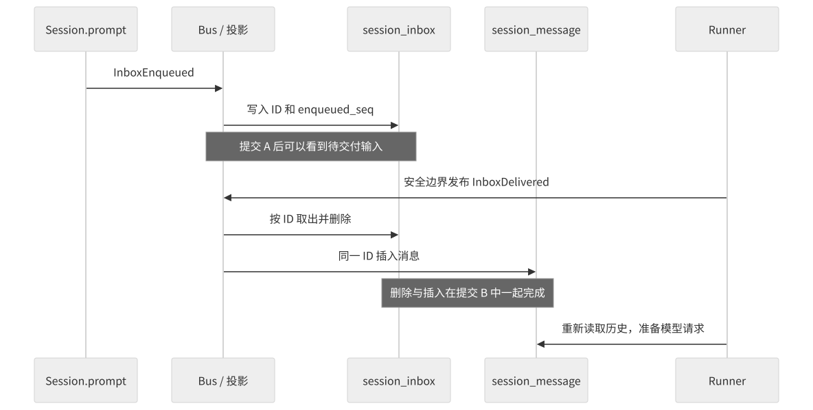

# 09 · 投影与 SQLite 持久化

你给一个商务核查会话追加「顺便查一下证书有效期」，并让它排队。随后关闭客户端再打开。追到本地数据库，可以查明 **后台在关闭前已经完成了哪一步**。如果该输入已接收但未交付，数据库应能回答「还有一条待处理输入」。如果已经交付，历史应能回答「这条消息何时成为会话上下文的一部分」。两者复用同一个消息 ID，落在不同的表里。

## 1 · 先找到数据库，再区分各种状态

固定提交的 CLI 服务把 `databasePath(global.data)` 作为数据库路径传给 Server。支持常见发行通道的默认数据库名是 `opencode.db`。没有设置 `XDG_DATA_HOME` 时，常见路径为 `~/.local/share/opencode/opencode.db`。设置了 `XDG_DATA_HOME` 时，数据目录改为该根目录下的 `opencode`。自定义通道可使用不同文件名，`OPENCODE_DB` 可指定覆盖值。需要确认某次 CLI 启动将选什么路径时，可以看 `opencode debug paths db`。嵌入式 SDK 默认为 `:memory:`，并允许调用方覆盖。因此测试或嵌入式会话是否跨进程存在，要先看实际用的是文件库还是内存库。[CLI 服务传参](https://github.com/anomalyco/opencode/blob/ee5fe34e136488a1839ac73bcca8321c51a31b75/packages/cli/src/server-process.ts#L101-L116) · [数据库路径选择](https://github.com/anomalyco/opencode/blob/ee5fe34e136488a1839ac73bcca8321c51a31b75/packages/cli/src/database-path.ts#L4-L12) · [数据目录](https://github.com/anomalyco/opencode/blob/ee5fe34e136488a1839ac73bcca8321c51a31b75/packages/util/src/global-roots.ts#L4-L17) · [SDK 默认选项](https://github.com/anomalyco/opencode/blob/ee5fe34e136488a1839ac73bcca8321c51a31b75/packages/sdk/src/internal/host.ts#L34-L42)

本地 Bun 驱动支持调优。数据库层在支持的驱动上请求 WAL、`synchronous=NORMAL` 和 `busy_timeout=5000`，支持外键切换时启用外键，然后执行迁移。WAL 属于 **SQLite 的事务日志**，用于处理数据库写入。OpenCode 的 `event` 表则属于 **应用历史**，是否保留事件负载由 `events.persist` 控制。在这一提交中，Bus 未配置时默认关闭事件负载保留，仍分配聚合序号并更新投影。文件库上的当前状态可以跨进程保留，历史事件能否查询或重放要另查实例设置。[数据库初始化](https://github.com/anomalyco/opencode/blob/ee5fe34e136488a1839ac73bcca8321c51a31b75/packages/core/src/database/database.ts#L35-L54) · [Bun 驱动](https://github.com/anomalyco/opencode/blob/ee5fe34e136488a1839ac73bcca8321c51a31b75/packages/core/src/database/sqlite.bun.ts#L1-L14) · [Server 向 Bus 传参](https://github.com/anomalyco/opencode/blob/ee5fe34e136488a1839ac73bcca8321c51a31b75/packages/server/src/routes.ts#L146-L148) · [Bus 默认选项](https://github.com/anomalyco/opencode/blob/ee5fe34e136488a1839ac73bcca8321c51a31b75/packages/core/src/bus.ts#L204-L215)

| 要回答的问题 | 看哪张表 | 怎样识别 |
|---|---|---|
| 这个 Session 在哪里，当前选了谁？ | `session_v2` | `id`、`project_id`、`directory`、`workspace_id`、`parent_id`、`agent`、`model`。父子关系与工作位置都可在这里查到。[会话表](https://github.com/anomalyco/opencode/blob/ee5fe34e136488a1839ac73bcca8321c51a31b75/packages/core/src/session/sql.ts#L28-L84) |
| 用户输入已接收，还在等交付吗？ | `session_inbox` | `id` 标识输入，`type`、`payload`、`delivery` 描述它的内容与投递方式，`enqueued_seq` 给出接收顺序。[Inbox 表](https://github.com/anomalyco/opencode/blob/ee5fe34e136488a1839ac73bcca8321c51a31b75/packages/core/src/session/sql.ts#L130-L152) |
| 这轮模型输出和工具调用已经记录了什么？ | `session_message`、`session_part` | 消息行的 `seq` 用于会话内排序。助手内容可拆成按 `ordinal` 排序的 part，工具 part 的 `call_id` 对应那次工具调用。[消息与分段表](https://github.com/anomalyco/opencode/blob/ee5fe34e136488a1839ac73bcca8321c51a31b75/packages/core/src/session/sql.ts#L86-L128) |
| 这组 durable 事件到了几号，能读到事件正文吗？ | `event_sequence`、`event` | 前者按 `aggregate_id` 保存最近的 `seq` 和可选的重放用 `owner_id`。开启负载保留时，后者保存事件 ID、序号、带版本的类型和负载。[事件表](https://github.com/anomalyco/opencode/blob/ee5fe34e136488a1839ac73bcca8321c51a31b75/packages/core/src/event/sql.ts#L4-L26) |
| 上一次执行中断后，是否仍有待恢复的认领？ | `session_v2` | `time_suspended` 是执行 claim 的历史列名，`resume_attempts` 记录恢复次数。界面查询用的 `time_busy`、`time_idle`、`idle_outcome` 是另一组信息。[执行认领读写](https://github.com/anomalyco/opencode/blob/ee5fe34e136488a1839ac73bcca8321c51a31b75/packages/core/src/session/store.ts#L245-L301) · [空闲投影](https://github.com/anomalyco/opencode/blob/ee5fe34e136488a1839ac73bcca8321c51a31b75/packages/core/src/session/projector.ts#L841-L863) |
| 后台检查工具在跑，还是已有结果等交给父会话？ | `job` | 用 `notification_id` 标识通知，结合 `kind`、`status`、`session_id`、`child_session_id`、`recovery`、`output`、`error` 辨认。待投递报告也用这张表。[Job 表](https://github.com/anomalyco/opencode/blob/ee5fe34e136488a1839ac73bcca8321c51a31b75/packages/core/src/job/sql.ts#L7-L27) · [子任务结算](https://github.com/anomalyco/opencode/blob/ee5fe34e136488a1839ac73bcca8321c51a31b75/packages/core/src/session/execution/subagent-report.ts#L151-L188) |
| 指令变化和较大的媒体内容怎么存？ | `instruction_state`、`instruction_entry`、`instruction_blob`，以及 `blob`、`blob_ref` | 指令快照包含 epoch 起点和已覆盖序号。开启媒体外置后，投影可保存引用，字节放在按哈希标识的 blob，读取时组装。[指令和媒体表](https://github.com/anomalyco/opencode/blob/ee5fe34e136488a1839ac73bcca8321c51a31b75/packages/core/src/session/sql.ts#L154-L215) · [更新指令投影](https://github.com/anomalyco/opencode/blob/ee5fe34e136488a1839ac73bcca8321c51a31b75/packages/core/src/session/projector.ts#L1074-L1079) |

## 2 · 投影把「发生了什么」变成「现在该读什么」

Runner 和消息页面经常需要读取同一个会话的当前历史。如果每次都重算一遍历史事件，就要重新做排队、分段、用量累加和兼容转换。OpenCode 在 durable 事件提交时调用对应的投影器。投影器把变化写到应用平时直接查询的表里。例如 `Step.Ended` 同时更新消息状态和累计用量，`Execution.Started` 则更新会话的忙碌时间。Runner 需要请求上下文时，从投影读取历史与指令基线，按上下文边界选取可用内容。[Bus 提交顺序](https://github.com/anomalyco/opencode/blob/ee5fe34e136488a1839ac73bcca8321c51a31b75/packages/core/src/bus.ts#L396-L432) · [会话生命周期投影](https://github.com/anomalyco/opencode/blob/ee5fe34e136488a1839ac73bcca8321c51a31b75/packages/core/src/session/projector.ts#L1065-L1119) · [Runner 历史读取](https://github.com/anomalyco/opencode/blob/ee5fe34e136488a1839ac73bcca8321c51a31b75/packages/core/src/session/history.ts#L282-L307)

一次提交也能带上运行时自己的数据库写入。例如执行开始时，`Execution.Started` 的投影记录 `time_busy`，调用者的提交回调建立 claim。子 Agent 正常结算时，另一事务释放认领并记录待投递回报，提交后才向父会话投递。**投影回答当前可读状态，claim 和待投递行回答重启后还有什么义务。** 是否继续执行还要看 claim 和恢复策略。[执行开始及认领](https://github.com/anomalyco/opencode/blob/ee5fe34e136488a1839ac73bcca8321c51a31b75/packages/core/src/session/execution.ts#L78-L85) · [执行生命周期连接](https://github.com/anomalyco/opencode/blob/ee5fe34e136488a1839ac73bcca8321c51a31b75/packages/core/src/session/execution.ts#L138-L176) · [提交后回报](https://github.com/anomalyco/opencode/blob/ee5fe34e136488a1839ac73bcca8321c51a31b75/packages/core/src/session/execution/subagent-report.ts#L179-L199)

## 3 · 同一个消息 ID 怎样从待办进入历史

1. **接收时。** `InboxEnqueued` 投影在 `session_inbox` 插入一行，`enqueued_seq` 为接收事件的序号。选择 `queue` 的输入可以待在这里，直到运行器抵达允许的交付边界。[接收投影](https://github.com/anomalyco/opencode/blob/ee5fe34e136488a1839ac73bcca8321c51a31b75/packages/core/src/session/projector.ts#L1040-L1050) · [首条排队输入选择](https://github.com/anomalyco/opencode/blob/ee5fe34e136488a1839ac73bcca8321c51a31b75/packages/core/src/session/inbox.ts#L470-L499)
2. **交付时。** `InboxDelivered` 的投影先执行删除并返回待交付行，再用它的内容插入 `session_message`。用户与合成输入沿用原 ID，消息 `seq` 取本次**交付事件**序号。两个动作在同一事件事务内提交。若投影后续写入失败，整个事务回滚，待交付行也会回来。压缩、会话移动等控制项同样消耗待交付行，其各自的动作有自己的事件。[交付投影](https://github.com/anomalyco/opencode/blob/ee5fe34e136488a1839ac73bcca8321c51a31b75/packages/core/src/session/projector.ts#L1011-L1039) · [消费输入](https://github.com/anomalyco/opencode/blob/ee5fe34e136488a1839ac73bcca8321c51a31b75/packages/core/src/session/inbox.ts#L347-L375) · [消息序号写入](https://github.com/anomalyco/opencode/blob/ee5fe34e136488a1839ac73bcca8321c51a31b75/packages/core/src/session/projector.ts#L801-L820) · [控制项交付](https://github.com/anomalyco/opencode/blob/ee5fe34e136488a1839ac73bcca8321c51a31b75/packages/core/src/session/runner/llm.ts#L91-L117)
3. **读取时。** 历史按消息 `seq` 排序。同一个 ID 可以连接接收和交付，仍需用序号判断消息何时对历史查询可见。重放测试从保留的接收事件重建待交付行，断言消息历史为空，执行唤醒也为空。重新得到待办记录，并没有自动开始推进它。[历史排序](https://github.com/anomalyco/opencode/blob/ee5fe34e136488a1839ac73bcca8321c51a31b75/packages/core/src/session/history.ts#L204-L213) · [待交付重投影测试](https://github.com/anomalyco/opencode/blob/ee5fe34e136488a1839ac73bcca8321c51a31b75/packages/core/test/session-prompt.test.ts#L1156-L1211)

## 4 · 存储形状会演进，读取语义可以保持稳定

一个助手消息可以先有文字，再提出工具调用，最后填入对应结果。常规助手更新在 `experimental.part_rows` 未设为 false 时使用分段写入。`session_message` 保存消息主体与元数据，`session_part` 保存内容分段，工具结果可更新对应 part。旧的整条内联消息仍能读出来。如果一条消息既有 part 行，又有旧版写入的内联内容，读取端依次拼接分段与内联内容，然后恢复媒体引用。通过测试切换三次存储配置，最终读到的回复仍等价。[写入适配器选择](https://github.com/anomalyco/opencode/blob/ee5fe34e136488a1839ac73bcca8321c51a31b75/packages/core/src/session/projector.ts#L316-L343) · [历史读时组装](https://github.com/anomalyco/opencode/blob/ee5fe34e136488a1839ac73bcca8321c51a31b75/packages/core/src/session/history.ts#L90-L124) · [跨存储形状验证](https://github.com/anomalyco/opencode/blob/ee5fe34e136488a1839ac73bcca8321c51a31b75/packages/core/test/session-projector.test.ts#L2581-L2612)

媒体也有同类边界。原版测试把同一张截图附上两次，又让工具返回相同字节。打开 `experimental.media_blob` 后，待交付投影、用户消息、工具 part 中都可看到 `media:<hash>`。`blob` 表只有一份该媒体字节。历史读取再把引用恢复为文件内容。这里的去重结论针对投影中的 blob 存储，历史事件负载保留是另一层配置。[媒体去重与恢复验证](https://github.com/anomalyco/opencode/blob/ee5fe34e136488a1839ac73bcca8321c51a31b75/packages/core/test/session-projector.test.ts#L1470-L1562)

## 在 Notebook 里观察四件事

| 案例 | 观察和判断 |
|---|---|
| **队列中的补充检查** | 运行原版交付测试，按同一个 ID 查看两张表。交付后 Inbox 行消失，用户消息行的 `seq` 等于交付事件序号。业务对应场景是合规核查的补充说明从排队进入历史。[交付断言](https://github.com/anomalyco/opencode/blob/ee5fe34e136488a1839ac73bcca8321c51a31b75/packages/core/test/session-projector.test.ts#L351-L375) |
| **分段保存的编码回复** | 比较全程启用 part、全程关闭 part 和中途切换三条路径。猜测历史 API 会不会因此返回三个不同结果，再检查上游断言。[分段兼容测试](https://github.com/anomalyco/opencode/blob/ee5fe34e136488a1839ac73bcca8321c51a31b75/packages/core/test/session-projector.test.ts#L2581-L2612) |
| **两份截图和一个工具输出** | 看哪个表只有一份二进制，哪个表记录使用处。再确认模型读取时得到的是可用文件内容。[媒体引用测试](https://github.com/anomalyco/opencode/blob/ee5fe34e136488a1839ac73bcca8321c51a31b75/packages/core/test/session-projector.test.ts#L1470-L1562) |
| **重放排队中的审批备注** | 原版测试依序重放保存的普通与合成输入事件。观察待交付行重新出现时，模型是否随之执行。审批备注是对测试的业务类比，测试输入为 `Replay pending` 和 `Replay synthetic`。[重放用例](https://github.com/anomalyco/opencode/blob/ee5fe34e136488a1839ac73bcca8321c51a31b75/packages/core/test/session-prompt.test.ts#L1156-L1211) |

**自测。** 找到一个 Session 的用户消息行、一个仍为 running 的后台 Job，以及一个非空 `time_suspended`。分别说明它们证明了什么。下一章再看进程启动时，恢复程序如何为这些记录选择继续执行、补发报告或留在待交付状态。

### 沿同一个 ID 看实际的两次提交

用上游的录制问候实验，先以 `resume: false` 提交，再显式恢复。第一次采样时，`session_inbox` 有一行，`enqueued_seq=0`，消息表为空。运行结束时，inbox 清空，同一个 ID 已成为 `session_message` 中的用户消息，消息序号为 2。序号 1 属于中间提交的指令更新事件。助手消息序号为 3。这些数来自开启事件载荷留存的课堂用例，可以在 Notebook 里同时对照行状态与事件顺序。
