# 10 · OpenCode 重启后，从哪里接上

假设 OpenCode 正在核对一份采购文件。主 Agent 等待测试命令，子 Agent 已经交了报告，但父会话还没收到。这时服务关闭或进程崩溃。下一次启动应该续跑会话、接回正在执行的命令，还是只补送报告？要回答这个问题，先找**最后一次已提交的状态**，再确定**哪个运行时负责接续**。

## 1 · 启动时扫的是遗留执行和待处理 Job

一次 Session 执行开始时，协调器发布 `Execution.Started`。同一数据库事务里的提交钩子写入 `session_v2.time_suspended`。字段叫 `time_suspended` 是历史原因，**从执行开始并仍在正常运行时就已经写入**。运行中有进程内协调器负责串行化，持久标记让接任进程知道这段工作可能需要继续。正常完成、失败和用户停止走终态提交，清空此字段并将 `resume_attempts` 重置为零。服务关闭可以发布 `Execution.Interrupted`，原因是 `shutdown`，同时保留标记和正在运行的 Job。进程突然退出时，开始事务留下的标记仍然是恢复依据。[写入开始标记与终态分支](https://github.com/anomalyco/opencode/blob/ee5fe34e136488a1839ac73bcca8321c51a31b75/packages/core/src/session/execution.ts#L138-L175) · [字段与读写](https://github.com/anomalyco/opencode/blob/ee5fe34e136488a1839ac73bcca8321c51a31b75/packages/core/src/session/store.ts#L245-L300)

恢复入口 `SessionRestart.resumeSuspendedSessions` 读取仍有执行标记的 Session 和持久化的后台 Job。托管服务启动时会开启这次扫描。嵌入式 `ServerFetch` 也会启动它。托管协议的前提是旧进程已退出，并由服务注册协调接任者。扫描避开当前协调器仍在运行的 Session，也会清理已经没有父会话的子执行标记。这里的执行标记表达上次工作是否仍待结算。第 08 章的事件回放 owner 约束谁能写入同步事件序列，两者各有用途。[恢复前提与入口](https://github.com/anomalyco/opencode/blob/ee5fe34e136488a1839ac73bcca8321c51a31b75/packages/core/src/session/execution/restart.ts#L52-L80) · [托管入口](https://github.com/anomalyco/opencode/blob/ee5fe34e136488a1839ac73bcca8321c51a31b75/packages/server/src/process.ts#L115-L132) · [嵌入式入口](https://github.com/anomalyco/opencode/blob/ee5fe34e136488a1839ac73bcca8321c51a31b75/packages/server/src/fetch.ts#L38-L51) · [初始扫描](https://github.com/anomalyco/opencode/blob/ee5fe34e136488a1839ac73bcca8321c51a31b75/packages/core/src/session/execution/restart.ts#L427-L451)

## 2 · 先判断遗留的是执行、命令，还是通知

| 服务重启时留下什么 | 先去哪读 | 接下来的动作 |
|---|---|---|
| 普通会话或直接驱动的子会话尚未结算 | `session_v2.time_suspended`、`resume_attempts`，再读取会话投影 | 先记入一次恢复尝试，写入「Continuing after restart」的合成消息，再启动 Session 执行。Runner 从已提交的历史继续，可将仍显示运行中的未结算工具调用标记为中断。 |
| 后台 shell 有原来的命令记录 | `job.recovery` 中的 shell ID、守护进程的命令状态 | 重新挂接同一条命令，继续等待，或读取重启期间已退出的结果。若先前会话还在等一个前台 shell，可根据原工具调用识别存活命令，先把工具调用结算为已移到后台，再恢复会话。 |
| 后台 shell 的命令已丢失，或有可补送的工具终态 | `job` 中的恢复资料、结果和 `notification_id` | 以稳定通知 ID 写入所有者的 Inbox。失去命令的情况报告取消，已经有终态时沿用该结果。纯补送工具结果可以只入队而保持空闲会话安静。 |
| 子 Agent 的 Job 仍在运行 | `job.status`、子 Session 及父子归属 | 由 `SubagentJob` 接回子 Session 的运行，子会话结算后走原有报告流程。父子归属失效时会清理报告义务。 |
| 子 Agent 终态已提交，报告未确认送达 | `job` 的结果和 `notification_id` | 把现成报告投递为父会话的合成输入，投递成功后确认。用同一消息 ID 处理上次已准入或已投影的情况。子会话的执行无需再启动。 |
| 用户取消已持久化 | Session 终态或 Job 的取消记录 | 释放遗留标记并按需报告。即使旧进程恰好停在「Job 取消已落库、还没来得及打断执行」之间，启动扫描也会处理这条取消记录。 |

[一般会话记账和续跑](https://github.com/anomalyco/opencode/blob/ee5fe34e136488a1839ac73bcca8321c51a31b75/packages/core/src/session/execution/restart.ts#L101-L123) · [Runner 结算未完成调用](https://github.com/anomalyco/opencode/blob/ee5fe34e136488a1839ac73bcca8321c51a31b75/packages/core/src/session/runner/llm.ts#L420-L443) · [shell 重挂接和前台调用结算](https://github.com/anomalyco/opencode/blob/ee5fe34e136488a1839ac73bcca8321c51a31b75/packages/core/src/session/execution/restart.ts#L263-L344) · [工具通知与确认](https://github.com/anomalyco/opencode/blob/ee5fe34e136488a1839ac73bcca8321c51a31b75/packages/core/src/session/execution/restart.ts#L183-L222) · [子 Agent 分支与取消记录](https://github.com/anomalyco/opencode/blob/ee5fe34e136488a1839ac73bcca8321c51a31b75/packages/core/src/session/execution/restart.ts#L390-L451)

前台调用这条路径有两个层次。**旧工具调用的 `completed` 可以表示「已成功交给后台」，它对应的命令仍可在运行**。等到收到后续 shell 通知，才知道命令最终成功、失败还是取消。测试给出两种时间线：命令在重启间隙完成，或新会话恢复时命令仍在运行。两条路径都用同一个原命令。命令消失、工作目录消失或没有可接回的句柄时，行为以保存的事实为准。[真实恢复路径的测试断言](https://github.com/anomalyco/opencode/blob/ee5fe34e136488a1839ac73bcca8321c51a31b75/packages/core/test/shell-restart.test.ts#L120-L201) · [找不到命令时的分支](https://github.com/anomalyco/opencode/blob/ee5fe34e136488a1839ac73bcca8321c51a31b75/packages/core/src/session/execution/restart.ts#L125-L145)

## 3 · 恢复次数在运行之前入账

`prepareResume` 先递增并写入 `resume_attempts`，再判断是否继续。本版本默认允许同一段执行恢复 **10 次**，超过预算发布 `Execution.Failed`，并通过同一提交释放标记、清零计数。测试把上限降为两次，便于观察。计数针对这段未结算的执行。假如新进程刚开始恢复又崩溃，标记和本次新增计数都还在。下次启动会接着计数。进程内协调器可以合并并发恢复请求。跨进程崩溃后，执行恢复按「至少一次」设计，某些外部副作用可能再次发生。[默认预算与至少一次语义](https://github.com/anomalyco/opencode/blob/ee5fe34e136488a1839ac73bcca8321c51a31b75/packages/core/src/session/execution/restart.ts#L38-L78) · [超限结算](https://github.com/anomalyco/opencode/blob/ee5fe34e136488a1839ac73bcca8321c51a31b75/packages/core/src/session/execution/restart.ts#L101-L123)

扫描还要安排**父子会话的唤醒时机**。它先尝试恢复工具结果和未结算的 shell 调用，再准备子 Job 和普通 Session 的恢复。在所有候选尝试先记账之后，才启动恢复执行和子 Job。扫描期间产生的通知可先准入 Inbox，唤醒则视接收者是否已列入计划而延后。否则，一个刚恢复的子 Agent 如果立刻完成，父会话可能先被它的报告唤醒，绕过本该计入的恢复次数。[延后的通知](https://github.com/anomalyco/opencode/blob/ee5fe34e136488a1839ac73bcca8321c51a31b75/packages/core/src/session/execution/restart.ts#L448-L473) · [各阶段启动顺序](https://github.com/anomalyco/opencode/blob/ee5fe34e136488a1839ac73bcca8321c51a31b75/packages/core/src/session/execution/restart.ts#L478-L539) · [快速子任务顺序断言](https://github.com/anomalyco/opencode/blob/ee5fe34e136488a1839ac73bcca8321c51a31b75/packages/core/test/session-execution.test.ts#L1861-L1928)

## 4 · 用三个崩溃时点读懂 outbox

1. **终态事务还没提交。** 旧进程留下未释放的执行标记，或者留下仍运行的 Job。重启会根据这些持久化的状态安排继续或取消。
2. **终态已提交，通知还没准入。** 子会话的终态、释放执行标记和保存待投递报告一起提交。重启可以读取报告内容并补送，原来那段子工作已经结算。
3. **通知已经准入或投影，报告还没确认。** 恢复会沿用同一个 `notification_id`。Inbox 能识别同 ID、同会话、同类型的已接收输入，或查到已经交付的投影。遇到 ID 真冲突会保留 outbox 标记，便于排查或下次重试。

这里可以验证**该报告在父会话中只交付一次**。一个 HTTP 请求或 shell 命令已产生外部效果、结果却来不及持久化时，数据库只能看到它最后一次提交的位置。任务需要强副作用约束时，仍要靠工具方识别重复执行。仅有会话历史，也无法复原旧进程的内存堆栈或接续已经断掉的模型流。[报告在终态事务内写入](https://github.com/anomalyco/opencode/blob/ee5fe34e136488a1839ac73bcca8321c51a31b75/packages/core/src/session/execution/subagent-report.ts#L150-L195) · [通知 ID 与确认](https://github.com/anomalyco/opencode/blob/ee5fe34e136488a1839ac73bcca8321c51a31b75/packages/core/src/session/subagent-completion.ts#L57-L86) · [已送达报告的补偿测试](https://github.com/anomalyco/opencode/blob/ee5fe34e136488a1839ac73bcca8321c51a31b75/packages/core/test/session-execution.test.ts#L1617-L1664) · [恢复边界](https://github.com/anomalyco/opencode/blob/ee5fe34e136488a1839ac73bcca8321c51a31b75/packages/core/src/session/execution/restart.ts#L63-L78)

## 5 · 在 Notebook 里观察持久证据

| 场景 | 原版测试里要找的证据 |
|---|---|
| 服务关闭与用户取消 | 工作中两条 Session 都有 claim，正常完成的清掉，关闭作用域的保留。用户中断结算后 claim 被清掉。[开始与结算](https://github.com/anomalyco/opencode/blob/ee5fe34e136488a1839ac73bcca8321c51a31b75/packages/core/test/session-execution.test.ts#L129-L173) · [用户中断](https://github.com/anomalyco/opencode/blob/ee5fe34e136488a1839ac73bcca8321c51a31b75/packages/core/test/session-execution.test.ts#L176-L196) |
| 恢复再次中断，或预算用尽 | 新 Runner 启动前数据库已有 `resume_attempts=1`。超限例里 Runner 没开始，记录 `aborted`，标记和计数均清零。[尝试持久化](https://github.com/anomalyco/opencode/blob/ee5fe34e136488a1839ac73bcca8321c51a31b75/packages/core/test/session-execution.test.ts#L471-L498) · [超限](https://github.com/anomalyco/opencode/blob/ee5fe34e136488a1839ac73bcca8321c51a31b75/packages/core/test/session-execution.test.ts#L444-L468) |
| 补送子 Agent 的完成报告 | 只有父会话进入后续执行，父 Inbox 可读到原报告，待投递记录随后清掉。[原版案例](https://github.com/anomalyco/opencode/blob/ee5fe34e136488a1839ac73bcca8321c51a31b75/packages/core/test/session-execution.test.ts#L1467-L1520) |
| 前台 shell 跨重启 | 两个服务作用域共享同一测试数据库。对照「命令在间隙退出」和「命令仍运行」，观察同一个 shell ID 的后台交接和后续通知。[测试环境](https://github.com/anomalyco/opencode/blob/ee5fe34e136488a1839ac73bcca8321c51a31b75/packages/core/test/shell-restart.test.ts#L54-L101) · [两个变体](https://github.com/anomalyco/opencode/blob/ee5fe34e136488a1839ac73bcca8321c51a31b75/packages/core/test/shell-restart.test.ts#L120-L201) |

这些测试走原版恢复代码。`session-execution.test.ts` 构建真实协调器、存储和恢复服务，用可控 Runner 记录启动顺序，并通过作用域关闭或预置行复现故障后的状态。`shell-restart.test.ts` 运行两套原版服务作用域，共用数据库，并用 `TestLLM` 和模拟守护进程制造时序。测试保护的是恢复条件、数据落点和处理先后。[恢复测试装配](https://github.com/anomalyco/opencode/blob/ee5fe34e136488a1839ac73bcca8321c51a31b75/packages/core/test/session-execution.test.ts#L2176-L2226) · [shell 测试替身](https://github.com/anomalyco/opencode/blob/ee5fe34e136488a1839ac73bcca8321c51a31b75/packages/core/test/shell-restart.test.ts#L54-L102)

**自测。** 子 Agent 的报告已在父 Inbox，outbox 行却还留着。你会比较哪个 ID？下次启动要恢复的是报告投递还是子 Agent 执行？再想一层，如果模型先前调用的是有外部副作用的工具，哪一份证据才能让你确认无需再执行？

### 文件库里的实际恢复结果

本章另在原版测试的临时副本中使用隔离的文件 SQLite，对两个不同的恢复起点采样。仍在运行的子 Job 在扫描后维持 claim，恢复次数从 0 增到 1。结算后释放 claim、清零恢复计数，并向父 Inbox 写入一条合成输入。已经完成、只等补送的报告在扫描前没有子 claim，Job 行为 `completed`。扫描后只推进父 Session，待投递 Job 行清理，父 Inbox 新增一条通知。

Bun 退出后，用只读 SQLite 连接重新打开同一个文件，仍能看到这两条待交付通知。**通知已落库和父 Agent 已处理通知是两个时点**。这里验证了落库。恢复扫描发生在上游测试宿主内，崩溃时点通过测试控制。
