# 11 · 上下文组装与历史选择

采购核查进行到第十轮，你问「按刚才发现的例外条款，重新判断交付期」。界面仍能向上滚到原文。模型这次能否引用它，要检查三个位置：**已存的完整记录、供当前模型继续的历史窗口、本步组装的模型请求。**

## 1 · 从 Location 得到指令和工具，从 Session 得到历史

`SessionContext.select()` 按 Session 当前的 Location 找到 Agent，合并 Agent 与 Session 权限，生成工具快照。它同时收集 Code Mode 目录、MCP、引用、技能、机器、项目发现、内置环境说明和会话专属条目等可变化的指令源。指令按共享度排序，让跨会话可复用的部分尽量形成稳定前缀。工具的结构化定义与给模型读的目录描述各自进入请求。[选择 Agent、权限与工具](https://github.com/anomalyco/opencode/blob/ee5fe34e136488a1839ac73bcca8321c51a31b75/packages/core/src/session/context.ts#L148) · [收集与排序指令源](https://github.com/anomalyco/opencode/blob/ee5fe34e136488a1839ac73bcca8321c51a31b75/packages/core/src/session/context.ts#L178) · [最终请求字段](https://github.com/anomalyco/opencode/blob/ee5fe34e136488a1839ac73bcca8321c51a31b75/packages/core/src/session/model-request.ts#L341)

普通模型步骤先观察并提交指令变化，在安全边界交付输入，再用已解析的模型读取历史。`entriesForRunner()` 在同一数据库事务里读指令基线和按序消息，避免拼用不同读取时点的两份状态。发生模型重试时，Runner 会重新准备上下文和历史，本步的输入交付边界保持稳定。[准备与交付](https://github.com/anomalyco/opencode/blob/ee5fe34e136488a1839ac73bcca8321c51a31b75/packages/core/src/session/runner/llm.ts#L191) · [指令观察与重载](https://github.com/anomalyco/opencode/blob/ee5fe34e136488a1839ac73bcca8321c51a31b75/packages/core/src/session/runner/llm.ts#L227) · [解析模型后读取历史](https://github.com/anomalyco/opencode/blob/ee5fe34e136488a1839ac73bcca8321c51a31b75/packages/core/src/session/context.ts#L210) · [同一事务读取](https://github.com/anomalyco/opencode/blob/ee5fe34e136488a1839ac73bcca8321c51a31b75/packages/core/src/session/history.ts#L290)

## 2 · 指令同时有基线和时间顺序

首次观察为 Session 建立指令基线，保存初始值、当前值及其序号。后续来源变化提交为差异，包含正文的差异被投影成一条按序出现的 `system` 消息。请求因此既保留「这段会话从什么规则开始」，也说明「这一步之前哪条规则有了更新」。[提交指令差异](https://github.com/anomalyco/opencode/blob/ee5fe34e136488a1839ac73bcca8321c51a31b75/packages/core/src/session/instruction-state.ts#L38) · [指令状态表写入](https://github.com/anomalyco/opencode/blob/ee5fe34e136488a1839ac73bcca8321c51a31b75/packages/core/src/session/instruction-state.ts#L89) · [指令投影](https://github.com/anomalyco/opencode/blob/ee5fe34e136488a1839ac73bcca8321c51a31b75/packages/core/src/session/projector.ts#L1074) · [生成 system 消息](https://github.com/anomalyco/opencode/blob/ee5fe34e136488a1839ac73bcca8321c51a31b75/packages/core/src/session/message-updater.ts#L154)

原版测试将 `Initial context` 改为 `Changed context` 后，第二次请求的系统前缀仍是初始值，消息角色则变为 `user → system → user`。模型先读到变化再读到第二个提问，原来的前缀仍可复用。压缩成功时，投影器将**已经提交的**当前指令值折入新基线，后续读取会隐藏已被基线涵盖的更新。手动压缩先预览已结算历史，刚观察到的源变化仍可在后续普通步骤中按序入账。[稳定前缀测试](https://github.com/anomalyco/opencode/blob/ee5fe34e136488a1839ac73bcca8321c51a31b75/packages/core/test/session-runner.test.ts#L1993) · [压缩完成投影](https://github.com/anomalyco/opencode/blob/ee5fe34e136488a1839ac73bcca8321c51a31b75/packages/core/src/session/projector.ts#L1121) · [折入新基线](https://github.com/anomalyco/opencode/blob/ee5fe34e136488a1839ac73bcca8321c51a31b75/packages/core/src/session/instruction-state.ts#L126) · [筛选已归并的指令](https://github.com/anomalyco/opencode/blob/ee5fe34e136488a1839ac73bcca8321c51a31b75/packages/core/src/session/history.ts#L225) · [手动压缩预览](https://github.com/anomalyco/opencode/blob/ee5fe34e136488a1839ac73bcca8321c51a31b75/packages/core/src/session/runner/llm.ts#L129)

## 3 · 从最近一个可用检查点读起

历史查询先在 `session_message` 中找最近一个**已成功且适合本次读取边界**的压缩记录，再读该记录及之后的行。失败或处理中记录保留自己的状态，最新完成记录仍然提供读取边界。[边界类型](https://github.com/anomalyco/opencode/blob/ee5fe34e136488a1839ac73bcca8321c51a31b75/packages/core/src/session/history.ts#L27) · [选择压缩记录](https://github.com/anomalyco/opencode/blob/ee5fe34e136488a1839ac73bcca8321c51a31b75/packages/core/src/session/history.ts#L55) · [按序读取](https://github.com/anomalyco/opencode/blob/ee5fe34e136488a1839ac73bcca8321c51a31b75/packages/core/src/session/history.ts#L193)

| 读取方式 | 选择规则 | 用途 |
|---|---|---|
| `latest` | 选最近完成的压缩，包括原生压缩 | 无需先选模型的 Session 历史视图 |
| `local` | 只有本地文本摘要可以切开历史 | 需要可移植文本，例如原生 trigger 压缩时选择近期真实用户消息 |
| 目标模型引用 | 文本摘要可用。原生窗口须出自同一 provider 和模型 ID，并通过解码 | Runner 为当前模型取得历史 |

[通用视图](https://github.com/anomalyco/opencode/blob/ee5fe34e136488a1839ac73bcca8321c51a31b75/packages/core/src/session/store.ts#L206) · [原生窗口过滤](https://github.com/anomalyco/opencode/blob/ee5fe34e136488a1839ac73bcca8321c51a31b75/packages/core/src/session/history.ts#L40) · [选择真实用户消息](https://github.com/anomalyco/opencode/blob/ee5fe34e136488a1839ac73bcca8321c51a31b75/packages/core/src/session/compaction.ts#L575)

**本地摘要**可带 `metadata.keepID`。读取时取从这个 ID 到压缩边界之前的行，在内存里重建近期文字。检查点会变成一条用户角色的历史消息，里面的 `
` 放摘要，`<recent-context>` 放序列化后的近期文字。压缩之后的新消息则以各自的角色接在后面。旧版本直接保存的 `recent` 文本也可读取。[近期尾部重建](https://github.com/anomalyco/opencode/blob/ee5fe34e136488a1839ac73bcca8321c51a31b75/packages/core/src/session/history.ts#L241) · [检查点请求格式](https://github.com/anomalyco/opencode/blob/ee5fe34e136488a1839ac73bcca8321c51a31b75/packages/core/src/session/runner/to-llm-message.ts#L292)

**原生检查点**保存模型专用的重放窗口。trigger 路径把近期真实用户消息和服务商返回的检查点合在一起。endpoint 路径沿用服务商给出的替换窗口。换了 provider 或模型 ID，或窗口无法解码，读取会回到更早可用的原生检查点、本地摘要或原始历史。换模型因此可能使输入变长，下一步会按新模型重新估算。[窗口组成](https://github.com/anomalyco/opencode/blob/ee5fe34e136488a1839ac73bcca8321c51a31b75/packages/core/src/session/compaction.ts#L543) · [两种原生调用方式](https://github.com/anomalyco/opencode/blob/ee5fe34e136488a1839ac73bcca8321c51a31b75/packages/core/src/session/compaction.ts#L575) · [解码回退](https://github.com/anomalyco/opencode/blob/ee5fe34e136488a1839ac73bcca8321c51a31b75/packages/core/src/session/history.ts#L220) · [兼容检查点测试](https://github.com/anomalyco/opencode/blob/ee5fe34e136488a1839ac73bcca8321c51a31b75/packages/core/test/session-native.test.ts#L312) · [损坏检查点回退测试](https://github.com/anomalyco/opencode/blob/ee5fe34e136488a1839ac73bcca8321c51a31b75/packages/core/test/session-native.test.ts#L345)

## 4 · 选中的历史再经过请求转换

`baseTranscript()` 将 Agent 系统提示和指令基线放入 `system`，再将历史转换成统一的消息对象。空闲标记不发送，后台 shell 的信息通过完成通知进入上下文。正常的工具调用和结果保留结构，失败或中断的助手内容按已经发生的步骤裁剪。原生元数据能否沿用，则取决于目标模型或 provider。[基础请求](https://github.com/anomalyco/opencode/blob/ee5fe34e136488a1839ac73bcca8321c51a31b75/packages/core/src/session/model-request.ts#L111) · [助手消息和工具回放](https://github.com/anomalyco/opencode/blob/ee5fe34e136488a1839ac73bcca8321c51a31b75/packages/core/src/session/runner/to-llm-message.ts#L146) · [会话消息分流](https://github.com/anomalyco/opencode/blob/ee5fe34e136488a1839ac73bcca8321c51a31b75/packages/core/src/session/runner/to-llm-message.ts#L245)

随后 `context` hook 可以调整草稿。运行时移除仅供 hook 使用的会话元数据，将模型不支持的媒体替换成文字提示，并在内联图像达到请求大小阈值时用提示替换较早的一批图像。要精确回答「模型看到了什么」，先查发送前的 `LLMRequest`，需要确认协议时再看服务商适配器编译后的请求体。原生压缩测试就直接检查后续请求体同时包含检查点 `encrypted_1`、当前指令和新用户输入。[请求 Hook](https://github.com/anomalyco/opencode/blob/ee5fe34e136488a1839ac73bcca8321c51a31b75/packages/core/src/session/model-request.ts#L468) · [媒体适配](https://github.com/anomalyco/opencode/blob/ee5fe34e136488a1839ac73bcca8321c51a31b75/packages/core/src/session/model-request.ts#L222) · [构造发送对象](https://github.com/anomalyco/opencode/blob/ee5fe34e136488a1839ac73bcca8321c51a31b75/packages/core/src/session/model-request.ts#L325) · [原版请求体断言](https://github.com/anomalyco/opencode/blob/ee5fe34e136488a1839ac73bcca8321c51a31b75/packages/core/test/session-native-compaction.test.ts#L266)

## 5 · 从长材料里确认保留下来的证据

把长采购核查想成三类输入：第一轮的任务范围、最近几次工具读到的原文和页码，以及先前附上的扫描件。压缩后，第一轮信息可能只有摘要，过长工具输出在近期文本里可能只留开头，附件也可能只留下 MIME 类型和文件名。近期文本会略去推理内容并截断长工具输出。如果模型要精确核对第 17 页例外条款，可以让它重新读该页。**文件可查**和**原文在当前请求中**是两个需要独立核对的条件。[近期文本规则](https://github.com/anomalyco/opencode/blob/ee5fe34e136488a1839ac73bcca8321c51a31b75/packages/core/src/session/recent-text.ts#L15) · [工具结果序列化](https://github.com/anomalyco/opencode/blob/ee5fe34e136488a1839ac73bcca8321c51a31b75/packages/core/src/session/recent-text.ts#L39) · [输出截断](https://github.com/anomalyco/opencode/blob/ee5fe34e136488a1839ac73bcca8321c51a31b75/packages/core/src/session/recent-text.ts#L72) · [尾部附件读取](https://github.com/anomalyco/opencode/blob/ee5fe34e136488a1839ac73bcca8321c51a31b75/packages/core/src/session/history.ts#L276)

| Notebook 观察 | 要核对的证据 |
|---|---|
| 长会话中有多次压缩和一次失败 | 最新成功 checkpoint 切出供模型读取的后缀。早期数据库行仍存在，甚至可以用测试中的坏行确认早期数据不会进入这次解码。[成功边界测试](https://github.com/anomalyco/opencode/blob/ee5fe34e136488a1839ac73bcca8321c51a31b75/packages/core/test/session-compaction.test.ts#L270) · [历史后缀测试](https://github.com/anomalyco/opencode/blob/ee5fe34e136488a1839ac73bcca8321c51a31b75/packages/core/test/session-compaction.test.ts#L303) |
| 会话进行中变化了项目指令 | 对照初始系统前缀与 `user → system → user` 的时间顺序。查看压缩后新指令怎样进入下一次请求。[指令前缀测试](https://github.com/anomalyco/opencode/blob/ee5fe34e136488a1839ac73bcca8321c51a31b75/packages/core/test/session-runner.test.ts#L1993) · [指令 epoch 测试](https://github.com/anomalyco/opencode/blob/ee5fe34e136488a1839ac73bcca8321c51a31b75/packages/core/test/session-runner.test.ts#L2553) |
| 换模型后检查点还能否使用 | 对照兼容模型重放原生窗口、不兼容模型从更早的检查点或历史恢复。[原生历史兼容性测试](https://github.com/anomalyco/opencode/blob/ee5fe34e136488a1839ac73bcca8321c51a31b75/packages/core/test/session-native.test.ts#L224) · [原生检查点回退测试](https://github.com/anomalyco/opencode/blob/ee5fe34e136488a1839ac73bcca8321c51a31b75/packages/core/test/session-native.test.ts#L312) |
| 扫描图片作为工具结果 | 近期文字里保留图片名称和 MIME 类型，查询得到的内联 base64 不进入这段历史文字。[媒体文本化测试](https://github.com/anomalyco/opencode/blob/ee5fe34e136488a1839ac73bcca8321c51a31b75/packages/core/test/session-compaction.test.ts#L140) |

### 实测 · 库里有六条，主请求历史只接两条

在上游历史选择案例中，会话原来有六条记录。最新成功的本地摘要指向「Kept question」，摘要后还有「After」。实验故意把切点前的旧行改成不可解码数据，用来验证读取是否真正跳过它们。最后进入模型历史的是两条消息：一条带摘要和 `<recent-context>` 的检查点，其中仍有「Kept question」，另一条是后续的「After」。系统片段和工具定义由主请求的其他部分提供。Notebook 会显示被跳过的 ID、`keepID` 与转成模型格式后的消息文本。
