# 12 · Token 预算与压缩触发

同一份长采购文件，在 100,000 Token 的窗口里可能触发压缩，在 272,000 Token 的输入额度里可能照常发送。即使本地估算显示请求能发，供应商也可能因为自己的计数规则拒绝。OpenCode 因此分别处理三个量：**请求大小估算、自动压缩触发线、该次生成的输出上限**。在 Notebook 中可以逐个跨过临界点，观察下一条请求走哪条路。



## 1 · 先算窗口，再算自动压缩触发线

设 `W` 为有效输入窗口。目录中 `limit.input` 和 `limit.context` 都有正值时取较小者。只有一个已知值时采用该值。两者都未知时，自动触发线为无穷大，仍可手动压缩或在收到供应商的溢出错误后恢复。构造压缩请求时需要尺寸目标，如果选定模型的窗口未知，代码会以 `context=200_000` 代入容量计算。[有效窗口与触发线](https://github.com/anomalyco/opencode/blob/ee5fe34e136488a1839ac73bcca8321c51a31b75/packages/core/src/session/compaction.ts#L1146-L1174) · [压缩请求的模型与尺寸目标](https://github.com/anomalyco/opencode/blob/ee5fe34e136488a1839ac73bcca8321c51a31b75/packages/core/src/session/compaction.ts#L274-L295) · [未知窗口溢出恢复断言](https://github.com/anomalyco/opencode/blob/ee5fe34e136488a1839ac73bcca8321c51a31b75/packages/core/test/session-runner.test.ts#L3944-L3959)

触发线 `C = W − bufferTokens`。有效的自定义 `compaction.buffer` 可以是非负整数，也可以是 `"25%"` 这样的字符串。百分比按 `W` 换算后四舍五入。留空或换算后的缓冲达到整个窗口时，采用默认缓冲：

```text
默认 bufferTokens = max(floor(W × 0.15), W ≥ 32,000 时取 16,000，否则取 0)
```

`limit.output` 单独参与输出上限的选择，所以调高输出上限不会移动这条触发线。小窗口在 `W < 32,000` 时只扣 15%，避免 16,000 的最低缓冲吃掉过多输入空间。独立的 `compaction.keep.tokens` 默认是 15,000，它是估算近期保留范围的预算。默认开启 `compaction.auto` 和 `compaction.background`。[配置约束](https://github.com/anomalyco/opencode/blob/ee5fe34e136488a1839ac73bcca8321c51a31b75/packages/schema/src/config/compaction.ts#L6-L27) · [运行时默认值](https://github.com/anomalyco/opencode/blob/ee5fe34e136488a1839ac73bcca8321c51a31b75/packages/core/src/session/compaction.ts#L122-L136) · [默认设置与获选模型](https://github.com/anomalyco/opencode/blob/ee5fe34e136488a1839ac73bcca8321c51a31b75/packages/core/src/session/compaction.ts#L264-L295)

| 目录尺寸或配置 | 有效窗口 | 首次达到自动触发线的估算值 |
|---|---:|---:|
| `context=400,000`，`input=272,000` | 272,000 | 231,200 |
| `context=128,000`，`input=272,000` | 128,000 | 108,800 |
| `context=100,000`，`output` 为 10,000 或 30,000 | 100,000 | 84,000 |
| `context=100,000`，`buffer="25%"` | 100,000 | 75,000 |
| `context=100,000`，`buffer=100,000` 回退到默认 | 100,000 | 84,000 |

前四种临界点分别在原版测试中用「少一个 Token」和「恰好达到门槛」验证。测试注入已测 usage 和目录上限，复现的是原版决策逻辑。[对应断言](https://github.com/anomalyco/opencode/blob/ee5fe34e136488a1839ac73bcca8321c51a31b75/packages/core/test/session-compaction.test.ts#L387-L470)

## 2 · 已测前缀加上未测增量

`estimatePrompt` 先找最近一条来自同一供应商、无错误、具备有效输入用量的助手回复。它的已测份额加总输入、缓存读写、输出和推理 Token，表示到该次回复为止运行时可借用的计数。后续新消息和该助手回复关联的本地工具结果按当前请求形状估算。工具结果已经写入会话，供应商在生成那次助手回复时尚未看到本地执行结果。原版测试给出很直观的一跳：上一条回复计数 89,000，新增 4,000 字符的工具结果，估算值变为 90,000。[估算与锚点条件](https://github.com/anomalyco/opencode/blob/ee5fe34e136488a1839ac73bcca8321c51a31b75/packages/core/src/session/compaction.ts#L1115-L1144) · [供应商用量约束](https://github.com/anomalyco/opencode/blob/ee5fe34e136488a1839ac73bcca8321c51a31b75/packages/core/src/session/compaction.ts#L1176-L1198) · [本地工具结果断言](https://github.com/anomalyco/opencode/blob/ee5fe34e136488a1839ac73bcca8321c51a31b75/packages/core/test/session-compaction.test.ts#L473-L500)

缺少有效锚点时，估算会覆盖系统指令、工具名称与描述、参数 schema、模型可发送的消息内容。文本按 JavaScript 字符串长度约每四个单位一个 Token，图片按 1,500，PDF 按 2,000。当前模型的模态支持与图片大小限制会先改变参与估算的内容，未知大小的加密压缩项本地无法量出。这个估算在请求钩子修改内容前进行。核查长 PDF 或由工具返回大量代码时，供应商实际长度仍可能高于估算。[文本估算器](https://github.com/anomalyco/opencode/blob/ee5fe34e136488a1839ac73bcca8321c51a31b75/packages/core/src/util/token.ts#L1-L5) · [媒体估算与构成](https://github.com/anomalyco/opencode/blob/ee5fe34e136488a1839ac73bcca8321c51a31b75/packages/core/src/session/compaction.ts#L1224-L1262) · [原版图片与 PDF 断言](https://github.com/anomalyco/opencode/blob/ee5fe34e136488a1839ac73bcca8321c51a31b75/packages/core/test/session-compaction.test.ts#L502-L529)

普通请求会用 `measured` 和 `estimated` 拟合输出上限。默认请求值采用目录的输出额度，缺失时为 32,000，最高 256,000。有已知总窗口和输入估算时，先留总窗口 1% 的余量，并给估算部分加 15% 的误差预算。最后取请求值与剩余空间两者的较小值，剩余空间按至少 1,024 处理。Hook 仍能调整默认输出上限，服务端也可能拒绝过长请求。[输出公式及常量](https://github.com/anomalyco/opencode/blob/ee5fe34e136488a1839ac73bcca8321c51a31b75/packages/core/src/session/model-request.ts#L54-L108) · [请求类型和 Hook](https://github.com/anomalyco/opencode/blob/ee5fe34e136488a1839ac73bcca8321c51a31b75/packages/core/src/session/model-request.ts#L295-L310)

```text
普通回复默认 maxTokens =
  min(目录输出额度或默认额度，max(1,024，floor(context × 0.99) − measured − ceil(estimated × 1.15)))
```

例如总窗口 100,000、目录输出 30,000，已测 75,000、新增估算 5,000。整体触发计算使用 80,000，低于默认 84,000，普通请求可继续。输出上限拟合为 `99,000 − 75,000 − 5,750 = 18,250`。这说明一轮可以同时处于「还没到触发线」和「回复额度已经缩小」两个状态。

## 3 · 形式相似的三条压缩路径

| 路径 | 当时检查的状态 | 下一步 |
|---|---|---|
| 自动 | 准备常规模型请求前，自动开关开启且估算达到 `C`。尾端刚完成压缩时先让 Runner 使用它生成请求。原生加密窗口还没测得随后一轮有效用量时也先等一轮。 | 选择摘要或原生路径，成功后重新加载上下文，再生成常规模型请求。 |
| 手动 `/compact` | 控制输入被 Runner 交付时进入手动分支。短历史也可生成摘要，关闭自动压缩仍可主动请求。 | 记录手动压缩事件，准备摘要或使用原生压缩。 |
| 供应商溢出 | 原请求被判定为上下文过长，且还没产生可见输出，当前逻辑 Step 尚可进行一次透明恢复，自动开关开启。 | 首次恢复的尺寸目标是 `min(所选压缩模型的 cap, floor(拒绝前总估算 × 0.85))`。成功后重建请求，原逻辑 Step 不再进行第二次透明恢复。 |

常规请求没有通过供应商的校验，与压缩请求自身也被拒绝，是两次不同的判断。当摘要请求过长时，后续尺寸目标按第一次被拒绝的估算值依次取 85%、70%、50%、35%。过大的内联附件还可能先让压缩请求改走纯文本。摘要仍无法保留必要的最新交换或检查点时会返回失败。主请求已出现可见输出的案例保留当次错误和输出证据。[三条压缩路径](https://github.com/anomalyco/opencode/blob/ee5fe34e136488a1839ac73bcca8321c51a31b75/packages/core/src/session/compaction.ts#L298-L335) · [自动触发例外](https://github.com/anomalyco/opencode/blob/ee5fe34e136488a1839ac73bcca8321c51a31b75/packages/core/src/session/compaction.ts#L430-L439) · [手动控制项](https://github.com/anomalyco/opencode/blob/ee5fe34e136488a1839ac73bcca8321c51a31b75/packages/core/src/session/runner/llm.ts#L129-L151) · [主请求溢出入口](https://github.com/anomalyco/opencode/blob/ee5fe34e136488a1839ac73bcca8321c51a31b75/packages/core/src/session/runner/step.ts#L202-L213) · [一次恢复的结算](https://github.com/anomalyco/opencode/blob/ee5fe34e136488a1839ac73bcca8321c51a31b75/packages/core/src/session/runner/llm.ts#L373-L386) · [缩短重试](https://github.com/anomalyco/opencode/blob/ee5fe34e136488a1839ac73bcca8321c51a31b75/packages/core/src/session/compaction.ts#L623-L683)

## 4 · 摘要请求还有自己的输出预算

摘要通常优先保留普通请求的既有前缀以复用提示词缓存。正常摘要可以借用之前实测的输入规模来判断完整请求是否能发送，要求模型、variant 和 Agent 仍匹配。触发恢复的主请求刚刚被拒绝时则重新走文本估算及收缩路径。即使超过自动压缩线，摘要请求也可能在留出摘要输出空间后容纳整个对话。装不下时先试只送保留尾段之前的历史，再把更早的交换逐级转成缩短文本。正常摘要从大约 182,000 Token 的对话开始，200,000 的窗口在预留 16,000 后仍可容下。换成大约 190,000 的对话时，原版的回退案例给摘要模型只发送约 160,000 的旧段。[摘要请求的适配判断](https://github.com/anomalyco/opencode/blob/ee5fe34e136488a1839ac73bcca8321c51a31b75/packages/core/src/session/compaction.ts#L467-L539) · [窗口与已测前缀条件](https://github.com/anomalyco/opencode/blob/ee5fe34e136488a1839ac73bcca8321c51a31b75/packages/core/src/session/compaction.ts#L1161-L1198) · [完整前缀与回退断言](https://github.com/anomalyco/opencode/blob/ee5fe34e136488a1839ac73bcca8321c51a31b75/packages/core/test/session-compaction.test.ts#L806-L854)

摘要发送前再按实际请求拟合 `maxTokens`。先用正常的估算余量计算，同时允许摘要在真实剩余空间内取到最多 32,000 的保底范围，结果仍受原请求上限限制。纯文本收缩也可能无法保留已有检查点和最新交换，第一次尝试仍可提交。用量估算接近或超过窗口时，测试可以观测到摘要请求上限降为 1,024。这个测试使用可控的供应商替身，印证了 OpenCode 如何发出请求。真实供应商是否接受由其窗口校验决定。[发送前拟合](https://github.com/anomalyco/opencode/blob/ee5fe34e136488a1839ac73bcca8321c51a31b75/packages/core/src/session/compaction.ts#L1200-L1222) · [摘要输出 1,024 与 30,000 对照](https://github.com/anomalyco/opencode/blob/ee5fe34e136488a1839ac73bcca8321c51a31b75/packages/core/test/session-compaction.test.ts#L856-L897)

## 5 · 接近门槛时可以先写摘要，随后再切换历史

后台预写只在自动和后台选项都开启、当前模型使用文本摘要时参与。它寻找最近一次可用计数的助手回复，要求仍与当前模型和 variant 匹配，而且预计缓存至少还有 30 秒。默认缓存有效期按 5 分钟估算，可读模型自己的 `cache.ttl`。预写从 **触发线减去固定提前量** 的位置开始，提前量取 60,000 和「触发线减去本轮首次已测输入量」的一半两者中的较小值。摘要覆盖该次回复之前的前缀，先暂存于会话对应的进程内记录。触发实际压缩时，如果仍对应同一段历史，保留尾段估算未超过请求预算的 40%，就可以复用。否则走即时压缩。预写本身已经占用一次模型请求。[提前量、缓存和预写](https://github.com/anomalyco/opencode/blob/ee5fe34e136488a1839ac73bcca8321c51a31b75/packages/core/src/session/compaction.ts#L338-L401) · [复用条件和用量](https://github.com/anomalyco/opencode/blob/ee5fe34e136488a1839ac73bcca8321c51a31b75/packages/core/src/session/compaction.ts#L404-L428) · [尾段估算与 TTL](https://github.com/anomalyco/opencode/blob/ee5fe34e136488a1839ac73bcca8321c51a31b75/packages/core/src/session/compaction.ts#L957-L981)

| 观测场景 | 计算和预期行为 |
|---|---|
| 1,000,000 的大窗口 | 自动压缩线 850,000，提前 60,000，在 790,000 起可预写。旧的 760,000 未预写，后来的 800,000 预写前缀，到 860,000 时采用这一份摘要。 |
| 64,000 的小窗口 | 自动压缩线 48,000。首次已测输入 20,000，提前量只取 14,000，在 34,000 起可预写。 |
| 后台完成后达到压缩线 | 原版请求记录只有一次摘要调用。生成的 checkpoint 包含摘要，以及锚点以来的近期文本。 |

[百万窗口固定提前量](https://github.com/anomalyco/opencode/blob/ee5fe34e136488a1839ac73bcca8321c51a31b75/packages/core/test/session-compaction.test.ts#L1485-L1510) · [小窗口提前量](https://github.com/anomalyco/opencode/blob/ee5fe34e136488a1839ac73bcca8321c51a31b75/packages/core/test/session-compaction.test.ts#L1512-L1536) · [复用后的历史与用量](https://github.com/anomalyco/opencode/blob/ee5fe34e136488a1839ac73bcca8321c51a31b75/packages/core/test/session-compaction.test.ts#L1225-L1272)

**自测。** 原版 100,000 窗口案例估算 83,999 时再追加一段工具结果，哪个分量会增长？如果估算刚越过 84,000，但仍能为摘要留出输入以外的空间，摘要模型可能继续收到哪些原文？接着用第 13 章的请求快照确认，常规模型在压缩之后收到哪些内容。

### 实测 · 临界线附近发生什么

| 模型声明与缓冲 | 调用原版时的输入估计 | 原版结果 |
|---|---|---|
| Context 400,000，Input 272,000，默认缓冲 | 231,199 → 231,200 | 跳过 → 完成摘要 |
| Context 100,000，默认缓冲 | 83,999 → 84,000 | 跳过 → 完成摘要 |
| Context 100,000，缓冲 25% | 74,999 → 75,000 | 跳过 → 完成摘要 |
| Context 100,000，已有 89,000 实测用量，追加本地工具结果 | 89,000 实测 + 1,000 估算 | 进入压缩 |

原版测试的服务商用量来自固定测试夹具。Notebook 打印**原版估算值和原版分支结果**。同一用例中，native 模型的探针也会在阈值处进入压缩，这个子测试的路由无法做 native 压缩，所以结果是 `failed`。跨过触发线与成功写入检查点是两个时点。
