# 13 · 上下文压缩与继续工作

长材料核查做了一半。OpenCode 先读了采购文件里的资格条件，又读取了补遗和报价附件。下一步要对照一条金额门槛以及补遗修改的截止时间。这时触发压缩，后续模型还需要哪些材料？回答这个问题，要分别看 **压缩器收到的请求、会话里保存的 checkpoint，以及继续工作时发给模型的请求**。同一条证据在三个位置可能有不同的表示。

## 1 · 三个入口汇入同一个压缩服务

| 入口 | Runner 什么时候进入压缩 | 压缩之后 |
|---|---|---|
| 手动 `/compact` | Session 将压缩写成 inbox 控制项。Runner 在可交付的步骤边界取出控制项，提交 `InboxDelivered` 和 `Compaction.Started`，加载压缩所需历史。空闲会话也可手动压缩。 | 控制项结算。如果此时没有续跑条件或可交付输入，可以只完成压缩便继续空闲。 |
| 自动 `auto` | Runner 每次准备主请求时检查当前上下文。自动压缩开启且第 12 章的触发条件满足时，先提交压缩结果，再重新加载历史和准备主请求。 | 正常接续已接收的任务。仍匹配当前会话范围的后台预摘要可以在这时转成正式 checkpoint。 |
| 服务商溢出 `overflow` | 主请求在已发布助手输出前收到上下文溢出拒绝，且自动压缩允许时，可以尝试一次压缩恢复。即使模型的上下文上限未知，也有这条恢复路径。 | 重新选模型、加载上下文并尝试主请求。已经排队或刚进入 inbox 的新输入仍按交付规则处理。 |

[手动压缩准入](https://github.com/anomalyco/opencode/blob/ee5fe34e136488a1839ac73bcca8321c51a31b75/packages/core/src/session/session.ts#L260-L277) · [Runner 交付与预览指令](https://github.com/anomalyco/opencode/blob/ee5fe34e136488a1839ac73bcca8321c51a31b75/packages/core/src/session/runner/llm.ts#L94-L176) · [主请求前的检查](https://github.com/anomalyco/opencode/blob/ee5fe34e136488a1839ac73bcca8321c51a31b75/packages/core/src/session/runner/llm.ts#L245-L270) · [溢出恢复条件](https://github.com/anomalyco/opencode/blob/ee5fe34e136488a1839ac73bcca8321c51a31b75/packages/core/src/session/runner/step.ts#L202-L212) · [关闭自动压缩的行为和可用分支](https://github.com/anomalyco/opencode/blob/ee5fe34e136488a1839ac73bcca8321c51a31b75/packages/core/src/session/compaction.ts#L298-L335)

后台预摘要暂存在当前服务作用域中。正式压缩时，它的起点要仍能对上会话，留下的尾段也要够短。满足条件可以采用它，或者等待已在生成的摘要。尾段增长太多或切到原生压缩时，走当前上下文的压缩路径。这样昂贵的摘要步骤可以提前做，同时让正常步骤继续使用已有的 prompt cache 前缀。[预摘要与切换条件](https://github.com/anomalyco/opencode/blob/ee5fe34e136488a1839ac73bcca8321c51a31b75/packages/core/src/session/compaction.ts#L338-L427)

## 2 · 文本摘要先准备「给接手者的交接」

摘要提示要求模型留下目标、要求、决策、已完成与待处理工作、下一步、相关文件和重要事实。做第二次摘要时，它给出上一次 checkpoint 与之后的历史，要求把两者更新成一个交接摘要，并以较新的要求为准。仓库规则和环境信息由运行时单独提供，因此摘要提示会要求省略这些内容。模型可能把某条依据判断为可重新查找而略去，这就是为什么摘要适合交接工作，合规判定还需要原文证据。[模板和更新规则](https://github.com/anomalyco/opencode/blob/ee5fe34e136488a1839ac73bcca8321c51a31b75/packages/core/src/session/compaction.ts#L170-L241)

**压缩器所读到的历史也受预算限制。** 有空间时它优先用准备好的完整对话，连准备保留的尾段一起送给摘要模型，以保留缓存前缀。空间不够时可以只送尾段之前的历史。再不够时，把历史扁平化成文本并逐级缩短。文字版会把工具调用和结果改写成文本行，去掉工具定义，媒体用占位表示。随后按次序压缩旧轮次的细节，包括截短工具输出、去除旧工具结果、只保留截短的用户文本，最后才省略旧轮次。最新轮次可缩短，完全省略有保护。如果压缩请求本身遭到超长拒绝，后续目标还会继续缩小。[选择发送范围](https://github.com/anomalyco/opencode/blob/ee5fe34e136488a1839ac73bcca8321c51a31b75/packages/core/src/session/compaction.ts#L461-L540) · [文本化的顺序与保护](https://github.com/anomalyco/opencode/blob/ee5fe34e136488a1839ac73bcca8321c51a31b75/packages/core/src/session/compaction.ts#L595-L706) · [预算内选择和省略标记](https://github.com/anomalyco/opencode/blob/ee5fe34e136488a1839ac73bcca8321c51a31b75/packages/core/src/session/compaction.ts#L710-L778) · [各级文本化格式](https://github.com/anomalyco/opencode/blob/ee5fe34e136488a1839ac73bcca8321c51a31b75/packages/core/src/session/compaction.ts#L1058-L1097)

## 3 · 正式 checkpoint 之后，主模型读到什么

文本压缩成功时，投影保留一条 `compaction/completed` 消息，写入摘要和模型信息。通常还有 `metadata.keepID`，指向要保留的近期历史起点。Runner 的下一次读取从可用的已完成 checkpoint 开始，再通过 `keepID` 读取对应的旧行，在内存中构造近期记录。近期起点通常选用户消息边界，便于把它引发的助手调用和结果放在一起。只有一个轮次时，也可能整轮进入摘要而没有另留尾段。压缩的投影动作结算 checkpoint，旧消息投影仍可用于回看。[保存摘要](https://github.com/anomalyco/opencode/blob/ee5fe34e136488a1839ac73bcca8321c51a31b75/packages/core/src/session/compaction.ts#L898-L931) · [压缩事件的投影](https://github.com/anomalyco/opencode/blob/ee5fe34e136488a1839ac73bcca8321c51a31b75/packages/core/src/session/message-updater.ts#L427-L471) · [近期保留边界](https://github.com/anomalyco/opencode/blob/ee5fe34e136488a1839ac73bcca8321c51a31b75/packages/core/src/session/compaction.ts#L998-L1044) · [历史读取与近期重建](https://github.com/anomalyco/opencode/blob/ee5fe34e136488a1839ac73bcca8321c51a31b75/packages/core/src/session/history.ts#L193-L279)

进入主请求时，文本 checkpoint 是一条 **`user` 角色的历史记录消息**。内容是 `<conversation-checkpoint>`，里面有 `
` 和可选的 `<recent-context>`，外层文字说明它属于历史上下文。它之后的消息按正常规则装配。当前系统信息另由请求层整理。这里的「保留」仍要按实际序列化结果来理解。近期用户文本可以按原字保留，附件通常只留下名称和 MIME；近期工具结果序列化并截到 1,250 个字符，助手 reasoning 省略。只在原附件或工具全文中出现的金额，仍需要到原页复核。[checkpoint 消息装配](https://github.com/anomalyco/opencode/blob/ee5fe34e136488a1839ac73bcca8321c51a31b75/packages/core/src/session/runner/to-llm-message.ts#L290-L309) · [近期消息序列化](https://github.com/anomalyco/opencode/blob/ee5fe34e136488a1839ac73bcca8321c51a31b75/packages/core/src/session/recent-text.ts#L6-L93)

## 4 · 原生压缩保存服务商返回的窗口

支持原生压缩的模型路线可以生成 `native.messages`。它有两种来源。支持触发项时，OpenCode 发送 compaction trigger，得到不透明的 checkpoint，再按预算把最近的真实用户消息与它一起存成窗口。用户消息以整条为单位保留，过滤掉不支持的媒体，合成输入不参与这一保留步骤。支持端点时，OpenCode 直接保存端点返回的 replacement 窗口，保留哪些内容由服务商决定。[两种原生机制](https://github.com/anomalyco/opencode/blob/ee5fe34e136488a1839ac73bcca8321c51a31b75/packages/core/src/session/compaction.ts#L543-L593) · [触发路径的近期用户选择](https://github.com/anomalyco/opencode/blob/ee5fe34e136488a1839ac73bcca8321c51a31b75/packages/core/src/session/compaction.ts#L1100-L1113)

后续请求在同一 `providerID` 和模型 ID 上、窗口可以解码时，直接铺开这组消息和之后的新消息。换到其他模型时，历史读取跳过不兼容的原生窗口，从更早仍可用的边界读起，期间的原始会话记录仍可被选入。原生窗口初装之后，本地无法从不透明部分估算真实用量，自动压缩先等兼容模型给出新用量。原版测试分别验证了下一次 HTTP 请求同时带上加密项、当前指令和新输入，以及 endpoint replacement 原样保存的情况。[历史兼容条件](https://github.com/anomalyco/opencode/blob/ee5fe34e136488a1839ac73bcca8321c51a31b75/packages/core/src/session/history.ts#L27-L85) · [原生窗口之后的用量门槛](https://github.com/anomalyco/opencode/blob/ee5fe34e136488a1839ac73bcca8321c51a31b75/packages/core/src/session/compaction.ts#L430-L438) · [原版后续 HTTP 请求断言](https://github.com/anomalyco/opencode/blob/ee5fe34e136488a1839ac73bcca8321c51a31b75/packages/core/test/session-native-compaction.test.ts#L248-L286) · [端点替换断言](https://github.com/anomalyco/opencode/blob/ee5fe34e136488a1839ac73bcca8321c51a31b75/packages/core/test/session-native-compaction.test.ts#L328-L342)

## 5 · 失败时追踪「哪条 checkpoint 已经生效」

摘要未满足模板时，OpenCode 可以再给一次格式提示。若仍无可用摘要，或者压缩重试未成功、被取消，压缩投影会标记为失败，历史读取继续选此前已完成且可用的 checkpoint。进程异常终止留下的运行中压缩，也会在 Runner 再次启动时结算。自动压缩是当前步骤的必要准备条件时，压缩失败会结束该步骤。主请求遇到溢出、成功压缩并重试后，同一个逻辑步骤也有一次恢复次数限制。用完这次恢复机会后，重复溢出会作为该步骤的错误返回。[摘要模板提示与失败](https://github.com/anomalyco/opencode/blob/ee5fe34e136488a1839ac73bcca8321c51a31b75/packages/core/src/session/compaction.ts#L485-L512) · [自动压缩失败与重建请求](https://github.com/anomalyco/opencode/blob/ee5fe34e136488a1839ac73bcca8321c51a31b75/packages/core/src/session/runner/llm.ts#L245-L261) · [一次溢出恢复和遗留状态结算](https://github.com/anomalyco/opencode/blob/ee5fe34e136488a1839ac73bcca8321c51a31b75/packages/core/src/session/runner/llm.ts#L378-L419) · [原生失败后旧 checkpoint 仍可用](https://github.com/anomalyco/opencode/blob/ee5fe34e136488a1839ac73bcca8321c51a31b75/packages/core/test/session-native-compaction.test.ts#L345-L374)

## 在 Notebook 里核对请求

| 场景 | 抓哪份输入，回答哪个问题 |
|---|---|
| **长会话自动压缩** | 摘要请求里还看得到近期用户原文。紧接着的主请求把摘要和近期文本放入同一个 checkpoint，数据库只存了 `keepID` 引用。继续追问又触发压缩时，摘要请求可以看到之前的 checkpoint 和这轮的新输入。[原版案例](https://github.com/anomalyco/opencode/blob/ee5fe34e136488a1839ac73bcca8321c51a31b75/packages/core/test/session-runner.test.ts#L3640-L3702) |
| **长材料核查遇到预算不足** | 把旧轮次里的长工具输出视作采购附件页。原版长输出用例首先出现 `[Tool result omitted]`，该旧轮的用户任务仍在摘要输入。更紧的用例进一步省略旧轮。核对时分开找「工具结果被省略」和「轮次被省略」两种标记。[先缩工具结果](https://github.com/anomalyco/opencode/blob/ee5fe34e136488a1839ac73bcca8321c51a31b75/packages/core/test/session-runner.test.ts#L3499-L3538) · [再省略旧轮](https://github.com/anomalyco/opencode/blob/ee5fe34e136488a1839ac73bcca8321c51a31b75/packages/core/test/session-runner.test.ts#L3540-L3565) |
| **继续工作时更换模型和指令** | 同一逻辑步骤被拒绝、生成摘要、用新模型重试。对照后续请求中的最新指令和 checkpoint；在压缩期间排队的两条用户输入要等接续之后按各自的规则交付。[溢出恢复时的实测断言](https://github.com/anomalyco/opencode/blob/ee5fe34e136488a1839ac73bcca8321c51a31b75/packages/core/test/session-runner.test.ts#L3848-L3916) |

**核查练习。** 设长期会话的旧工具结果里有「资格门槛见附件 A 第 2 节，金额按未税口径」，最后一条用户消息写了「以附件 B 第 4 节的补遗为准，截止时间 17:00」。压缩后，在摘要正文、`<recent-context>` 和新消息中逐项标出「精确原文仍可见」「只剩摘要线索」「当前请求未包含」。如果附件 A 只留下线索，下一步用条款号重新定位附件，确认原金额和口径后再输出结论。原版测试中的确定性摘要是测试输入，能够验证 OpenCode 怎样搬运数据，真实摘要对条款的覆盖率仍需要另行核查。

### 实测 · 核查长采购材料时，旧报价上限去哪了

这个课堂变体用虚构的采购条款和较小的测试模型窗口复现主动压缩。Runner、历史选择和请求组装都运行原版实现。摘要文字由固定模型夹具提供，特意只保留旧报价条款的定位。这样可以检验「如果摘要漏了具体数字，运行时会把什么带到下一次主请求」。

| 观察位置 | 较早报价条款 `ANNEX-A §2` 的原文 | 近期截止条款 `ANNEX-B §4` 的原文 |
|---|---|---|
| 第一条主请求 | 有，报价须不超过 CNY 100000，未税 | 尚未提交 |
| 后续摘要请求 | 有 | 有，截止到 2026-12-03 17:00 CST |
| 压缩后接续主请求 | 只有摘要里的条款定位 | 原文仍在 `<recent-context>` |
| 已持久化的会话消息 | 原文仍可读取 | 原文仍可读取 |

同章还采集原版长会话的「摘要 → 接续」、模型服务商溢出的「拒绝 → 压缩 → 重试」，以及原生压缩用例在本地测试 HTTP 服务收到的真实协议请求体。后者的第二份请求中能看到当前指令、两条真实用户输入和 `compaction` 项。示例中的 `encrypted_1` 是测试用的替代值。
