# 14 · 配置、Skills 与插件加载

一个工作区新增了采购合规 Skill，同时配置了一个专用 Agent。模型到底什么时候能看到它们？可以沿三张不同的表追踪。配置条目描述「这个位置发现了什么」，运行时注册表描述「现在已经加载了什么」，请求记录描述「这一步实际送了什么」。从设置到请求之间，还要经过来源排序、转换注册、权限和会话上下文。

## 1 · 先标准化每份文件，再按领域解释来源

`Config.Service.entries()` 交给调用方的是按优先级排列的配置条目。加载器先从 `opencode.json`、`opencode.jsonc` 等来源读出文档，展开环境和文件替换，再解析并标准化。能识别的旧字段会转换成当前结构。例如旧 `command` 和新 `commands` 映射到同一个命令领域，旧 `plugin` 和新 `plugins` 转成有顺序的插件操作。MCP 也先把旧服务器定义转成当前的 `mcp.servers` 结构。迁移发生在读取路径，最后还要按当前 schema 校验。项目目录里的旧文件名 `config.json` 不属于这两个发现入口。[配置读取与校验](https://github.com/anomalyco/opencode/blob/ee5fe34e136488a1839ac73bcca8321c51a31b75/packages/core/src/config.ts#L139-L184) · [命令与插件兼容](https://github.com/anomalyco/opencode/blob/ee5fe34e136488a1839ac73bcca8321c51a31b75/packages/core/src/config/normalize.ts#L118-L135) · [新旧 MCP 结构](https://github.com/anomalyco/opencode/blob/ee5fe34e136488a1839ac73bcca8321c51a31b75/packages/core/src/config/normalize.ts#L251-L306) · [文件名测试](https://github.com/anomalyco/opencode/blob/ee5fe34e136488a1839ac73bcca8321c51a31b75/packages/core/test/config/config.test.ts#L1838)

对于普通设置，主要顺序从低到高是集成文档、well-known 文档、全局补充配置、显式文件、沿目录向上发现的直接文件、项目补充目录、启用时的项目 overlay、显式内容、受管设置。`Config.latest` 会从后向前找某个已定义的字段。命令、Skills、插件等领域按各自规则消费条目，能叠加不同名字的贡献。管理策略按前置优先顺序处理，受管策略高于集成，集成高于用户和项目。判断谁生效前，先分清你正在看的是标量设置、有名字的对象，还是策略。[来源与优先级](https://github.com/anomalyco/opencode/blob/ee5fe34e136488a1839ac73bcca8321c51a31b75/packages/core/src/config.ts#L339-L404) · [标量读取](https://github.com/anomalyco/opencode/blob/ee5fe34e136488a1839ac73bcca8321c51a31b75/packages/core/src/config.ts#L30-L37) · [策略接入](https://github.com/anomalyco/opencode/blob/ee5fe34e136488a1839ac73bcca8321c51a31b75/packages/core/src/config/plugin/policy.ts#L23-L32) · [集成策略测试](https://github.com/anomalyco/opencode/blob/ee5fe34e136488a1839ac73bcca8321c51a31b75/packages/core/test/config/config.test.ts#L509)

**案例 · 两个文件，一个项目。** 测试让全局 `opencode.json` 提供 `base` provider，后读的 `opencode.jsonc` 提供 `last` provider。查看 `entries()` 可以同时看见两份文档，以及它们各自的标量值和 provider。另一个实验用显式文件、项目文件与显式内容对照实际次序。遇到文件变更，配置层先重载并发布 `config.updated`，各领域继续更新自己的注册表，便于知道是配置读错了，还是某个领域还在刷新。[JSON 与 JSONC 并存测试](https://github.com/anomalyco/opencode/blob/ee5fe34e136488a1839ac73bcca8321c51a31b75/packages/core/test/config/config.test.ts#L1722) · [显式来源测试](https://github.com/anomalyco/opencode/blob/ee5fe34e136488a1839ac73bcca8321c51a31b75/packages/core/test/config/config.test.ts#L392) · [监听与重载](https://github.com/anomalyco/opencode/blob/ee5fe34e136488a1839ac73bcca8321c51a31b75/packages/core/src/config.ts#L417-L458)

## 2 · Skill 如何从目录进入一次模型请求

| 观察时点 | 原版行为 | 应该找什么证据 |
|---|---|---|
| 发现 | 扫描配置目录里的 `skill`、`skills` 和额外声明的路径或 URL，解析 `SKILL.md` 并按 ID 建目录。内置兼容插件还可贡献来自兼容目录的条目。 | 在同一 Location 看 Skill 列表与配置来源。 |
| 可发现 | 原版生成 `<available_skills>` 摘要，只放 ID、名称和描述。列目录还要受合并的许可规则、描述是否可用和自动调用配置影响。 | 对照模型系统说明里的 Skill 名单。 |
| 模型主动用 | 模型调 `skill` 工具，运行时按 ID 查找、申请许可，随后读取正文和最多 10 个配套文件的样本列表，返回 `<skill_content>`。 | 查看工具结果。 |
| 用户随输入提及 | `SessionPrompt.prepare` 解析结构化 Skill 附件，把正文快照存到该输入的 payload。交付后它属于原来的用户消息。相同 ID 多次提及保留每个引用位置，正文只展开一次。 | 对比 Inbox 交付前后的用户消息与 `skills[].text`。 |
| 单独激活 | `Session.skill` 发布 `session.skill.activated`，事件投影直接附加一条 `skill` 消息。转成模型参数时，这条消息映射到用户角色。 | 查询事件和消息历史，观察是否生成了单独的 `skill` 消息。 |

[Skill 源与刷新](https://github.com/anomalyco/opencode/blob/ee5fe34e136488a1839ac73bcca8321c51a31b75/packages/core/src/config/plugin/skill.ts#L80-L105) · [兼容目录](https://github.com/anomalyco/opencode/blob/ee5fe34e136488a1839ac73bcca8321c51a31b75/packages/core/src/config/plugin/compatibility.ts#L78-L94) · [摘要目录与过滤](https://github.com/anomalyco/opencode/blob/ee5fe34e136488a1839ac73bcca8321c51a31b75/packages/core/src/skill/instructions.ts#L25-L44) · [模型调用与授权](https://github.com/anomalyco/opencode/blob/ee5fe34e136488a1839ac73bcca8321c51a31b75/packages/core/src/tool/plugin/skill.ts#L37-L64) · [附件固化](https://github.com/anomalyco/opencode/blob/ee5fe34e136488a1839ac73bcca8321c51a31b75/packages/core/src/session/prompt.ts#L58-L89) · [激活事件](https://github.com/anomalyco/opencode/blob/ee5fe34e136488a1839ac73bcca8321c51a31b75/packages/core/src/session/session.ts#L237-L259) · [投影与重组模型消息](https://github.com/anomalyco/opencode/blob/ee5fe34e136488a1839ac73bcca8321c51a31b75/packages/core/src/session/message-updater.ts#L179-L190) · [模型请求转换](https://github.com/anomalyco/opencode/blob/ee5fe34e136488a1839ac73bcca8321c51a31b75/packages/core/src/session/runner/to-llm-message.ts#L260-L277)

**案例 · 原来附着的是哪一版规则？** 先提交一条包含两个 `@effect` 提及的输入，再执行交付。原版测试检查它只有一份正文，两处提及的位置都保留。随后在这条消息之前分叉，分支里不包含附着在该消息上的正文。这个实验解释了长会话里为何要查看历史选取范围，才能知道某条 Skill 内容是否仍进入模型请求。若受管策略拒绝 `skill.use`，该条目从运行目录移除，附着和单独激活都找不到它。工具主动调用还有独立的许可检查。[重复提及](https://github.com/anomalyco/opencode/blob/ee5fe34e136488a1839ac73bcca8321c51a31b75/packages/core/test/session-skill.test.ts#L127) · [分叉边界](https://github.com/anomalyco/opencode/blob/ee5fe34e136488a1839ac73bcca8321c51a31b75/packages/core/test/session-skill.test.ts#L171) · [受管策略门](https://github.com/anomalyco/opencode/blob/ee5fe34e136488a1839ac73bcca8321c51a31b75/packages/core/src/config/plugin/policy.ts#L87-L98) · [拒绝后的落库断言](https://github.com/anomalyco/opencode/blob/ee5fe34e136488a1839ac73bcca8321c51a31b75/packages/core/test/session-skill.test.ts#L105)

## 3 · 插件以加载版本为单位贡献能力

在 Location 内，`PluginSupervisor` 汇总内置、SDK、实例和外部来源。目录扫描可以发现插件，显式配置的操作随后叠加，所以能为某个插件指定选项或移除已发现的目标。受保护的组织政策与连接插件仍维持运行。Supervisor 先激活已经可用的插件，再解决尚缺的包。这样工具、Agent、命令或 Hook 可以分批出现。实验开关另由当前构建渠道、配置和覆盖值解析，插件出现在清单中时，相应功能仍可能有自己的开关。[来源与显式操作](https://github.com/anomalyco/opencode/blob/ee5fe34e136488a1839ac73bcca8321c51a31b75/packages/core/src/config/plugin/source.ts#L116-L172) · [受保护内置插件](https://github.com/anomalyco/opencode/blob/ee5fe34e136488a1839ac73bcca8321c51a31b75/packages/core/src/plugin/internal.ts#L333-L353) · [加载顺序](https://github.com/anomalyco/opencode/blob/ee5fe34e136488a1839ac73bcca8321c51a31b75/packages/core/src/plugin/supervisor.ts#L146-L174) · [功能开关解析](https://github.com/anomalyco/opencode/blob/ee5fe34e136488a1839ac73bcca8321c51a31b75/packages/core/src/flag.ts#L25-L43)

插件在自己的 Scope 里运行。工具与命令的转换、Hook 注册和订阅由所在 Scope 托管。重载比较有序的定义与加载版本，保留未变化的前缀，关闭并重建变化之后的部分。单个插件导入失败时，可继续保留它上一份工作版本。若某一加载版本的运行时转换失败，注册表可以禁用该版本并重新计算状态，避免把它对工具或命令表的半成品继续暴露。通过 `plugin.updated` 和各目录的更新事件，长连接客户端可以刷新列表。[Scope 与清单发布](https://github.com/anomalyco/opencode/blob/ee5fe34e136488a1839ac73bcca8321c51a31b75/packages/core/src/plugin.ts#L43-L94) · [变更后的重建](https://github.com/anomalyco/opencode/blob/ee5fe34e136488a1839ac73bcca8321c51a31b75/packages/core/src/plugin.ts#L120-L193) · [转换失败回收](https://github.com/anomalyco/opencode/blob/ee5fe34e136488a1839ac73bcca8321c51a31b75/packages/core/src/plugin.ts#L200-L233) · [导入失效时的保留测试](https://github.com/anomalyco/opencode/blob/ee5fe34e136488a1839ac73bcca8321c51a31b75/packages/core/test/plugin/supervisor-reload.test.ts#L254)

**案例 · 冷启动目录为空。** 插件目录接口返回此刻已加载的结果，长连接客户端随后刷新，一次性 CLI 可以在客户端等待其需要的目录。会话 Runner 在自己的准备阶段等待一次插件激活边界，用当时可用的 Agent、工具和 Hook 准备下一步。目录读取、会话运行准备和执行某个已注册的 Hook 是三个不同的位置，排查时可以分别观察。[插件目录 API](https://github.com/anomalyco/opencode/blob/ee5fe34e136488a1839ac73bcca8321c51a31b75/packages/server/src/handlers/plugin.ts#L11-L27) · [CLI 等待](https://github.com/anomalyco/opencode/blob/ee5fe34e136488a1839ac73bcca8321c51a31b75/packages/cli/src/services/plugin-startup.ts#L4-L13) · [会话准备](https://github.com/anomalyco/opencode/blob/ee5fe34e136488a1839ac73bcca8321c51a31b75/packages/core/src/session/runner/llm.ts#L226-L234)

### Notebook 要验证什么

1. 打印配置条目来源，分开核对普通字段和受管策略。
2. 对同一条 Skill 输入比较 admission 与 projection，辨认正文、引用位置和缺失的原因。
3. 用原版健康插件和错误插件实验，观察卸载、重载和半成品清理时能读到的命令、目录与状态。[激活失败测试](https://github.com/anomalyco/opencode/blob/ee5fe34e136488a1839ac73bcca8321c51a31b75/packages/core/test/plugin.test.ts#L200) · [转换回滚测试](https://github.com/anomalyco/opencode/blob/ee5fe34e136488a1839ac73bcca8321c51a31b75/packages/core/test/plugin.test.ts#L224) · [卸载测试](https://github.com/anomalyco/opencode/blob/ee5fe34e136488a1839ac73bcca8321c51a31b75/packages/core/test/plugin.test.ts#L170)
