# 16 · 客户端、协议与实时界面

同一条采购核查任务，可以从 TUI 发给后台服务，可以从 `opencode run` 一次性执行，也可以由嵌入式 SDK 创建。三条路径最终把工作交给同一套服务端会话接口。客户端的职责是定位服务、提交操作、订阅变化，以及把服务端状态呈现给人。

## 1 · CLI 怎样把字符串变成一个 handler

`packages/cli/src/commands/commands.ts` 是命令规格树，包含子命令、参数、别名和继承 flags。`index.ts` 把同一棵树的节点绑定到惰性导入函数。`Runtime.handlers` 递归展开，选中命令才加载对应模块的 handler。读一个命令可以从规格跟到导入，再看 handler 将哪些工作交给本机配置、服务管理层、HTTP Client 或 TUI。会话内的斜杠命令还有自己的注册入口。[CLI 规格](https://github.com/anomalyco/opencode/blob/ee5fe34e136488a1839ac73bcca8321c51a31b75/packages/cli/src/commands/commands.ts#L72) · [handler 绑定](https://github.com/anomalyco/opencode/blob/ee5fe34e136488a1839ac73bcca8321c51a31b75/packages/cli/src/index.ts#L51-L112) · [惰性分派](https://github.com/anomalyco/opencode/blob/ee5fe34e136488a1839ac73bcca8321c51a31b75/packages/cli/src/framework/runtime.ts#L64-L108)

| TypeScript CLI 命令 | 读源码时关注什么 |
|---|---|
| `opencode [目录]` | 默认交互 TUI。目录、继续上次会话和显式 Session ID 在入口解析。[规格](https://github.com/anomalyco/opencode/blob/ee5fe34e136488a1839ac73bcca8321c51a31b75/packages/cli/src/commands/commands.ts#L72) |
| `run`、`mini` | `run` 面向一次性提交与输出，可复用已有服务，也可为本次调用启动私有服务。`mini` 是更小的交互界面。[规格](https://github.com/anomalyco/opencode/blob/ee5fe34e136488a1839ac73bcca8321c51a31b75/packages/cli/src/commands/commands.ts#L383-L470) · [run handler](https://github.com/anomalyco/opencode/blob/ee5fe34e136488a1839ac73bcca8321c51a31b75/packages/cli/src/commands/handlers/run.ts#L6-L21) |
| `serve`、`service start/restart/status/stop/get/set/unset` | `serve` 启动服务进程，可选择 service 或 stdio 模式。`service` 管理后台实例及其配置。[服务命令](https://github.com/anomalyco/opencode/blob/ee5fe34e136488a1839ac73bcca8321c51a31b75/packages/cli/src/commands/commands.ts#L521-L562) · [serve handler](https://github.com/anomalyco/opencode/blob/ee5fe34e136488a1839ac73bcca8321c51a31b75/packages/cli/src/commands/handlers/serve.ts#L6-L16) |
| `api`、`acp` | `api` 通过 OpenAPI operation ID 或 HTTP 方法及路径访问服务。`acp` 在标准输入输出上承接 Agent Client Protocol，再通过客户端连接服务。[规格](https://github.com/anomalyco/opencode/blob/ee5fe34e136488a1839ac73bcca8321c51a31b75/packages/cli/src/commands/commands.ts#L123-L148) · [ACP handler](https://github.com/anomalyco/opencode/blob/ee5fe34e136488a1839ac73bcca8321c51a31b75/packages/cli/src/commands/handlers/acp.ts#L19-L35) |
| `session list/delete/export/import` | 查看、删除和迁移会话。迁移走相应的实验性协议操作。[规格](https://github.com/anomalyco/opencode/blob/ee5fe34e136488a1839ac73bcca8321c51a31b75/packages/cli/src/commands/commands.ts#L471-L520) · [Session 契约](https://github.com/anomalyco/opencode/blob/ee5fe34e136488a1839ac73bcca8321c51a31b75/packages/protocol/src/groups/session.ts#L192-L223) |
| `auth list/login/logout/export/import/switch`、`login` | 管理集成与凭据。隐藏的顶级 `login` 与 `auth login` 使用同一 handler。[规格](https://github.com/anomalyco/opencode/blob/ee5fe34e136488a1839ac73bcca8321c51a31b75/packages/cli/src/commands/commands.ts#L188-L256) |
| `mcp list/add/auth/logout`、`plugin list/add/check/update/remove` | 管理 MCP 与插件。管理动作中既有读取服务状态，也有写本机配置。[规格](https://github.com/anomalyco/opencode/blob/ee5fe34e136488a1839ac73bcca8321c51a31b75/packages/cli/src/commands/commands.ts#L257-L347) |
| `models`、`stats`、`reload` | 查看可用模型和用量，或要求服务重新加载实例。[模型与统计](https://github.com/anomalyco/opencode/blob/ee5fe34e136488a1839ac73bcca8321c51a31b75/packages/cli/src/commands/commands.ts#L348-L382) · [reload 规格](https://github.com/anomalyco/opencode/blob/ee5fe34e136488a1839ac73bcca8321c51a31b75/packages/cli/src/commands/commands.ts#L563) |
| `machine add/list/remove`、`pair` | 管理机器连接与配对。[规格](https://github.com/anomalyco/opencode/blob/ee5fe34e136488a1839ac73bcca8321c51a31b75/packages/cli/src/commands/commands.ts#L567-L611) |
| `debug agents/config/heap-dump/paths` | 检查 Agent、配置来源、运行服务的堆快照及全局目录。[规格](https://github.com/anomalyco/opencode/blob/ee5fe34e136488a1839ac73bcca8321c51a31b75/packages/cli/src/commands/commands.ts#L149-L186) |
| `upgrade`（别名 `update`）、`uninstall` | 管理当前 CLI 安装。[规格](https://github.com/anomalyco/opencode/blob/ee5fe34e136488a1839ac73bcca8321c51a31b75/packages/cli/src/commands/commands.ts#L94-L122) |

**第一步先确定 endpoint。** 对支持连接的命令，显式 `--server` 走指定服务并探测 `server.info`。显式 `--standalone` 启动私有服务，两者互斥。通常由服务注册和 `Service.ensure` 决定复用或启动后台进程。`run` 设 `autostart: false`，找不到已有后台服务时使用一次性私有服务。本地配置类命令也可以在自己的 handler 直接完成。[连接分派](https://github.com/anomalyco/opencode/blob/ee5fe34e136488a1839ac73bcca8321c51a31b75/packages/cli/src/services/server-connection.ts#L27-L77) · [本地命令用例](https://github.com/anomalyco/opencode/blob/ee5fe34e136488a1839ac73bcca8321c51a31b75/packages/cli/test/server-connection.test.ts#L175)

## 2 · 一个契约，几种运行外壳

`packages/protocol` 定义 HTTP 组、路径、Schema、operation ID 与错误。比如 `session.prompt` 定义请求与返回结构，并挂上会话 Location 中间件。Server 将 handler 接到同一接口。生成器分别产出 Promise 客户端、Effect 客户端和 OpenAPI 文档，因此服务端行为和网络形状可以分别核对。实验性操作的路由前缀和客户端命名空间由约定关联，仓库有测试确保二者一致。[API 组装](https://github.com/anomalyco/opencode/blob/ee5fe34e136488a1839ac73bcca8321c51a31b75/packages/protocol/src/api.ts#L167-L199) · [prompt 契约](https://github.com/anomalyco/opencode/blob/ee5fe34e136488a1839ac73bcca8321c51a31b75/packages/protocol/src/groups/session.ts#L341-L362) · [Client 生成器](https://github.com/anomalyco/opencode/blob/ee5fe34e136488a1839ac73bcca8321c51a31b75/packages/client/script/generate.ts#L117-L143) · [实验路由契约测试](https://github.com/anomalyco/opencode/blob/ee5fe34e136488a1839ac73bcca8321c51a31b75/packages/protocol/test/experimental-identifiers.test.ts#L7)

| 外壳 | endpoint 与数据路径 |
|---|---|
| TUI | 默认 handler 先解析服务器，再把 URL、鉴权头与可用的重连函数交给 TUI。TUI 建立 Client 和事件连接。[默认 handler](https://github.com/anomalyco/opencode/blob/ee5fe34e136488a1839ac73bcca8321c51a31b75/packages/cli/src/commands/handlers/default.ts#L102-L129) · [TUI 客户端](https://github.com/anomalyco/opencode/blob/ee5fe34e136488a1839ac73bcca8321c51a31b75/packages/tui/src/context/client.tsx#L19-L47) |
| Electron 桌面 | 主进程管理后台服务，多个窗口可共用一次连接尝试。渲染进程复用 App 界面树，sidecar endpoint 变化时可原位更新连接。[服务状态机](https://github.com/anomalyco/opencode/blob/ee5fe34e136488a1839ac73bcca8321c51a31b75/packages/desktop/src/main/service/background-service-machine.ts#L123-L166) · [渲染进程接入](https://github.com/anomalyco/opencode/blob/ee5fe34e136488a1839ac73bcca8321c51a31b75/packages/desktop/src/renderer/desktop-app.tsx#L73-L121) |
| 浏览器 App | 服务客户端接入同一 Client 与事件连接，为界面提供连接状态和会话数据。[App 客户端](https://github.com/anomalyco/opencode/blob/ee5fe34e136488a1839ac73bcca8321c51a31b75/packages/app/src/runtime/server/client.tsx#L99-L131) |
| SDK 嵌入宿主 | `OpenCode.create` 创建内嵌 Server，通过 host.fetch 将同样的 Client 接到同进程 HTTP 路由。关闭宿主释放运行资源。[SDK Promise 宿主](https://github.com/anomalyco/opencode/blob/ee5fe34e136488a1839ac73bcca8321c51a31b75/packages/sdk/src/promise.ts#L34-L68) · [ServerFetch](https://github.com/anomalyco/opencode/blob/ee5fe34e136488a1839ac73bcca8321c51a31b75/packages/server/src/fetch.ts#L30-L51) |

CLI 与桌面常有一个真实后台服务端口。嵌入式 Promise SDK 中的 `http://opencode.local` 交给进程内的 `fetch`。以 SDK 创建会话、读取它并检查 `session.created` 的测试走的就是这条路。[内嵌路由用例](https://github.com/anomalyco/opencode/blob/ee5fe34e136488a1839ac73bcca8321c51a31b75/packages/sdk/test/promise.test.ts#L7-L33)

## 3 · SSE 信号如何变成界面里的进度

`GET /api/event` 通过 SSE 通知实时变化。服务端先订阅公开事件，给连接发出 `server.connected`，再混入 15 秒的注释心跳。EventFeed 为每个订阅者独立排队，落后太多的订阅者会被断开。公开事件和内部事件各有过滤边界。[事件契约](https://github.com/anomalyco/opencode/blob/ee5fe34e136488a1839ac73bcca8321c51a31b75/packages/protocol/src/groups/event.ts#L55-L81) · [连接标记与心跳](https://github.com/anomalyco/opencode/blob/ee5fe34e136488a1839ac73bcca8321c51a31b75/packages/server/src/handlers/event.ts#L8-L36) · [EventFeed](https://github.com/anomalyco/opencode/blob/ee5fe34e136488a1839ac73bcca8321c51a31b75/packages/server/src/event-feed.ts#L29-L85)

Client 首先解析跨字节块的 SSE 帧。Solid 的连接层等待首个连接标记，三个动作各负其责：

1. **检查连接是否还活着。** 读到字节就延长空闲期限，包含心跳注释。流结束、超时或切回前台后判断半开时，可以重接。连接策略若允许，也可重新解析一个有效 endpoint。
2. **合并界面写入。** 短时间内的事件成批发送到客户端数据层。较密的输出增量可以共享一次界面更新。
3. **补齐重新连接时的状态。** 数据层收到连接标记后通过接口重新读取需要的快照，例如当前活跃的会话，并协调在读取期间到达的生命周期事件。

[连接与合批](https://github.com/anomalyco/opencode/blob/ee5fe34e136488a1839ac73bcca8321c51a31b75/packages/client/src/solid/connection.ts#L35-L143) · [重连和页面生命周期](https://github.com/anomalyco/opencode/blob/ee5fe34e136488a1839ac73bcca8321c51a31b75/packages/client/src/solid/connection.ts#L147-L233) · [连接后协调活跃会话](https://github.com/anomalyco/opencode/blob/ee5fe34e136488a1839ac73bcca8321c51a31b75/packages/client/src/solid/data.ts#L781-L821)

**界面是第二层投影。** 服务端可先接受消息，客户端可先显示乐观的待处理项，真正交付后再从 Inbox 调整到消息列表。Step 进度、文本增量和终态也分别更新这份缓存。某个消息过早被逐出缓存时，增量可能找不到目标，所以仍需要分页读取、失效和重新对账。[乐观发送状态测试](https://github.com/anomalyco/opencode/blob/ee5fe34e136488a1839ac73bcca8321c51a31b75/packages/client/test/solid-pending-status.test.ts#L64-L82) · [客户端 Inbox 转移](https://github.com/anomalyco/opencode/blob/ee5fe34e136488a1839ac73bcca8321c51a31b75/packages/client/src/solid/data.ts#L987-L1028) · [增量所需的已加载目标](https://github.com/anomalyco/opencode/blob/ee5fe34e136488a1839ac73bcca8321c51a31b75/packages/client/src/solid/data.ts#L582-L590) · [Step 事件更新](https://github.com/anomalyco/opencode/blob/ee5fe34e136488a1839ac73bcca8321c51a31b75/packages/client/src/solid/data.ts#L1077-L1138)

### 断线期间发生的工作，从哪里找回来

你合上笔记本时子 Agent 仍在检查采购条款。期间有一个新子 Session 开始运行。打开界面时实时流重新连接，之前的业务帧不会随连接重放。客户端用 `session.active` 等读取操作补回需要显示的状态。需要检查持久事件时，另查实验性的 `session.log`，按 Session、`after` 和 `follow` 选择范围。可读的事件载荷取决于实例的持久事件配置。已投影的 Session 信息和消息也有各自的读取接口。[重连不请求历史帧测试](https://github.com/anomalyco/opencode/blob/ee5fe34e136488a1839ac73bcca8321c51a31b75/packages/client/test/solid-connection.test.ts#L166) · [断线期间新会话恢复到家族测试](https://github.com/anomalyco/opencode/blob/ee5fe34e136488a1839ac73bcca8321c51a31b75/packages/client/test/solid-data.test.ts#L1668) · [Session log 契约](https://github.com/anomalyco/opencode/blob/ee5fe34e136488a1839ac73bcca8321c51a31b75/packages/protocol/src/groups/session.ts#L658-L676)

## 在 Notebook 里观察

| 场景 | 看什么 |
|---|---|
| CLI 从参数选中服务 | 解析不同位置的服务 flags，拒绝互斥配置，确认本地配置命令可独自运行。[原版用例](https://github.com/anomalyco/opencode/blob/ee5fe34e136488a1839ac73bcca8321c51a31b75/packages/cli/test/server-connection.test.ts#L81) |
| SDK 连接生命周期 | 在内嵌路由创建、读取会话，并检查订阅取消。观察取消一个订阅时迭代如何收尾。[原版用例](https://github.com/anomalyco/opencode/blob/ee5fe34e136488a1839ac73bcca8321c51a31b75/packages/sdk/test/promise.test.ts#L7-L50) |
| 同一帧被网络拆开 | 缓冲需要同时管理 JSON 与被拆开的多字节字符。注释心跳可作为活动信号，正常业务迭代器忽略它。[原版用例](https://github.com/anomalyco/opencode/blob/ee5fe34e136488a1839ac73bcca8321c51a31b75/packages/client/test/promise.test.ts#L844-L910) |
| 浏览器睡眠后恢复 | 重连重新订阅实时流，数据层读取快照，避免漏掉在离线期间开始的会话。[连接测试](https://github.com/anomalyco/opencode/blob/ee5fe34e136488a1839ac73bcca8321c51a31b75/packages/client/test/solid-connection.test.ts#L166) · [数据层测试](https://github.com/anomalyco/opencode/blob/ee5fe34e136488a1839ac73bcca8321c51a31b75/packages/client/test/solid-data.test.ts#L1668) |

**自测。** 离线时错过一段工具增量。重连后要恢复最新工具状态、定位某个历史事件、确认服务进程还活着，各自会看哪个接口或信号？先解释三个需求，再从图里选路径。
