# 17 · CI、构建与发布

假设一条 Session API 新增了可选字段。要知道修改是否可靠，可以依次验证契约能否生成、Client 是否编解码正确、会话状态能否同步到界面、打包后的程序能否启动。OpenCode 的 workflow 把这几种验证放在不同的 Job。发布还需要决定渠道、构建可追溯的产物、完成签名，再由有对应权限的 Job 分发。

## 1 · 一次改动如何进入不同检查

**先读触发，再读 Job 的条件。** `on` 告诉你哪些事件会创建运行。Job 的 `if`、`needs` 和矩阵再决定这次具体跑到哪里。以 `check-test.yml` 为例：

| 情形 | 执行范围 |
|---|---|
| 非草稿 PR | Linux unit，按受影响包运行。Linux 的 unit 阶段还检查生成的 Client 与 OpenAPI。 |
| 推送到 `dev` 或 `beta` | Linux 与 Windows unit，编译产物及服务生命周期冒烟。浏览器套件先查 App 或 Stories 是否受影响。 |
| 手动运行 | 普通运行覆盖全量。选 quarantine 时专跑隔离的浏览器用例。 |
| 稳定发布调用 `release_gate` | 全量 unit 与编译冒烟，浏览器矩阵只跑 Linux。 |

这里还保留了一层构建验证。工作区 unit 可以直接导入各包源码，打包后的 CLI 与服务则另有 smoke test。浏览器 E2E 在生产构建上按 spec 分片，组件测试单列；Playwright 报告与测试结果会上传成运行产物。需要完整重现一项失败时，先定位是哪一层，再找具体 Job 的工作目录与命令。[触发与差异计算](https://github.com/anomalyco/opencode/blob/ee5fe34e136488a1839ac73bcca8321c51a31b75/.github/workflows/check-test.yml#L6-L78) · [unit 与生成检查](https://github.com/anomalyco/opencode/blob/ee5fe34e136488a1839ac73bcca8321c51a31b75/.github/workflows/check-test.yml#L80-L156) · [编译与服务冒烟](https://github.com/anomalyco/opencode/blob/ee5fe34e136488a1839ac73bcca8321c51a31b75/.github/workflows/check-test.yml#L158-L220) · [浏览器分片与产物](https://github.com/anomalyco/opencode/blob/ee5fe34e136488a1839ac73bcca8321c51a31b75/.github/workflows/check-test.yml#L222-L333)

## 2 · 固定提交中的 19 个 Workflow

### 代码、测试与依赖检查

| Workflow | 触发条件 | Job、命令与产物 |
|---|---|---|
| [check.yml](https://github.com/anomalyco/opencode/blob/ee5fe34e136488a1839ac73bcca8321c51a31b75/.github/workflows/check.yml#L3-L43) | `dev` 推送，面向 `dev/beta` 的 PR，或手动运行。 | `check` 安装依赖，执行 `bun run lint`、`bun run typecheck:tsc`，对 PR 另跑 `lint:changed`。输出检查状态。 |
| [check-test.yml](https://github.com/anomalyco/opencode/blob/ee5fe34e136488a1839ac73bcca8321c51a31b75/.github/workflows/check-test.yml#L6-L51) | `dev/beta` 推送、PR、手动运行、被其他 workflow 调用。 | `affected` 算浏览器范围，`unit` 运行 Bun/Turbo 测试及生成、打包核对，`build` 运行 Bun 和 Node CLI 冒烟，`e2e-suite` 跑 Playwright，`e2e` 汇总每个系统的状态。产物包括浏览器测试报告。 |
| [check-docs.yml](https://github.com/anomalyco/opencode/blob/ee5fe34e136488a1839ac73bcca8321c51a31b75/.github/workflows/check-docs.yml#L6-L42) | 涉及站点、OpenAPI、CLI 配置或自身的 PR，或手动运行。 | `docs` 在 `services/site` 运行 `bun run generate` 与文档构建，构建输出放到 Runner 临时目录。 |
| [check-nix.yml](https://github.com/anomalyco/opencode/blob/ee5fe34e136488a1839ac73bcca8321c51a31b75/.github/workflows/check-nix.yml#L3-L94) | `dev` 推送、面向 `dev` 的 PR、手动运行。 | `nix-eval` 求值三个系统的 Flake、`opencode` 包及默认 devShell，桌面包目前属告警项。输出求值检查状态。 |
| [check-process-daemon.yml](https://github.com/anomalyco/opencode/blob/ee5fe34e136488a1839ac73bcca8321c51a31b75/.github/workflows/check-process-daemon.yml#L3-L29) | 守护进程和 Ghostty 预取变更的 PR 或 `dev` 推送，亦可手动运行。 | `miri`、`test`、`windows` 跑对应的 Rust 动态检查、fmt/clippy 与平台测试。输出矩阵检查状态。[执行区](https://github.com/anomalyco/opencode/blob/ee5fe34e136488a1839ac73bcca8321c51a31b75/.github/workflows/check-process-daemon.yml#L29-L83) |
| [check-bot-scope.yml](https://github.com/anomalyco/opencode/blob/ee5fe34e136488a1839ac73bcca8321c51a31b75/.github/workflows/check-bot-scope.yml#L7-L63) | PR 或手动运行。 | `bot-scope` 只在 `bot/nix-hashes` 分支跑实际核对，要求差异只有 `nix/hashes.json`，再运行结构验证脚本。 |
| [bot-nix-hashes.yml](https://github.com/anomalyco/opencode/blob/ee5fe34e136488a1839ac73bcca8321c51a31b75/.github/workflows/bot-nix-hashes.yml#L15-L38) | `dev` 推送涉及锁文件、包清单、Nix、补丁或自身，亦可手动运行。 | `hash` 产生每个平台的 `hash-*` 产物，`compute` 合并为 `nix-hashes`，`publish` 在官方 `dev` 的合格运行消费这个单文件产物，更新机器人分支与 PR。[合并与发布](https://github.com/anomalyco/opencode/blob/ee5fe34e136488a1839ac73bcca8321c51a31b75/.github/workflows/bot-nix-hashes.yml#L103-L200) |
| [nightly-beta.yml](https://github.com/anomalyco/opencode/blob/ee5fe34e136488a1839ac73bcca8321c51a31b75/.github/workflows/nightly-beta.yml#L5-L23) | 定时或手动运行。 | 官方仓库的 `dispatch` 对 `beta` 触发普通和 quarantine 两次 `check-test.yml`。这条 workflow 的输出是两个下游运行。 |

### 版本发布与在线部署

| Workflow | 触发条件 | Job、命令与产物 |
|---|---|---|
| [release.yml](https://github.com/anomalyco/opencode/blob/ee5fe34e136488a1839ac73bcca8321c51a31b75/.github/workflows/release.yml#L17-L77) | `beta` 推送、定时、手动运行。 | `plan` 选版本与渠道；`verify` 复用测试；`tag` 确定源码 SHA；模型清单、CLI/Node、npm、Docker、桌面分别构建；平台签名后按渠道发布。产物有编译程序、归档、安装包、签名结果和分发清单。[Job 关系](https://github.com/anomalyco/opencode/blob/ee5fe34e136488a1839ac73bcca8321c51a31b75/.github/workflows/release.yml#L84-L175) · [发布区](https://github.com/anomalyco/opencode/blob/ee5fe34e136488a1839ac73bcca8321c51a31b75/.github/workflows/release.yml#L583-L816) |
| [release-process-daemon.yml](https://github.com/anomalyco/opencode/blob/ee5fe34e136488a1839ac73bcca8321c51a31b75/.github/workflows/release-process-daemon.yml#L7-L19) | `process-daemon-v*` 标签推送、相关 PR、手动运行。 | `checks → build/build-windows → package → release`。生成多架构守护进程归档、校验和、协议版本 manifest 及 npm 包；最后的发布 Job 只在匹配标签推送运行。[打包与发布](https://github.com/anomalyco/opencode/blob/ee5fe34e136488a1839ac73bcca8321c51a31b75/.github/workflows/release-process-daemon.yml#L282-L393) |
| [deploy.yml](https://github.com/anomalyco/opencode/blob/ee5fe34e136488a1839ac73bcca8321c51a31b75/.github/workflows/deploy.yml#L18-L52) | `dev/production` 推送或手动触发，执行阶段也校验官方仓库与分支。 | 两条路径。`legacy-build/deploy` 由 cf 构建；`data-build/deploy` 由 Bun 构建。分别产出 `legacy-<分支>`、`data-<分支>`，部署 Job 校验并消费产物。[Data 阶段](https://github.com/anomalyco/opencode/blob/ee5fe34e136488a1839ac73bcca8321c51a31b75/.github/workflows/deploy.yml#L124-L175) |
| [deploy-site.yml](https://github.com/anomalyco/opencode/blob/ee5fe34e136488a1839ac73bcca8321c51a31b75/.github/workflows/deploy-site.yml#L15-L60) | `dev/production` 推送或手动运行，Job 校验官方仓库与分支。 | `site-build` 跑站点构建，上传 `site-<分支>`；`site-deploy` 下载产物再调用部署脚本。[部署步骤](https://github.com/anomalyco/opencode/blob/ee5fe34e136488a1839ac73bcca8321c51a31b75/.github/workflows/deploy-site.yml#L84-L110) |
| [deploy-files.yml](https://github.com/anomalyco/opencode/blob/ee5fe34e136488a1839ac73bcca8321c51a31b75/.github/workflows/deploy-files.yml#L15-L66) | `dev/production` 推送或手动运行，Job 校验官方仓库与分支。 | `files-build` 做 TS 检查并用 Wrangler dry-run 打包 Worker，上传 `files-<分支>`；`files-deploy` 消费包并部署。[部署步骤](https://github.com/anomalyco/opencode/blob/ee5fe34e136488a1839ac73bcca8321c51a31b75/.github/workflows/deploy-files.yml#L91-L117) |
| [deploy-update.yml](https://github.com/anomalyco/opencode/blob/ee5fe34e136488a1839ac73bcca8321c51a31b75/.github/workflows/deploy-update.yml#L14-L62) | `production` 推送或手动运行，Job 校验官方仓库与生产分支。 | `update-build` 做 TS 检查及 Wrangler dry-run，上传 `update-production`；`update-deploy` 发布更新 Worker。[部署步骤](https://github.com/anomalyco/opencode/blob/ee5fe34e136488a1839ac73bcca8321c51a31b75/.github/workflows/deploy-update.yml#L87-L112) |

### 项目维护

| Workflow | 触发条件 | Job、命令与结果 |
|---|---|---|
| [triage-close-issues.yml](https://github.com/anomalyco/opencode/blob/ee5fe34e136488a1839ac73bcca8321c51a31b75/.github/workflows/triage-close-issues.yml#L3-L24) | 每日定时或手动运行。 | `close` 跑 `bun script/github/close-issues.ts`，处理 60 天无活动的 issue。输出仓库状态变更和日志。[判定脚本](https://github.com/anomalyco/opencode/blob/ee5fe34e136488a1839ac73bcca8321c51a31b75/script/github/close-issues.ts#L4-L27) |
| [triage-close-prs.yml](https://github.com/anomalyco/opencode/blob/ee5fe34e136488a1839ac73bcca8321c51a31b75/.github/workflows/triage-close-prs.yml#L3-L50) | 每日定时或手动运行。 | `close` 跑 `close-prs.ts`，按年龄、正向反应数和关闭上限筛选。定时运行会执行操作，手动默认预览。 |
| [triage-compliance-close.yml](https://github.com/anomalyco/opencode/blob/ee5fe34e136488a1839ac73bcca8321c51a31b75/.github/workflows/triage-compliance-close.yml#L3-L37) | 每 30 分钟或手动运行。 | `close-non-compliant` 检查带 `needs:compliance` 标签、有相应评论且已超过 72 小时的条目，在豁免规则后评论和关闭。[时限条件](https://github.com/anomalyco/opencode/blob/ee5fe34e136488a1839ac73bcca8321c51a31b75/.github/workflows/triage-compliance-close.yml#L53-L104) |
| [triage-contributor.yml](https://github.com/anomalyco/opencode/blob/ee5fe34e136488a1839ac73bcca8321c51a31b75/.github/workflows/triage-contributor.yml#L3-L25) | `pull_request_target` 的 opened 事件。 | `add-contributor-label` 根据作者关联身份添加 `contributor` 标签。 |
| [triage-pr-standards.yml](https://github.com/anomalyco/opencode/blob/ee5fe34e136488a1839ac73bcca8321c51a31b75/.github/workflows/triage-pr-standards.yml#L3-L15) | PR 打开、编辑、同步的 `pull_request_target`。 | `check-standards` 校验标题和相关 issue，`check-compliance` 校验描述结构与验证证据，分别更新标签和评论。[标题与 Issue 检查](https://github.com/anomalyco/opencode/blob/ee5fe34e136488a1839ac73bcca8321c51a31b75/.github/workflows/triage-pr-standards.yml#L86-L164) · [合规反馈](https://github.com/anomalyco/opencode/blob/ee5fe34e136488a1839ac73bcca8321c51a31b75/.github/workflows/triage-pr-standards.yml#L264-L354) |

## 3 · 稳定发布的门槛和可追溯产物

发布计划读事件、分支与手动输入。定时或未填版本的 `dev` 调度生成开发版本，`beta` 走桌面渠道，带版本或 bump 的稳定发布需要在 `dev` 手动触发、发布说明、授权触发者以及未占用的版本。此提交的脚本还定义了 PR dry-run 分支，当前 workflow 的 `on` 没注册 PR 触发。学习渠道时要同时看两处。[发布计划](https://github.com/anomalyco/opencode/blob/ee5fe34e136488a1839ac73bcca8321c51a31b75/.github/release/plan-release.sh#L13-L68) · [实际触发定义](https://github.com/anomalyco/opencode/blob/ee5fe34e136488a1839ac73bcca8321c51a31b75/.github/workflows/release.yml#L17-L36)

稳定渠道的 `verify` 直接调用全量 `check-test.yml`，发布 Job 依赖它。`tag` 只依赖 `plan`，因此准备 tagged commit 与全量测试可以并行。构建 Job 用该 SHA 打包，同次构建共享已下载的 models catalog。签名和发布 Job 下载指定产物并核验其摘要，然后按目标生成分发包、签名或发布。WinGet 的 Job 在这一提交生成 manifest 产物，提交到 Microsoft 仓库的步骤暂停。[稳定门槛与 tag](https://github.com/anomalyco/opencode/blob/ee5fe34e136488a1839ac73bcca8321c51a31b75/.github/workflows/release.yml#L84-L147) · [共享模型清单](https://github.com/anomalyco/opencode/blob/ee5fe34e136488a1839ac73bcca8321c51a31b75/.github/workflows/release.yml#L148-L204) · [发布依赖](https://github.com/anomalyco/opencode/blob/ee5fe34e136488a1839ac73bcca8321c51a31b75/.github/workflows/release.yml#L583-L656) · [WinGet 产物](https://github.com/anomalyco/opencode/blob/ee5fe34e136488a1839ac73bcca8321c51a31b75/.github/workflows/release.yml#L739-L758)

## 在 Notebook 里观察

1. **契约更改怎样被发现。** 读取 Protocol 源码、OpenAPI 和 Client 生成检查的入口，再运行仓库自己的实验路由契约测试。可以从已生成的操作名反查对应的 UI 客户端调用。[协议测试](https://github.com/anomalyco/opencode/blob/ee5fe34e136488a1839ac73bcca8321c51a31b75/packages/protocol/test/experimental-identifiers.test.ts#L7) · [生成文档检查](https://github.com/anomalyco/opencode/blob/ee5fe34e136488a1839ac73bcca8321c51a31b75/packages/protocol/script/generate-openapi.ts#L11-L19) · [Client 检查](https://github.com/anomalyco/opencode/blob/ee5fe34e136488a1839ac73bcca8321c51a31b75/packages/client/package.json#L32-L35)
2. **一次普通 PR 与一次稳定发布的验证矩阵。** 比较 workflow 的触发、`if` 和 `needs`。观察两种情形的 Browser Job、产物以及发布门槛。[运行差异](https://github.com/anomalyco/opencode/blob/ee5fe34e136488a1839ac73bcca8321c51a31b75/.github/workflows/check-test.yml#L40-L87) · [发布调用](https://github.com/anomalyco/opencode/blob/ee5fe34e136488a1839ac73bcca8321c51a31b75/.github/workflows/release.yml#L84-L98)
3. **本地可重跑的边界。** 固定提交、锁文件和 Bun 后，可以核对 Protocol 测试和生成文件。本册的出版验证使用隔离源码副本。真实签名、发布和在线部署需要对应 Runner、环境与权限，教材用原版定义解释这些 Job 的条件和产物。

**自测。** 一条 CLI 变更通过了单元测试，生产二进制却无法接管后台服务。根据本章找出能捕获这一问题的原版检查，再指出稳定发版如何等待这项证据。
