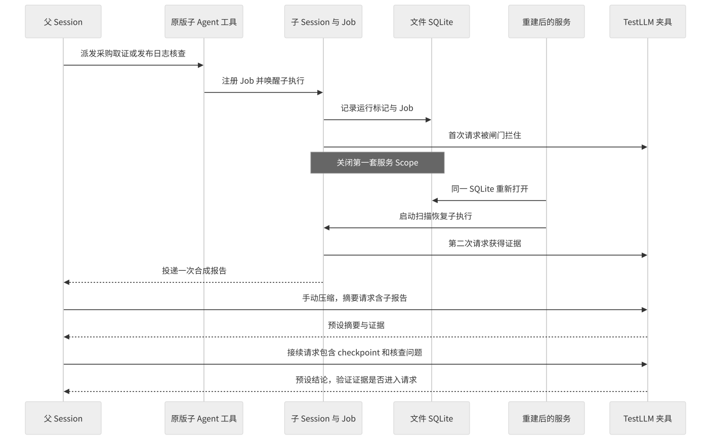

# 18 · 综合实验与设计取舍

前面的章节把 Agent、Session、Job、Inbox、投影和压缩分开讲。这里用同一次工作把它们接起来。这个实验有两个版本：采购证书有完整页码与有效期，发布验收在日志中找不到最终退出码。看完以后，你应该能解释**为什么系统可以恢复工作，以及恢复后作答的模型还能看见哪些证据**。

## 课堂任务与验收

| 场景 | 子 Agent 负责 | 主 Agent 看到的验收证据 | 课堂预设结果 |
|---|---|---|---|
| ISO 9001 商务核查 | 定位证书页、持有人和有效期 | `P12` 提供同名持有人和 2027-06-30 的有效期，早期材料给出投标截止 2026-11-25 | 符合 |
| 发布回归核查 | 查找回归命令的最终退出码 | `LOG-42` 提供日志定位，也明确说缺少最终退出码 | 待复核 |

两个案例共用同一套原版执行机制。课堂的角色回复、摘要和结论由 `TestLLM` 提供。实际验收的是**证据在派发、恢复、回传和压缩后是否到达接续请求**。这两项结论用于检查控制流，不能作为原版模型判断能力的评测。

## 五个观察点

1. **派发返回，子任务仍运行。** 课堂脚本通过原版工具注册表调用 `subagent`，父 Session 已有材料。子 Runner 首次请求被测试闸门挂起。此时文件 SQLite 里已有子执行认领及运行中的 Job 行，父会话报告数是 0。[真实的子 Agent 工具](https://github.com/anomalyco/opencode/blob/ee5fe34e136488a1839ac73bcca8321c51a31b75/packages/core/src/tool/plugin/subagent.ts#L170-L216) · [上游中断夹具](https://github.com/anomalyco/opencode/blob/ee5fe34e136488a1839ac73bcca8321c51a31b75/packages/core/test/subagent-idle-e2e.test.ts#L679-L723)
2. **关掉第一套服务，重开同一个库。** 在首个模型回复发布前关闭服务 Scope。第二套服务打开同一个文件 SQLite，仍读到同一子 Session 的 claim 和 running Job。原版恢复扫描重新推进已认领的工作。第二次模型调用属于同一子 Session。[重开与启动扫描的上游断言](https://github.com/anomalyco/opencode/blob/ee5fe34e136488a1839ac73bcca8321c51a31b75/packages/core/test/subagent-idle-e2e.test.ts#L720-L748)
3. **只收到一份可用报告。** 子任务结算后，带证据定位的合成消息进入父历史。测试再次执行恢复扫描，核对父历史仍只有一条报告。第一次模型请求已经启动，第二次恢复请求仍然可能发生。通知的去重范围和模型请求的重跑范围不同。[父会话报告投递](https://github.com/anomalyco/opencode/blob/ee5fe34e136488a1839ac73bcca8321c51a31b75/packages/core/src/session/execution/subagent-report.ts#L75-L130) · [稳定通知 ID](https://github.com/anomalyco/opencode/blob/ee5fe34e136488a1839ac73bcca8321c51a31b75/packages/core/src/session/subagent-completion.ts#L57-L86)
4. **父会话的压缩模型读取了子报告。** 课堂显式提交压缩项。原版摘要请求中可见子报告的证据文本。原版会话保存完成的压缩检查点。两组案例的摘要回复都特意保存了证据定位，借此查看后续请求会怎样携带它。[手动压缩输入](https://github.com/anomalyco/opencode/blob/ee5fe34e136488a1839ac73bcca8321c51a31b75/packages/core/src/session/session.ts#L260-L277) · [摘要执行与换入](https://github.com/anomalyco/opencode/blob/ee5fe34e136488a1839ac73bcca8321c51a31b75/packages/core/src/session/compaction.ts#L299-L335)
5. **接续请求里仍然能看见可核查信息。** 给父会话追加最终核查问题。探针检查真实模型请求中出现了 `
` 和对应证据，随后核对会话里确实写下了预设结论。此时子模型请求总数仍是 2。[模型消息中的检查点](https://github.com/anomalyco/opencode/blob/ee5fe34e136488a1839ac73bcca8321c51a31b75/packages/core/src/session/runner/to-llm-message.ts#L292-L308)

## 用同一套问题设计自己的 Agent

| 设计问题 | 针对轻量业务的判断方法 |
|---|---|
| 一项任务是否需要多个 Agent？ | 如果需要独立审阅、多个工具集或需要并行查互不依赖的材料，子会话能隔离上下文。只有几步只读查询时，先看一次受预算限制的工具循环能否覆盖实际需求。 |
| 用什么作为恢复锚点？ | 记录「是否接收」「是否执行中」「是否完成待通知」三种事实。为通知使用稳定 ID。会产生外部副作用的工具还要能识别重复请求。 |
| 什么时候需要目标复核？ | 有明确可核验的目标、执行可能跨多次空闲边界时，才适合继续审核。简单核查可以用证据字段、结构化结果与缺证据待复核来收尾。 |
| 哪些东西应该放进摘要？ | 摘要适合保存目标、进度、约束和可重新获取的证据定位。精确条款、日期、金额和退出码最好带原文或可回查的稳定引用。 |
| 怎么知道自建方案有收益？ | 用相同任务样本比较证据正确率、工具调用数、模型调用数、输入输出 Token 和端到端耗时。先找第一次偏离预期的步骤，再判断是否需要更复杂的框架机制。 |

**自测。** 如果子任务确实核对了证书，但摘要遗漏证书持有人，且后续请求没有原文，你会根据什么要求主 Agent 再查一次？如果模型发起了一次服务重试，你会怎样确认报告只有一份，同时不把这个事实套用到外部工具的执行次数上？
