# Learn OpenCode · 原版框架设计样章

教材以 [OpenCode ee5fe34e13](https://github.com/anomalyco/opencode/tree/ee5fe34e136488a1839ac73bcca8321c51a31b75) 为基准。适合已经理解 Agent 基础概念、想看懂原版如何组织执行的人。先看架构、工具、提示词和单条消息，再沿子会话、Job 和 /goal 观察多个执行单元怎样协作。

- [架构总览](#01-architecture) · [Jupyter](notebooks/01-architecture.ipynb)
- [内置工具目录](#02-tools) · [Jupyter](notebooks/02-tools.ipynb)
- [内置提示词清单](#03-prompts) · [Jupyter](notebooks/03-prompts.ipynb)
- [单条消息闭环](#04-message) · [Jupyter](notebooks/04-message.ipynb)
- [子 Agent 与任务分派](#05-subagent-dispatch) · [Jupyter](notebooks/05-subagent-dispatch.ipynb)
- [后台 Job 与结果回传](#06-background-jobs) · [Jupyter](notebooks/06-background-jobs.ipynb)
- [/goal 与目标复核](#07-goal) · [Jupyter](notebooks/07-goal.ipynb)
- [事件与 Bus](#08-events-and-bus) · [Jupyter](notebooks/08-events-and-bus.ipynb)
- [投影与 SQLite 持久化](#09-projections-storage) · [Jupyter](notebooks/09-projections-storage.ipynb)
- [重启恢复与崩溃边界](#10-restart-recovery) · [Jupyter](notebooks/10-restart-recovery.ipynb)
- [上下文管理与历史选择](#11-context-history) · [Jupyter](notebooks/11-context-history.ipynb)
- [Token 预算与压缩触发](#12-token-budget) · [Jupyter](notebooks/12-token-budget.ipynb)
- [压缩与接续请求](#13-compaction) · [Jupyter](notebooks/13-compaction.ipynb)
- [配置、Skills 与插件加载](#14-extensions) · [Jupyter](notebooks/14-extensions.ipynb)
- [Hooks 与 MCP](#15-hooks-mcp) · [Jupyter](notebooks/15-hooks-mcp.ipynb)
- [CLI、客户端、SDK 与事件流](#16-clients-protocol) · [Jupyter](notebooks/16-clients-protocol.ipynb)
- [CI、构建与发布](#17-ci-release) · [Jupyter](notebooks/17-ci-release.ipynb)
- [综合实验与设计取舍](#18-capstone) · [Jupyter](notebooks/18-capstone.ipynb)

<a id="01-architecture"></a>

## 01 · OpenCode 架构总览

在 OpenCode 输入「核查这份 ISO 9001 证书」，TUI 可以先显示你刚发出的消息。同一时刻，Server 可能刚把它记录到 Inbox，模型还没有收到它。把这几个时点分开，就能理解为什么 OpenCode 要有客户端、会话运行时和事件流。


本章按原版提交 `ee5fe34e13` 走读。图中的请求、执行和事件通知是运行时的关系。包之间的依赖要另看一层。Schema 提供共用数据结构，Core 和 Protocol 使用 Schema，Server 组合 Core 和 Protocol。Client 使用 Schema 和 Protocol，嵌入式 SDK 在宿主侧组合 Client、Core 和 Server。这样，普通客户端只需要理解 API 和事件，也能接入同一套会话能力。[仓库依赖约定](https://github.com/anomalyco/opencode/blob/ee5fe34e136488a1839ac73bcca8321c51a31b75/AGENTS.md#L1-L4) · [嵌入式 SDK](https://github.com/anomalyco/opencode/blob/ee5fe34e136488a1839ac73bcca8321c51a31b75/packages/sdk/src/promise.ts#L34-L62)

### 一条请求，各层分别负责什么

| 层 | 负责的事 | ISO 9001 案例里可以观测到什么 |
|---|---|---|
| 客户端与 Client | TUI、Web、桌面或非交互 CLI 收集输入，通过 Client 调用 Server，订阅事件更新界面。 | TUI 乐观显示消息，请求失败时回滚。界面已经出现文字时，Core 仍可能在等待交付。 |
| Protocol 与 Server | Protocol 定义请求和响应。Server 组合 handler、认证和会话 Location 中间件。 | `POST /api/session/:sessionID/prompt` 通过 handler 把核查指令交给 Core。 |
| Core 会话运行时 | 接收输入、控制交付顺序、加载历史和可见工具，再决定是否开始下一步。 | 一条核查指令先等待交付，随后变成用户消息。Runner 到了可执行边界才把它装进请求。 |
| AI 适配层 | 连接不同模型服务，把服务商的流式帧解码成 Runner 能消费的事件。 | 模型建议读取证书。Runner 收到工具调用事件后执行工具，并把结果纳入会话。 |
| 数据库与事件 | 持久事件和查询投影保存在数据库。Bus 在持久提交后通知订阅者，Server 通过 SSE 发出实时事件。 | 会话历史可在下一步重新加载。客户端可以实时看到助手输出和工具状态。 |

沿请求走一遍，可以依次打开客户端提交、Protocol 路由、Server handler 和 Core 的 `Session.prompt()`。沿返回方向，则从 Bus 到 Server 的 SSE handler，再看客户端如何维护连接。[TUI 提交](https://github.com/anomalyco/opencode/blob/ee5fe34e136488a1839ac73bcca8321c51a31b75/packages/tui/src/component/prompt/index.tsx#L1370) · [Protocol 路由](https://github.com/anomalyco/opencode/blob/ee5fe34e136488a1839ac73bcca8321c51a31b75/packages/protocol/src/groups/session.ts#L342) · [Server handler](https://github.com/anomalyco/opencode/blob/ee5fe34e136488a1839ac73bcca8321c51a31b75/packages/server/src/handlers/session.ts#L290) · [Core 接收](https://github.com/anomalyco/opencode/blob/ee5fe34e136488a1839ac73bcca8321c51a31b75/packages/core/src/session/session.ts#L153) · [AI 事件解码](https://github.com/anomalyco/opencode/blob/ee5fe34e136488a1839ac73bcca8321c51a31b75/packages/ai/src/route/client.ts#L352) · [持久提交](https://github.com/anomalyco/opencode/blob/ee5fe34e136488a1839ac73bcca8321c51a31b75/packages/core/src/bus.ts#L451-L483) · [SSE 入口](https://github.com/anomalyco/opencode/blob/ee5fe34e136488a1839ac73bcca8321c51a31b75/packages/server/src/handlers/event.ts#L8-L27)

### 启动方式为什么值得单独看

1. **默认 TUI**。CLI 先解析连接目标，再启动界面。显式 `--server` 连接指定地址，`--standalone` 启动私有实例，默认分支通过本机后台服务管理层连接。CLI 的职责包括决定去哪里发请求。[TUI 入口](https://github.com/anomalyco/opencode/blob/ee5fe34e136488a1839ac73bcca8321c51a31b75/packages/cli/src/commands/handlers/default.ts#L49) · [连接目标选择](https://github.com/anomalyco/opencode/blob/ee5fe34e136488a1839ac73bcca8321c51a31b75/packages/cli/src/services/server-connection.ts#L27)
2. **非交互 CLI 与桌面端**。`opencode run` 经 Client 提交 prompt。桌面端在 Electron 主进程中管理后台连接。这些入口可以面向同一套 Session API。仓库里还有 Rust CLI/TUI 客户端，可顺着它的 README 对照原生入口。[非交互提交](https://github.com/anomalyco/opencode/blob/ee5fe34e136488a1839ac73bcca8321c51a31b75/packages/cli/src/run/noninteractive.ts#L217) · [桌面后台服务](https://github.com/anomalyco/opencode/blob/ee5fe34e136488a1839ac73bcca8321c51a31b75/packages/desktop/src/main/service/background-service.ts#L57) · [Rust CLI](https://github.com/anomalyco/opencode/blob/ee5fe34e136488a1839ac73bcca8321c51a31b75/packages/cli-rs/README.md#L3)
3. **嵌入式 SDK**。宿主进程创建 Server 路由，SDK 把宿主提供的 `fetch` 交给 Client。这条路径仍运行会话和工具机制，省去由外部 CLI 进程转发请求这一环节。它为比较运行开销提供了一条实际可读的源码路径。[进程内 Client](https://github.com/anomalyco/opencode/blob/ee5fe34e136488a1839ac73bcca8321c51a31b75/packages/sdk/src/promise.ts#L34-L62) · [进程内路由](https://github.com/anomalyco/opencode/blob/ee5fe34e136488a1839ac73bcca8321c51a31b75/packages/server/src/fetch.ts#L43)

独立 Server 先监听，再组装路由并启动后台服务，完成装配后才标记就绪。路由层把同一份 Protocol 契约和服务层接起来。这里的「Server 就绪」表达的是 API 可提供服务。具体 Session 哪些插件能力已经可用，要看它所在位置的加载情况。[Server 启动过程](https://github.com/anomalyco/opencode/blob/ee5fe34e136488a1839ac73bcca8321c51a31b75/packages/server/src/process.ts#L53-L137) · [路由组合](https://github.com/anomalyco/opencode/blob/ee5fe34e136488a1839ac73bcca8321c51a31b75/packages/server/src/routes.ts#L214-L227)

### 容易混在一起的五个对象

| 对象 | 请记住一个问题 |
|---|---|
| **Agent** | 当这次工作要发给模型时，使用哪套角色指令、工具边界和运行配置？ |
| **Session** | 输入、消息历史和后续交付状态属于哪一个会话？ |
| **Step** | 此处的一次逻辑模型调用，用的是哪份请求，如何处理流式结果？发生特定失败时，Runner 可以为同一个逻辑 Step 再安排一次尝试。 |
| **Tool** | 模型提出了什么动作？运行时应如何验证输入和权限、执行并记录结果？ |
| **Job** | 一项后台工作由谁驱动、怎样记录终态和恢复信息？子 Agent 的 Job 可以驱动自己的子 Session。 |

Agent 可以理解为执行配置，Session 则持有任务推进所需的会话状态。插件在两者之间提供扩展点，可注册 Agent 模板、工具和 Hooks。Core 在准备模型请求时，解析当前 Agent，再按照权限和条件选取工具快照。同一个 Agent 可以参与多个 Session。同一个 Session 也可以调整之后执行所用的 Agent。[原生 Agent 定义](https://github.com/anomalyco/opencode/blob/ee5fe34e136488a1839ac73bcca8321c51a31b75/packages/core/src/plugin/agent.ts#L52) · [内置插件装配](https://github.com/anomalyco/opencode/blob/ee5fe34e136488a1839ac73bcca8321c51a31b75/packages/core/src/plugin/internal.ts#L264) · [会话上下文选择](https://github.com/anomalyco/opencode/blob/ee5fe34e136488a1839ac73bcca8321c51a31b75/packages/core/src/session/context.ts#L148-L206) · [选择 Agent](https://github.com/anomalyco/opencode/blob/ee5fe34e136488a1839ac73bcca8321c51a31b75/packages/core/src/session/session.ts#L96)

#### 执行位置和运行职责

Location 表示会话实际在哪个目录及工作区运行。Session 的协调器以 Session ID 为键管理执行。开始一次 drain 时，它读取 Session，再从 Location 取得对应的运行服务。模型、插件、工具和文件环境因此可以按位置选择。同一个 Server 能接住来自不同项目的会话，又允许这些会话各自使用合适的项目配置。[Location 的字段](https://github.com/anomalyco/opencode/blob/ee5fe34e136488a1839ac73bcca8321c51a31b75/packages/core/src/location.ts#L20-L34) · [执行时绑定服务](https://github.com/anomalyco/opencode/blob/ee5fe34e136488a1839ac73bcca8321c51a31b75/packages/core/src/session/execution.ts#L105-L138)

子 Agent 把这些对象连起来。父模型提出派发请求，工具建立父子关系，Job 驱动子 Session，子会话自己走模型和工具循环。结果随后作为输入送到父会话 Inbox，再由父会话在自己的安全边界处理。以后读多 Agent 流程，可以先分别找到两个 Session 的执行边界，再追 Job 如何交接结果。[子任务派发](https://github.com/anomalyco/opencode/blob/ee5fe34e136488a1839ac73bcca8321c51a31b75/packages/core/src/tool/plugin/subagent.ts#L171-L216) · [Job 驱动子 Session](https://github.com/anomalyco/opencode/blob/ee5fe34e136488a1839ac73bcca8321c51a31b75/packages/core/src/session/subagent-job.ts#L17-L40) · [结果交给父 Inbox](https://github.com/anomalyco/opencode/blob/ee5fe34e136488a1839ac73bcca8321c51a31b75/packages/core/src/session/execution/subagent-report.ts#L75-L96)

### 观察与自测

1. **沿请求走一遍。** 如果从 TUI 改用嵌入式 SDK 提交同一句核查指令，哪些环节换了入口？沿链接确认，两种方式都可以走同一套 API 路由与会话机制。
2. **看清三个时点。** 写下「TUI 显示已发送」「Inbox 持久接收」「模型第一次看到消息」各自由哪一层产生。后面的消息闭环样章会把第二、第三个时点按事件顺序展开。
3. **找出子任务的所有者。** 现在把核查拆成证书持有人核对和有效期核对。指出父 Session、子 Session 和后台 Job 各自保存哪些状态，再预测父 Agent 在什么时候会收到结果。

<a id="02-tools"></a>

## 内置工具 · 模型如何获得行动能力

模型提出一个工具名称和一组参数。OpenCode 决定该工具是否对当前会话可见、能否访问这些资源、怎样执行，以及把什么结果交回给模型。理解这层边界，就能解释为什么某个工具在源码里存在，却没出现在你的请求里。


### 先认清三个工具清单

| 看哪里 | 回答什么 |
|---|---|
| **内置插件注册点** | 固定版本随仓库带了哪些能力？某个插件或功能开关生效时，它会注册什么？ |
| **当前位置的注册表 `Tool.list()`** | 当前 Location 有哪些工具已注册？这里还可能包括用户插件和 MCP 服务动态提供的工具。 |
| **当前请求的工具快照和请求定义** | 合并 Agent 与 Session 权限之后，模型真正能看到什么？工具以独立函数暴露，还是由 Code Mode 统一暴露？ |

`SessionContext.select()` 合并权限并计算模型工具策略。`Tool.snapshot()` 排除显式隐藏和整项拒绝的工具，将其余项分成直接工具和 Code Mode 目录。模型请求的 Hook 还能修改描述、参数定义和请求中的工具名。执行时仍会判断具体操作，例如写入哪个文件、访问哪个 URL。**看得到工具，表示模型可以提出调用。具体操作能否执行，由运行时授权。** [内置插件](https://github.com/anomalyco/opencode/blob/ee5fe34e136488a1839ac73bcca8321c51a31b75/packages/core/src/plugin/internal.ts#L264-L332) · [会话选择](https://github.com/anomalyco/opencode/blob/ee5fe34e136488a1839ac73bcca8321c51a31b75/packages/core/src/session/context.ts#L148-L177) · [工具快照](https://github.com/anomalyco/opencode/blob/ee5fe34e136488a1839ac73bcca8321c51a31b75/packages/core/src/tool.ts#L310-L398) · [请求定义整形](https://github.com/anomalyco/opencode/blob/ee5fe34e136488a1839ac73bcca8321c51a31b75/packages/core/src/session/model-request.ts#L287-L357)

### 一个工具可以怎样呈现

以会话检索为例，源码注册的是命名空间 `opencode.session` 下的 `search`。直接暴露时名称是 `opencode_session_search`。如果该工具进入 Code Mode 目录，模型通过 `execute` 调用 `tools.opencode.session.search`。Code Mode 目录中的各工具仍有各自的参数定义和权限入口。

这里还要区分 **Code Mode** 和 **`full_codemode`**。快照层判断当前权限是否整项拒绝 `execute`。如果拒绝，符合其他条件的目录工具会以直接工具暴露。完整模式是在此之上的实验能力，会改变部分文件工具的呈现，并让模型工具策略隐藏 `glob`、`grep` 和 `webfetch`。例如 Explore 的权限允许 `grep`，却没有给 `execute` 放行，因而可以继续以直接工具使用 `grep`。[命名规则](https://github.com/anomalyco/opencode/blob/ee5fe34e136488a1839ac73bcca8321c51a31b75/packages/core/src/tool/runtime.ts#L300-L307) · [Code Mode 可用条件](https://github.com/anomalyco/opencode/blob/ee5fe34e136488a1839ac73bcca8321c51a31b75/packages/core/src/tool.ts#L497-L503) · [模型工具策略](https://github.com/anomalyco/opencode/blob/ee5fe34e136488a1839ac73bcca8321c51a31b75/packages/core/src/tool/model-policy.ts#L3-L23) · [Explore 权限](https://github.com/anomalyco/opencode/blob/ee5fe34e136488a1839ac73bcca8321c51a31b75/packages/core/src/plugin/agent.ts#L72-L93)

### 固定版本工具总表

教学基准 `ee5fe34e1364`。下面列出可追到这一版本的固定注册项，包括 Core 工具、随仓 Browser 和 Console 插件，以及快照生成的 `execute`。命名空间工具用点号表示注册分组。直接暴露或经 Code Mode 调用时，按上节的命名方式读取。功能开关的默认值还取决于开发构建和正式发行构建，因此一次实际请求里的数量会变化。配置中的外部 MCP 服务和用户插件可注册新工具，具体成员随运行环境变化。[功能开关声明](https://github.com/anomalyco/opencode/blob/ee5fe34e136488a1839ac73bcca8321c51a31b75/packages/schema/src/config/flag.ts#L7-L30) · [MCP 动态注册](https://github.com/anomalyco/opencode/blob/ee5fe34e136488a1839ac73bcca8321c51a31b75/packages/core/src/tool/mcp.ts#L38-L77)

#### Core · 文件、进程和协作

| 工具 | 接收什么 → 返回或改变什么 |
|---|---|
| `read` | 路径和读取范围 → 行、目录条目或支持的文件内容。[源码](https://github.com/anomalyco/opencode/blob/ee5fe34e136488a1839ac73bcca8321c51a31b75/packages/core/src/tool/plugin/read.ts#L21-L64) |
| `glob` | 路径模式和范围 → 匹配文件列表。[源码](https://github.com/anomalyco/opencode/blob/ee5fe34e136488a1839ac73bcca8321c51a31b75/packages/core/src/tool/plugin/glob.ts#L16-L61) |
| `grep` | 文本或正则、目录和过滤条件 → 匹配位置与行内容。[源码](https://github.com/anomalyco/opencode/blob/ee5fe34e136488a1839ac73bcca8321c51a31b75/packages/core/src/tool/plugin/grep.ts#L15-L81) |
| `edit` | 文件和新旧文本 → 局部编辑与差异信息。[源码](https://github.com/anomalyco/opencode/blob/ee5fe34e136488a1839ac73bcca8321c51a31b75/packages/core/src/tool/plugin/edit.ts#L268-L283) |
| `write` | 文件路径和完整内容 → 创建或覆盖文件。[源码](https://github.com/anomalyco/opencode/blob/ee5fe34e136488a1839ac73bcca8321c51a31b75/packages/core/src/tool/plugin/write.ts#L17-L57) |
| `patch` | 描述新增、修改或删除的补丁 → 变更结果。模型策略通常让 GPT-5 系使用 `patch`，其余走 `edit` 和 `write`，具体匹配以源码条件为准。[注册](https://github.com/anomalyco/opencode/blob/ee5fe34e136488a1839ac73bcca8321c51a31b75/packages/core/src/tool/plugin/patch.ts#L22-L29) · [选择规则](https://github.com/anomalyco/opencode/blob/ee5fe34e136488a1839ac73bcca8321c51a31b75/packages/core/src/tool/model-policy.ts#L19-L36) |
| `shell` | 命令、工作目录和执行时限等 → 输出、退出状态，或后台进程信息。[输入输出](https://github.com/anomalyco/opencode/blob/ee5fe34e136488a1839ac73bcca8321c51a31b75/packages/core/src/tool/plugin/shell.ts#L59-L101) |
| `question` | 问题和可选回答 → 用户返回的答案。[注册](https://github.com/anomalyco/opencode/blob/ee5fe34e136488a1839ac73bcca8321c51a31b75/packages/core/src/tool/plugin/question.ts#L23-L82) |
| `subagent` | 子 Agent、指令、简述和可选子 Session ID → 新建或继续子任务并返回 Session ID。后续报告可通过父会话 Inbox 交付。[输入](https://github.com/anomalyco/opencode/blob/ee5fe34e136488a1839ac73bcca8321c51a31b75/packages/core/src/tool/plugin/subagent.ts#L30-L54) · [Job](https://github.com/anomalyco/opencode/blob/ee5fe34e136488a1839ac73bcca8321c51a31b75/packages/core/src/tool/plugin/subagent.ts#L170-L223) |
| `todowrite` | 带状态的条目列表 → 更新当前会话的待办。须显式启用 `todo` 开关。这个清单记录进度，后台执行由其他组件管理。[源码](https://github.com/anomalyco/opencode/blob/ee5fe34e136488a1839ac73bcca8321c51a31b75/packages/core/src/tool/plugin/todo.ts#L46-L75) |
| `skill` | Skill ID → 激活对应 Skill 并把相关指令用于当前会话。[源码](https://github.com/anomalyco/opencode/blob/ee5fe34e136488a1839ac73bcca8321c51a31b75/packages/core/src/tool/plugin/skill.ts#L36-L67) |
| `webfetch` | URL、输出格式和超时 → 获取单个地址的内容。[源码](https://github.com/anomalyco/opencode/blob/ee5fe34e136488a1839ac73bcca8321c51a31b75/packages/core/src/tool/plugin/webfetch.ts#L13-L32) |
| `websearch` | 查询词 → 搜索结果。模型工具策略会在没有可用搜索提供方时隐藏它。[注册](https://github.com/anomalyco/opencode/blob/ee5fe34e136488a1839ac73bcca8321c51a31b75/packages/core/src/tool/plugin/websearch.ts#L38-L61) · [可见性](https://github.com/anomalyco/opencode/blob/ee5fe34e136488a1839ac73bcca8321c51a31b75/packages/core/src/tool/model-policy.ts#L10-L21) |
| `experimental_image_generate` | 生成要求、输出路径和可选参考素材等 → 生成任务信息。有可用图像模型时注册，图像生成配置和权限也参与控制。[源码](https://github.com/anomalyco/opencode/blob/ee5fe34e136488a1839ac73bcca8321c51a31b75/packages/core/src/tool/plugin/image-generate.ts#L232-L273) |
| `experimental_video_generate` | 生成要求、参考素材、时长等 → 生成任务信息。需视频功能开关和可用视频模型。[开关](https://github.com/anomalyco/opencode/blob/ee5fe34e136488a1839ac73bcca8321c51a31b75/packages/core/src/tool/plugin/video-generate.ts#L191-L194) · [注册](https://github.com/anomalyco/opencode/blob/ee5fe34e136488a1839ac73bcca8321c51a31b75/packages/core/src/tool/plugin/video-generate.ts#L276-L309) |

#### Core · 管理、调度和扩展

| 工具 | 接收什么 → 返回或改变什么 |
|---|---|
| `opencode.session.rename`、`opencode.session.move` | 目标 Session 和新名称或目录 → 更新标题或交付会话迁移控制项。[源码](https://github.com/anomalyco/opencode/blob/ee5fe34e136488a1839ac73bcca8321c51a31b75/packages/core/src/tool/plugin/opencode.ts#L122-L177) |
| `opencode.session.search`、`opencode.session.read` | 搜索条件或会话 ID 和游标 → 历史命中或分页消息。由 `sqlite_fts` 控制注册。[源码](https://github.com/anomalyco/opencode/blob/ee5fe34e136488a1839ac73bcca8321c51a31b75/packages/core/src/tool/plugin/session-search.ts#L56-L97) |
| `opencode.worktree_create`、`opencode.worktree_list`、`opencode.worktree_remove` | 工作树名称、当前项目或目标路径 → 创建、列出或移除工作树。移除还检查 `edit` 权限。[源码](https://github.com/anomalyco/opencode/blob/ee5fe34e136488a1839ac73bcca8321c51a31b75/packages/core/src/tool/plugin/opencode.ts#L179-L234) |
| `opencode.models` | 提供方、类型、名称等过滤条件 → 分页模型信息。[源码](https://github.com/anomalyco/opencode/blob/ee5fe34e136488a1839ac73bcca8321c51a31b75/packages/core/src/tool/plugin/opencode.ts#L235-L287) |
| `opencode.list_mcp_resources`、`opencode.read_mcp_resource`、`opencode.list_mcp_events` | MCP 服务名称及资源 URI 等 → 列出资源、读取资源内容或列出可订阅的事件描述。[资源](https://github.com/anomalyco/opencode/blob/ee5fe34e136488a1839ac73bcca8321c51a31b75/packages/core/src/tool/plugin/mcp-resource.ts#L16-L77) · [事件](https://github.com/anomalyco/opencode/blob/ee5fe34e136488a1839ac73bcca8321c51a31b75/packages/core/src/tool/plugin/mcp-events.ts#L30-L68) |
| `opencode.artifact_create`、`opencode.artifact_read`、`opencode.artifact_update`、`opencode.artifact_delete` | 文件映射、提供方或产物 ID → 管理已配置提供方上的产物。由 `artifacts` 控制注册，执行依赖产物服务。[源码](https://github.com/anomalyco/opencode/blob/ee5fe34e136488a1839ac73bcca8321c51a31b75/packages/core/src/tool/plugin/artifact.ts#L66-L152) |
| `automation.create`、`automation.list`、`automation.pause`、`automation.resume`、`automation.delete` | 触发器与动作定义或自动化 ID → 管理项目的定时和事件触发任务。由 `automations` 配置控制，执行再检查项目和操作权限。[源码](https://github.com/anomalyco/opencode/blob/ee5fe34e136488a1839ac73bcca8321c51a31b75/packages/core/src/tool/plugin/automation.ts#L53-L156) |
| `machine.list` | 当前上下文 → 已配置机器列表。由 `machines` 控制注册。[源码](https://github.com/anomalyco/opencode/blob/ee5fe34e136488a1839ac73bcca8321c51a31b75/packages/core/src/tool/plugin/machine.ts#L12-L36) |

#### Browser · 同一套工具定义服务于桌面浏览器

Browser 插件将协议里的 **44 个操作**逐个注册到 `browser` 命名空间。执行需浏览器能力与相应授权，文件传入或传出还检查文件权限。这里按原协议名列出，可在每项前加 `browser.` 得到命名空间路径。[注册器](https://github.com/anomalyco/opencode/blob/ee5fe34e136488a1839ac73bcca8321c51a31b75/packages/plugin-browser/src/tools.ts#L173-L222) · [完整协议](https://github.com/anomalyco/opencode/blob/ee5fe34e136488a1839ac73bcca8321c51a31b75/packages/plugin-browser/src/rpc.ts#L292-L665)

| 用途 | 操作 |
|---|---|
| 标签页、导航和加载 | `tabs.list`、`tabs.open`、`tabs.focus`、`tabs.close`、`navigate`、`back`、`forward`、`reload`、`stop` |
| 页面结构与观察 | `frames`、`snapshot`、`find`、`evaluate`、`screenshot` |
| 页面操作 | `click`、`hover`、`drag`、`fill`、`fill_form`、`select`、`check`、`press`、`scroll`、`wait`、`dialog` |
| 页面文件 | `files.upload`、`files.drop`、`files.list`、`files.get` |
| 控制台和网络观察 | `console`、`network.list`、`network.get` |
| 性能记录与报告 | `trace.start`、`trace.stop`、`trace.analyze`、`cpu.start`、`cpu.stop`、`cpu.analyze`、`lighthouse` |
| 内存快照 | `heap.snapshot`、`heap.summary`、`heap.query`、`heap.object`、`heap.compare` |

#### 条件注册与快照生成

| 工具 | 在什么场景出现 |
|---|---|
| `console_watch.watch`、`console_watch.unwatch`、`console_watch.watches`、`console_watch.events` | 对支持事件订阅且允许连接的 Console 工作区，开启 `console_watches` 后管理订阅、查看订阅和可用事件。处理发回会话的事件是后台能力。[连接条件](https://github.com/anomalyco/opencode/blob/ee5fe34e136488a1839ac73bcca8321c51a31b75/packages/core/src/plugin/provider/opencode.ts#L332-L356) · [注册](https://github.com/anomalyco/opencode/blob/ee5fe34e136488a1839ac73bcca8321c51a31b75/packages/core/src/plugin/provider/opencode-watches.ts#L258-L391) |
| `execute` | 快照按权限生成的 Code Mode 入口。模型提交程序，通过目录调用已授权工具，得到执行结果和调用记录。[生成](https://github.com/anomalyco/opencode/blob/ee5fe34e136488a1839ac73bcca8321c51a31b75/packages/core/src/tool.ts#L336-L389) · [入口](https://github.com/anomalyco/opencode/blob/ee5fe34e136488a1839ac73bcca8321c51a31b75/packages/core/src/codemode/tool.ts#L141-L169) |

### 用日期错误练一次判断

假设项目的证书到期日判断了 `expiry > deadline`，业务要求是同一天也算有效。打开本章 Notebook 的清单，观察下面三件事。

1. **查哪里。** 先用 `grep` 找判断，再用 `read` 读实现和测试。Explore 可以产出证据和文件位置。
2. **谁能改。** 找到一行错误之后，改动交给有编辑权限的 Agent。根据模型工具策略，同一改动可能用 `patch`，也可能用 `edit`。跑测试则由 `shell` 发起。
3. **结果从哪里回来。** 模型提出文件编辑或测试操作。运行时返回差异、退出状态等证据，再由下一步模型根据记录决定是否完成。

**自测。** 源码里有 `todowrite`，为什么新装的实例可能看不到？答：`todo` 是须显式启用的功能开关。启用后，仍要经过当前 Agent 的权限和请求筛选。又如当前请求只出现 `execute` 而没有 `opencode_session_search`，可以先查看该工具是否进入 Code Mode 目录。这两种现象分别发生在注册层和请求呈现层。

<a id="03-prompts"></a>

## 03 · 内置提示词与请求装配

同样是「确认起息日是否算第一天」，Build 可以继续改代码，Explore 被要求专注搜索和分析，Plan 会把这次对话当成方案讨论。要解释这三种行为，先分清 **角色指令、项目事实、工具接口、执行权限** 各自由谁提供。比如 Explore 的角色指令要求只读，工具层还会按权限筛选和检查实际调用。前者让模型理解任务边界，后者负责执行约束。[内置 Agent](https://github.com/anomalyco/opencode/blob/ee5fe34e136488a1839ac73bcca8321c51a31b75/packages/core/src/plugin/agent.ts#L54) · [按权限生成工具快照](https://github.com/anomalyco/opencode/blob/ee5fe34e136488a1839ac73bcca8321c51a31b75/packages/core/src/tool.ts#L312)


### 从当前环境到模型请求

1. **选出这一步的 Agent、模型与工具。** `SessionContext.select()` 合并 Agent 和 Session 权限，再依据模型策略生成工具快照。它同时收集 Code Mode 目录、MCP、References、Skills、机器、项目指令、日期和环境等来源。来源顺序优先排列更容易在多个会话间保持相同的内容，有利于复用提示词缓存前缀。[会话上下文选择](https://github.com/anomalyco/opencode/blob/ee5fe34e136488a1839ac73bcca8321c51a31b75/packages/core/src/session/context.ts#L148)
2. **把会话已有内容装配成请求草稿。** `baseTranscript()` 用 `agent.system` 或默认模板形成首个 system 段，再加入已保存的指令基线。历史里的用户消息、助手回复和工具结果分别转换为模型消息。项目文件中的说明是运行时提供的指令来源，仓库随附模板则负责定义通用行为。[请求草稿](https://github.com/anomalyco/opencode/blob/ee5fe34e136488a1839ac73bcca8321c51a31b75/packages/core/src/session/model-request.ts#L111) · [读取历史与基线](https://github.com/anomalyco/opencode/blob/ee5fe34e136488a1839ac73bcca8321c51a31b75/packages/core/src/session/history.ts#L290)
3. **按用途运行 Hook。** 主循环、压缩、辅助生成、命名分别进入 `context`、`compaction`、`generate`、`title` 钩子。Hook 可以修改 system、消息和工具定义，因此同一个工具的静态说明、快照里的说明和最后发给模型的说明需要分别查证。[请求用途与 Hook](https://github.com/anomalyco/opencode/blob/ee5fe34e136488a1839ac73bcca8321c51a31b75/packages/core/src/session/model-request.ts#L468)
4. **生成协议请求并执行。** 主请求用 Hook 返回的 system、消息和工具定义构造，删掉只用于本地 Hook 的消息元数据并应用模型输入能力限制。工具仍按注册身份映射回本地执行器。排查模型行为时，以当次请求的数据为依据。[工具映射与实际请求](https://github.com/anomalyco/opencode/blob/ee5fe34e136488a1839ac73bcca8321c51a31b75/packages/core/src/session/model-request.ts#L286)

### 系统、角色和模型模板

| 内置项 | 内容与注入条件 | 源码 |
|---|---|---|
| 通用系统模板 | 当 Agent 没有显式 `system` 时用作首个 system 段。根据直出工具名插入 `shell`、`write`、`edit` 的使用说明。 | [模板](https://github.com/anomalyco/opencode/blob/ee5fe34e136488a1839ac73bcca8321c51a31b75/packages/core/src/session/runner/prompt/system.txt) · [渲染器](https://github.com/anomalyco/opencode/blob/ee5fe34e136488a1839ac73bcca8321c51a31b75/packages/core/src/session/system-prompt.ts#L3) |
| Build | 默认主 Agent。核心注册在此处设置角色描述和权限，普通请求走通用系统提示词路径。 | [角色配置](https://github.com/anomalyco/opencode/blob/ee5fe34e136488a1839ac73bcca8321c51a31b75/packages/core/src/plugin/agent.ts#L56) |
| General | 通用子 Agent。该处设置的简短职责也可随 `subagent` 工具描述提供给父 Agent，帮助它决定派发给谁。 | [角色配置](https://github.com/anomalyco/opencode/blob/ee5fe34e136488a1839ac73bcca8321c51a31b75/packages/core/src/plugin/agent.ts#L63) · [派发说明动态拼装](https://github.com/anomalyco/opencode/blob/ee5fe34e136488a1839ac73bcca8321c51a31b75/packages/core/src/tool/plugin/subagent.ts#L240) |
| Explore | 专门搜索与分析。注册时设置独立的角色 system，另行配置工具权限。 | [角色提示词](https://github.com/anomalyco/opencode/blob/ee5fe34e136488a1839ac73bcca8321c51a31b75/packages/core/src/plugin/agent.ts#L7) · [角色与权限](https://github.com/anomalyco/opencode/blob/ee5fe34e136488a1839ac73bcca8321c51a31b75/packages/core/src/plugin/agent.ts#L74) |
| Plan | 进入和退出 Plan 时，向会话注入对应提醒。若压缩后历史缺少有效提醒，`context` Hook 可在消息尾部附近补齐。编辑限制另外由权限规则落实。 | [Plan 状态提示](https://github.com/anomalyco/opencode/blob/ee5fe34e136488a1839ac73bcca8321c51a31b75/packages/core/src/plugin/plan.ts#L12) · [请求中补齐提醒](https://github.com/anomalyco/opencode/blob/ee5fe34e136488a1839ac73bcca8321c51a31b75/packages/core/src/plugin/plan.ts#L55) |
| OpenAI 系列适配 | ID 包含 `gpt` 时替换首段。ID 同时包含 `astra` 时使用 Astra 专用版本。 | [GPT 模板](https://github.com/anomalyco/opencode/blob/ee5fe34e136488a1839ac73bcca8321c51a31b75/packages/core/src/plugin/system-prompt/gpt.txt) · [Astra 模板](https://github.com/anomalyco/opencode/blob/ee5fe34e136488a1839ac73bcca8321c51a31b75/packages/core/src/plugin/system-prompt/gpt-astra.txt) · [匹配条件](https://github.com/anomalyco/opencode/blob/ee5fe34e136488a1839ac73bcca8321c51a31b75/packages/core/src/plugin/optimize.ts#L16) |
| Claude 系列适配 | ID 包含 `claude` 时追加至首段。 | [Claude 模板](https://github.com/anomalyco/opencode/blob/ee5fe34e136488a1839ac73bcca8321c51a31b75/packages/core/src/plugin/system-prompt/anthropic.txt) · [追加条件](https://github.com/anomalyco/opencode/blob/ee5fe34e136488a1839ac73bcca8321c51a31b75/packages/core/src/plugin/optimize.ts#L22) |
| Kimi、Trinity、Muse 系列适配 | 分别按 ID 子串替换首段。Muse 模板还填入显示模型名。 | [Kimi](https://github.com/anomalyco/opencode/blob/ee5fe34e136488a1839ac73bcca8321c51a31b75/packages/core/src/plugin/system-prompt/kimi.txt) · [Trinity](https://github.com/anomalyco/opencode/blob/ee5fe34e136488a1839ac73bcca8321c51a31b75/packages/core/src/plugin/system-prompt/trinity.txt) · [Muse](https://github.com/anomalyco/opencode/blob/ee5fe34e136488a1839ac73bcca8321c51a31b75/packages/core/src/plugin/system-prompt/meta.txt) · [匹配条件](https://github.com/anomalyco/opencode/blob/ee5fe34e136488a1839ac73bcca8321c51a31b75/packages/core/src/plugin/optimize.ts#L32) |
| 模型身份 | 在相关请求的 system 块中插入模型名、Provider ID 和 Model ID。 | [身份 Hook](https://github.com/anomalyco/opencode/blob/ee5fe34e136488a1839ac73bcca8321c51a31b75/packages/core/src/plugin/identity.ts#L10) |
| Claude Code 提供方的运行时模板 | 走 Claude Agent SDK 时，主请求和派生请求采用相应的 Claude Code 预设，可附加 OpenCode 角色和指令。独立用途请求另有辅助 system 路径。 | [提供方系统模板](https://github.com/anomalyco/opencode/blob/ee5fe34e136488a1839ac73bcca8321c51a31b75/packages/core/src/plugin/provider/claude-agent/language-model/system-prompt.ts#L9) · [按用途选择](https://github.com/anomalyco/opencode/blob/ee5fe34e136488a1839ac73bcca8321c51a31b75/packages/core/src/plugin/provider/claude-agent/language-model/claude-agent-language-model.ts#L45) |

模型模板的追加或替换发生在首个 system 段。若 Agent 已明确设置自己的 `system`，优化插件会跳过改写。独立的项目指令块和其他 Hook 仍按各自逻辑处理。比如 Explore 对同一个 GPT 模型保留它的探索角色，项目里的测试规范依然可以随指令基线进入请求。[模板 Hook 的守卫与改写位置](https://github.com/anomalyco/opencode/blob/ee5fe34e136488a1839ac73bcca8321c51a31b75/packages/core/src/plugin/optimize.ts#L59)

### 工具说明和环境指令

| 内容来源 | 模型怎样看见 | 源码 |
|---|---|---|
| 项目、全局和配置指令 | 发现 `AGENTS.md`、启用后可用的 `CLAUDE.md` 回退，以及配置额外指定的来源，作为指令基线或变化进入会话。读取带有更具体指令的路径时，还可按需加载并记录到会话。 | [默认发现规则](https://github.com/anomalyco/opencode/blob/ee5fe34e136488a1839ac73bcca8321c51a31b75/packages/core/src/instruction-discovery.ts#L128) · [配置和来源合并](https://github.com/anomalyco/opencode/blob/ee5fe34e136488a1839ac73bcca8321c51a31b75/packages/core/src/config/plugin/instruction.ts#L192) · [按需注入](https://github.com/anomalyco/opencode/blob/ee5fe34e136488a1839ac73bcca8321c51a31b75/packages/core/src/session/instructions.ts#L47) |
| 日期、环境、工作位置 | 根据 Location 和运行时状态渲染日期、工作目录、工作区根目录、平台等信息。 | [动态内置指令](https://github.com/anomalyco/opencode/blob/ee5fe34e136488a1839ac73bcca8321c51a31b75/packages/core/src/instructions/builtins.ts#L21) |
| 工具描述、参数和格式 | 每个工具随定义提供描述及输入 Schema。比如 `read` 的参数带路径和行范围说明，`patch` 使用补丁格式提示，`todowrite` 带随仓使用指南。Hook 还可在请求前完善说明。 | [定义生成](https://github.com/anomalyco/opencode/blob/ee5fe34e136488a1839ac73bcca8321c51a31b75/packages/core/src/tool/runtime.ts#L27) · [读取工具](https://github.com/anomalyco/opencode/blob/ee5fe34e136488a1839ac73bcca8321c51a31b75/packages/core/src/tool/plugin/read.ts#L22) · [补丁工具](https://github.com/anomalyco/opencode/blob/ee5fe34e136488a1839ac73bcca8321c51a31b75/packages/core/src/tool/plugin/patch.ts#L18) · [待办提示](https://github.com/anomalyco/opencode/blob/ee5fe34e136488a1839ac73bcca8321c51a31b75/packages/core/src/tool/todowrite.txt) |
| 动态工具说明 | `subagent` 可附带适用的子 Agent 名称和职责。Shell 说明会按所选 Shell 渲染。工作树相关提示按可调用入口提示直接调用或 Code Mode 路径。 | [子 Agent](https://github.com/anomalyco/opencode/blob/ee5fe34e136488a1839ac73bcca8321c51a31b75/packages/core/src/tool/plugin/subagent.ts#L240) · [Shell](https://github.com/anomalyco/opencode/blob/ee5fe34e136488a1839ac73bcca8321c51a31b75/packages/core/src/tool/plugin/shell.ts#L560) · [工作树指导](https://github.com/anomalyco/opencode/blob/ee5fe34e136488a1839ac73bcca8321c51a31b75/packages/core/src/tool/plugin/opencode.ts#L97) |
| Code Mode | 存在可用目录时渲染调用说明和工具目录。目录变化时可生成更新说明。 | [目录提示渲染](https://github.com/anomalyco/opencode/blob/ee5fe34e136488a1839ac73bcca8321c51a31b75/packages/core/src/codemode/instructions.ts#L9) · [指令来源](https://github.com/anomalyco/opencode/blob/ee5fe34e136488a1839ac73bcca8321c51a31b75/packages/core/src/codemode/instructions.ts#L147) |
| Skills、References、MCP、机器 | Skills 和 References 可以先展示描述供模型选择，MCP 指令会按当前快照中相关工具的可见性筛选，机器信息按功能与当前环境加载。随仓的 OpenCode 和 Report Skill 另有各自的内容。 | [Skills](https://github.com/anomalyco/opencode/blob/ee5fe34e136488a1839ac73bcca8321c51a31b75/packages/core/src/skill/instructions.ts#L55) · [内置 Skill 注册](https://github.com/anomalyco/opencode/blob/ee5fe34e136488a1839ac73bcca8321c51a31b75/packages/core/src/plugin/skill.ts#L23) · [References](https://github.com/anomalyco/opencode/blob/ee5fe34e136488a1839ac73bcca8321c51a31b75/packages/core/src/reference/instructions.ts#L51) · [MCP](https://github.com/anomalyco/opencode/blob/ee5fe34e136488a1839ac73bcca8321c51a31b75/packages/core/src/mcp/instructions.ts#L64) · [机器](https://github.com/anomalyco/opencode/blob/ee5fe34e136488a1839ac73bcca8321c51a31b75/packages/core/src/machine/instructions.ts#L36) |

指令来源有稳定的键。首次装配建立基线，之后检测到内容变化时，将增量和渲染文本写入事件。于是跨 Step 重建请求时，模型仍能读懂「哪条规则后来变了」。这也是理解提示词缓存的一个抓手。稳定的前缀和变化发生时间都能从会话数据看见。[指令键和读取接口](https://github.com/anomalyco/opencode/blob/ee5fe34e136488a1839ac73bcca8321c51a31b75/packages/core/src/instructions/index.ts#L28) · [基线与变化事件](https://github.com/anomalyco/opencode/blob/ee5fe34e136488a1839ac73bcca8321c51a31b75/packages/core/src/session/instruction-state.ts#L38)

### 有目标的专用提示词

| 入口 | 用途和位置 | 源码 |
|---|---|---|
| 标题 | 隐藏 Title Agent 的 system 要求输出简短会话名。命名请求另行发送，用户输入提供待命名素材。 | [Title 指令](https://github.com/anomalyco/opencode/blob/ee5fe34e136488a1839ac73bcca8321c51a31b75/packages/core/src/plugin/agent.ts#L19) · [命名请求](https://github.com/anomalyco/opencode/blob/ee5fe34e136488a1839ac73bcca8321c51a31b75/packages/core/src/session/title.ts#L74) |
| Summary | 内置的隐藏 Summary Agent 有自己的简短会话总结指令。历史压缩另有结构化 checkpoint 模板。 | [Summary 指令](https://github.com/anomalyco/opencode/blob/ee5fe34e136488a1839ac73bcca8321c51a31b75/packages/core/src/plugin/agent.ts#L40) · [注册](https://github.com/anomalyco/opencode/blob/ee5fe34e136488a1839ac73bcca8321c51a31b75/packages/core/src/plugin/agent.ts#L110) |
| 上下文压缩 | `buildPrompt()` 按新建或更新 checkpoint 选择模板，保留用户需求、决定和待办。旧格式还有专用迁移提醒，未按模板输出时可提示重做。请求提取当前对话上下文进行总结。 | [压缩模板与纠偏](https://github.com/anomalyco/opencode/blob/ee5fe34e136488a1839ac73bcca8321c51a31b75/packages/core/src/session/compaction.ts#L211) · [压缩请求准备](https://github.com/anomalyco/opencode/blob/ee5fe34e136488a1839ac73bcca8321c51a31b75/packages/core/src/session/compaction.ts#L843) |
| `/goal` | 启动时展开目标模板。会话即将空闲时，通过单独的生成请求请模型判定状态。若需继续，注入下一步。目标因压缩而不可见时，Hook 临时补提醒。 | [启动模板](https://github.com/anomalyco/opencode/blob/ee5fe34e136488a1839ac73bcca8321c51a31b75/packages/core/src/plugin/goal/kickoff.txt) · [判定模板](https://github.com/anomalyco/opencode/blob/ee5fe34e136488a1839ac73bcca8321c51a31b75/packages/core/src/plugin/goal/judge.txt) · [继续模板](https://github.com/anomalyco/opencode/blob/ee5fe34e136488a1839ac73bcca8321c51a31b75/packages/core/src/plugin/goal/continuation.txt) · [提醒模板](https://github.com/anomalyco/opencode/blob/ee5fe34e136488a1839ac73bcca8321c51a31b75/packages/core/src/plugin/goal/reminder.txt) · [判定与继续](https://github.com/anomalyco/opencode/blob/ee5fe34e136488a1839ac73bcca8321c51a31b75/packages/core/src/plugin/goal.ts#L104) |
| `/init`、`/review` | 展开工作区路径及命令参数，通过 `session.prompt()` 作为命令输入交给会话。 | [初始化模板](https://github.com/anomalyco/opencode/blob/ee5fe34e136488a1839ac73bcca8321c51a31b75/packages/core/src/plugin/command/initialize.txt) · [审查模板](https://github.com/anomalyco/opencode/blob/ee5fe34e136488a1839ac73bcca8321c51a31b75/packages/core/src/plugin/command/review.txt) · [命令分派](https://github.com/anomalyco/opencode/blob/ee5fe34e136488a1839ac73bcca8321c51a31b75/packages/core/src/plugin/command.ts#L27) |
| `/automation` | 启用自动化后注册命令，将参数填进自动化任务的专门模板，再投递给会话。 | [自动化模板](https://github.com/anomalyco/opencode/blob/ee5fe34e136488a1839ac73bcca8321c51a31b75/packages/core/src/plugin/command/automation.txt) · [命令注册](https://github.com/anomalyco/opencode/blob/ee5fe34e136488a1839ac73bcca8321c51a31b75/packages/core/src/tool/plugin/automation.ts#L159) |
| `/btw` | 从 TUI 发起一次临时问答，指令要求用当前上下文直接回答。调用 `session.generate`，结果显示在侧问对话框。 | [临时问答指令与入口](https://github.com/anomalyco/opencode/blob/ee5fe34e136488a1839ac73bcca8321c51a31b75/packages/tui/src/feature-plugins/prompt/btw.tsx#L16) |
| Step 上限 | 到达 Agent 的 Step 上限时，在消息末尾插入文字提示，同时把 `toolChoice` 设为 `none`。定义仍可留在请求里以复用模型缓存前缀。 | [上限提示](https://github.com/anomalyco/opencode/blob/ee5fe34e136488a1839ac73bcca8321c51a31b75/packages/core/src/session/runner/max-steps.ts#L1) · [上限执行策略](https://github.com/anomalyco/opencode/blob/ee5fe34e136488a1839ac73bcca8321c51a31b75/packages/core/src/session/runner/llm.ts#L261) |
| 会话分叉提示 | Fork Hook 将后台工作归属、共享文件和后续协作的说明加入分支会话。 | [分叉提示与投递](https://github.com/anomalyco/opencode/blob/ee5fe34e136488a1839ac73bcca8321c51a31b75/packages/core/src/plugin/fork-notice.ts#L7) |
| Home Memory | 在启用且当前 Location 为家目录时，注册记忆参考资源，并可将维护提示投递给单独的会话。 | [提示与启用条件](https://github.com/anomalyco/opencode/blob/ee5fe34e136488a1839ac73bcca8321c51a31b75/packages/core/src/plugin/home-memory.ts#L34) |
| 缓存保活 | 在配置启用且时间窗口适合时，使用短辅助提示触发模型保活请求。 | [保活提示与启用条件](https://github.com/anomalyco/opencode/blob/ee5fe34e136488a1839ac73bcca8321c51a31b75/packages/core/src/plugin/warming.ts#L13) |

### 观察实验 · 同一任务换角色

固定任务「查明订单的服务期限从哪一天开始」，对照 Build 和 Explore。两组请求都提供同一份项目规范和同一条用户问题。观察 **第一个 system 块的来源、项目规范的位置、实际工具定义、是否触发模型模板 Hook**。分析时先把模板和 `messages` 分开，再核对 `tools` 与执行权限。

- **Build + GPT 模型**。预计通用首段可被 GPT 模板替换，项目规范仍经指令基线进入请求。
- **Explore + 同一 GPT 模型**。预计 Explore 自带 system 保留，工具定义按其角色和会话权限筛选。
- **Build 到达 Step 上限**。预计工具名仍可能出现在请求字段里，但 `toolChoice=none` 会阻止本步继续选工具。

自测时回答两个问题。把新团队规范写进项目指令后，已经进行多步的会话怎样看到变化？如果要保证某个 Agent 无法编辑文件，除了角色提示词，还需要检查哪条工具授权？这两个问题分别追到指令事件，以及实际工具请求和授权链路。[指令变化](https://github.com/anomalyco/opencode/blob/ee5fe34e136488a1839ac73bcca8321c51a31b75/packages/core/src/session/instruction-state.ts#L38) · [工具执行核验](https://github.com/anomalyco/opencode/blob/ee5fe34e136488a1839ac73bcca8321c51a31b75/packages/core/src/tool.ts#L176)

<a id="04-message"></a>

## 04 · 一条消息怎样跑完

假设你说「核查这份 ISO 9001 证书是否由投标人持有，且在投标截止日仍有效」。指令里只有任务要求。投标人、截止日和证书原文在附件材料里。这个案例要回答三个问题：**消息何时成为模型输入，模型怎么拿到证据，程序凭什么继续或停止。**

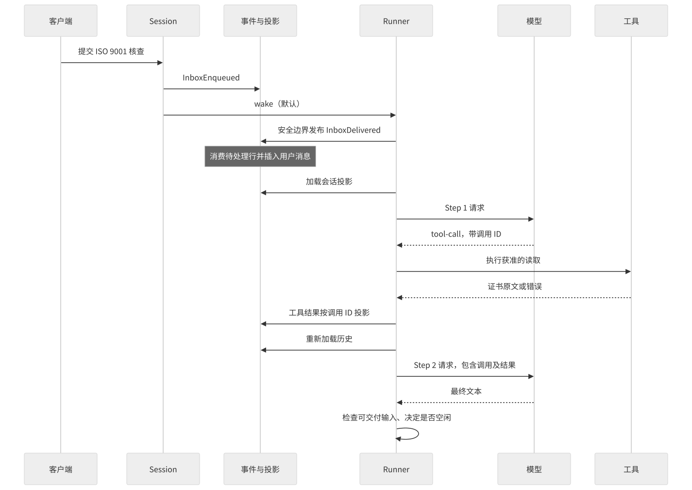

图中为简洁只画了一次读取。实际可能先搜索再读取，也可能在一次模型响应里请求多个工具。本章的 ISO 9001 轨迹是**教学数据**。

### 1 · 接收是一项数据库事实

Server 的 `session.prompt` handler 将请求交给 Core。Core 取得或生成 `messageID`，首次提交用 `SessionPrompt.prepare` 整理输入，再调用 `admission.admit`。后者发布 `InboxEnqueued`，投影在 `session_inbox` 中保存待交付记录。默认在这之后才调用 `execution.wake(sessionID)`。如果请求带 `resume: false`，这次提交只完成接收，稍后仍可由其它执行机会交付。[服务端入口](https://github.com/anomalyco/opencode/blob/ee5fe34e136488a1839ac73bcca8321c51a31b75/packages/server/src/handlers/session.ts#L290) · [Admission](https://github.com/anomalyco/opencode/blob/ee5fe34e136488a1839ac73bcca8321c51a31b75/packages/core/src/session/session.ts#L153) · [入队投影](https://github.com/anomalyco/opencode/blob/ee5fe34e136488a1839ac73bcca8321c51a31b75/packages/core/src/session/projector.ts#L1040)

这个边界让「我接收过这条输入」和「模型已读到这条输入」可以分别核实。拿着同一个 `messageID`，你可以沿着待交付记录追到用户消息。

### 2 · 运行者决定什么时候交付

`SessionExecution` 按 Session 找到它所在的 Location 和 Runner。同一个 Session 的执行由协调器串行管理，额外 wake 可以合并。Runner 到了安全边界，先准备上下文，然后调用 `SessionInbox.promote`。普通对话路径下，`steer` 可在当前工作进行中的安全步骤边界交付，`queue` 则等到会话原本要进入空闲时再逐条交付。移动、压缩等控制项还有优先级，图里只画普通输入。[执行入口](https://github.com/anomalyco/opencode/blob/ee5fe34e136488a1839ac73bcca8321c51a31b75/packages/core/src/session/execution.ts#L105) · [协调器](https://github.com/anomalyco/opencode/blob/ee5fe34e136488a1839ac73bcca8321c51a31b75/packages/core/src/session/run-coordinator.ts#L135) · [交付选择](https://github.com/anomalyco/opencode/blob/ee5fe34e136488a1839ac73bcca8321c51a31b75/packages/core/src/session/inbox.ts#L567)

`InboxDelivered` 的投影在同一事务里消费 inbox 行，并用原 ID 插入 `type: "user"` 的消息。随后才加载会话历史。这两个动作的顺序解释了为什么新输入可以出现在紧接着的模型请求里。[交付投影](https://github.com/anomalyco/opencode/blob/ee5fe34e136488a1839ac73bcca8321c51a31b75/packages/core/src/session/projector.ts#L1011) · [先交付再读取](https://github.com/anomalyco/opencode/blob/ee5fe34e136488a1839ac73bcca8321c51a31b75/packages/core/src/session/runner/llm.ts#L191)

### 3 · Step 是一次逻辑模型调用

`runStep` 取到当前 Agent、模型、指令、工具和历史，组装主请求。一次尝试由 `step.ts` 发起一次 `llm.stream()`。重试由上层处理，因此同一个逻辑 Step 在出错后可能经历多次尝试。假设模型请求读取证书所在页，它发出工具名、参数与调用 ID。对于本地执行的调用，OpenCode 先发布调用事件，再执行工具，把结果与原 ID 一起记录到会话中。模型服务商已执行的工具走自己的结果路径。[主请求准备](https://github.com/anomalyco/opencode/blob/ee5fe34e136488a1839ac73bcca8321c51a31b75/packages/core/src/session/runner/llm.ts#L237) · [模型流和本地执行](https://github.com/anomalyco/opencode/blob/ee5fe34e136488a1839ac73bcca8321c51a31b75/packages/core/src/session/runner/step.ts#L137) · [本地结果发布](https://github.com/anomalyco/opencode/blob/ee5fe34e136488a1839ac73bcca8321c51a31b75/packages/core/src/session/runner/publish-llm-event.ts#L582)

下一步加载新历史，`to-llm-message.ts` 把存好的调用及其结果转换成请求消息。此时模型才获得证书持有人和有效日期，可以继续查投标人和截止日，或者作出有依据的结论。[调用与结果转换](https://github.com/anomalyco/opencode/blob/ee5fe34e136488a1839ac73bcca8321c51a31b75/packages/core/src/session/runner/to-llm-message.ts#L105)

### 4 · 局部步骤与整次会话有不同的完成条件

正常完成时，Step 会根据工具记录判断 `needsContinuation`。外层收到这个值后再次走安全边界。即使模型已经给出最终文本，仍可能存在待交付输入，或者 idle Hook 会追加工作。反过来，工具拒绝、执行中断、输出受限、重试和步数上限都走各自的分支。[续跑来源](https://github.com/anomalyco/opencode/blob/ee5fe34e136488a1839ac73bcca8321c51a31b75/packages/core/src/session/runner/publish-llm-event.ts#L615) · [空闲判断](https://github.com/anomalyco/opencode/blob/ee5fe34e136488a1839ac73bcca8321c51a31b75/packages/core/src/session/runner/llm.ts#L177) · [主循环](https://github.com/anomalyco/opencode/blob/ee5fe34e136488a1839ac73bcca8321c51a31b75/packages/core/src/session/runner/llm.ts#L216)


### 在 Notebook 里看两条轨迹

1. **原版测试的期望事件与录制响应。** 上游测试提交的是 `Say hello in one short sentence.`，带 `resume: false`，随后显式 resume。Notebook 从原版 TypeScript 测试提取事件断言，并逐帧打开原版录制的 HTTP 流。这里能分别看到「运行时预期记录什么」和「上游模型真实返回过什么」。[原版测试](https://github.com/anomalyco/opencode/blob/ee5fe34e136488a1839ac73bcca8321c51a31b75/packages/core/test/session-runner-recorded.test.ts#L225)
2. **ISO 9001 教学轨迹。** 同一条核查指令经过接收、交付、调用工具、结果回传和最终作答。切换观察时点，看看 inbox、历史和工具结果中已经有了什么。教学数据与前面的真实 HTTP 录制分别标注。

**自测。** 如果你能看到证书的工具结果，但暂时没看到最终结论，系统可能已经完成了什么？根据前面的图，解释工具结果为什么要保留原调用 ID，以及下一步怎样拿到它。

<a id="05-subagent-dispatch"></a>

## 05 · 子 Agent 与任务分派

假设 Build 在调查 TypeScript 的日期边界故障。它可以请 Explore 找出测试与调用位置，自己继续检查日期表示和边界条件。这个分工的关键是**谁决定派发、子任务带走什么上下文、父会话什么时候能继续**。本章以 OpenCode `ee5fe34e13` 为基准。


### 从角色到执行单元

| 对象 | 在派发中负责什么 |
|---|---|
| **Agent** | 角色配置，包括可运行的模式、系统指令、工具权限和模型偏好 |
| **父 Session** | 保存原任务和派发记录，通过工具输出中的子会话 ID 关联后续工作 |
| **子 Session** | 保存自己收到的任务、工具结果和答复。同一个子 Session 可以收到后续指令 |
| **Job** | 驱动子 Session 的后台执行。子会话有新的工作时，Job 管理这次执行 |

Build 是默认主角色。General 是可分派的通用角色，内置权限拒绝 `question` 和进一步调用 `subagent`。Explore 的角色指令定位为搜索和分析，授权规则列出搜索、读取、网络等操作。内置规则也允许 `shell`，其只读行为由专门角色指令约束。看角色能力时要分别读**提示词**和**权限规则**。Agent 配置的 `mode` 有 `primary`、`subagent` 和 `all` 三种。[内置角色与授权](https://github.com/anomalyco/opencode/blob/ee5fe34e136488a1839ac73bcca8321c51a31b75/packages/core/src/plugin/agent.ts#L52-L94) · [Explore 指令](https://github.com/anomalyco/opencode/blob/ee5fe34e136488a1839ac73bcca8321c51a31b75/packages/core/src/plugin/agent.ts#L7-L17) · [Agent schema](https://github.com/anomalyco/opencode/blob/ee5fe34e136488a1839ac73bcca8321c51a31b75/packages/schema/src/agent.ts#L23-L37)

新子会话有自己的历史。它继承父会话的 Location，默认继承会话级 metadata 和 permissions。也就是说，两个 Agent 可以在同一个项目位置工作，各自保有消息上下文。派发日期故障时，给 Explore 的任务应自行交代哪条断言失败、需要查哪些文件，以及你希望收到哪些证据。[子会话创建](https://github.com/anomalyco/opencode/blob/ee5fe34e136488a1839ac73bcca8321c51a31b75/packages/core/src/session.ts#L292-L321) · [工具对新上下文的说明](https://github.com/anomalyco/opencode/blob/ee5fe34e136488a1839ac73bcca8321c51a31b75/packages/core/src/tool/plugin/subagent.ts#L51-L57)

### 入口一 · 模型通过 `subagent` 工具分派

模型给出 `agent`、短标题 `description` 和具体任务 `prompt`。省略 `sessionID` 表示新建子会话，传入已有 ID 则向同一子会话追加任务。可选的 `model` 是显式覆盖。新建时模型选择顺序为指定模型、目标 Agent 配置、父会话模型。工具描述会根据选中角色的权限列出可用子 Agent，真正执行时还会校验目标、权限和子会话归属。[工具参数](https://github.com/anomalyco/opencode/blob/ee5fe34e136488a1839ac73bcca8321c51a31b75/packages/core/src/tool/plugin/subagent.ts#L30-L49) · [校验与新建](https://github.com/anomalyco/opencode/blob/ee5fe34e136488a1839ac73bcca8321c51a31b75/packages/core/src/tool/plugin/subagent.ts#L111-L180) · [请求前生成的候选角色](https://github.com/anomalyco/opencode/blob/ee5fe34e136488a1839ac73bcca8321c51a31b75/packages/core/src/tool/plugin/subagent.ts#L240-L267)

权限检查把目标 Agent ID 当资源。将别的父会话创建的子 Session ID 交给当前工具，会在归属校验处被拒绝。工具还会检查嵌套深度，默认允许从顶层向下创建一层。增大深度只改变这个上限，仍需满足工具权限和目标角色要求。[权限及归属校验](https://github.com/anomalyco/opencode/blob/ee5fe34e136488a1839ac73bcca8321c51a31b75/packages/core/src/tool/plugin/subagent.ts#L118-L154) · [默认深度](https://github.com/anomalyco/opencode/blob/ee5fe34e136488a1839ac73bcca8321c51a31b75/packages/core/src/session/subagent-depth.ts#L8-L20)

首次分派先把任务写到子会话的 inbox，对尚未运行的子会话用 `resume: false`，随后由 `SubagentJob.start` 接管启动。这个顺序把任务接收和 Job 驱动分开，作业能先登记执行边界。工具很快返回 `sessionID` 和 `status: "running"`，此时**父会话的工具调用已完成，子任务仍在后台运行**。如果子会话正在运行，再用原 ID 发后续指令会将输入交给当前执行；可以用它继续缩小日期问题的调查范围。[子会话入队与 Job 启动](https://github.com/anomalyco/opencode/blob/ee5fe34e136488a1839ac73bcca8321c51a31b75/packages/core/src/tool/plugin/subagent.ts#L187-L222) · [后续任务原版测试](https://github.com/anomalyco/opencode/blob/ee5fe34e136488a1839ac73bcca8321c51a31b75/packages/core/test/tool-subagent.test.ts#L541-L585)

### 入口二 · 用户通过自定义命令指定分派

例如，为评审变更配置 `/review`。用户提交命令后，配置插件展开模板再决定投递位置。优先读 `subagent`，缺省时读旧字段 `subtask`，两者都缺省才依据配置中 Agent 的模式判断。选择子会话时，命令创建带 `parentID` 的 Session，把模板结果送进子 inbox，再启动同一种 Job。选择父会话时，命令可按配置切换当前 Agent 或模型，把消息投到原 Session。[命令执行实现](https://github.com/anomalyco/opencode/blob/ee5fe34e136488a1839ac73bcca8321c51a31b75/packages/core/src/config/plugin/command.ts#L50-L109)

两条入口的差别在于**决策来自哪一层**。模型工具调用由模型选任务和角色，OpenCode 在执行时施加工具权限和目标约束。用户发出的自定义命令按配置决定投递位置，可以显式要求某角色在子 Session 运行。原版测试甚至用 `subagent: true` 把 Build 放进子 Session，说明命令路径和模型工具路径的角色校验不同。这个测试场景里，父会话本身的 Agent、模型和历史均保留。[显式命令的测试矩阵](https://github.com/anomalyco/opencode/blob/ee5fe34e136488a1839ac73bcca8321c51a31b75/packages/core/test/config/command-subagent.test.ts#L55-L105)

### 跑原版 · 代码评审、运行中追加与归属校验

| 案例 | 跑原版时看什么 |
|---|---|
| **命令发起代码评审** | `command-subagent.test.ts` 让子会话的模型停在测试闸门。命令已返回，父会话尚未收到消息。打开闸门后，父会话收到带子 ID 的 `synthetic` 结果。另一个用例用 `subagent: false` 把改写后的评审指令送回当前会话。[后台评审](https://github.com/anomalyco/opencode/blob/ee5fe34e136488a1839ac73bcca8321c51a31b75/packages/core/test/config/command-subagent.test.ts#L79-L105) · [原会话对照](https://github.com/anomalyco/opencode/blob/ee5fe34e136488a1839ac73bcca8321c51a31b75/packages/core/test/config/command-subagent.test.ts#L110-L123) |
| **安排背景调查，再增加核对范围** | `tool-subagent.test.ts` 先验证新会话的父 ID、Location、模型和入队内容，再验证传回同一子 ID 时只有一个子会话、具有两条待处理指令。运行中追加的用例还验证原 Job 继续运行。[创建并返回句柄](https://github.com/anomalyco/opencode/blob/ee5fe34e136488a1839ac73bcca8321c51a31b75/packages/core/test/tool-subagent.test.ts#L422-L478) · [同一会话后续任务](https://github.com/anomalyco/opencode/blob/ee5fe34e136488a1839ac73bcca8321c51a31b75/packages/core/test/tool-subagent.test.ts#L484-L535) |
| **提交属于另一个父会话的 ID** | 同一工具测试分别传入不存在的 ID、格式不合法的 ID、父会话自身 ID，以及另一个父会话的子 ID。观察哪些在参数解码时失败，哪些在查找与归属检查时失败。[归属与参数错误](https://github.com/anomalyco/opencode/blob/ee5fe34e136488a1839ac73bcca8321c51a31b75/packages/core/test/tool-subagent.test.ts#L648-L718) |

这些原版测试使用受控的模型响应或既定工具调用，以便重现后台时序。日期边界故障是阅读场景。上游测试中实际执行的是评审命令、子会话派发及后续指令等用例。

**自测。** 父会话看到 `status: "running"` 后，为什么可以继续查日期逻辑？如果要让 Explore 把输出缩小到特定测试文件，哪一个 ID 能把新指令送进原来的调查？哪些信息应该写进第一次委派的任务里？

### 原版实跑结果

| 案例 | 运行时断言 | 结果 |
|---|---|---|
| [新派发：父 Agent 拿到运行句柄](https://github.com/anomalyco/opencode/blob/ee5fe34e136488a1839ac73bcca8321c51a31b75/packages/core/test/tool-subagent.test.ts#L422) | 工具调用带回运行状态和子 Session ID，子 Session 保存父 ID，任务在后台继续。 | 1 通过 |
| [追加指令：沿用正在运行的子 Session](https://github.com/anomalyco/opencode/blob/ee5fe34e136488a1839ac73bcca8321c51a31b75/packages/core/test/tool-subagent.test.ts#L541) | 通过已有 Session ID 补充任务，调用仍立即返回，子会话后续读取追加指令。 | 1 通过 |
| [代码审查 /review：配置决定执行归属](https://github.com/anomalyco/opencode/blob/ee5fe34e136488a1839ac73bcca8321c51a31b75/packages/core/test/config/command-subagent.test.ts#L55) | JSON、旧 Markdown 和 Agent 模式都能走后台派发。显式 subagent:false 时执行回到当前 Session。 | 4 通过 |
| [越权引用：拒绝复用其他父会话的子 Session](https://github.com/anomalyco/opencode/blob/ee5fe34e136488a1839ac73bcca8321c51a31b75/packages/core/test/tool-subagent.test.ts#L648) | 会话 ID 不能跨父会话复用，合法续派仍可以按规则更换子 Agent。 | 1 通过 |

[打开 Jupyter 实验](notebooks/05-subagent-dispatch.ipynb) · [逐案例实跑记录](fixtures/orchestration-cases.json)

<a id="06-background-jobs"></a>

## 06 · 后台 Job 与结果回传

你让主 Agent 派一名 reviewer 跑测试，自己继续解释当前改动。派发工具已经返回，reviewer 说「测试已启动」，Shell 却还在跑。此时谁算完成？如果服务重启，应该继续 reviewer 的工作，还是只补送它已经写好的报告？

OpenCode 给这几个问题各自留了依据。**子会话保存对话与执行位置，Job 管理后台工作，会话认领标记保存恢复依据，父会话 Inbox 接收报告。** 读完本章，你能从这些状态判断下一步该运行谁、该投递什么。

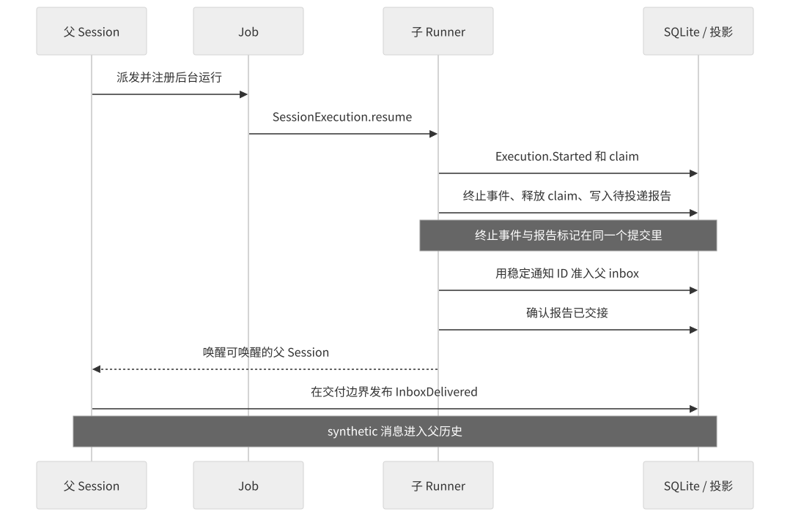

### 1 · 派发返回之后，谁负责运行

`subagent` 把任务提交到子会话。新建或当前空闲的子会话用 `resume: false` 接收入参，让随后启动的 Job 接管执行。已有子会话正在工作时，追加指令沿会话的普通 Inbox 路径进入。工具返回的子会话 ID 和 `running` 状态是回执，主 Agent 可以继续运行。Job 把启动信息写入持久表后，才在自己的作用域中运行 `SessionExecution.resume(childID)`。同一 ID 的活跃 Job 通常复用，若旧的一批已开始结算，新任务会取得新的 generation。这样旧任务的收尾有自己的归属。[子 Agent 派发](https://github.com/anomalyco/opencode/blob/ee5fe34e136488a1839ac73bcca8321c51a31b75/packages/core/src/tool/plugin/subagent.ts#L187-L223) · [SubagentJob](https://github.com/anomalyco/opencode/blob/ee5fe34e136488a1839ac73bcca8321c51a31b75/packages/core/src/session/subagent-job.ts#L17-L52) · [Job 启动与复用](https://github.com/anomalyco/opencode/blob/ee5fe34e136488a1839ac73bcca8321c51a31b75/packages/core/src/job.ts#L370-L426)

| 标识或状态 | 实际用途 |
|---|---|
| 子会话 ID | 找到对话历史、接收后续指令和驱动该 Session。子代理 Job 也用它作为逻辑 ID。 |
| Job generation | 进程内区分同一个逻辑 Job 的不同批次。会话从忙到闲时，结算逻辑用它匹配自己观察到的取消或运行状态。 |
| `notificationID` | 持久 Job 行的主键，也是父会话通知的消息 ID。同一份报告重投时保持一致。同一个子会话后续再次完成工作可以产生新通知。 |
| 执行认领 `time_suspended` | 和 Session 启动事件一起写入的恢复标记。服务停止或进程崩溃后，它提供尚待恢复的依据。它不保存执行栈。 |

[Job 表](https://github.com/anomalyco/opencode/blob/ee5fe34e136488a1839ac73bcca8321c51a31b75/packages/core/src/job/sql.ts#L7-L25) · [generation 匹配](https://github.com/anomalyco/opencode/blob/ee5fe34e136488a1839ac73bcca8321c51a31b75/packages/core/src/job.ts#L661-L700) · [启动时绑定](https://github.com/anomalyco/opencode/blob/ee5fe34e136488a1839ac73bcca8321c51a31b75/packages/core/src/session/execution.ts#L138-L151) · [认领写入](https://github.com/anomalyco/opencode/blob/ee5fe34e136488a1839ac73bcca8321c51a31b75/packages/core/src/session/store.ts#L256-L274)

### 2 · 一份结果如何跨过两个事务

**先结算子会话。** `SubagentReport.prepare` 为这段忙碌期取得报告上下文。成功时按启动事件序号查找本期最后一个已完成、无错误的 assistant 消息，汇集文本部分。失败、用户取消各有对应终态。终态事件、释放子会话的认领、保存待投递报告在同一个事务里提交。测试故意阻止插入 Job 行时，子会话的空闲状态和认领释放也一起回滚。[选择本期结果](https://github.com/anomalyco/opencode/blob/ee5fe34e136488a1839ac73bcca8321c51a31b75/packages/core/src/session/execution/subagent-report.ts#L56-L73) · [查找已完成消息](https://github.com/anomalyco/opencode/blob/ee5fe34e136488a1839ac73bcca8321c51a31b75/packages/core/src/session/store.ts#L207-L232) · [原子结算](https://github.com/anomalyco/opencode/blob/ee5fe34e136488a1839ac73bcca8321c51a31b75/packages/core/src/session/execution/subagent-report.ts#L150-L187) · [写入失败回滚测试](https://github.com/anomalyco/opencode/blob/ee5fe34e136488a1839ac73bcca8321c51a31b75/packages/core/test/subagent-report.test.ts#L482-L504)

**再投递给父会话。** 提交后，运行时用同一个 `notificationID` 把报告作为 `synthetic`、`steer` 项写入父 Inbox，收到持久接收结果后清除 outbox 行。父会话存在且没有暂存 revert 时，投递会唤醒父会话。报告进入父历史的时点仍遵循上一章的安全边界。父会话已删除时可以清理报告，通知 ID 与其他输入冲突时则保留，留待后续诊断。[投递到父 Inbox](https://github.com/anomalyco/opencode/blob/ee5fe34e136488a1839ac73bcca8321c51a31b75/packages/core/src/session/execution/subagent-report.ts#L75-L129) · [报告接收后确认](https://github.com/anomalyco/opencode/blob/ee5fe34e136488a1839ac73bcca8321c51a31b75/packages/core/src/session/subagent-completion.ts#L75-L85) · [revert 测试](https://github.com/anomalyco/opencode/blob/ee5fe34e136488a1839ac73bcca8321c51a31b75/packages/core/test/subagent-report.test.ts#L546-L600)

这个设计让结果在进程故障后仍能追溯。若事务已提交、投递还没开始，恢复程序用完成态 outbox 补发通知。若父 Inbox 已接收、清理还没完成，重放仍使用原 ID。测试验证了父会话最终只见到同一份报告一次。[启动时重放结果](https://github.com/anomalyco/opencode/blob/ee5fe34e136488a1839ac73bcca8321c51a31b75/packages/core/src/session/execution/restart.ts#L390-L419) · [投递后、确认前的重放测试](https://github.com/anomalyco/opencode/blob/ee5fe34e136488a1839ac73bcca8321c51a31b75/packages/core/test/tool-subagent.test.ts#L225-L306)

### 3 · 当前会话空闲时，后台工作还能继续

代码检查案例复用上游的「后台 Shell 跑测试」。reviewer 第一次交还控制权时说 `Started tests`。其本期 Job 已完成，报告的元数据 `state` 是 `completed`。报告正文面向父模型的 `<background-result>` 同时写 `state="running"`，附带仍在运行的 Shell。Shell 完成后，reviewer 再运行一段，返回 `Tests green`，父会话看到第二份带新 ID 的报告。**“这一期有结果”和“整项工作已经结束”需要分别判断。** [报告状态装配](https://github.com/anomalyco/opencode/blob/ee5fe34e136488a1839ac73bcca8321c51a31b75/packages/core/src/session/subagent-completion.ts#L38-L85) · [两次回传的原版端到端测试](https://github.com/anomalyco/opencode/blob/ee5fe34e136488a1839ac73bcca8321c51a31b75/packages/core/test/subagent-idle-e2e.test.ts#L405-L454)

有孙级任务时，通知每次只向直属父会话投递。中间会话可以向上汇报孙级仍在运行的工作，顶层拿到的报告仍由直属子会话发出。这让每级 Agent 负责解释自己观察到的进展。[逐级回传测试](https://github.com/anomalyco/opencode/blob/ee5fe34e136488a1839ac73bcca8321c51a31b75/packages/core/test/subagent-idle-e2e.test.ts#L544-L625)

### 4 · 取消、关机与恢复怎样分流


| 发生了什么 | 持久状态与下一步 |
|---|---|
| 子会话正常完成或失败 | 写入终态，释放认领。若有待投递报告，提交后送给父会话。 |
| 明确取消 | 运行中的 Job 记录调用方取消并中断工作。子会话进入用户中断的结算路径，释放认领并按需报告取消。若进程恰在持久化取消之后退出，恢复流程也会读取取消状态。 |
| 服务关机或进程退出时仍在执行 | 关机分支保留认领和运行中的 Job 行，这次无需报告完成。进程崩溃留下的认领同样可作为恢复依据。启动时为仍需继续的子会话计算恢复次数，并按恢复策略重启其 Job。 |
| 退出时已经有完成态 outbox | 只重放报告。无需重新请求子 Agent 模型。 |
| 达到恢复预算上限 | 子会话落失败终态并释放认领，父会话得到一份错误通知。 |

[取消记录](https://github.com/anomalyco/opencode/blob/ee5fe34e136488a1839ac73bcca8321c51a31b75/packages/core/src/job.ts#L553-L590) · [关机与终态分支](https://github.com/anomalyco/opencode/blob/ee5fe34e136488a1839ac73bcca8321c51a31b75/packages/core/src/session/execution.ts#L155-L175) · [持久取消恢复测试](https://github.com/anomalyco/opencode/blob/ee5fe34e136488a1839ac73bcca8321c51a31b75/packages/core/test/session-execution.test.ts#L328-L370) · [已完成报告的恢复测试](https://github.com/anomalyco/opencode/blob/ee5fe34e136488a1839ac73bcca8321c51a31b75/packages/core/test/subagent-idle-e2e.test.ts#L630-L674) · [恢复预算耗尽测试](https://github.com/anomalyco/opencode/blob/ee5fe34e136488a1839ac73bcca8321c51a31b75/packages/core/test/session-execution.test.ts#L1808-L1857)

恢复还得处理父子竞态。实现先对需要恢复的父会话计算当次恢复预算，再启动它们的后台子任务。这样，一个很快结束的子 Agent 唤醒父会话时，父会话已经纳入恢复检查。[恢复排序](https://github.com/anomalyco/opencode/blob/ee5fe34e136488a1839ac73bcca8321c51a31b75/packages/core/src/session/execution/restart.ts#L502-L539)

### 在 Notebook 里看什么

1. **代码测试回传。** 运行上游 Shell 案例。第一份报告出现时找两个不同语境里的状态，第二份报告出现时对比通知 ID。上游测试使用脚本化模型响应和实际测试 Shell。  
2. **暂停一次投递。** 走上游 outbox 故障案例。在父会话还没收到消息时，检查子会话认领、待投递行和模型请求数。恢复后再比对三项，验证补的是报告。  
3. **同样中断，两种意图。** 对照用户取消与服务关闭。预测哪一种会释放认领，哪一种仍能恢复。最后看达到预算上限时父会话能拿到什么。

**自测。** 子 Agent 已输出「检查进行中」，报告正文的状态为 `running`。这对父 Agent 判断「是否等测试完成」意味着什么？如果再收到一份完成报告，你会用什么信息确认它与前一份报告来自同一个子会话？

### 原版实跑结果

| 案例 | 运行时断言 | 结果 |
|---|---|---|
| [长测试：先报告仍在运行，再报告最终结果](https://github.com/anomalyco/opencode/blob/ee5fe34e136488a1839ac73bcca8321c51a31b75/packages/core/test/subagent-idle-e2e.test.ts#L406) | 后台 shell 未完成时父会话先收到 Started tests，放行 shell 后再收到 Tests green，两次通知 ID 不同。 | 1 通过 |
| [进程中断：已提交的报告可以补发](https://github.com/anomalyco/opencode/blob/ee5fe34e136488a1839ac73bcca8321c51a31b75/packages/core/test/subagent-idle-e2e.test.ts#L630) | 重放扫描两次，只交付一份父会话报告，子模型请求仍只有一次。 | 1 通过 |
| [取消与关闭：同一个中断动作有不同后续](https://github.com/anomalyco/opencode/blob/ee5fe34e136488a1839ac73bcca8321c51a31b75/packages/core/test/tool-subagent.test.ts#L1001) | 显式取消中断子会话，shutdown 路径保留用于恢复的执行标记。 | 1 通过 |
| [写入失败：终态与报告必须同进退](https://github.com/anomalyco/opencode/blob/ee5fe34e136488a1839ac73bcca8321c51a31b75/packages/core/test/subagent-report.test.ts#L481) | 报告写入失败时回滚 idle 投影及 claim 释放，成功时先提交再投递、确认和唤醒。 | 2 通过 |
| [恢复预算耗尽：失败结算并通知父会话](https://github.com/anomalyco/opencode/blob/ee5fe34e136488a1839ac73bcca8321c51a31b75/packages/core/test/session-execution.test.ts#L1808) | 恢复预算耗尽后对子会话结算失败，释放 claim，并把错误回报交给父 Session。 | 1 通过 |

[打开 Jupyter 实验](notebooks/06-background-jobs.ipynb) · [逐案例实跑记录](fixtures/orchestration-cases.json)

<a id="07-goal"></a>

## 07 · /goal 怎样判断何时继续工作

一个编码 Agent 说「日期解析修好了」，Session 已经没有下一条输入，运行时准备进入空闲。此时可以追问两件事：**这次执行结束了吗？“让测试套件通过”这个目标达成了吗？** `/goal` 让 OpenCode 在即将空闲时再检查目标，通过事件和消息驱动下一轮。第 05、06 章的子 Agent 和 Job 可以提供证据，是否继续工作由持有目标的 Session 决定。


### 1 · 目标绑定在哪个 Session

`/goal <objective>` 由内置插件 `opencode.goal` 注册。命令把目标写到插件自己的存储，键为 `session:<id>`。状态包含目标文本、状态、最后原因、续跑计数、停滞计数和启动它的服务器进程标识。每次写入都会尝试发布 `changed`，TUI 也可以通过 `get` 拉取当前目标。子 Session 和 fork 从各自的键开始，仍可以通过任务参数收到父级给出的工作要求。目标状态和传给下游 Agent 的指令是两个信息来源。[目标存储和 RPC](https://github.com/anomalyco/opencode/blob/ee5fe34e136488a1839ac73bcca8321c51a31b75/packages/core/src/plugin/goal.ts#L40) · [状态定义](https://github.com/anomalyco/opencode/blob/ee5fe34e136488a1839ac73bcca8321c51a31b75/packages/schema/src/goal.ts#L7) · [TUI 如何订阅目标变更](https://github.com/anomalyco/opencode/blob/ee5fe34e136488a1839ac73bcca8321c51a31b75/packages/tui/src/feature-plugins/prompt/goal.tsx#L8)

设置目标时，插件记录 `active` 和 `rounds: 0`，再投递启动提示词。普通启动是一条带 `goalID` 的 `synthetic` 消息，时间线可用简短说明展示它。有文件、Agent 或 Skill 附件时改用用户 prompt 路径携带原附件。两种方式都复用 Session 的输入链路，因此新增目标也可以带上原有的投递方式。**目标先成为 Session 的状态，再通过已有输入机制驱动工作。** [命令实现](https://github.com/anomalyco/opencode/blob/ee5fe34e136488a1839ac73bcca8321c51a31b75/packages/core/src/plugin/goal.ts#L347) · [启动和附件分支](https://github.com/anomalyco/opencode/blob/ee5fe34e136488a1839ac73bcca8321c51a31b75/packages/core/src/plugin/goal.ts#L392) · [合成消息入队](https://github.com/anomalyco/opencode/blob/ee5fe34e136488a1839ac73bcca8321c51a31b75/packages/core/src/session/synthetic.ts#L15)

### 2 · 为什么在空闲边界做评审

第 04 章的 Step 负责一次逻辑模型调用。Runner 做完当前工作、没有可交付输入且确实执行过模型步骤后，才会触发 `experimental.idle`。这时工具调用和结果已经能成为评审的证据。如果 Hook 新增了输入，Runner 会再次检查 Inbox，有工作就沿用当前执行继续跑。源码测试验证了「先评审为继续，再评审为完成」的案例最终只记录一次 Session idle。[Runner 空闲边界](https://github.com/anomalyco/opencode/blob/ee5fe34e136488a1839ac73bcca8321c51a31b75/packages/core/src/session/runner/llm.ts#L177) · [注册 idle Hook](https://github.com/anomalyco/opencode/blob/ee5fe34e136488a1839ac73bcca8321c51a31b75/packages/core/src/plugin/goal.ts#L209) · [同一次执行继续的测试](https://github.com/anomalyco/opencode/blob/ee5fe34e136488a1839ac73bcca8321c51a31b75/packages/core/test/plugin/goal.test.ts#L60)

评审器通过 `Session.generate` 发起一条独立模型请求。它复用会话上下文，并附加目标评审提示词，要求根据已经出现的命令输出、工具结果和材料判断，而不是采信助手宣称已完成。生成响应的正文不会作为一次助手答复写进会话历史，模型用量仍会记录。JSON 判定可从代码围栏中提取并经 Schema 校验。**这里让模型理解证据，让运行时负责状态转换。** [评审提示词](https://github.com/anomalyco/opencode/blob/ee5fe34e136488a1839ac73bcca8321c51a31b75/packages/core/src/plugin/goal/judge.txt#L1) · [评审调用和解析](https://github.com/anomalyco/opencode/blob/ee5fe34e136488a1839ac73bcca8321c51a31b75/packages/core/src/plugin/goal.ts#L104) · [生成请求及用量](https://github.com/anomalyco/opencode/blob/ee5fe34e136488a1839ac73bcca8321c51a31b75/packages/core/src/session/generate.ts#L30)

### 3 · 后台在运行时，谁来唤醒目标

当当前 Session 直接拥有的子 Agent、图片、视频或 Code Mode Job 仍在运行时，目标 Hook 先让出执行，不发评审请求。Job 的回报能唤醒所有者，届时再评审。孙 Session 的 Job 结果会回到自己的父级，当前 Session 不会把这种间接工作当作自己的唤醒来源。当前 Session 自己的后台 Shell 走另一条分支：仍然请求评审，并传上命令清单。只有清单非空时才接受 `wait`，模型可指出目标需要等哪条命令结果。[后台判定](https://github.com/anomalyco/opencode/blob/ee5fe34e136488a1839ac73bcca8321c51a31b75/packages/core/src/plugin/goal.ts#L140) · [Shell 等待判定](https://github.com/anomalyco/opencode/blob/ee5fe34e136488a1839ac73bcca8321c51a31b75/packages/core/src/plugin/goal.ts#L109) · [直接子任务测试](https://github.com/anomalyco/opencode/blob/ee5fe34e136488a1839ac73bcca8321c51a31b75/packages/core/test/plugin/goal.test.ts#L178) · [后代所有权测试](https://github.com/anomalyco/opencode/blob/ee5fe34e136488a1839ac73bcca8321c51a31b75/packages/core/test/plugin/goal.test.ts#L216)

这解释了一个常见现象：**父 Session 已经空闲，目标仍然是 active，子 Job 也可能仍在运行**。三种状态各自回答一个问题：

| 看哪个状态 | 它回答的问题 |
|---|---|
| Session 的执行状态 | 当前有没有模型和工具步骤正在推进？ |
| 子 Agent Job 的状态 | 派出去的具体工作还在运行吗，回报要交给哪个 Session？ |
| `/goal` 的状态 | 在这个 Session 下，目标仍可继续、已暂停，还是已经被评审为完成？ |

### 4 · 一个 verdict 如何变成一次状态变更

| 评审输出或防护条件 | 运行时行为 |
|---|---|
| `done` | 记录 `complete` 和证据理由，当前目标停止追加输入。 |
| `continue` | 先检查有无进展。继续时更新状态，再注入带 `goalID` 的 `synthetic` 续跑消息，携带目标、评审理由和可选下一步。 |
| `blocked` 或 `paused` | 记录 `paused` 和原因，让用户接手或稍后恢复。 |
| `wait` | 有本 Session 的后台 Shell 时保持 active，等待新的执行机会。 |
| 连续无有效判定 | 普通无效响应再问一次，仍无法解析便暂停。评审上下文溢出时，每轮允许先压缩一次再次评审，仍溢出便暂停。 |

进展检查采用两个信号：评审理由经过去空白、统一大小写等归一化后是否重复，以及上一次启动或续跑以来是否出现工具调用。连续三轮满足任一停滞条件就暂停。历史压缩后如果找不到进度起点，源码按有进展处理。默认 50 个续跑轮次是另一个上限，这个数字统计续跑计数，不能直接换算成模型请求量。一轮工作内可能已经调用模型多次，评审本身也有单独的调用。压缩让目标片段暂时消失时，`context` Hook 可在请求尾部附近补入提醒，该提醒不落入会话历史。[判定和续跑](https://github.com/anomalyco/opencode/blob/ee5fe34e136488a1839ac73bcca8321c51a31b75/packages/core/src/plugin/goal.ts#L166) · [进展信号](https://github.com/anomalyco/opencode/blob/ee5fe34e136488a1839ac73bcca8321c51a31b75/packages/core/src/plugin/goal.ts#L89) · [理由归一化](https://github.com/anomalyco/opencode/blob/ee5fe34e136488a1839ac73bcca8321c51a31b75/packages/core/src/plugin/goal.ts#L459) · [上限常量](https://github.com/anomalyco/opencode/blob/ee5fe34e136488a1839ac73bcca8321c51a31b75/packages/core/src/plugin/goal.ts#L15) · [压缩后的提醒](https://github.com/anomalyco/opencode/blob/ee5fe34e136488a1839ac73bcca8321c51a31b75/packages/core/src/plugin/goal.ts#L222)

### 5 · 人能暂停，重启也有明确的边界

`/goal pause` 将 active 目标标为 paused。`/goal resume` 恢复同一个目标 ID，把续跑消息作为新预算的第一轮。`/goal clear` 移除目标。如果评审期间用户暂停、清除或更换目标，插件会重读目标并丢弃过时的评审结果。写入逻辑也会核对目标 ID、更新时间和状态。目标命令改变的是目标状态。用户直接停止 Session 时，插件另接收中断事件并暂停目标。[命令控制](https://github.com/anomalyco/opencode/blob/ee5fe34e136488a1839ac73bcca8321c51a31b75/packages/core/src/plugin/goal.ts#L358) · [写入前的检查](https://github.com/anomalyco/opencode/blob/ee5fe34e136488a1839ac73bcca8321c51a31b75/packages/core/src/plugin/goal.ts#L61) · [运行中暂停的测试](https://github.com/anomalyco/opencode/blob/ee5fe34e136488a1839ac73bcca8321c51a31b75/packages/core/test/plugin/goal.test.ts#L264) · [处理执行失败及用户中断](https://github.com/anomalyco/opencode/blob/ee5fe34e136488a1839ac73bcca8321c51a31b75/packages/core/src/plugin/goal.ts#L277)

等待后台时，目标会进入监测。以一次 Session 执行成功结束为起点，如果没有新的执行或后代步骤活动，等待约 30 分钟后暂停。作用域限定在当前 Session 与它下面的会话树。重启时，原版会比较进程标识，在启动扫描或下次 idle 时将旧进程留下的 active 目标标为 paused。第 06 章的后台 Job 恢复有自己的生命周期。目标在重启后等待用户用 `/goal resume` 恢复。[等待监测](https://github.com/anomalyco/opencode/blob/ee5fe34e136488a1839ac73bcca8321c51a31b75/packages/core/src/plugin/goal.ts#L237) · [启动扫描](https://github.com/anomalyco/opencode/blob/ee5fe34e136488a1839ac73bcca8321c51a31b75/packages/core/src/plugin/goal.ts#L318) · [旧进程目标防护](https://github.com/anomalyco/opencode/blob/ee5fe34e136488a1839ac73bcca8321c51a31b75/packages/core/src/plugin/goal.ts#L144) · [模拟时钟验证](https://github.com/anomalyco/opencode/blob/ee5fe34e136488a1839ac73bcca8321c51a31b75/packages/core/test/plugin/goal-watchdog.test.ts#L134)

### 在 Notebook 里观察四种原版行为

| 案例 | 读哪条原版断言 | 可观察的结果 |
|---|---|---|
| **让测试套件通过** | 日期解析仍失败时返 `continue`，下一次返 `done`。[原版案例](https://github.com/anomalyco/opencode/blob/ee5fe34e136488a1839ac73bcca8321c51a31b75/packages/core/test/plugin/goal.test.ts#L60) | 两次评审，一次续跑，最后一次 idle，目标 complete。 |
| **等调研报告** | 正在运行的直接子 Agent 推迟评审。测试夹具释放 Job 后，主动注入模拟的完成通知来唤醒父会话。[原版案例](https://github.com/anomalyco/opencode/blob/ee5fe34e136488a1839ac73bcca8321c51a31b75/packages/core/test/plugin/goal.test.ts#L178) | 等待时评审次数为 0，唤醒后评审一次并完成。第 06 章另观察真实报告投递链。 |
| **修复偶发测试** | 连续回报不同理由却没有工具调用，或反复回报同一理由。原版用两种情况构造停滞。[原版案例](https://github.com/anomalyco/opencode/blob/ee5fe34e136488a1839ac73bcca8321c51a31b75/packages/core/test/plugin/goal.test.ts#L104) | 第三个连续停滞候选触发暂停，没有再追加该轮续跑。 |
| **发布目标遇到停机或长期等待** | 启动时读到旧进程的目标，或用模拟时钟推进等待时间。[原版案例](https://github.com/anomalyco/opencode/blob/ee5fe34e136488a1839ac73bcca8321c51a31b75/packages/core/test/plugin/goal-watchdog.test.ts#L115) | 旧 active 目标暂停；持续活动的后代可刷新等待，无关 Session 不刷新。 |

这些案例运行的是原版目标插件。会话集成测试用 `TestLLM` 预设模型回答，便于固定确切的判定次数。等待监测测试用测试宿主和模拟时钟控制事件。这里验证的是**给定判定和事件时，原版怎样编排**。例如测试中的评审返回「All 12 tests pass」，这句话是输入给插件的预设判定。[评审回复夹具](https://github.com/anomalyco/opencode/blob/ee5fe34e136488a1839ac73bcca8321c51a31b75/packages/core/test/plugin/goal.test.ts#L485) · [测试宿主接口](https://github.com/anomalyco/opencode/blob/ee5fe34e136488a1839ac73bcca8321c51a31b75/packages/core/test/plugin/goal-watchdog.test.ts#L96)

**自测。** 一个父 Session 正在等待报表 Job，界面显示当前执行已经结束，目标仍然 active。先找出完成通知之后会唤醒谁，再判断什么时候才需要新的评审请求。如果读取了全部证据，模型仍连续给出相同的「需要更多检查」，哪个层负责止住重复续跑？

### 原版实跑结果

| 案例 | 运行时断言 | 结果 |
|---|---|---|
| [日期解析器：复核继续一次，再判完成](https://github.com/anomalyco/opencode/blob/ee5fe34e136488a1839ac73bcca8321c51a31b75/packages/core/test/plugin/goal.test.ts#L60) | 复核器给出 continue 和 done，持久目标 complete、rounds=1，并只记录一次最终 idle。 | 1 通过 |
| [后台调查：等子 Agent 结果再复核](https://github.com/anomalyco/opencode/blob/ee5fe34e136488a1839ac73bcca8321c51a31b75/packages/core/test/plugin/goal.test.ts#L178) | 后台 Job 运行期间零次复核，夹具模拟收到通知后进行一次复核。 | 1 通过 |
| [不再推进：多次只有文字，没有工具动作](https://github.com/anomalyco/opencode/blob/ee5fe34e136488a1839ac73bcca8321c51a31b75/packages/core/test/plugin/goal.test.ts#L100) | 连续停滞达到阈值后暂停，后续脚本化 done 没有被调用。 | 1 通过 |
| [进程换代：旧进程留下的目标暂停](https://github.com/anomalyco/opencode/blob/ee5fe34e136488a1839ac73bcca8321c51a31b75/packages/core/test/plugin/goal-watchdog.test.ts#L115) | 启动时识别旧进程留下的 active 目标并将其暂停。 | 1 通过 |
| [长时间空闲：监测器按活动时间暂停](https://github.com/anomalyco/opencode/blob/ee5fe34e136488a1839ac73bcca8321c51a31b75/packages/core/test/plugin/goal-watchdog.test.ts#L134) | 模拟时钟覆盖空闲超限和后代持续活动两种情形，验证何时暂停、何时继续等待。 | 2 通过 |

[打开 Jupyter 实验](notebooks/07-goal.ipynb) · [逐案例实跑记录](fixtures/orchestration-cases.json)

<a id="08-events-and-bus"></a>

## 08 · 事件总线：什么应该被记住

OpenCode 正在显示助手的流式答复。同一时间，另一个 Session 正把刚提交的文件检查请求写进 Inbox。前者需要频繁刷新界面，后者需要留下能查询和处理的记录。从这两种操作出发，可以追问**哪些变化需要持久语义、何时可以告诉订阅者，以及断线后怎样补读**。


### 1 · 一个事件的内容、位置和版本各有什么用

事件定义包含类型和数据 schema。持久事件还指定用数据中的哪个字段作为聚合键，以及当前数据版本。大部分 Session 持久事件用 `sessionID` 作为聚合键。一次发布可以得到下列彼此独立的信息。[事件定义](https://github.com/anomalyco/opencode/blob/ee5fe34e136488a1839ac73bcca8321c51a31b75/packages/schema/src/event.ts#L67-L125) · [会话聚合定义](https://github.com/anomalyco/opencode/blob/ee5fe34e136488a1839ac73bcca8321c51a31b75/packages/schema/src/session-event.ts#L29-L38)

| 字段 | 作用 |
|---|---|
| `id` | 这条事件的身份。工具调用 ID、消息 ID 和 Session ID 是业务对象的身份，可能出现在 `data` 中。 |
| `aggregateID` | 事件属于哪条聚合历史，例如哪一个 Session。 |
| `seq` | 在该聚合里的顺序，从 0 开始。不同 Session 各自推进，两个 Session 都可以有 `seq: 0`。 |
| `version` | 事件的数据契约版本。数据库的 `type` 把版本编码进名称，例如 `session.tool.success.2`。旧事件重放时精确选择其版本对应的投影器。 |

`event_sequence` 按聚合保存最后序号和可选的 `owner_id`。`event` 用主键保存事件身份，并给 `(aggregate_id, seq)` 加唯一约束。序号适合作为单个 Session 的读取游标，跨 Session 需要各自的游标。[事件表结构](https://github.com/anomalyco/opencode/blob/ee5fe34e136488a1839ac73bcca8321c51a31b75/packages/core/src/event/sql.ts#L4-L25) · [事件版本编码](https://github.com/anomalyco/opencode/blob/ee5fe34e136488a1839ac73bcca8321c51a31b75/packages/schema/src/event.ts#L174-L187) · [按聚合递增测试](https://github.com/anomalyco/opencode/blob/ee5fe34e136488a1839ac73bcca8321c51a31b75/packages/core/test/bus.test.ts#L459)

### 2 · 实时增量、持久语义、事件历史

以一段助手文字为例。`session.text.delta` 携带边生成边显示的片段，属于 **ephemeral**。结束后，`session.text.ended` 携带最终全文，属于 **durable**。工具也采用类似结构。`session.tool.progress` 是实时进度，成功和失败事件则包含各自的最终结果数据。投影器可以用终态构建消息部分，界面仍能通过实时事件获得过程反馈。[文字片段和全文](https://github.com/anomalyco/opencode/blob/ee5fe34e136488a1839ac73bcca8321c51a31b75/packages/schema/src/session-event.ts#L407-L443) · [工具进度与终态](https://github.com/anomalyco/opencode/blob/ee5fe34e136488a1839ac73bcca8321c51a31b75/packages/schema/src/session-event.ts#L535-L580)

**Durable 描述事件怎样提交，`persist` 决定是否把事件负载另存为历史。** 本册固定提交里，Bus 的 `persist` 默认关闭。持久事件仍然运行投影器、提交本地状态和更新 `event_sequence`。开启 `persist: true` 时，同一事务还会写入 `event` 表。Server 可以通过 `events.persist` 配置这个选项，workerd 的设置明确开启。判断某个实例的历史日志能读到什么，先核对这个配置，再查具体序号和行。[默认开关](https://github.com/anomalyco/opencode/blob/ee5fe34e136488a1839ac73bcca8321c51a31b75/packages/core/src/bus.ts#L185-L214) · [Server 配置接线](https://github.com/anomalyco/opencode/blob/ee5fe34e136488a1839ac73bcca8321c51a31b75/packages/server/src/routes.ts#L145-L148) · [workerd 配置](https://github.com/anomalyco/opencode/blob/ee5fe34e136488a1839ac73bcca8321c51a31b75/packages/server/src/workerd.ts#L68-L76) · [禁用历史仍有投影与序号的测试](https://github.com/anomalyco/opencode/blob/ee5fe34e136488a1839ac73bcca8321c51a31b75/packages/core/test/bus.test.ts#L281-L299)

### 3 · 一次提交怎样同时改变多个地方

拿消息入队举例。事件记录的是「这条输入被接收」，Inbox 投影保留的是「当前还有哪些输入待交付」。Bus 按聚合获取锁，在 SQLite 的 `IMMEDIATE` 事务里读取序号、执行对应的投影器、运行可选的本地 `commit(seq)`，再写入序号和启用时的事件历史。这个顺序让投影与它所依据的事件一起生效。批量发布 `publishAll` 要求整批属于同一个聚合，按传入顺序编号和投影。一次投影失败会让整批数据库变更回滚。[Inbox 投影入口](https://github.com/anomalyco/opencode/blob/ee5fe34e136488a1839ac73bcca8321c51a31b75/packages/core/src/session/projector.ts#L1040) · [单事件事务](https://github.com/anomalyco/opencode/blob/ee5fe34e136488a1839ac73bcca8321c51a31b75/packages/core/src/bus.ts#L290-L445) · [同聚合批处理](https://github.com/anomalyco/opencode/blob/ee5fe34e136488a1839ac73bcca8321c51a31b75/packages/core/src/bus.ts#L536-L645) · [整批回滚测试](https://github.com/anomalyco/opencode/blob/ee5fe34e136488a1839ac73bcca8321c51a31b75/packages/core/test/bus.test.ts#L519)

把「写持久状态」和「告诉观察者」放在不同阶段很重要。持久事件提交后，Bus 才更新内存路由、唤醒历史跟随者并通知实时观察者。持久事件的监听器发生普通缺陷时，Bus 记录错误，并继续通知其它观察者。测试让全局监听器在回调内立刻查询数据库，查询已经能看到该事件的行。临时事件经由实时通知路径，不接受 `commit`。因此外部网络调用和需要故障后补送的工作应有自己的持久交接依据，后续会用后台结果 outbox 说明这一点。[提交后唤醒与通知](https://github.com/anomalyco/opencode/blob/ee5fe34e136488a1839ac73bcca8321c51a31b75/packages/core/src/bus.ts#L437-L507) · [监听器查询已提交的行](https://github.com/anomalyco/opencode/blob/ee5fe34e136488a1839ac73bcca8321c51a31b75/packages/core/test/bus.test.ts#L377) · [监听器缺陷隔离](https://github.com/anomalyco/opencode/blob/ee5fe34e136488a1839ac73bcca8321c51a31b75/packages/core/test/bus.test.ts#L357)

### 4 · 补读日志和重新投影是两种操作

**补读日志给读取者看。** 实验性 Session 日志接口接受排他的 `after` 游标，可用 `follow: true` 继续跟随。Bus 先订阅该聚合的唤醒，再读取当时的最高序号。分页读完截至该点的历史后发出 `log.synced`。历史读取期间提交的后续事件会在标记后补读。唤醒本身只提醒数据库里可能有新行，跟随者仍按序号检查数据库。即使多次唤醒合并，也会补齐已保留的行。读取遇到当前 manifest 不认识的历史类型会略过输出，游标仍能根据数据库中的原始序号继续前进。[历史读取及跟随实现](https://github.com/anomalyco/opencode/blob/ee5fe34e136488a1839ac73bcca8321c51a31b75/packages/core/src/bus.ts#L765-L870) · [Session 日志 API](https://github.com/anomalyco/opencode/blob/ee5fe34e136488a1839ac73bcca8321c51a31b75/packages/protocol/src/groups/session.ts#L659-L675)

**重新投影给另一个数据库应用。** `Bus.replay` 接受带聚合、序号和版本类型的序列化事件，解码后复用持久事件提交路径。新事件必须接在该聚合的下一个序号。启用了事件历史时，可以用已存行判断旧序号是精确重放还是分叉。调用方可用 `ownerID` 约束同步来源，`strictOwner` 模式下 owner 冲突会明确报错。是否通知普通实时订阅者由 `publish` 选项决定。未登记版本的事件无法用此入口应用。[重放入口](https://github.com/anomalyco/opencode/blob/ee5fe34e136488a1839ac73bcca8321c51a31b75/packages/core/src/bus.ts#L653-L682) · [序号和 owner 检查](https://github.com/anomalyco/opencode/blob/ee5fe34e136488a1839ac73bcca8321c51a31b75/packages/core/src/bus.ts#L319-L394) · [版本分派测试](https://github.com/anomalyco/opencode/blob/ee5fe34e136488a1839ac73bcca8321c51a31b75/packages/core/test/bus.test.ts#L883) · [owner 隔离测试](https://github.com/anomalyco/opencode/blob/ee5fe34e136488a1839ac73bcca8321c51a31b75/packages/core/test/bus.test.ts#L920)

Event replay owner 约束谁能往某条聚合历史应用事件。Session 执行恢复依据的是 Session 上的执行认领。后者由启动事件的本地 `commit` 写入，正常结束时释放，关机时保留。这个本地回调和使用它的恢复信息有自己的生命周期。下一章看投影数据库的形状，再看重启时实际检查哪些状态。[本地 commit 的语义](https://github.com/anomalyco/opencode/blob/ee5fe34e136488a1839ac73bcca8321c51a31b75/packages/core/src/bus.ts#L100-L110) · [写入执行认领](https://github.com/anomalyco/opencode/blob/ee5fe34e136488a1839ac73bcca8321c51a31b75/packages/core/src/session/execution.ts#L78-L85) · [关机时的认领处理](https://github.com/anomalyco/opencode/blob/ee5fe34e136488a1839ac73bcca8321c51a31b75/packages/core/src/session/execution.ts#L138-L170)

### 在 Notebook 里看什么

| 原版案例 | 观察点 |
|---|---|
| **保留 Inbox 所需投影，省掉事件负载**。[原版测试](https://github.com/anomalyco/opencode/blob/ee5fe34e136488a1839ac73bcca8321c51a31b75/packages/core/test/bus.test.ts#L281) | 在通用 Bus 夹具里关闭事件历史。投影表出现一行，`event` 空，`event_sequence` 仍有 `seq: 0`。 |
| **本地写入失败**。[原版测试](https://github.com/anomalyco/opencode/blob/ee5fe34e136488a1839ac73bcca8321c51a31b75/packages/core/test/bus.test.ts#L257) | 投影器先写探针表，随后故意让本地 `commit` 失败。投影、事件行和聚合序号在事务后均为空。 |
| **从历史切到跟随时又来了一条消息**。[原版测试](https://github.com/anomalyco/opencode/blob/ee5fe34e136488a1839ac73bcca8321c51a31b75/packages/core/test/bus.test.ts#L1368) | 测试用同步点暂停历史读取，提交另一条事件，再放行。读取顺序为 `seq 0 → log.synced(0) → seq 1`。 |
| **同步客户端写错版本或来源**。[版本测试](https://github.com/anomalyco/opencode/blob/ee5fe34e136488a1839ac73bcca8321c51a31b75/packages/core/test/bus.test.ts#L883) · [来源测试](https://github.com/anomalyco/opencode/blob/ee5fe34e136488a1839ac73bcca8321c51a31b75/packages/core/test/bus.test.ts#L920) | 只识别 V2 的投影器仅接收 V2 事件。已有 owner 的聚合会隔离其它来源的重放。 |

**自测。** 如果浏览器断开时最后看到半行回复，重连后你会从哪里找完整文本？再假设数据库里已有投影和最新序号，却没有任何 `event` 行，说明可能采用了哪种配置？下一章会从 `session_message` 和 `session_part` 追到实际查询结果。

#### SQLite 实测对照

| 上游案例 | 业务投影行 | `event` 载荷行 | `event_sequence` |
|---|---:|---:|---|
| 本地提交钩子失败 | 0 | 0 | 空 |
| `persist: false`，成功发布 | 1 | 0 | 有，首个序号为 0 |

两组数字来自在上游测试副本加入的只读查询。第二行最容易误判。只查 `event` 表，两组都找不到载荷。加查业务投影和聚合序号，就能分清事务回滚和正常发布。

### 原版实跑结果

| 案例 | 运行时断言 | 结果 |
|---|---|---|
| [故意让本地提交失败](https://github.com/anomalyco/opencode/blob/ee5fe34e136488a1839ac73bcca8321c51a31b75/packages/core/test/bus.test.ts#L257) | 业务投影、event 行、event_sequence 行均回滚。 | 1 通过 |
| [关掉历史载荷保留](https://github.com/anomalyco/opencode/blob/ee5fe34e136488a1839ac73bcca8321c51a31b75/packages/core/test/bus.test.ts#L281) | durable 投影与序号提交，event 载荷可不留存。纯实时事件没有进入 durable aggregate stream。 | 2 通过 |
| [批量提交与历史流交接](https://github.com/anomalyco/opencode/blob/ee5fe34e136488a1839ac73bcca8321c51a31b75/packages/core/test/bus.test.ts#L478) | 批量按给定顺序原子提交，投影失败时整批回滚，历史流与后续实时事件衔接时没有遗失该窗口的已提交事件。 | 3 通过 |
| [事件版本与 replay owner](https://github.com/anomalyco/opencode/blob/ee5fe34e136488a1839ac73bcca8321c51a31b75/packages/core/test/bus.test.ts#L883) | 对应历史版本的投影器才执行，其他事件同步所有者受到 replay claim 约束。 | 2 通过 |

[打开 Jupyter 实验](notebooks/08-events-and-bus.ipynb) · [逐案例实跑记录](fixtures/storage-cases.json) · [实际 SQLite 行](fixtures/storage-observations.json)

<a id="09-projections-storage"></a>

## 09 · 投影与 SQLite 持久化

你给一个商务核查会话追加「顺便查一下证书有效期」，并让它排队。随后关闭客户端再打开。追到本地数据库，可以查明 **后台在关闭前已经完成了哪一步**。如果该输入已接收但未交付，数据库应能回答「还有一条待处理输入」。如果已经交付，历史应能回答「这条消息何时成为会话上下文的一部分」。两者复用同一个消息 ID，落在不同的表里。


### 1 · 先找到数据库，再区分各种状态

固定提交的 CLI 服务把 `databasePath(global.data)` 作为数据库路径传给 Server。支持常见发行通道的默认数据库名是 `opencode.db`。没有设置 `XDG_DATA_HOME` 时，常见路径为 `~/.local/share/opencode/opencode.db`。设置了 `XDG_DATA_HOME` 时，数据目录改为该根目录下的 `opencode`。自定义通道可使用不同文件名，`OPENCODE_DB` 可指定覆盖值。需要确认某次 CLI 启动将选什么路径时，可以看 `opencode debug paths db`。嵌入式 SDK 默认为 `:memory:`，并允许调用方覆盖。因此测试或嵌入式会话是否跨进程存在，要先看实际用的是文件库还是内存库。[CLI 服务传参](https://github.com/anomalyco/opencode/blob/ee5fe34e136488a1839ac73bcca8321c51a31b75/packages/cli/src/server-process.ts#L101-L116) · [数据库路径选择](https://github.com/anomalyco/opencode/blob/ee5fe34e136488a1839ac73bcca8321c51a31b75/packages/cli/src/database-path.ts#L4-L12) · [数据目录](https://github.com/anomalyco/opencode/blob/ee5fe34e136488a1839ac73bcca8321c51a31b75/packages/util/src/global-roots.ts#L4-L17) · [SDK 默认选项](https://github.com/anomalyco/opencode/blob/ee5fe34e136488a1839ac73bcca8321c51a31b75/packages/sdk/src/internal/host.ts#L34-L42)

本地 Bun 驱动支持调优。数据库层在支持的驱动上请求 WAL、`synchronous=NORMAL` 和 `busy_timeout=5000`，支持外键切换时启用外键，然后执行迁移。WAL 属于 **SQLite 的事务日志**，用于处理数据库写入。OpenCode 的 `event` 表则属于 **应用历史**，是否保留事件负载由 `events.persist` 控制。在这一提交中，Bus 未配置时默认关闭事件负载保留，仍分配聚合序号并更新投影。文件库上的当前状态可以跨进程保留，历史事件能否查询或重放要另查实例设置。[数据库初始化](https://github.com/anomalyco/opencode/blob/ee5fe34e136488a1839ac73bcca8321c51a31b75/packages/core/src/database/database.ts#L35-L54) · [Bun 驱动](https://github.com/anomalyco/opencode/blob/ee5fe34e136488a1839ac73bcca8321c51a31b75/packages/core/src/database/sqlite.bun.ts#L1-L14) · [Server 向 Bus 传参](https://github.com/anomalyco/opencode/blob/ee5fe34e136488a1839ac73bcca8321c51a31b75/packages/server/src/routes.ts#L146-L148) · [Bus 默认选项](https://github.com/anomalyco/opencode/blob/ee5fe34e136488a1839ac73bcca8321c51a31b75/packages/core/src/bus.ts#L204-L215)

| 要回答的问题 | 看哪张表 | 怎样识别 |
|---|---|---|
| 这个 Session 在哪里，当前选了谁？ | `session_v2` | `id`、`project_id`、`directory`、`workspace_id`、`parent_id`、`agent`、`model`。父子关系与工作位置都可在这里查到。[会话表](https://github.com/anomalyco/opencode/blob/ee5fe34e136488a1839ac73bcca8321c51a31b75/packages/core/src/session/sql.ts#L28-L84) |
| 用户输入已接收，还在等交付吗？ | `session_inbox` | `id` 标识输入，`type`、`payload`、`delivery` 描述它的内容与投递方式，`enqueued_seq` 给出接收顺序。[Inbox 表](https://github.com/anomalyco/opencode/blob/ee5fe34e136488a1839ac73bcca8321c51a31b75/packages/core/src/session/sql.ts#L130-L152) |
| 这轮模型输出和工具调用已经记录了什么？ | `session_message`、`session_part` | 消息行的 `seq` 用于会话内排序。助手内容可拆成按 `ordinal` 排序的 part，工具 part 的 `call_id` 对应那次工具调用。[消息与分段表](https://github.com/anomalyco/opencode/blob/ee5fe34e136488a1839ac73bcca8321c51a31b75/packages/core/src/session/sql.ts#L86-L128) |
| 这组 durable 事件到了几号，能读到事件正文吗？ | `event_sequence`、`event` | 前者按 `aggregate_id` 保存最近的 `seq` 和可选的重放用 `owner_id`。开启负载保留时，后者保存事件 ID、序号、带版本的类型和负载。[事件表](https://github.com/anomalyco/opencode/blob/ee5fe34e136488a1839ac73bcca8321c51a31b75/packages/core/src/event/sql.ts#L4-L26) |
| 上一次执行中断后，是否仍有待恢复的认领？ | `session_v2` | `time_suspended` 是执行 claim 的历史列名，`resume_attempts` 记录恢复次数。界面查询用的 `time_busy`、`time_idle`、`idle_outcome` 是另一组信息。[执行认领读写](https://github.com/anomalyco/opencode/blob/ee5fe34e136488a1839ac73bcca8321c51a31b75/packages/core/src/session/store.ts#L245-L301) · [空闲投影](https://github.com/anomalyco/opencode/blob/ee5fe34e136488a1839ac73bcca8321c51a31b75/packages/core/src/session/projector.ts#L841-L863) |
| 后台检查工具在跑，还是已有结果等交给父会话？ | `job` | 用 `notification_id` 标识通知，结合 `kind`、`status`、`session_id`、`child_session_id`、`recovery`、`output`、`error` 辨认。待投递报告也用这张表。[Job 表](https://github.com/anomalyco/opencode/blob/ee5fe34e136488a1839ac73bcca8321c51a31b75/packages/core/src/job/sql.ts#L7-L27) · [子任务结算](https://github.com/anomalyco/opencode/blob/ee5fe34e136488a1839ac73bcca8321c51a31b75/packages/core/src/session/execution/subagent-report.ts#L151-L188) |
| 指令变化和较大的媒体内容怎么存？ | `instruction_state`、`instruction_entry`、`instruction_blob`，以及 `blob`、`blob_ref` | 指令快照包含 epoch 起点和已覆盖序号。开启媒体外置后，投影可保存引用，字节放在按哈希标识的 blob，读取时组装。[指令和媒体表](https://github.com/anomalyco/opencode/blob/ee5fe34e136488a1839ac73bcca8321c51a31b75/packages/core/src/session/sql.ts#L154-L215) · [更新指令投影](https://github.com/anomalyco/opencode/blob/ee5fe34e136488a1839ac73bcca8321c51a31b75/packages/core/src/session/projector.ts#L1074-L1079) |

### 2 · 投影把「发生了什么」变成「现在该读什么」

Runner 和消息页面经常需要读取同一个会话的当前历史。如果每次都重算一遍历史事件，就要重新做排队、分段、用量累加和兼容转换。OpenCode 在 durable 事件提交时调用对应的投影器。投影器把变化写到应用平时直接查询的表里。例如 `Step.Ended` 同时更新消息状态和累计用量，`Execution.Started` 则更新会话的忙碌时间。Runner 需要请求上下文时，从投影读取历史与指令基线，按上下文边界选取可用内容。[Bus 提交顺序](https://github.com/anomalyco/opencode/blob/ee5fe34e136488a1839ac73bcca8321c51a31b75/packages/core/src/bus.ts#L396-L432) · [会话生命周期投影](https://github.com/anomalyco/opencode/blob/ee5fe34e136488a1839ac73bcca8321c51a31b75/packages/core/src/session/projector.ts#L1065-L1119) · [Runner 历史读取](https://github.com/anomalyco/opencode/blob/ee5fe34e136488a1839ac73bcca8321c51a31b75/packages/core/src/session/history.ts#L282-L307)

一次提交也能带上运行时自己的数据库写入。例如执行开始时，`Execution.Started` 的投影记录 `time_busy`，调用者的提交回调建立 claim。子 Agent 正常结算时，另一事务释放认领并记录待投递回报，提交后才向父会话投递。**投影回答当前可读状态，claim 和待投递行回答重启后还有什么义务。** 是否继续执行还要看 claim 和恢复策略。[执行开始及认领](https://github.com/anomalyco/opencode/blob/ee5fe34e136488a1839ac73bcca8321c51a31b75/packages/core/src/session/execution.ts#L78-L85) · [执行生命周期连接](https://github.com/anomalyco/opencode/blob/ee5fe34e136488a1839ac73bcca8321c51a31b75/packages/core/src/session/execution.ts#L138-L176) · [提交后回报](https://github.com/anomalyco/opencode/blob/ee5fe34e136488a1839ac73bcca8321c51a31b75/packages/core/src/session/execution/subagent-report.ts#L179-L199)

### 3 · 同一个消息 ID 怎样从待办进入历史

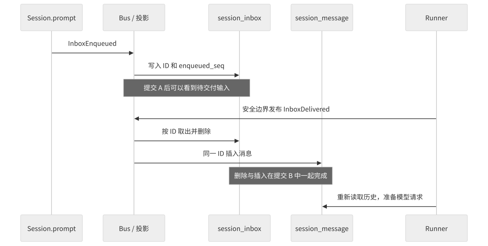

1. **接收时。** `InboxEnqueued` 投影在 `session_inbox` 插入一行，`enqueued_seq` 为接收事件的序号。选择 `queue` 的输入可以待在这里，直到运行器抵达允许的交付边界。[接收投影](https://github.com/anomalyco/opencode/blob/ee5fe34e136488a1839ac73bcca8321c51a31b75/packages/core/src/session/projector.ts#L1040-L1050) · [首条排队输入选择](https://github.com/anomalyco/opencode/blob/ee5fe34e136488a1839ac73bcca8321c51a31b75/packages/core/src/session/inbox.ts#L470-L499)
2. **交付时。** `InboxDelivered` 的投影先执行删除并返回待交付行，再用它的内容插入 `session_message`。用户与合成输入沿用原 ID，消息 `seq` 取本次**交付事件**序号。两个动作在同一事件事务内提交。若投影后续写入失败，整个事务回滚，待交付行也会回来。压缩、会话移动等控制项同样消耗待交付行，其各自的动作有自己的事件。[交付投影](https://github.com/anomalyco/opencode/blob/ee5fe34e136488a1839ac73bcca8321c51a31b75/packages/core/src/session/projector.ts#L1011-L1039) · [消费输入](https://github.com/anomalyco/opencode/blob/ee5fe34e136488a1839ac73bcca8321c51a31b75/packages/core/src/session/inbox.ts#L347-L375) · [消息序号写入](https://github.com/anomalyco/opencode/blob/ee5fe34e136488a1839ac73bcca8321c51a31b75/packages/core/src/session/projector.ts#L801-L820) · [控制项交付](https://github.com/anomalyco/opencode/blob/ee5fe34e136488a1839ac73bcca8321c51a31b75/packages/core/src/session/runner/llm.ts#L91-L117)
3. **读取时。** 历史按消息 `seq` 排序。同一个 ID 可以连接接收和交付，仍需用序号判断消息何时对历史查询可见。重放测试从保留的接收事件重建待交付行，断言消息历史为空，执行唤醒也为空。重新得到待办记录，并没有自动开始推进它。[历史排序](https://github.com/anomalyco/opencode/blob/ee5fe34e136488a1839ac73bcca8321c51a31b75/packages/core/src/session/history.ts#L204-L213) · [待交付重投影测试](https://github.com/anomalyco/opencode/blob/ee5fe34e136488a1839ac73bcca8321c51a31b75/packages/core/test/session-prompt.test.ts#L1156-L1211)

### 4 · 存储形状会演进，读取语义可以保持稳定

一个助手消息可以先有文字，再提出工具调用，最后填入对应结果。常规助手更新在 `experimental.part_rows` 未设为 false 时使用分段写入。`session_message` 保存消息主体与元数据，`session_part` 保存内容分段，工具结果可更新对应 part。旧的整条内联消息仍能读出来。如果一条消息既有 part 行，又有旧版写入的内联内容，读取端依次拼接分段与内联内容，然后恢复媒体引用。通过测试切换三次存储配置，最终读到的回复仍等价。[写入适配器选择](https://github.com/anomalyco/opencode/blob/ee5fe34e136488a1839ac73bcca8321c51a31b75/packages/core/src/session/projector.ts#L316-L343) · [历史读时组装](https://github.com/anomalyco/opencode/blob/ee5fe34e136488a1839ac73bcca8321c51a31b75/packages/core/src/session/history.ts#L90-L124) · [跨存储形状验证](https://github.com/anomalyco/opencode/blob/ee5fe34e136488a1839ac73bcca8321c51a31b75/packages/core/test/session-projector.test.ts#L2581-L2612)

媒体也有同类边界。原版测试把同一张截图附上两次，又让工具返回相同字节。打开 `experimental.media_blob` 后，待交付投影、用户消息、工具 part 中都可看到 `media:<hash>`。`blob` 表只有一份该媒体字节。历史读取再把引用恢复为文件内容。这里的去重结论针对投影中的 blob 存储，历史事件负载保留是另一层配置。[媒体去重与恢复验证](https://github.com/anomalyco/opencode/blob/ee5fe34e136488a1839ac73bcca8321c51a31b75/packages/core/test/session-projector.test.ts#L1470-L1562)

### 在 Notebook 里观察四件事

| 案例 | 观察和判断 |
|---|---|
| **队列中的补充检查** | 运行原版交付测试，按同一个 ID 查看两张表。交付后 Inbox 行消失，用户消息行的 `seq` 等于交付事件序号。业务对应场景是合规核查的补充说明从排队进入历史。[交付断言](https://github.com/anomalyco/opencode/blob/ee5fe34e136488a1839ac73bcca8321c51a31b75/packages/core/test/session-projector.test.ts#L351-L375) |
| **分段保存的编码回复** | 比较全程启用 part、全程关闭 part 和中途切换三条路径。猜测历史 API 会不会因此返回三个不同结果，再检查上游断言。[分段兼容测试](https://github.com/anomalyco/opencode/blob/ee5fe34e136488a1839ac73bcca8321c51a31b75/packages/core/test/session-projector.test.ts#L2581-L2612) |
| **两份截图和一个工具输出** | 看哪个表只有一份二进制，哪个表记录使用处。再确认模型读取时得到的是可用文件内容。[媒体引用测试](https://github.com/anomalyco/opencode/blob/ee5fe34e136488a1839ac73bcca8321c51a31b75/packages/core/test/session-projector.test.ts#L1470-L1562) |
| **重放排队中的审批备注** | 原版测试依序重放保存的普通与合成输入事件。观察待交付行重新出现时，模型是否随之执行。审批备注是对测试的业务类比，测试输入为 `Replay pending` 和 `Replay synthetic`。[重放用例](https://github.com/anomalyco/opencode/blob/ee5fe34e136488a1839ac73bcca8321c51a31b75/packages/core/test/session-prompt.test.ts#L1156-L1211) |

**自测。** 找到一个 Session 的用户消息行、一个仍为 running 的后台 Job，以及一个非空 `time_suspended`。分别说明它们证明了什么。下一章再看进程启动时，恢复程序如何为这些记录选择继续执行、补发报告或留在待交付状态。

#### 沿同一个 ID 看实际的两次提交

用上游的录制问候实验，先以 `resume: false` 提交，再显式恢复。第一次采样时，`session_inbox` 有一行，`enqueued_seq=0`，消息表为空。运行结束时，inbox 清空，同一个 ID 已成为 `session_message` 中的用户消息，消息序号为 2。序号 1 属于中间提交的指令更新事件。助手消息序号为 3。这些数来自开启事件载荷留存的课堂用例，可以在 Notebook 里同时对照行状态与事件顺序。

### 原版实跑结果

| 案例 | 运行时断言 | 结果 |
|---|---|---|
| [接收问候后显式恢复](https://github.com/anomalyco/opencode/blob/ee5fe34e136488a1839ac73bcca8321c51a31b75/packages/core/test/session-runner-recorded.test.ts#L185) | resume:false 先接收输入，显式 resume 后投影用户和助手消息，模型回复来自原版 HTTP 录制。 | 1 通过 |
| [交付同一条输入并保持顺序](https://github.com/anomalyco/opencode/blob/ee5fe34e136488a1839ac73bcca8321c51a31b75/packages/core/test/session-projector.test.ts#L351) | 输入投影消费待处理行，消息和历史按聚合序号排序。 | 2 通过 |
| [重放输入投影不启动 Runner](https://github.com/anomalyco/opencode/blob/ee5fe34e136488a1839ac73bcca8321c51a31b75/packages/core/test/session-prompt.test.ts#L1156) | 项目重放可重建待交付内容，重放本身不调度执行。 | 1 通过 |
| [助手子项和媒体引用](https://github.com/anomalyco/opencode/blob/ee5fe34e136488a1839ac73bcca8321c51a31b75/packages/core/test/session-projector.test.ts#L1470) | 切换 part_rows 仍读取到同一条回复。开启 media_blob 后，多类会话对象通过引用使用同一份媒体内容。 | 2 通过 |

[打开 Jupyter 实验](notebooks/09-projections-storage.ipynb) · [逐案例实跑记录](fixtures/storage-cases.json) · [实际 SQLite 行](fixtures/storage-observations.json)

<a id="10-restart-recovery"></a>

## 10 · OpenCode 重启后，从哪里接上

假设 OpenCode 正在核对一份采购文件。主 Agent 等待测试命令，子 Agent 已经交了报告，但父会话还没收到。这时服务关闭或进程崩溃。下一次启动应该续跑会话、接回正在执行的命令，还是只补送报告？要回答这个问题，先找**最后一次已提交的状态**，再确定**哪个运行时负责接续**。


### 1 · 启动时扫的是遗留执行和待处理 Job

一次 Session 执行开始时，协调器发布 `Execution.Started`。同一数据库事务里的提交钩子写入 `session_v2.time_suspended`。字段叫 `time_suspended` 是历史原因，**从执行开始并仍在正常运行时就已经写入**。运行中有进程内协调器负责串行化，持久标记让接任进程知道这段工作可能需要继续。正常完成、失败和用户停止走终态提交，清空此字段并将 `resume_attempts` 重置为零。服务关闭可以发布 `Execution.Interrupted`，原因是 `shutdown`，同时保留标记和正在运行的 Job。进程突然退出时，开始事务留下的标记仍然是恢复依据。[写入开始标记与终态分支](https://github.com/anomalyco/opencode/blob/ee5fe34e136488a1839ac73bcca8321c51a31b75/packages/core/src/session/execution.ts#L138-L175) · [字段与读写](https://github.com/anomalyco/opencode/blob/ee5fe34e136488a1839ac73bcca8321c51a31b75/packages/core/src/session/store.ts#L245-L300)

恢复入口 `SessionRestart.resumeSuspendedSessions` 读取仍有执行标记的 Session 和持久化的后台 Job。托管服务启动时会开启这次扫描。嵌入式 `ServerFetch` 也会启动它。托管协议的前提是旧进程已退出，并由服务注册协调接任者。扫描避开当前协调器仍在运行的 Session，也会清理已经没有父会话的子执行标记。这里的执行标记表达上次工作是否仍待结算。第 08 章的事件回放 owner 约束谁能写入同步事件序列，两者各有用途。[恢复前提与入口](https://github.com/anomalyco/opencode/blob/ee5fe34e136488a1839ac73bcca8321c51a31b75/packages/core/src/session/execution/restart.ts#L52-L80) · [托管入口](https://github.com/anomalyco/opencode/blob/ee5fe34e136488a1839ac73bcca8321c51a31b75/packages/server/src/process.ts#L115-L132) · [嵌入式入口](https://github.com/anomalyco/opencode/blob/ee5fe34e136488a1839ac73bcca8321c51a31b75/packages/server/src/fetch.ts#L38-L51) · [初始扫描](https://github.com/anomalyco/opencode/blob/ee5fe34e136488a1839ac73bcca8321c51a31b75/packages/core/src/session/execution/restart.ts#L427-L451)

### 2 · 先判断遗留的是执行、命令，还是通知

| 服务重启时留下什么 | 先去哪读 | 接下来的动作 |
|---|---|---|
| 普通会话或直接驱动的子会话尚未结算 | `session_v2.time_suspended`、`resume_attempts`，再读取会话投影 | 先记入一次恢复尝试，写入「Continuing after restart」的合成消息，再启动 Session 执行。Runner 从已提交的历史继续，可将仍显示运行中的未结算工具调用标记为中断。 |
| 后台 shell 有原来的命令记录 | `job.recovery` 中的 shell ID、守护进程的命令状态 | 重新挂接同一条命令，继续等待，或读取重启期间已退出的结果。若先前会话还在等一个前台 shell，可根据原工具调用识别存活命令，先把工具调用结算为已移到后台，再恢复会话。 |
| 后台 shell 的命令已丢失，或有可补送的工具终态 | `job` 中的恢复资料、结果和 `notification_id` | 以稳定通知 ID 写入所有者的 Inbox。失去命令的情况报告取消，已经有终态时沿用该结果。纯补送工具结果可以只入队而保持空闲会话安静。 |
| 子 Agent 的 Job 仍在运行 | `job.status`、子 Session 及父子归属 | 由 `SubagentJob` 接回子 Session 的运行，子会话结算后走原有报告流程。父子归属失效时会清理报告义务。 |
| 子 Agent 终态已提交，报告未确认送达 | `job` 的结果和 `notification_id` | 把现成报告投递为父会话的合成输入，投递成功后确认。用同一消息 ID 处理上次已准入或已投影的情况。子会话的执行无需再启动。 |
| 用户取消已持久化 | Session 终态或 Job 的取消记录 | 释放遗留标记并按需报告。即使旧进程恰好停在「Job 取消已落库、还没来得及打断执行」之间，启动扫描也会处理这条取消记录。 |

[一般会话记账和续跑](https://github.com/anomalyco/opencode/blob/ee5fe34e136488a1839ac73bcca8321c51a31b75/packages/core/src/session/execution/restart.ts#L101-L123) · [Runner 结算未完成调用](https://github.com/anomalyco/opencode/blob/ee5fe34e136488a1839ac73bcca8321c51a31b75/packages/core/src/session/runner/llm.ts#L420-L443) · [shell 重挂接和前台调用结算](https://github.com/anomalyco/opencode/blob/ee5fe34e136488a1839ac73bcca8321c51a31b75/packages/core/src/session/execution/restart.ts#L263-L344) · [工具通知与确认](https://github.com/anomalyco/opencode/blob/ee5fe34e136488a1839ac73bcca8321c51a31b75/packages/core/src/session/execution/restart.ts#L183-L222) · [子 Agent 分支与取消记录](https://github.com/anomalyco/opencode/blob/ee5fe34e136488a1839ac73bcca8321c51a31b75/packages/core/src/session/execution/restart.ts#L390-L451)

前台调用这条路径有两个层次。**旧工具调用的 `completed` 可以表示「已成功交给后台」，它对应的命令仍可在运行**。等到收到后续 shell 通知，才知道命令最终成功、失败还是取消。测试给出两种时间线：命令在重启间隙完成，或新会话恢复时命令仍在运行。两条路径都用同一个原命令。命令消失、工作目录消失或没有可接回的句柄时，行为以保存的事实为准。[真实恢复路径的测试断言](https://github.com/anomalyco/opencode/blob/ee5fe34e136488a1839ac73bcca8321c51a31b75/packages/core/test/shell-restart.test.ts#L120-L201) · [找不到命令时的分支](https://github.com/anomalyco/opencode/blob/ee5fe34e136488a1839ac73bcca8321c51a31b75/packages/core/src/session/execution/restart.ts#L125-L145)

### 3 · 恢复次数在运行之前入账

`prepareResume` 先递增并写入 `resume_attempts`，再判断是否继续。本版本默认允许同一段执行恢复 **10 次**，超过预算发布 `Execution.Failed`，并通过同一提交释放标记、清零计数。测试把上限降为两次，便于观察。计数针对这段未结算的执行。假如新进程刚开始恢复又崩溃，标记和本次新增计数都还在。下次启动会接着计数。进程内协调器可以合并并发恢复请求。跨进程崩溃后，执行恢复按「至少一次」设计，某些外部副作用可能再次发生。[默认预算与至少一次语义](https://github.com/anomalyco/opencode/blob/ee5fe34e136488a1839ac73bcca8321c51a31b75/packages/core/src/session/execution/restart.ts#L38-L78) · [超限结算](https://github.com/anomalyco/opencode/blob/ee5fe34e136488a1839ac73bcca8321c51a31b75/packages/core/src/session/execution/restart.ts#L101-L123)

扫描还要安排**父子会话的唤醒时机**。它先尝试恢复工具结果和未结算的 shell 调用，再准备子 Job 和普通 Session 的恢复。在所有候选尝试先记账之后，才启动恢复执行和子 Job。扫描期间产生的通知可先准入 Inbox，唤醒则视接收者是否已列入计划而延后。否则，一个刚恢复的子 Agent 如果立刻完成，父会话可能先被它的报告唤醒，绕过本该计入的恢复次数。[延后的通知](https://github.com/anomalyco/opencode/blob/ee5fe34e136488a1839ac73bcca8321c51a31b75/packages/core/src/session/execution/restart.ts#L448-L473) · [各阶段启动顺序](https://github.com/anomalyco/opencode/blob/ee5fe34e136488a1839ac73bcca8321c51a31b75/packages/core/src/session/execution/restart.ts#L478-L539) · [快速子任务顺序断言](https://github.com/anomalyco/opencode/blob/ee5fe34e136488a1839ac73bcca8321c51a31b75/packages/core/test/session-execution.test.ts#L1861-L1928)

### 4 · 用三个崩溃时点读懂 outbox


1. **终态事务还没提交。** 旧进程留下未释放的执行标记，或者留下仍运行的 Job。重启会根据这些持久化的状态安排继续或取消。
2. **终态已提交，通知还没准入。** 子会话的终态、释放执行标记和保存待投递报告一起提交。重启可以读取报告内容并补送，原来那段子工作已经结算。
3. **通知已经准入或投影，报告还没确认。** 恢复会沿用同一个 `notification_id`。Inbox 能识别同 ID、同会话、同类型的已接收输入，或查到已经交付的投影。遇到 ID 真冲突会保留 outbox 标记，便于排查或下次重试。

这里可以验证**该报告在父会话中只交付一次**。一个 HTTP 请求或 shell 命令已产生外部效果、结果却来不及持久化时，数据库只能看到它最后一次提交的位置。任务需要强副作用约束时，仍要靠工具方识别重复执行。仅有会话历史，也无法复原旧进程的内存堆栈或接续已经断掉的模型流。[报告在终态事务内写入](https://github.com/anomalyco/opencode/blob/ee5fe34e136488a1839ac73bcca8321c51a31b75/packages/core/src/session/execution/subagent-report.ts#L150-L195) · [通知 ID 与确认](https://github.com/anomalyco/opencode/blob/ee5fe34e136488a1839ac73bcca8321c51a31b75/packages/core/src/session/subagent-completion.ts#L57-L86) · [已送达报告的补偿测试](https://github.com/anomalyco/opencode/blob/ee5fe34e136488a1839ac73bcca8321c51a31b75/packages/core/test/session-execution.test.ts#L1617-L1664) · [恢复边界](https://github.com/anomalyco/opencode/blob/ee5fe34e136488a1839ac73bcca8321c51a31b75/packages/core/src/session/execution/restart.ts#L63-L78)

### 5 · 在 Notebook 里观察持久证据

| 场景 | 原版测试里要找的证据 |
|---|---|
| 服务关闭与用户取消 | 工作中两条 Session 都有 claim，正常完成的清掉，关闭作用域的保留。用户中断结算后 claim 被清掉。[开始与结算](https://github.com/anomalyco/opencode/blob/ee5fe34e136488a1839ac73bcca8321c51a31b75/packages/core/test/session-execution.test.ts#L129-L173) · [用户中断](https://github.com/anomalyco/opencode/blob/ee5fe34e136488a1839ac73bcca8321c51a31b75/packages/core/test/session-execution.test.ts#L176-L196) |
| 恢复再次中断，或预算用尽 | 新 Runner 启动前数据库已有 `resume_attempts=1`。超限例里 Runner 没开始，记录 `aborted`，标记和计数均清零。[尝试持久化](https://github.com/anomalyco/opencode/blob/ee5fe34e136488a1839ac73bcca8321c51a31b75/packages/core/test/session-execution.test.ts#L471-L498) · [超限](https://github.com/anomalyco/opencode/blob/ee5fe34e136488a1839ac73bcca8321c51a31b75/packages/core/test/session-execution.test.ts#L444-L468) |
| 补送子 Agent 的完成报告 | 只有父会话进入后续执行，父 Inbox 可读到原报告，待投递记录随后清掉。[原版案例](https://github.com/anomalyco/opencode/blob/ee5fe34e136488a1839ac73bcca8321c51a31b75/packages/core/test/session-execution.test.ts#L1467-L1520) |
| 前台 shell 跨重启 | 两个服务作用域共享同一测试数据库。对照「命令在间隙退出」和「命令仍运行」，观察同一个 shell ID 的后台交接和后续通知。[测试环境](https://github.com/anomalyco/opencode/blob/ee5fe34e136488a1839ac73bcca8321c51a31b75/packages/core/test/shell-restart.test.ts#L54-L101) · [两个变体](https://github.com/anomalyco/opencode/blob/ee5fe34e136488a1839ac73bcca8321c51a31b75/packages/core/test/shell-restart.test.ts#L120-L201) |

这些测试走原版恢复代码。`session-execution.test.ts` 构建真实协调器、存储和恢复服务，用可控 Runner 记录启动顺序，并通过作用域关闭或预置行复现故障后的状态。`shell-restart.test.ts` 运行两套原版服务作用域，共用数据库，并用 `TestLLM` 和模拟守护进程制造时序。测试保护的是恢复条件、数据落点和处理先后。[恢复测试装配](https://github.com/anomalyco/opencode/blob/ee5fe34e136488a1839ac73bcca8321c51a31b75/packages/core/test/session-execution.test.ts#L2176-L2226) · [shell 测试替身](https://github.com/anomalyco/opencode/blob/ee5fe34e136488a1839ac73bcca8321c51a31b75/packages/core/test/shell-restart.test.ts#L54-L102)

**自测。** 子 Agent 的报告已在父 Inbox，outbox 行却还留着。你会比较哪个 ID？下次启动要恢复的是报告投递还是子 Agent 执行？再想一层，如果模型先前调用的是有外部副作用的工具，哪一份证据才能让你确认无需再执行？

#### 文件库里的实际恢复结果

本章另在原版测试的临时副本中使用隔离的文件 SQLite，对两个不同的恢复起点采样。仍在运行的子 Job 在扫描后维持 claim，恢复次数从 0 增到 1。结算后释放 claim、清零恢复计数，并向父 Inbox 写入一条合成输入。已经完成、只等补送的报告在扫描前没有子 claim，Job 行为 `completed`。扫描后只推进父 Session，待投递 Job 行清理，父 Inbox 新增一条通知。

Bun 退出后，用只读 SQLite 连接重新打开同一个文件，仍能看到这两条待交付通知。**通知已落库和父 Agent 已处理通知是两个时点**。这里验证了落库。恢复扫描发生在上游测试宿主内，崩溃时点通过测试控制。

### 原版实跑结果

| 案例 | 运行时断言 | 结果 |
|---|---|---|
| [运行认领：用户中断与服务关闭](https://github.com/anomalyco/opencode/blob/ee5fe34e136488a1839ac73bcca8321c51a31b75/packages/core/test/session-execution.test.ts#L129) | 正常结束和用户中断释放认领，服务 Scope 关闭保留未完工作的认领。 | 2 通过 |
| [后台子 Agent 仍在运行](https://github.com/anomalyco/opencode/blob/ee5fe34e136488a1839ac73bcca8321c51a31b75/packages/core/test/session-execution.test.ts#L1386) | 恢复扫描再次计入运行尝试，只恢复一次子执行，最后只给父会话一份报告。 | 1 通过 |
| [报告已完成，退出发生在投递之前](https://github.com/anomalyco/opencode/blob/ee5fe34e136488a1839ac73bcca8321c51a31b75/packages/core/test/session-execution.test.ts#L1523) | 待投递报告可直接补发，已交付的报告可对账。子 Session 不需要为生成报告再运行一次。 | 2 通过 |
| [恢复预算与显式取消](https://github.com/anomalyco/opencode/blob/ee5fe34e136488a1839ac73bcca8321c51a31b75/packages/core/test/session-execution.test.ts#L1808) | 预算耗尽走失败终态，已经持久化的取消仍然有效。 | 2 通过 |
| [前台 Shell 已经退出，恢复后的 Session 怎样继续](https://github.com/anomalyco/opencode/blob/ee5fe34e136488a1839ac73bcca8321c51a31b75/packages/core/test/shell-restart.test.ts#L122) | 测试宿主更换服务 Scope，通过测试守护进程恢复工具结果，再推进会话。 | 2 通过 |

[打开 Jupyter 实验](notebooks/10-restart-recovery.ipynb) · [逐案例实跑记录](fixtures/storage-cases.json) · [实际 SQLite 行](fixtures/storage-observations.json)

<a id="11-context-history"></a>

## 11 · 上下文组装与历史选择

采购核查进行到第十轮，你问「按刚才发现的例外条款，重新判断交付期」。界面仍能向上滚到原文。模型这次能否引用它，要检查三个位置：**已存的完整记录、供当前模型继续的历史窗口、本步组装的模型请求。**


### 1 · 从 Location 得到指令和工具，从 Session 得到历史

`SessionContext.select()` 按 Session 当前的 Location 找到 Agent，合并 Agent 与 Session 权限，生成工具快照。它同时收集 Code Mode 目录、MCP、引用、技能、机器、项目发现、内置环境说明和会话专属条目等可变化的指令源。指令按共享度排序，让跨会话可复用的部分尽量形成稳定前缀。工具的结构化定义与给模型读的目录描述各自进入请求。[选择 Agent、权限与工具](https://github.com/anomalyco/opencode/blob/ee5fe34e136488a1839ac73bcca8321c51a31b75/packages/core/src/session/context.ts#L148) · [收集与排序指令源](https://github.com/anomalyco/opencode/blob/ee5fe34e136488a1839ac73bcca8321c51a31b75/packages/core/src/session/context.ts#L178) · [最终请求字段](https://github.com/anomalyco/opencode/blob/ee5fe34e136488a1839ac73bcca8321c51a31b75/packages/core/src/session/model-request.ts#L341)

普通模型步骤先观察并提交指令变化，在安全边界交付输入，再用已解析的模型读取历史。`entriesForRunner()` 在同一数据库事务里读指令基线和按序消息，避免拼用不同读取时点的两份状态。发生模型重试时，Runner 会重新准备上下文和历史，本步的输入交付边界保持稳定。[准备与交付](https://github.com/anomalyco/opencode/blob/ee5fe34e136488a1839ac73bcca8321c51a31b75/packages/core/src/session/runner/llm.ts#L191) · [指令观察与重载](https://github.com/anomalyco/opencode/blob/ee5fe34e136488a1839ac73bcca8321c51a31b75/packages/core/src/session/runner/llm.ts#L227) · [解析模型后读取历史](https://github.com/anomalyco/opencode/blob/ee5fe34e136488a1839ac73bcca8321c51a31b75/packages/core/src/session/context.ts#L210) · [同一事务读取](https://github.com/anomalyco/opencode/blob/ee5fe34e136488a1839ac73bcca8321c51a31b75/packages/core/src/session/history.ts#L290)

### 2 · 指令同时有基线和时间顺序

首次观察为 Session 建立指令基线，保存初始值、当前值及其序号。后续来源变化提交为差异，包含正文的差异被投影成一条按序出现的 `system` 消息。请求因此既保留「这段会话从什么规则开始」，也说明「这一步之前哪条规则有了更新」。[提交指令差异](https://github.com/anomalyco/opencode/blob/ee5fe34e136488a1839ac73bcca8321c51a31b75/packages/core/src/session/instruction-state.ts#L38) · [指令状态表写入](https://github.com/anomalyco/opencode/blob/ee5fe34e136488a1839ac73bcca8321c51a31b75/packages/core/src/session/instruction-state.ts#L89) · [指令投影](https://github.com/anomalyco/opencode/blob/ee5fe34e136488a1839ac73bcca8321c51a31b75/packages/core/src/session/projector.ts#L1074) · [生成 system 消息](https://github.com/anomalyco/opencode/blob/ee5fe34e136488a1839ac73bcca8321c51a31b75/packages/core/src/session/message-updater.ts#L154)

原版测试将 `Initial context` 改为 `Changed context` 后，第二次请求的系统前缀仍是初始值，消息角色则变为 `user → system → user`。模型先读到变化再读到第二个提问，原来的前缀仍可复用。压缩成功时，投影器将**已经提交的**当前指令值折入新基线，后续读取会隐藏已被基线涵盖的更新。手动压缩先预览已结算历史，刚观察到的源变化仍可在后续普通步骤中按序入账。[稳定前缀测试](https://github.com/anomalyco/opencode/blob/ee5fe34e136488a1839ac73bcca8321c51a31b75/packages/core/test/session-runner.test.ts#L1993) · [压缩完成投影](https://github.com/anomalyco/opencode/blob/ee5fe34e136488a1839ac73bcca8321c51a31b75/packages/core/src/session/projector.ts#L1121) · [折入新基线](https://github.com/anomalyco/opencode/blob/ee5fe34e136488a1839ac73bcca8321c51a31b75/packages/core/src/session/instruction-state.ts#L126) · [筛选已归并的指令](https://github.com/anomalyco/opencode/blob/ee5fe34e136488a1839ac73bcca8321c51a31b75/packages/core/src/session/history.ts#L225) · [手动压缩预览](https://github.com/anomalyco/opencode/blob/ee5fe34e136488a1839ac73bcca8321c51a31b75/packages/core/src/session/runner/llm.ts#L129)

### 3 · 从最近一个可用检查点读起

历史查询先在 `session_message` 中找最近一个**已成功且适合本次读取边界**的压缩记录，再读该记录及之后的行。失败或处理中记录保留自己的状态，最新完成记录仍然提供读取边界。[边界类型](https://github.com/anomalyco/opencode/blob/ee5fe34e136488a1839ac73bcca8321c51a31b75/packages/core/src/session/history.ts#L27) · [选择压缩记录](https://github.com/anomalyco/opencode/blob/ee5fe34e136488a1839ac73bcca8321c51a31b75/packages/core/src/session/history.ts#L55) · [按序读取](https://github.com/anomalyco/opencode/blob/ee5fe34e136488a1839ac73bcca8321c51a31b75/packages/core/src/session/history.ts#L193)

| 读取方式 | 选择规则 | 用途 |
|---|---|---|
| `latest` | 选最近完成的压缩，包括原生压缩 | 无需先选模型的 Session 历史视图 |
| `local` | 只有本地文本摘要可以切开历史 | 需要可移植文本，例如原生 trigger 压缩时选择近期真实用户消息 |
| 目标模型引用 | 文本摘要可用。原生窗口须出自同一 provider 和模型 ID，并通过解码 | Runner 为当前模型取得历史 |

[通用视图](https://github.com/anomalyco/opencode/blob/ee5fe34e136488a1839ac73bcca8321c51a31b75/packages/core/src/session/store.ts#L206) · [原生窗口过滤](https://github.com/anomalyco/opencode/blob/ee5fe34e136488a1839ac73bcca8321c51a31b75/packages/core/src/session/history.ts#L40) · [选择真实用户消息](https://github.com/anomalyco/opencode/blob/ee5fe34e136488a1839ac73bcca8321c51a31b75/packages/core/src/session/compaction.ts#L575)

**本地摘要**可带 `metadata.keepID`。读取时取从这个 ID 到压缩边界之前的行，在内存里重建近期文字。检查点会变成一条用户角色的历史消息，里面的 `<summary>` 放摘要，`<recent-context>` 放序列化后的近期文字。压缩之后的新消息则以各自的角色接在后面。旧版本直接保存的 `recent` 文本也可读取。[近期尾部重建](https://github.com/anomalyco/opencode/blob/ee5fe34e136488a1839ac73bcca8321c51a31b75/packages/core/src/session/history.ts#L241) · [检查点请求格式](https://github.com/anomalyco/opencode/blob/ee5fe34e136488a1839ac73bcca8321c51a31b75/packages/core/src/session/runner/to-llm-message.ts#L292)

**原生检查点**保存模型专用的重放窗口。trigger 路径把近期真实用户消息和服务商返回的检查点合在一起。endpoint 路径沿用服务商给出的替换窗口。换了 provider 或模型 ID，或窗口无法解码，读取会回到更早可用的原生检查点、本地摘要或原始历史。换模型因此可能使输入变长，下一步会按新模型重新估算。[窗口组成](https://github.com/anomalyco/opencode/blob/ee5fe34e136488a1839ac73bcca8321c51a31b75/packages/core/src/session/compaction.ts#L543) · [两种原生调用方式](https://github.com/anomalyco/opencode/blob/ee5fe34e136488a1839ac73bcca8321c51a31b75/packages/core/src/session/compaction.ts#L575) · [解码回退](https://github.com/anomalyco/opencode/blob/ee5fe34e136488a1839ac73bcca8321c51a31b75/packages/core/src/session/history.ts#L220) · [兼容检查点测试](https://github.com/anomalyco/opencode/blob/ee5fe34e136488a1839ac73bcca8321c51a31b75/packages/core/test/session-native.test.ts#L312) · [损坏检查点回退测试](https://github.com/anomalyco/opencode/blob/ee5fe34e136488a1839ac73bcca8321c51a31b75/packages/core/test/session-native.test.ts#L345)

### 4 · 选中的历史再经过请求转换

`baseTranscript()` 将 Agent 系统提示和指令基线放入 `system`，再将历史转换成统一的消息对象。空闲标记不发送，后台 shell 的信息通过完成通知进入上下文。正常的工具调用和结果保留结构，失败或中断的助手内容按已经发生的步骤裁剪。原生元数据能否沿用，则取决于目标模型或 provider。[基础请求](https://github.com/anomalyco/opencode/blob/ee5fe34e136488a1839ac73bcca8321c51a31b75/packages/core/src/session/model-request.ts#L111) · [助手消息和工具回放](https://github.com/anomalyco/opencode/blob/ee5fe34e136488a1839ac73bcca8321c51a31b75/packages/core/src/session/runner/to-llm-message.ts#L146) · [会话消息分流](https://github.com/anomalyco/opencode/blob/ee5fe34e136488a1839ac73bcca8321c51a31b75/packages/core/src/session/runner/to-llm-message.ts#L245)

随后 `context` hook 可以调整草稿。运行时移除仅供 hook 使用的会话元数据，将模型不支持的媒体替换成文字提示，并在内联图像达到请求大小阈值时用提示替换较早的一批图像。要精确回答「模型看到了什么」，先查发送前的 `LLMRequest`，需要确认协议时再看服务商适配器编译后的请求体。原生压缩测试就直接检查后续请求体同时包含检查点 `encrypted_1`、当前指令和新用户输入。[请求 Hook](https://github.com/anomalyco/opencode/blob/ee5fe34e136488a1839ac73bcca8321c51a31b75/packages/core/src/session/model-request.ts#L468) · [媒体适配](https://github.com/anomalyco/opencode/blob/ee5fe34e136488a1839ac73bcca8321c51a31b75/packages/core/src/session/model-request.ts#L222) · [构造发送对象](https://github.com/anomalyco/opencode/blob/ee5fe34e136488a1839ac73bcca8321c51a31b75/packages/core/src/session/model-request.ts#L325) · [原版请求体断言](https://github.com/anomalyco/opencode/blob/ee5fe34e136488a1839ac73bcca8321c51a31b75/packages/core/test/session-native-compaction.test.ts#L266)

### 5 · 从长材料里确认保留下来的证据

把长采购核查想成三类输入：第一轮的任务范围、最近几次工具读到的原文和页码，以及先前附上的扫描件。压缩后，第一轮信息可能只有摘要，过长工具输出在近期文本里可能只留开头，附件也可能只留下 MIME 类型和文件名。近期文本会略去推理内容并截断长工具输出。如果模型要精确核对第 17 页例外条款，可以让它重新读该页。**文件可查**和**原文在当前请求中**是两个需要独立核对的条件。[近期文本规则](https://github.com/anomalyco/opencode/blob/ee5fe34e136488a1839ac73bcca8321c51a31b75/packages/core/src/session/recent-text.ts#L15) · [工具结果序列化](https://github.com/anomalyco/opencode/blob/ee5fe34e136488a1839ac73bcca8321c51a31b75/packages/core/src/session/recent-text.ts#L39) · [输出截断](https://github.com/anomalyco/opencode/blob/ee5fe34e136488a1839ac73bcca8321c51a31b75/packages/core/src/session/recent-text.ts#L72) · [尾部附件读取](https://github.com/anomalyco/opencode/blob/ee5fe34e136488a1839ac73bcca8321c51a31b75/packages/core/src/session/history.ts#L276)

| Notebook 观察 | 要核对的证据 |
|---|---|
| 长会话中有多次压缩和一次失败 | 最新成功 checkpoint 切出供模型读取的后缀。早期数据库行仍存在，甚至可以用测试中的坏行确认早期数据不会进入这次解码。[成功边界测试](https://github.com/anomalyco/opencode/blob/ee5fe34e136488a1839ac73bcca8321c51a31b75/packages/core/test/session-compaction.test.ts#L270) · [历史后缀测试](https://github.com/anomalyco/opencode/blob/ee5fe34e136488a1839ac73bcca8321c51a31b75/packages/core/test/session-compaction.test.ts#L303) |
| 会话进行中变化了项目指令 | 对照初始系统前缀与 `user → system → user` 的时间顺序。查看压缩后新指令怎样进入下一次请求。[指令前缀测试](https://github.com/anomalyco/opencode/blob/ee5fe34e136488a1839ac73bcca8321c51a31b75/packages/core/test/session-runner.test.ts#L1993) · [指令 epoch 测试](https://github.com/anomalyco/opencode/blob/ee5fe34e136488a1839ac73bcca8321c51a31b75/packages/core/test/session-runner.test.ts#L2553) |
| 换模型后检查点还能否使用 | 对照兼容模型重放原生窗口、不兼容模型从更早的检查点或历史恢复。[原生历史兼容性测试](https://github.com/anomalyco/opencode/blob/ee5fe34e136488a1839ac73bcca8321c51a31b75/packages/core/test/session-native.test.ts#L224) · [原生检查点回退测试](https://github.com/anomalyco/opencode/blob/ee5fe34e136488a1839ac73bcca8321c51a31b75/packages/core/test/session-native.test.ts#L312) |
| 扫描图片作为工具结果 | 近期文字里保留图片名称和 MIME 类型，查询得到的内联 base64 不进入这段历史文字。[媒体文本化测试](https://github.com/anomalyco/opencode/blob/ee5fe34e136488a1839ac73bcca8321c51a31b75/packages/core/test/session-compaction.test.ts#L140) |

#### 实测 · 库里有六条，主请求历史只接两条

在上游历史选择案例中，会话原来有六条记录。最新成功的本地摘要指向「Kept question」，摘要后还有「After」。实验故意把切点前的旧行改成不可解码数据，用来验证读取是否真正跳过它们。最后进入模型历史的是两条消息：一条带摘要和 `<recent-context>` 的检查点，其中仍有「Kept question」，另一条是后续的「After」。系统片段和工具定义由主请求的其他部分提供。Notebook 会显示被跳过的 ID、`keepID` 与转成模型格式后的消息文本。

### 原版实跑结果

| 案例 | 运行时断言 | 结果 |
|---|---|---|
| [长会话：定位最后一个成功压缩点](https://github.com/anomalyco/opencode/blob/ee5fe34e136488a1839ac73bcca8321c51a31b75/packages/core/test/session-compaction.test.ts#L270) | 有失败记录时仍采用上一份成功检查点，keepID 尾部参与窗口，窗口前旧行不进入模型读取。 | 2 通过 |
| [切换模型：回退到兼容的检查点](https://github.com/anomalyco/opencode/blob/ee5fe34e136488a1839ac73bcca8321c51a31b75/packages/core/test/session-native.test.ts#L312) | 遇到不兼容或无法解码的原生窗口时，读取路径回退并保留可发送历史。 | 2 通过 |
| [长会话中途改项目指令](https://github.com/anomalyco/opencode/blob/ee5fe34e136488a1839ac73bcca8321c51a31b75/packages/core/test/session-runner.test.ts#L1993) | 未压缩时初始指令保持稳定，新增变化按时序叙述；压缩完成后新的指令 epoch 接管。 | 2 通过 |

[打开 Jupyter 实验](notebooks/11-context-history.ipynb) · [逐案例实跑记录](fixtures/context-cases.json) · [模型请求与预算观测](fixtures/context-observations.json)

<a id="12-token-budget"></a>

## 12 · Token 预算与压缩触发

同一份长采购文件，在 100,000 Token 的窗口里可能触发压缩，在 272,000 Token 的输入额度里可能照常发送。即使本地估算显示请求能发，供应商也可能因为自己的计数规则拒绝。OpenCode 因此分别处理三个量：**请求大小估算、自动压缩触发线、该次生成的输出上限**。在 Notebook 中可以逐个跨过临界点，观察下一条请求走哪条路。


### 1 · 先算窗口，再算自动压缩触发线

设 `W` 为有效输入窗口。目录中 `limit.input` 和 `limit.context` 都有正值时取较小者。只有一个已知值时采用该值。两者都未知时，自动触发线为无穷大，仍可手动压缩或在收到供应商的溢出错误后恢复。构造压缩请求时需要尺寸目标，如果选定模型的窗口未知，代码会以 `context=200_000` 代入容量计算。[有效窗口与触发线](https://github.com/anomalyco/opencode/blob/ee5fe34e136488a1839ac73bcca8321c51a31b75/packages/core/src/session/compaction.ts#L1146-L1174) · [压缩请求的模型与尺寸目标](https://github.com/anomalyco/opencode/blob/ee5fe34e136488a1839ac73bcca8321c51a31b75/packages/core/src/session/compaction.ts#L274-L295) · [未知窗口溢出恢复断言](https://github.com/anomalyco/opencode/blob/ee5fe34e136488a1839ac73bcca8321c51a31b75/packages/core/test/session-runner.test.ts#L3944-L3959)

触发线 `C = W − bufferTokens`。有效的自定义 `compaction.buffer` 可以是非负整数，也可以是 `"25%"` 这样的字符串。百分比按 `W` 换算后四舍五入。留空或换算后的缓冲达到整个窗口时，采用默认缓冲：

```text
默认 bufferTokens = max(floor(W × 0.15), W ≥ 32,000 时取 16,000，否则取 0)
```

`limit.output` 单独参与输出上限的选择，所以调高输出上限不会移动这条触发线。小窗口在 `W < 32,000` 时只扣 15%，避免 16,000 的最低缓冲吃掉过多输入空间。独立的 `compaction.keep.tokens` 默认是 15,000，它是估算近期保留范围的预算。默认开启 `compaction.auto` 和 `compaction.background`。[配置约束](https://github.com/anomalyco/opencode/blob/ee5fe34e136488a1839ac73bcca8321c51a31b75/packages/schema/src/config/compaction.ts#L6-L27) · [运行时默认值](https://github.com/anomalyco/opencode/blob/ee5fe34e136488a1839ac73bcca8321c51a31b75/packages/core/src/session/compaction.ts#L122-L136) · [默认设置与获选模型](https://github.com/anomalyco/opencode/blob/ee5fe34e136488a1839ac73bcca8321c51a31b75/packages/core/src/session/compaction.ts#L264-L295)

| 目录尺寸或配置 | 有效窗口 | 首次达到自动触发线的估算值 |
|---|---:|---:|
| `context=400,000`，`input=272,000` | 272,000 | 231,200 |
| `context=128,000`，`input=272,000` | 128,000 | 108,800 |
| `context=100,000`，`output` 为 10,000 或 30,000 | 100,000 | 84,000 |
| `context=100,000`，`buffer="25%"` | 100,000 | 75,000 |
| `context=100,000`，`buffer=100,000` 回退到默认 | 100,000 | 84,000 |

前四种临界点分别在原版测试中用「少一个 Token」和「恰好达到门槛」验证。测试注入已测 usage 和目录上限，复现的是原版决策逻辑。[对应断言](https://github.com/anomalyco/opencode/blob/ee5fe34e136488a1839ac73bcca8321c51a31b75/packages/core/test/session-compaction.test.ts#L387-L470)

### 2 · 已测前缀加上未测增量

`estimatePrompt` 先找最近一条来自同一供应商、无错误、具备有效输入用量的助手回复。它的已测份额加总输入、缓存读写、输出和推理 Token，表示到该次回复为止运行时可借用的计数。后续新消息和该助手回复关联的本地工具结果按当前请求形状估算。工具结果已经写入会话，供应商在生成那次助手回复时尚未看到本地执行结果。原版测试给出很直观的一跳：上一条回复计数 89,000，新增 4,000 字符的工具结果，估算值变为 90,000。[估算与锚点条件](https://github.com/anomalyco/opencode/blob/ee5fe34e136488a1839ac73bcca8321c51a31b75/packages/core/src/session/compaction.ts#L1115-L1144) · [供应商用量约束](https://github.com/anomalyco/opencode/blob/ee5fe34e136488a1839ac73bcca8321c51a31b75/packages/core/src/session/compaction.ts#L1176-L1198) · [本地工具结果断言](https://github.com/anomalyco/opencode/blob/ee5fe34e136488a1839ac73bcca8321c51a31b75/packages/core/test/session-compaction.test.ts#L473-L500)

缺少有效锚点时，估算会覆盖系统指令、工具名称与描述、参数 schema、模型可发送的消息内容。文本按 JavaScript 字符串长度约每四个单位一个 Token，图片按 1,500，PDF 按 2,000。当前模型的模态支持与图片大小限制会先改变参与估算的内容，未知大小的加密压缩项本地无法量出。这个估算在请求钩子修改内容前进行。核查长 PDF 或由工具返回大量代码时，供应商实际长度仍可能高于估算。[文本估算器](https://github.com/anomalyco/opencode/blob/ee5fe34e136488a1839ac73bcca8321c51a31b75/packages/core/src/util/token.ts#L1-L5) · [媒体估算与构成](https://github.com/anomalyco/opencode/blob/ee5fe34e136488a1839ac73bcca8321c51a31b75/packages/core/src/session/compaction.ts#L1224-L1262) · [原版图片与 PDF 断言](https://github.com/anomalyco/opencode/blob/ee5fe34e136488a1839ac73bcca8321c51a31b75/packages/core/test/session-compaction.test.ts#L502-L529)

普通请求会用 `measured` 和 `estimated` 拟合输出上限。默认请求值采用目录的输出额度，缺失时为 32,000，最高 256,000。有已知总窗口和输入估算时，先留总窗口 1% 的余量，并给估算部分加 15% 的误差预算。最后取请求值与剩余空间两者的较小值，剩余空间按至少 1,024 处理。Hook 仍能调整默认输出上限，服务端也可能拒绝过长请求。[输出公式及常量](https://github.com/anomalyco/opencode/blob/ee5fe34e136488a1839ac73bcca8321c51a31b75/packages/core/src/session/model-request.ts#L54-L108) · [请求类型和 Hook](https://github.com/anomalyco/opencode/blob/ee5fe34e136488a1839ac73bcca8321c51a31b75/packages/core/src/session/model-request.ts#L295-L310)

```text
普通回复默认 maxTokens =
  min(目录输出额度或默认额度，max(1,024，floor(context × 0.99) − measured − ceil(estimated × 1.15)))
```

例如总窗口 100,000、目录输出 30,000，已测 75,000、新增估算 5,000。整体触发计算使用 80,000，低于默认 84,000，普通请求可继续。输出上限拟合为 `99,000 − 75,000 − 5,750 = 18,250`。这说明一轮可以同时处于「还没到触发线」和「回复额度已经缩小」两个状态。

### 3 · 形式相似的三条压缩路径

| 路径 | 当时检查的状态 | 下一步 |
|---|---|---|
| 自动 | 准备常规模型请求前，自动开关开启且估算达到 `C`。尾端刚完成压缩时先让 Runner 使用它生成请求。原生加密窗口还没测得随后一轮有效用量时也先等一轮。 | 选择摘要或原生路径，成功后重新加载上下文，再生成常规模型请求。 |
| 手动 `/compact` | 控制输入被 Runner 交付时进入手动分支。短历史也可生成摘要，关闭自动压缩仍可主动请求。 | 记录手动压缩事件，准备摘要或使用原生压缩。 |
| 供应商溢出 | 原请求被判定为上下文过长，且还没产生可见输出，当前逻辑 Step 尚可进行一次透明恢复，自动开关开启。 | 首次恢复的尺寸目标是 `min(所选压缩模型的 cap, floor(拒绝前总估算 × 0.85))`。成功后重建请求，原逻辑 Step 不再进行第二次透明恢复。 |

常规请求没有通过供应商的校验，与压缩请求自身也被拒绝，是两次不同的判断。当摘要请求过长时，后续尺寸目标按第一次被拒绝的估算值依次取 85%、70%、50%、35%。过大的内联附件还可能先让压缩请求改走纯文本。摘要仍无法保留必要的最新交换或检查点时会返回失败。主请求已出现可见输出的案例保留当次错误和输出证据。[三条压缩路径](https://github.com/anomalyco/opencode/blob/ee5fe34e136488a1839ac73bcca8321c51a31b75/packages/core/src/session/compaction.ts#L298-L335) · [自动触发例外](https://github.com/anomalyco/opencode/blob/ee5fe34e136488a1839ac73bcca8321c51a31b75/packages/core/src/session/compaction.ts#L430-L439) · [手动控制项](https://github.com/anomalyco/opencode/blob/ee5fe34e136488a1839ac73bcca8321c51a31b75/packages/core/src/session/runner/llm.ts#L129-L151) · [主请求溢出入口](https://github.com/anomalyco/opencode/blob/ee5fe34e136488a1839ac73bcca8321c51a31b75/packages/core/src/session/runner/step.ts#L202-L213) · [一次恢复的结算](https://github.com/anomalyco/opencode/blob/ee5fe34e136488a1839ac73bcca8321c51a31b75/packages/core/src/session/runner/llm.ts#L373-L386) · [缩短重试](https://github.com/anomalyco/opencode/blob/ee5fe34e136488a1839ac73bcca8321c51a31b75/packages/core/src/session/compaction.ts#L623-L683)

### 4 · 摘要请求还有自己的输出预算

摘要通常优先保留普通请求的既有前缀以复用提示词缓存。正常摘要可以借用之前实测的输入规模来判断完整请求是否能发送，要求模型、variant 和 Agent 仍匹配。触发恢复的主请求刚刚被拒绝时则重新走文本估算及收缩路径。即使超过自动压缩线，摘要请求也可能在留出摘要输出空间后容纳整个对话。装不下时先试只送保留尾段之前的历史，再把更早的交换逐级转成缩短文本。正常摘要从大约 182,000 Token 的对话开始，200,000 的窗口在预留 16,000 后仍可容下。换成大约 190,000 的对话时，原版的回退案例给摘要模型只发送约 160,000 的旧段。[摘要请求的适配判断](https://github.com/anomalyco/opencode/blob/ee5fe34e136488a1839ac73bcca8321c51a31b75/packages/core/src/session/compaction.ts#L467-L539) · [窗口与已测前缀条件](https://github.com/anomalyco/opencode/blob/ee5fe34e136488a1839ac73bcca8321c51a31b75/packages/core/src/session/compaction.ts#L1161-L1198) · [完整前缀与回退断言](https://github.com/anomalyco/opencode/blob/ee5fe34e136488a1839ac73bcca8321c51a31b75/packages/core/test/session-compaction.test.ts#L806-L854)

摘要发送前再按实际请求拟合 `maxTokens`。先用正常的估算余量计算，同时允许摘要在真实剩余空间内取到最多 32,000 的保底范围，结果仍受原请求上限限制。纯文本收缩也可能无法保留已有检查点和最新交换，第一次尝试仍可提交。用量估算接近或超过窗口时，测试可以观测到摘要请求上限降为 1,024。这个测试使用可控的供应商替身，印证了 OpenCode 如何发出请求。真实供应商是否接受由其窗口校验决定。[发送前拟合](https://github.com/anomalyco/opencode/blob/ee5fe34e136488a1839ac73bcca8321c51a31b75/packages/core/src/session/compaction.ts#L1200-L1222) · [摘要输出 1,024 与 30,000 对照](https://github.com/anomalyco/opencode/blob/ee5fe34e136488a1839ac73bcca8321c51a31b75/packages/core/test/session-compaction.test.ts#L856-L897)

### 5 · 接近门槛时可以先写摘要，随后再切换历史

后台预写只在自动和后台选项都开启、当前模型使用文本摘要时参与。它寻找最近一次可用计数的助手回复，要求仍与当前模型和 variant 匹配，而且预计缓存至少还有 30 秒。默认缓存有效期按 5 分钟估算，可读模型自己的 `cache.ttl`。预写从 **触发线减去固定提前量** 的位置开始，提前量取 60,000 和「触发线减去本轮首次已测输入量」的一半两者中的较小值。摘要覆盖该次回复之前的前缀，先暂存于会话对应的进程内记录。触发实际压缩时，如果仍对应同一段历史，保留尾段估算未超过请求预算的 40%，就可以复用。否则走即时压缩。预写本身已经占用一次模型请求。[提前量、缓存和预写](https://github.com/anomalyco/opencode/blob/ee5fe34e136488a1839ac73bcca8321c51a31b75/packages/core/src/session/compaction.ts#L338-L401) · [复用条件和用量](https://github.com/anomalyco/opencode/blob/ee5fe34e136488a1839ac73bcca8321c51a31b75/packages/core/src/session/compaction.ts#L404-L428) · [尾段估算与 TTL](https://github.com/anomalyco/opencode/blob/ee5fe34e136488a1839ac73bcca8321c51a31b75/packages/core/src/session/compaction.ts#L957-L981)

| 观测场景 | 计算和预期行为 |
|---|---|
| 1,000,000 的大窗口 | 自动压缩线 850,000，提前 60,000，在 790,000 起可预写。旧的 760,000 未预写，后来的 800,000 预写前缀，到 860,000 时采用这一份摘要。 |
| 64,000 的小窗口 | 自动压缩线 48,000。首次已测输入 20,000，提前量只取 14,000，在 34,000 起可预写。 |
| 后台完成后达到压缩线 | 原版请求记录只有一次摘要调用。生成的 checkpoint 包含摘要，以及锚点以来的近期文本。 |

[百万窗口固定提前量](https://github.com/anomalyco/opencode/blob/ee5fe34e136488a1839ac73bcca8321c51a31b75/packages/core/test/session-compaction.test.ts#L1485-L1510) · [小窗口提前量](https://github.com/anomalyco/opencode/blob/ee5fe34e136488a1839ac73bcca8321c51a31b75/packages/core/test/session-compaction.test.ts#L1512-L1536) · [复用后的历史与用量](https://github.com/anomalyco/opencode/blob/ee5fe34e136488a1839ac73bcca8321c51a31b75/packages/core/test/session-compaction.test.ts#L1225-L1272)

**自测。** 原版 100,000 窗口案例估算 83,999 时再追加一段工具结果，哪个分量会增长？如果估算刚越过 84,000，但仍能为摘要留出输入以外的空间，摘要模型可能继续收到哪些原文？接着用第 13 章的请求快照确认，常规模型在压缩之后收到哪些内容。

#### 实测 · 临界线附近发生什么

| 模型声明与缓冲 | 调用原版时的输入估计 | 原版结果 |
|---|---|---|
| Context 400,000，Input 272,000，默认缓冲 | 231,199 → 231,200 | 跳过 → 完成摘要 |
| Context 100,000，默认缓冲 | 83,999 → 84,000 | 跳过 → 完成摘要 |
| Context 100,000，缓冲 25% | 74,999 → 75,000 | 跳过 → 完成摘要 |
| Context 100,000，已有 89,000 实测用量，追加本地工具结果 | 89,000 实测 + 1,000 估算 | 进入压缩 |

原版测试的服务商用量来自固定测试夹具。Notebook 打印**原版估算值和原版分支结果**。同一用例中，native 模型的探针也会在阈值处进入压缩，这个子测试的路由无法做 native 压缩，所以结果是 `failed`。跨过触发线与成功写入检查点是两个时点。

### 原版实跑结果

| 案例 | 运行时断言 | 结果 |
|---|---|---|
| [从阈值前一 Token 到刚好达到阈值](https://github.com/anomalyco/opencode/blob/ee5fe34e136488a1839ac73bcca8321c51a31b75/packages/core/test/session-compaction.test.ts#L387) | 模型输入上限、缓冲配置和累计估计决定是否进入自动压缩；普通输出上限变化不等于阈值变化。 | 1 通过 |
| [摘要请求的输入与回复空间](https://github.com/anomalyco/opencode/blob/ee5fe34e136488a1839ac73bcca8321c51a31b75/packages/core/test/session-compaction.test.ts#L806) | 压缩已触发时仍可沿用能装下的完整请求，放不下时另行缩减且可能调整摘要输出上限。 | 3 通过 |
| [提前写摘要，到阈值后再换入](https://github.com/anomalyco/opencode/blob/ee5fe34e136488a1839ac73bcca8321c51a31b75/packages/core/test/session-compaction.test.ts#L1225) | 后台预生成和正式换入分开；符合条件时，换入已有摘要无需再调用一次摘要模型。 | 3 通过 |

[打开 Jupyter 实验](notebooks/12-token-budget.ipynb) · [逐案例实跑记录](fixtures/context-cases.json) · [模型请求与预算观测](fixtures/context-observations.json)

<a id="13-compaction"></a>

## 13 · 上下文压缩与继续工作

长材料核查做了一半。OpenCode 先读了采购文件里的资格条件，又读取了补遗和报价附件。下一步要对照一条金额门槛以及补遗修改的截止时间。这时触发压缩，后续模型还需要哪些材料？回答这个问题，要分别看 **压缩器收到的请求、会话里保存的 checkpoint，以及继续工作时发给模型的请求**。同一条证据在三个位置可能有不同的表示。


### 1 · 三个入口汇入同一个压缩服务

| 入口 | Runner 什么时候进入压缩 | 压缩之后 |
|---|---|---|
| 手动 `/compact` | Session 将压缩写成 inbox 控制项。Runner 在可交付的步骤边界取出控制项，提交 `InboxDelivered` 和 `Compaction.Started`，加载压缩所需历史。空闲会话也可手动压缩。 | 控制项结算。如果此时没有续跑条件或可交付输入，可以只完成压缩便继续空闲。 |
| 自动 `auto` | Runner 每次准备主请求时检查当前上下文。自动压缩开启且第 12 章的触发条件满足时，先提交压缩结果，再重新加载历史和准备主请求。 | 正常接续已接收的任务。仍匹配当前会话范围的后台预摘要可以在这时转成正式 checkpoint。 |
| 服务商溢出 `overflow` | 主请求在已发布助手输出前收到上下文溢出拒绝，且自动压缩允许时，可以尝试一次压缩恢复。即使模型的上下文上限未知，也有这条恢复路径。 | 重新选模型、加载上下文并尝试主请求。已经排队或刚进入 inbox 的新输入仍按交付规则处理。 |

[手动压缩准入](https://github.com/anomalyco/opencode/blob/ee5fe34e136488a1839ac73bcca8321c51a31b75/packages/core/src/session/session.ts#L260-L277) · [Runner 交付与预览指令](https://github.com/anomalyco/opencode/blob/ee5fe34e136488a1839ac73bcca8321c51a31b75/packages/core/src/session/runner/llm.ts#L94-L176) · [主请求前的检查](https://github.com/anomalyco/opencode/blob/ee5fe34e136488a1839ac73bcca8321c51a31b75/packages/core/src/session/runner/llm.ts#L245-L270) · [溢出恢复条件](https://github.com/anomalyco/opencode/blob/ee5fe34e136488a1839ac73bcca8321c51a31b75/packages/core/src/session/runner/step.ts#L202-L212) · [关闭自动压缩的行为和可用分支](https://github.com/anomalyco/opencode/blob/ee5fe34e136488a1839ac73bcca8321c51a31b75/packages/core/src/session/compaction.ts#L298-L335)

后台预摘要暂存在当前服务作用域中。正式压缩时，它的起点要仍能对上会话，留下的尾段也要够短。满足条件可以采用它，或者等待已在生成的摘要。尾段增长太多或切到原生压缩时，走当前上下文的压缩路径。这样昂贵的摘要步骤可以提前做，同时让正常步骤继续使用已有的 prompt cache 前缀。[预摘要与切换条件](https://github.com/anomalyco/opencode/blob/ee5fe34e136488a1839ac73bcca8321c51a31b75/packages/core/src/session/compaction.ts#L338-L427)

### 2 · 文本摘要先准备「给接手者的交接」

摘要提示要求模型留下目标、要求、决策、已完成与待处理工作、下一步、相关文件和重要事实。做第二次摘要时，它给出上一次 checkpoint 与之后的历史，要求把两者更新成一个交接摘要，并以较新的要求为准。仓库规则和环境信息由运行时单独提供，因此摘要提示会要求省略这些内容。模型可能把某条依据判断为可重新查找而略去，这就是为什么摘要适合交接工作，合规判定还需要原文证据。[模板和更新规则](https://github.com/anomalyco/opencode/blob/ee5fe34e136488a1839ac73bcca8321c51a31b75/packages/core/src/session/compaction.ts#L170-L241)

**压缩器所读到的历史也受预算限制。** 有空间时它优先用准备好的完整对话，连准备保留的尾段一起送给摘要模型，以保留缓存前缀。空间不够时可以只送尾段之前的历史。再不够时，把历史扁平化成文本并逐级缩短。文字版会把工具调用和结果改写成文本行，去掉工具定义，媒体用占位表示。随后按次序压缩旧轮次的细节，包括截短工具输出、去除旧工具结果、只保留截短的用户文本，最后才省略旧轮次。最新轮次可缩短，完全省略有保护。如果压缩请求本身遭到超长拒绝，后续目标还会继续缩小。[选择发送范围](https://github.com/anomalyco/opencode/blob/ee5fe34e136488a1839ac73bcca8321c51a31b75/packages/core/src/session/compaction.ts#L461-L540) · [文本化的顺序与保护](https://github.com/anomalyco/opencode/blob/ee5fe34e136488a1839ac73bcca8321c51a31b75/packages/core/src/session/compaction.ts#L595-L706) · [预算内选择和省略标记](https://github.com/anomalyco/opencode/blob/ee5fe34e136488a1839ac73bcca8321c51a31b75/packages/core/src/session/compaction.ts#L710-L778) · [各级文本化格式](https://github.com/anomalyco/opencode/blob/ee5fe34e136488a1839ac73bcca8321c51a31b75/packages/core/src/session/compaction.ts#L1058-L1097)

### 3 · 正式 checkpoint 之后，主模型读到什么


文本压缩成功时，投影保留一条 `compaction/completed` 消息，写入摘要和模型信息。通常还有 `metadata.keepID`，指向要保留的近期历史起点。Runner 的下一次读取从可用的已完成 checkpoint 开始，再通过 `keepID` 读取对应的旧行，在内存中构造近期记录。近期起点通常选用户消息边界，便于把它引发的助手调用和结果放在一起。只有一个轮次时，也可能整轮进入摘要而没有另留尾段。压缩的投影动作结算 checkpoint，旧消息投影仍可用于回看。[保存摘要](https://github.com/anomalyco/opencode/blob/ee5fe34e136488a1839ac73bcca8321c51a31b75/packages/core/src/session/compaction.ts#L898-L931) · [压缩事件的投影](https://github.com/anomalyco/opencode/blob/ee5fe34e136488a1839ac73bcca8321c51a31b75/packages/core/src/session/message-updater.ts#L427-L471) · [近期保留边界](https://github.com/anomalyco/opencode/blob/ee5fe34e136488a1839ac73bcca8321c51a31b75/packages/core/src/session/compaction.ts#L998-L1044) · [历史读取与近期重建](https://github.com/anomalyco/opencode/blob/ee5fe34e136488a1839ac73bcca8321c51a31b75/packages/core/src/session/history.ts#L193-L279)

进入主请求时，文本 checkpoint 是一条 **`user` 角色的历史记录消息**。内容是 `<conversation-checkpoint>`，里面有 `<summary>` 和可选的 `<recent-context>`，外层文字说明它属于历史上下文。它之后的消息按正常规则装配。当前系统信息另由请求层整理。这里的「保留」仍要按实际序列化结果来理解。近期用户文本可以按原字保留，附件通常只留下名称和 MIME；近期工具结果序列化并截到 1,250 个字符，助手 reasoning 省略。只在原附件或工具全文中出现的金额，仍需要到原页复核。[checkpoint 消息装配](https://github.com/anomalyco/opencode/blob/ee5fe34e136488a1839ac73bcca8321c51a31b75/packages/core/src/session/runner/to-llm-message.ts#L290-L309) · [近期消息序列化](https://github.com/anomalyco/opencode/blob/ee5fe34e136488a1839ac73bcca8321c51a31b75/packages/core/src/session/recent-text.ts#L6-L93)

### 4 · 原生压缩保存服务商返回的窗口

支持原生压缩的模型路线可以生成 `native.messages`。它有两种来源。支持触发项时，OpenCode 发送 compaction trigger，得到不透明的 checkpoint，再按预算把最近的真实用户消息与它一起存成窗口。用户消息以整条为单位保留，过滤掉不支持的媒体，合成输入不参与这一保留步骤。支持端点时，OpenCode 直接保存端点返回的 replacement 窗口，保留哪些内容由服务商决定。[两种原生机制](https://github.com/anomalyco/opencode/blob/ee5fe34e136488a1839ac73bcca8321c51a31b75/packages/core/src/session/compaction.ts#L543-L593) · [触发路径的近期用户选择](https://github.com/anomalyco/opencode/blob/ee5fe34e136488a1839ac73bcca8321c51a31b75/packages/core/src/session/compaction.ts#L1100-L1113)

后续请求在同一 `providerID` 和模型 ID 上、窗口可以解码时，直接铺开这组消息和之后的新消息。换到其他模型时，历史读取跳过不兼容的原生窗口，从更早仍可用的边界读起，期间的原始会话记录仍可被选入。原生窗口初装之后，本地无法从不透明部分估算真实用量，自动压缩先等兼容模型给出新用量。原版测试分别验证了下一次 HTTP 请求同时带上加密项、当前指令和新输入，以及 endpoint replacement 原样保存的情况。[历史兼容条件](https://github.com/anomalyco/opencode/blob/ee5fe34e136488a1839ac73bcca8321c51a31b75/packages/core/src/session/history.ts#L27-L85) · [原生窗口之后的用量门槛](https://github.com/anomalyco/opencode/blob/ee5fe34e136488a1839ac73bcca8321c51a31b75/packages/core/src/session/compaction.ts#L430-L438) · [原版后续 HTTP 请求断言](https://github.com/anomalyco/opencode/blob/ee5fe34e136488a1839ac73bcca8321c51a31b75/packages/core/test/session-native-compaction.test.ts#L248-L286) · [端点替换断言](https://github.com/anomalyco/opencode/blob/ee5fe34e136488a1839ac73bcca8321c51a31b75/packages/core/test/session-native-compaction.test.ts#L328-L342)

### 5 · 失败时追踪「哪条 checkpoint 已经生效」

摘要未满足模板时，OpenCode 可以再给一次格式提示。若仍无可用摘要，或者压缩重试未成功、被取消，压缩投影会标记为失败，历史读取继续选此前已完成且可用的 checkpoint。进程异常终止留下的运行中压缩，也会在 Runner 再次启动时结算。自动压缩是当前步骤的必要准备条件时，压缩失败会结束该步骤。主请求遇到溢出、成功压缩并重试后，同一个逻辑步骤也有一次恢复次数限制。用完这次恢复机会后，重复溢出会作为该步骤的错误返回。[摘要模板提示与失败](https://github.com/anomalyco/opencode/blob/ee5fe34e136488a1839ac73bcca8321c51a31b75/packages/core/src/session/compaction.ts#L485-L512) · [自动压缩失败与重建请求](https://github.com/anomalyco/opencode/blob/ee5fe34e136488a1839ac73bcca8321c51a31b75/packages/core/src/session/runner/llm.ts#L245-L261) · [一次溢出恢复和遗留状态结算](https://github.com/anomalyco/opencode/blob/ee5fe34e136488a1839ac73bcca8321c51a31b75/packages/core/src/session/runner/llm.ts#L378-L419) · [原生失败后旧 checkpoint 仍可用](https://github.com/anomalyco/opencode/blob/ee5fe34e136488a1839ac73bcca8321c51a31b75/packages/core/test/session-native-compaction.test.ts#L345-L374)

### 在 Notebook 里核对请求

| 场景 | 抓哪份输入，回答哪个问题 |
|---|---|
| **长会话自动压缩** | 摘要请求里还看得到近期用户原文。紧接着的主请求把摘要和近期文本放入同一个 checkpoint，数据库只存了 `keepID` 引用。继续追问又触发压缩时，摘要请求可以看到之前的 checkpoint 和这轮的新输入。[原版案例](https://github.com/anomalyco/opencode/blob/ee5fe34e136488a1839ac73bcca8321c51a31b75/packages/core/test/session-runner.test.ts#L3640-L3702) |
| **长材料核查遇到预算不足** | 把旧轮次里的长工具输出视作采购附件页。原版长输出用例首先出现 `[Tool result omitted]`，该旧轮的用户任务仍在摘要输入。更紧的用例进一步省略旧轮。核对时分开找「工具结果被省略」和「轮次被省略」两种标记。[先缩工具结果](https://github.com/anomalyco/opencode/blob/ee5fe34e136488a1839ac73bcca8321c51a31b75/packages/core/test/session-runner.test.ts#L3499-L3538) · [再省略旧轮](https://github.com/anomalyco/opencode/blob/ee5fe34e136488a1839ac73bcca8321c51a31b75/packages/core/test/session-runner.test.ts#L3540-L3565) |
| **继续工作时更换模型和指令** | 同一逻辑步骤被拒绝、生成摘要、用新模型重试。对照后续请求中的最新指令和 checkpoint；在压缩期间排队的两条用户输入要等接续之后按各自的规则交付。[溢出恢复时的实测断言](https://github.com/anomalyco/opencode/blob/ee5fe34e136488a1839ac73bcca8321c51a31b75/packages/core/test/session-runner.test.ts#L3848-L3916) |

**核查练习。** 设长期会话的旧工具结果里有「资格门槛见附件 A 第 2 节，金额按未税口径」，最后一条用户消息写了「以附件 B 第 4 节的补遗为准，截止时间 17:00」。压缩后，在摘要正文、`<recent-context>` 和新消息中逐项标出「精确原文仍可见」「只剩摘要线索」「当前请求未包含」。如果附件 A 只留下线索，下一步用条款号重新定位附件，确认原金额和口径后再输出结论。原版测试中的确定性摘要是测试输入，能够验证 OpenCode 怎样搬运数据，真实摘要对条款的覆盖率仍需要另行核查。

#### 实测 · 核查长采购材料时，旧报价上限去哪了

这个课堂变体用虚构的采购条款和较小的测试模型窗口复现主动压缩。Runner、历史选择和请求组装都运行原版实现。摘要文字由固定模型夹具提供，特意只保留旧报价条款的定位。这样可以检验「如果摘要漏了具体数字，运行时会把什么带到下一次主请求」。

| 观察位置 | 较早报价条款 `ANNEX-A §2` 的原文 | 近期截止条款 `ANNEX-B §4` 的原文 |
|---|---|---|
| 第一条主请求 | 有，报价须不超过 CNY 100000，未税 | 尚未提交 |
| 后续摘要请求 | 有 | 有，截止到 2026-12-03 17:00 CST |
| 压缩后接续主请求 | 只有摘要里的条款定位 | 原文仍在 `<recent-context>` |
| 已持久化的会话消息 | 原文仍可读取 | 原文仍可读取 |

同章还采集原版长会话的「摘要 → 接续」、模型服务商溢出的「拒绝 → 压缩 → 重试」，以及原生压缩用例在本地测试 HTTP 服务收到的真实协议请求体。后者的第二份请求中能看到当前指令、两条真实用户输入和 `compaction` 项。示例中的 `encrypted_1` 是测试用的替代值。

### 原版实跑结果

| 案例 | 运行时断言 | 结果 |
|---|---|---|
| [长会话不断追加，摘要和近期原话怎样更新](https://github.com/anomalyco/opencode/blob/ee5fe34e136488a1839ac73bcca8321c51a31b75/packages/core/test/session-runner.test.ts#L3640) | 第一次接续带摘要和近期原话，下一次摘要请求可读到上一份摘要和保留的尾部。 | 1 通过 |
| [模型服务商判溢出，运行时如何重试](https://github.com/anomalyco/opencode/blob/ee5fe34e136488a1839ac73bcca8321c51a31b75/packages/core/test/session-runner.test.ts#L3825) | 有恢复条件时，原请求之后出现摘要请求与接续请求。禁用自动压缩时不进入该恢复路径。 | 2 通过 |
| [超窗时先缩工具输出](https://github.com/anomalyco/opencode/blob/ee5fe34e136488a1839ac73bcca8321c51a31b75/packages/core/test/session-runner.test.ts#L3499) | 摘要请求降级为可裁剪文本时，优先缩减工具输出，再考虑更早的完整轮次。 | 1 通过 |
| [原生压缩与下一次 HTTP 请求](https://github.com/anomalyco/opencode/blob/ee5fe34e136488a1839ac73bcca8321c51a31b75/packages/core/test/session-native-compaction.test.ts#L248) | 真实协议编译器生成原生检查点输入，当前指令和新用户请求依然可见，失败时保留此前检查点。 | 3 通过 |

[打开 Jupyter 实验](notebooks/13-compaction.ipynb) · [逐案例实跑记录](fixtures/context-cases.json) · [模型请求与预算观测](fixtures/context-observations.json)

<a id="14-extensions"></a>

## 14 · 配置、Skills 与插件加载

一个工作区新增了采购合规 Skill，同时配置了一个专用 Agent。模型到底什么时候能看到它们？可以沿三张不同的表追踪。配置条目描述「这个位置发现了什么」，运行时注册表描述「现在已经加载了什么」，请求记录描述「这一步实际送了什么」。从设置到请求之间，还要经过来源排序、转换注册、权限和会话上下文。


### 1 · 先标准化每份文件，再按领域解释来源

`Config.Service.entries()` 交给调用方的是按优先级排列的配置条目。加载器先从 `opencode.json`、`opencode.jsonc` 等来源读出文档，展开环境和文件替换，再解析并标准化。能识别的旧字段会转换成当前结构。例如旧 `command` 和新 `commands` 映射到同一个命令领域，旧 `plugin` 和新 `plugins` 转成有顺序的插件操作。MCP 也先把旧服务器定义转成当前的 `mcp.servers` 结构。迁移发生在读取路径，最后还要按当前 schema 校验。项目目录里的旧文件名 `config.json` 不属于这两个发现入口。[配置读取与校验](https://github.com/anomalyco/opencode/blob/ee5fe34e136488a1839ac73bcca8321c51a31b75/packages/core/src/config.ts#L139-L184) · [命令与插件兼容](https://github.com/anomalyco/opencode/blob/ee5fe34e136488a1839ac73bcca8321c51a31b75/packages/core/src/config/normalize.ts#L118-L135) · [新旧 MCP 结构](https://github.com/anomalyco/opencode/blob/ee5fe34e136488a1839ac73bcca8321c51a31b75/packages/core/src/config/normalize.ts#L251-L306) · [文件名测试](https://github.com/anomalyco/opencode/blob/ee5fe34e136488a1839ac73bcca8321c51a31b75/packages/core/test/config/config.test.ts#L1838)

对于普通设置，主要顺序从低到高是集成文档、well-known 文档、全局补充配置、显式文件、沿目录向上发现的直接文件、项目补充目录、启用时的项目 overlay、显式内容、受管设置。`Config.latest` 会从后向前找某个已定义的字段。命令、Skills、插件等领域按各自规则消费条目，能叠加不同名字的贡献。管理策略按前置优先顺序处理，受管策略高于集成，集成高于用户和项目。判断谁生效前，先分清你正在看的是标量设置、有名字的对象，还是策略。[来源与优先级](https://github.com/anomalyco/opencode/blob/ee5fe34e136488a1839ac73bcca8321c51a31b75/packages/core/src/config.ts#L339-L404) · [标量读取](https://github.com/anomalyco/opencode/blob/ee5fe34e136488a1839ac73bcca8321c51a31b75/packages/core/src/config.ts#L30-L37) · [策略接入](https://github.com/anomalyco/opencode/blob/ee5fe34e136488a1839ac73bcca8321c51a31b75/packages/core/src/config/plugin/policy.ts#L23-L32) · [集成策略测试](https://github.com/anomalyco/opencode/blob/ee5fe34e136488a1839ac73bcca8321c51a31b75/packages/core/test/config/config.test.ts#L509)

**案例 · 两个文件，一个项目。** 测试让全局 `opencode.json` 提供 `base` provider，后读的 `opencode.jsonc` 提供 `last` provider。查看 `entries()` 可以同时看见两份文档，以及它们各自的标量值和 provider。另一个实验用显式文件、项目文件与显式内容对照实际次序。遇到文件变更，配置层先重载并发布 `config.updated`，各领域继续更新自己的注册表，便于知道是配置读错了，还是某个领域还在刷新。[JSON 与 JSONC 并存测试](https://github.com/anomalyco/opencode/blob/ee5fe34e136488a1839ac73bcca8321c51a31b75/packages/core/test/config/config.test.ts#L1722) · [显式来源测试](https://github.com/anomalyco/opencode/blob/ee5fe34e136488a1839ac73bcca8321c51a31b75/packages/core/test/config/config.test.ts#L392) · [监听与重载](https://github.com/anomalyco/opencode/blob/ee5fe34e136488a1839ac73bcca8321c51a31b75/packages/core/src/config.ts#L417-L458)

### 2 · Skill 如何从目录进入一次模型请求

| 观察时点 | 原版行为 | 应该找什么证据 |
|---|---|---|
| 发现 | 扫描配置目录里的 `skill`、`skills` 和额外声明的路径或 URL，解析 `SKILL.md` 并按 ID 建目录。内置兼容插件还可贡献来自兼容目录的条目。 | 在同一 Location 看 Skill 列表与配置来源。 |
| 可发现 | 原版生成 `<available_skills>` 摘要，只放 ID、名称和描述。列目录还要受合并的许可规则、描述是否可用和自动调用配置影响。 | 对照模型系统说明里的 Skill 名单。 |
| 模型主动用 | 模型调 `skill` 工具，运行时按 ID 查找、申请许可，随后读取正文和最多 10 个配套文件的样本列表，返回 `<skill_content>`。 | 查看工具结果。 |
| 用户随输入提及 | `SessionPrompt.prepare` 解析结构化 Skill 附件，把正文快照存到该输入的 payload。交付后它属于原来的用户消息。相同 ID 多次提及保留每个引用位置，正文只展开一次。 | 对比 Inbox 交付前后的用户消息与 `skills[].text`。 |
| 单独激活 | `Session.skill` 发布 `session.skill.activated`，事件投影直接附加一条 `skill` 消息。转成模型参数时，这条消息映射到用户角色。 | 查询事件和消息历史，观察是否生成了单独的 `skill` 消息。 |

[Skill 源与刷新](https://github.com/anomalyco/opencode/blob/ee5fe34e136488a1839ac73bcca8321c51a31b75/packages/core/src/config/plugin/skill.ts#L80-L105) · [兼容目录](https://github.com/anomalyco/opencode/blob/ee5fe34e136488a1839ac73bcca8321c51a31b75/packages/core/src/config/plugin/compatibility.ts#L78-L94) · [摘要目录与过滤](https://github.com/anomalyco/opencode/blob/ee5fe34e136488a1839ac73bcca8321c51a31b75/packages/core/src/skill/instructions.ts#L25-L44) · [模型调用与授权](https://github.com/anomalyco/opencode/blob/ee5fe34e136488a1839ac73bcca8321c51a31b75/packages/core/src/tool/plugin/skill.ts#L37-L64) · [附件固化](https://github.com/anomalyco/opencode/blob/ee5fe34e136488a1839ac73bcca8321c51a31b75/packages/core/src/session/prompt.ts#L58-L89) · [激活事件](https://github.com/anomalyco/opencode/blob/ee5fe34e136488a1839ac73bcca8321c51a31b75/packages/core/src/session/session.ts#L237-L259) · [投影与重组模型消息](https://github.com/anomalyco/opencode/blob/ee5fe34e136488a1839ac73bcca8321c51a31b75/packages/core/src/session/message-updater.ts#L179-L190) · [模型请求转换](https://github.com/anomalyco/opencode/blob/ee5fe34e136488a1839ac73bcca8321c51a31b75/packages/core/src/session/runner/to-llm-message.ts#L260-L277)

**案例 · 原来附着的是哪一版规则？** 先提交一条包含两个 `@effect` 提及的输入，再执行交付。原版测试检查它只有一份正文，两处提及的位置都保留。随后在这条消息之前分叉，分支里不包含附着在该消息上的正文。这个实验解释了长会话里为何要查看历史选取范围，才能知道某条 Skill 内容是否仍进入模型请求。若受管策略拒绝 `skill.use`，该条目从运行目录移除，附着和单独激活都找不到它。工具主动调用还有独立的许可检查。[重复提及](https://github.com/anomalyco/opencode/blob/ee5fe34e136488a1839ac73bcca8321c51a31b75/packages/core/test/session-skill.test.ts#L127) · [分叉边界](https://github.com/anomalyco/opencode/blob/ee5fe34e136488a1839ac73bcca8321c51a31b75/packages/core/test/session-skill.test.ts#L171) · [受管策略门](https://github.com/anomalyco/opencode/blob/ee5fe34e136488a1839ac73bcca8321c51a31b75/packages/core/src/config/plugin/policy.ts#L87-L98) · [拒绝后的落库断言](https://github.com/anomalyco/opencode/blob/ee5fe34e136488a1839ac73bcca8321c51a31b75/packages/core/test/session-skill.test.ts#L105)

### 3 · 插件以加载版本为单位贡献能力

在 Location 内，`PluginSupervisor` 汇总内置、SDK、实例和外部来源。目录扫描可以发现插件，显式配置的操作随后叠加，所以能为某个插件指定选项或移除已发现的目标。受保护的组织政策与连接插件仍维持运行。Supervisor 先激活已经可用的插件，再解决尚缺的包。这样工具、Agent、命令或 Hook 可以分批出现。实验开关另由当前构建渠道、配置和覆盖值解析，插件出现在清单中时，相应功能仍可能有自己的开关。[来源与显式操作](https://github.com/anomalyco/opencode/blob/ee5fe34e136488a1839ac73bcca8321c51a31b75/packages/core/src/config/plugin/source.ts#L116-L172) · [受保护内置插件](https://github.com/anomalyco/opencode/blob/ee5fe34e136488a1839ac73bcca8321c51a31b75/packages/core/src/plugin/internal.ts#L333-L353) · [加载顺序](https://github.com/anomalyco/opencode/blob/ee5fe34e136488a1839ac73bcca8321c51a31b75/packages/core/src/plugin/supervisor.ts#L146-L174) · [功能开关解析](https://github.com/anomalyco/opencode/blob/ee5fe34e136488a1839ac73bcca8321c51a31b75/packages/core/src/flag.ts#L25-L43)

插件在自己的 Scope 里运行。工具与命令的转换、Hook 注册和订阅由所在 Scope 托管。重载比较有序的定义与加载版本，保留未变化的前缀，关闭并重建变化之后的部分。单个插件导入失败时，可继续保留它上一份工作版本。若某一加载版本的运行时转换失败，注册表可以禁用该版本并重新计算状态，避免把它对工具或命令表的半成品继续暴露。通过 `plugin.updated` 和各目录的更新事件，长连接客户端可以刷新列表。[Scope 与清单发布](https://github.com/anomalyco/opencode/blob/ee5fe34e136488a1839ac73bcca8321c51a31b75/packages/core/src/plugin.ts#L43-L94) · [变更后的重建](https://github.com/anomalyco/opencode/blob/ee5fe34e136488a1839ac73bcca8321c51a31b75/packages/core/src/plugin.ts#L120-L193) · [转换失败回收](https://github.com/anomalyco/opencode/blob/ee5fe34e136488a1839ac73bcca8321c51a31b75/packages/core/src/plugin.ts#L200-L233) · [导入失效时的保留测试](https://github.com/anomalyco/opencode/blob/ee5fe34e136488a1839ac73bcca8321c51a31b75/packages/core/test/plugin/supervisor-reload.test.ts#L254)

**案例 · 冷启动目录为空。** 插件目录接口返回此刻已加载的结果，长连接客户端随后刷新，一次性 CLI 可以在客户端等待其需要的目录。会话 Runner 在自己的准备阶段等待一次插件激活边界，用当时可用的 Agent、工具和 Hook 准备下一步。目录读取、会话运行准备和执行某个已注册的 Hook 是三个不同的位置，排查时可以分别观察。[插件目录 API](https://github.com/anomalyco/opencode/blob/ee5fe34e136488a1839ac73bcca8321c51a31b75/packages/server/src/handlers/plugin.ts#L11-L27) · [CLI 等待](https://github.com/anomalyco/opencode/blob/ee5fe34e136488a1839ac73bcca8321c51a31b75/packages/cli/src/services/plugin-startup.ts#L4-L13) · [会话准备](https://github.com/anomalyco/opencode/blob/ee5fe34e136488a1839ac73bcca8321c51a31b75/packages/core/src/session/runner/llm.ts#L226-L234)

#### Notebook 要验证什么

1. 打印配置条目来源，分开核对普通字段和受管策略。
2. 对同一条 Skill 输入比较 admission 与 projection，辨认正文、引用位置和缺失的原因。
3. 用原版健康插件和错误插件实验，观察卸载、重载和半成品清理时能读到的命令、目录与状态。[激活失败测试](https://github.com/anomalyco/opencode/blob/ee5fe34e136488a1839ac73bcca8321c51a31b75/packages/core/test/plugin.test.ts#L200) · [转换回滚测试](https://github.com/anomalyco/opencode/blob/ee5fe34e136488a1839ac73bcca8321c51a31b75/packages/core/test/plugin.test.ts#L224) · [卸载测试](https://github.com/anomalyco/opencode/blob/ee5fe34e136488a1839ac73bcca8321c51a31b75/packages/core/test/plugin.test.ts#L170)

### 原版实跑结果

| 案例 | 运行时断言 | 结果 |
|---|---|---|
| [配置来源：覆盖顺序和旧版迁移](https://github.com/anomalyco/opencode/blob/ee5fe34e136488a1839ac73bcca8321c51a31b75/packages/core/test/config/config.test.ts#L392) | 通过原版读取器验证较高优先级来源与旧版配置迁移。 | 3 通过 |
| [Skill：挂到所属的用户消息](https://github.com/anomalyco/opencode/blob/ee5fe34e136488a1839ac73bcca8321c51a31b75/packages/core/test/session-skill.test.ts#L105) | 同一用户消息两处 Skill 引用保留定位，只物化一份正文。权限拒绝时不写入正文。 | 3 通过 |
| [插件激活、失败隔离和卸载](https://github.com/anomalyco/opencode/blob/ee5fe34e136488a1839ac73bcca8321c51a31b75/packages/core/test/plugin.test.ts#L170) | 原版注册表观察失败隔离、命令替换和卸载清理。 | 3 通过 |
| [插件更新文件损坏](https://github.com/anomalyco/opencode/blob/ee5fe34e136488a1839ac73bcca8321c51a31b75/packages/core/test/plugin/supervisor-reload.test.ts#L254) | 更新的本地模块导入失败时，旧的一代插件继续服务。 | 1 通过 |

[打开 Jupyter 实验](notebooks/14-extensions.ipynb) · [逐案例实跑记录](fixtures/final-cases.json) · [实际运行观测](fixtures/final-observations.json)

<a id="15-hooks-mcp"></a>

## 15 · Hooks、MCP 与运行时能力边界

假设采购 Agent 需要调用资料库的搜索工具。OpenCode 会先确定当前 Location 有哪些 MCP 工具，再为当前 Session 生成可调用的目录。模型提出调用后，工具运行时处理参数、许可、服务器连接和返回值。Hooks 则能介入这条链中的特定时点。把这两个扩展面分开看，就能定位一个工具究竟是没发现、没展示、没授权，还是调用后返回了错误。


### 1 · Hook 改的是哪一刻的数据

`PluginHooks` 把回调按 domain 和事件名分组，注册作用域结束后会卸载。触发时，适用的回调按注册顺序处理同一个事件对象。带 provider 过滤的回调只处理匹配的模型请求。Hook 有明确的调用阶段和字段，调试时先确认自己拿到的是准备中的草稿、已组装的请求，还是工具执行后的结果。[作用域、触发和 provider 过滤](https://github.com/anomalyco/opencode/blob/ee5fe34e136488a1839ac73bcca8321c51a31b75/packages/core/src/plugin/hooks.ts#L69-L101)

| 时点 | Hook 能参与什么 |
|---|---|
| 提交 prompt | `session.prompt` 可改待提交的 prompt、元信息与投递方式。Runner 后续才读取写入的内容。 |
| 准备模型请求 | `context`、`compaction`、`generate` 和 `title` 分别接收对应草稿。主请求的 `context` 可以整理系统片段、消息、工具描述与参数定义。 |
| 协议与模型调用 | `session.model.request` 在组装之后触发。已注册的 HTTP Hooks 可围住传输请求和响应。这里能看到更接近实际线上请求的内容。 |
| 工具前后 | `tool.execute.before` 可整理参数或工具名，允许通过类型化错误拒绝执行。运行时接着解析别名、可用性与参数。进入执行后，`tool.execute.after` 会看到完成结果，或被捕获的工具错误。 |
| 运行边界 | `session.retry` 和 `experimental.idle` 分别在重试和即将空闲时触发。第 07 章的 `/goal` 就通过 idle Hook 看证据并决定是否续做。 |

[提交前处理](https://github.com/anomalyco/opencode/blob/ee5fe34e136488a1839ac73bcca8321c51a31b75/packages/core/src/session/prompt.ts#L38-L54) · [请求组装与 Hook](https://github.com/anomalyco/opencode/blob/ee5fe34e136488a1839ac73bcca8321c51a31b75/packages/core/src/session/model-request.ts#L287-L329) · [模型与 HTTP 时点](https://github.com/anomalyco/opencode/blob/ee5fe34e136488a1839ac73bcca8321c51a31b75/packages/core/src/session/model-request.ts#L364-L419) · [压缩和生成等入口](https://github.com/anomalyco/opencode/blob/ee5fe34e136488a1839ac73bcca8321c51a31b75/packages/core/src/session/model-request.ts#L469-L476) · [工具执行前后](https://github.com/anomalyco/opencode/blob/ee5fe34e136488a1839ac73bcca8321c51a31b75/packages/core/src/tool.ts#L164-L224) · [重试入口](https://github.com/anomalyco/opencode/blob/ee5fe34e136488a1839ac73bcca8321c51a31b75/packages/core/src/session/model-request.ts#L430-L444) · [目标复核](https://github.com/anomalyco/opencode/blob/ee5fe34e136488a1839ac73bcca8321c51a31b75/packages/core/src/plugin/goal.ts#L209)

**案例 · 工具名和参数需要修正。** 原版集成测试让模型给出别名或形状有误的参数，观察前置 Hook 怎样修复它们，再由原来的工具 schema 校验。Code Mode 的内层调用也有相应的输入校验。即使 Hook 把名称改成一个已知工具，当前请求没有授权该工具定义时，工具快照仍会拦下它。工具自己的资源许可继续在执行阶段生效。[修复测试](https://github.com/anomalyco/opencode/blob/ee5fe34e136488a1839ac73bcca8321c51a31b75/packages/core/test/plugin/tool-input-repair-integration.test.ts#L19) · [内层 Code Mode 测试](https://github.com/anomalyco/opencode/blob/ee5fe34e136488a1839ac73bcca8321c51a31b75/packages/core/test/plugin/tool-input-repair-integration.test.ts#L127) · [快照与别名约束](https://github.com/anomalyco/opencode/blob/ee5fe34e136488a1839ac73bcca8321c51a31b75/packages/core/src/tool.ts#L398-L417) · [工具参数解码](https://github.com/anomalyco/opencode/blob/ee5fe34e136488a1839ac73bcca8321c51a31b75/packages/core/src/tool/runtime.ts#L40-L57)

### 2 · MCP 从一个连接变成模型能调用的工具

配置中的服务器可以是本地进程或远程连接，客户端还可以附加自己提供的连接。连接建立时，MCP 客户端协商协议能力，再读取服务器实际提供的工具、资源或提示词。对于正在连接的配置服务器，Session 选上下文时会通过 `McpTool.flush` 给它有限的等待时间，随后使用已就绪的工具，目录接口也能返回当前已连接的清单。此提交的启动等待以连接开始计，宽限为 2 秒。[连接协商](https://github.com/anomalyco/opencode/blob/ee5fe34e136488a1839ac73bcca8321c51a31b75/packages/core/src/mcp/client.ts#L349-L410) · [当前目录和启动宽限](https://github.com/anomalyco/opencode/blob/ee5fe34e136488a1839ac73bcca8321c51a31b75/packages/core/src/mcp/index.ts#L1041-L1063) · [宽限常量](https://github.com/anomalyco/opencode/blob/ee5fe34e136488a1839ac73bcca8321c51a31b75/packages/core/src/mcp/index.ts#L126-L130) · [Session 选上下文](https://github.com/anomalyco/opencode/blob/ee5fe34e136488a1839ac73bcca8321c51a31b75/packages/core/src/session/context.ts#L148-L185)

SDK 读取分页目录后，OpenCode 逐条检查工具定义。缺少名称或基本输入 schema 形状有误的项可以单独跳过。通过检查的项进入工具注册表，并使用从服务器名派生的 namespace。同一能力可以作为直接工具，也可以出现在 Code Mode 目录中。Session 快照会根据 Agent、会话权限与 Code Mode 是否可用决定呈现方式。服务器提供的说明也从该快照判断，只为至少有一个工具可达的服务器展示。[分页与逐项检查](https://github.com/anomalyco/opencode/blob/ee5fe34e136488a1839ac73bcca8321c51a31b75/packages/core/src/mcp/client.ts#L789-L842) · [目录登记](https://github.com/anomalyco/opencode/blob/ee5fe34e136488a1839ac73bcca8321c51a31b75/packages/core/src/tool/mcp.ts#L23-L60) · [工具快照](https://github.com/anomalyco/opencode/blob/ee5fe34e136488a1839ac73bcca8321c51a31b75/packages/core/src/tool.ts#L318-L356) · [服务器说明的可达检查](https://github.com/anomalyco/opencode/blob/ee5fe34e136488a1839ac73bcca8321c51a31b75/packages/core/src/mcp/instructions.ts#L70-L102)

名字相同的客户端附加连接和配置服务器可以同时存在。已附加连接对它列出的同名工具有优先权，同一附加名称也可以堆叠多个连接，关闭顶层后回退。服务器连接状态或列表变化发出事件，经过防抖后重新建立注册表。后续请求会看到新的快照。在工具列表里看到条目仍需等运行时授权。[附加连接的目录优先级](https://github.com/anomalyco/opencode/blob/ee5fe34e136488a1839ac73bcca8321c51a31b75/packages/core/src/mcp/index.ts#L804-L835) · [调用归属](https://github.com/anomalyco/opencode/blob/ee5fe34e136488a1839ac73bcca8321c51a31b75/packages/core/src/mcp/index.ts#L1064-L1089) · [目录变更刷新](https://github.com/anomalyco/opencode/blob/ee5fe34e136488a1839ac73bcca8321c51a31b75/packages/core/src/tool/mcp.ts#L122-L150) · [目录变动测试](https://github.com/anomalyco/opencode/blob/ee5fe34e136488a1839ac73bcca8321c51a31b75/packages/core/test/mcp-attach.test.ts#L319)

### 3 · 权限、调用身份和返回值看哪几层

执行 MCP 工具时，适配器以有效工具名调用 `permission.assert`，通过后才向具体服务器发出 `tools/call`。运行时通过调用上下文传入 Session ID，MCP 客户端把它作为协议元信息发送。直接工具和 Code Mode 都沿这条授权与身份传递路径工作。模型的函数参数里无需提供 Session ID。原版授权测试用延迟门控，确认批准前外部调用次数为 0，批准后为 1。拒绝路径不会调用外部工具。[权限与调用上下文](https://github.com/anomalyco/opencode/blob/ee5fe34e136488a1839ac73bcca8321c51a31b75/packages/core/src/tool/mcp.ts#L61-L83) · [MCP 元信息](https://github.com/anomalyco/opencode/blob/ee5fe34e136488a1839ac73bcca8321c51a31b75/packages/core/src/mcp/client.ts#L877-L888) · [两种调用形态测试](https://github.com/anomalyco/opencode/blob/ee5fe34e136488a1839ac73bcca8321c51a31b75/packages/core/test/mcp.test.ts#L2853) · [授权等待及拒绝测试](https://github.com/anomalyco/opencode/blob/ee5fe34e136488a1839ac73bcca8321c51a31b75/packages/core/test/mcp.test.ts#L3046)

回来的内容分为结构化输出与模型可读部分，有 `isError` 时走工具错误。内容可以是文字或支持的媒体，其他二进制内容保存后用路径提示。目录中的输出 schema 会保留给调用方参考，OpenCode 客户端实际调用时跳过 SDK 对返回值的严检，有些服务动作已完成却返回空响应或不符合声明的字段。教学实验需要区分「目录保留 schema」「原始 SDK 的校验行为」和「OpenCode 适配器实际保留的结果」。[返回值适配](https://github.com/anomalyco/opencode/blob/ee5fe34e136488a1839ac73bcca8321c51a31b75/packages/core/src/tool/mcp.ts#L84-L114) · [媒体与二进制处理](https://github.com/anomalyco/opencode/blob/ee5fe34e136488a1839ac73bcca8321c51a31b75/packages/core/src/tool/mcp.ts#L155-L170) · [SDK 校验选择](https://github.com/anomalyco/opencode/blob/ee5fe34e136488a1839ac73bcca8321c51a31b75/packages/core/src/mcp/client.ts#L892-L900) · [分页保留输出结构](https://github.com/anomalyco/opencode/blob/ee5fe34e136488a1839ac73bcca8321c51a31b75/packages/core/test/mcp.test.ts#L756) · [OpenCode 客户端的兼容结果测试](https://github.com/anomalyco/opencode/blob/ee5fe34e136488a1839ac73bcca8321c51a31b75/packages/core/test/mcp.test.ts#L1341)

### 4 · 资源用于读证据，事件用于启动工作

**案例 · 读取采购附件。** MCP 资源描述可读对象及模板。原版的 list/read 工具会分别按服务器和资源 URI 申请权限。通过目录定位 URI 后再读取，得到文件正文或支持的媒体。MCP prompt 也有独立的发现与获取路径。资源、prompt 和工具使用各自的协议目录与更新通知。[资源列表与读权限](https://github.com/anomalyco/opencode/blob/ee5fe34e136488a1839ac73bcca8321c51a31b75/packages/core/src/tool/plugin/mcp-resource.ts#L18-L76) · [协议目录能力检查](https://github.com/anomalyco/opencode/blob/ee5fe34e136488a1839ac73bcca8321c51a31b75/packages/core/src/mcp/client.ts#L846-L876) · [连接就绪后通知](https://github.com/anomalyco/opencode/blob/ee5fe34e136488a1839ac73bcca8321c51a31b75/packages/core/src/mcp/index.ts#L696-L705) · [资源目录变化测试](https://github.com/anomalyco/opencode/blob/ee5fe34e136488a1839ac73bcca8321c51a31b75/packages/core/test/mcp.test.ts#L1429)

**案例 · 订单状态推送。** 原版工具能列出支持 push 的实验性 MCP 事件。设置自动化时，会验证被授权的服务器、事件与参数。运行中，订阅按游标接收事件，执行器再次检查自动化仍有效，再运行对应动作。普通 MCP 共享订阅也能重连并跳过已记住的近期事件 ID。自动化还维护持久游标与交付状态，用于重连后接续。需要判断是否重复执行时，可以先查事件 ID 和游标，再查 Session Inbox 的交接。[事件工具](https://github.com/anomalyco/opencode/blob/ee5fe34e136488a1839ac73bcca8321c51a31b75/packages/core/src/tool/plugin/mcp-events.ts#L30-L60) · [游标与近期去重](https://github.com/anomalyco/opencode/blob/ee5fe34e136488a1839ac73bcca8321c51a31b75/packages/core/src/mcp/index.ts#L298-L347) · [自动化消费与游标](https://github.com/anomalyco/opencode/blob/ee5fe34e136488a1839ac73bcca8321c51a31b75/packages/core/src/automation.ts#L822-L865) · [事件订阅重连测试](https://github.com/anomalyco/opencode/blob/ee5fe34e136488a1839ac73bcca8321c51a31b75/packages/core/test/automation-event.test.ts#L369)

#### Notebook 要验证什么

1. 在修复参数实验里，区分 Hook 看见的输入和最终交给原工具校验的输入。
2. 比较目录中的 MCP 工具名、许可请求和真实 `tools/call`。关键证据是批准前调用计数为 0，以及协议元信息中的 Session 身份。
3. 对照目录刷新、资源变化和事件重连三个案例。它们分别改变工具可见性、更新可读取的证据、触发后续工作。

### 原版实跑结果

| 案例 | 运行时断言 | 结果 |
|---|---|---|
| [调用前 Hook：输入修复后再过 schema](https://github.com/anomalyco/opencode/blob/ee5fe34e136488a1839ac73bcca8321c51a31b75/packages/core/test/plugin/tool-input-repair-integration.test.ts#L19) | 观察修复结果进入真实工具执行器，并验证嵌套调用的参数 schema。 | 2 通过 |
| [MCP 两条调用路径和权限](https://github.com/anomalyco/opencode/blob/ee5fe34e136488a1839ac73bcca8321c51a31b75/packages/core/test/mcp.test.ts#L2853) | 直接工具与 Code Mode 调用携带自己的 Session 来源，受拒绝的操作不发往 MCP。 | 3 通过 |
| [MCP 动态能力、资源和事件](https://github.com/anomalyco/opencode/blob/ee5fe34e136488a1839ac73bcca8321c51a31b75/packages/core/test/mcp-attach.test.ts#L319) | 测试 MCP 连接发出工具目录变化，原版 Location 注册表重新刷新。 | 1 通过 |
| [推送事件要先经过权限](https://github.com/anomalyco/opencode/blob/ee5fe34e136488a1839ac73bcca8321c51a31b75/packages/core/test/tool-mcp-events.test.ts#L72) | 原版工具先向权限服务询问，再返回 MCP 事件目录。 | 1 通过 |

[打开 Jupyter 实验](notebooks/15-hooks-mcp.ipynb) · [逐案例实跑记录](fixtures/final-cases.json) · [实际运行观测](fixtures/final-observations.json)

<a id="16-clients-protocol"></a>

## 16 · 客户端、协议与实时界面

同一条采购核查任务，可以从 TUI 发给后台服务，可以从 `opencode run` 一次性执行，也可以由嵌入式 SDK 创建。三条路径最终把工作交给同一套服务端会话接口。客户端的职责是定位服务、提交操作、订阅变化，以及把服务端状态呈现给人。


### 1 · CLI 怎样把字符串变成一个 handler

`packages/cli/src/commands/commands.ts` 是命令规格树，包含子命令、参数、别名和继承 flags。`index.ts` 把同一棵树的节点绑定到惰性导入函数。`Runtime.handlers` 递归展开，选中命令才加载对应模块的 handler。读一个命令可以从规格跟到导入，再看 handler 将哪些工作交给本机配置、服务管理层、HTTP Client 或 TUI。会话内的斜杠命令还有自己的注册入口。[CLI 规格](https://github.com/anomalyco/opencode/blob/ee5fe34e136488a1839ac73bcca8321c51a31b75/packages/cli/src/commands/commands.ts#L72) · [handler 绑定](https://github.com/anomalyco/opencode/blob/ee5fe34e136488a1839ac73bcca8321c51a31b75/packages/cli/src/index.ts#L51-L112) · [惰性分派](https://github.com/anomalyco/opencode/blob/ee5fe34e136488a1839ac73bcca8321c51a31b75/packages/cli/src/framework/runtime.ts#L64-L108)

| TypeScript CLI 命令 | 读源码时关注什么 |
|---|---|
| `opencode [目录]` | 默认交互 TUI。目录、继续上次会话和显式 Session ID 在入口解析。[规格](https://github.com/anomalyco/opencode/blob/ee5fe34e136488a1839ac73bcca8321c51a31b75/packages/cli/src/commands/commands.ts#L72) |
| `run`、`mini` | `run` 面向一次性提交与输出，可复用已有服务，也可为本次调用启动私有服务。`mini` 是更小的交互界面。[规格](https://github.com/anomalyco/opencode/blob/ee5fe34e136488a1839ac73bcca8321c51a31b75/packages/cli/src/commands/commands.ts#L383-L470) · [run handler](https://github.com/anomalyco/opencode/blob/ee5fe34e136488a1839ac73bcca8321c51a31b75/packages/cli/src/commands/handlers/run.ts#L6-L21) |
| `serve`、`service start/restart/status/stop/get/set/unset` | `serve` 启动服务进程，可选择 service 或 stdio 模式。`service` 管理后台实例及其配置。[服务命令](https://github.com/anomalyco/opencode/blob/ee5fe34e136488a1839ac73bcca8321c51a31b75/packages/cli/src/commands/commands.ts#L521-L562) · [serve handler](https://github.com/anomalyco/opencode/blob/ee5fe34e136488a1839ac73bcca8321c51a31b75/packages/cli/src/commands/handlers/serve.ts#L6-L16) |
| `api`、`acp` | `api` 通过 OpenAPI operation ID 或 HTTP 方法及路径访问服务。`acp` 在标准输入输出上承接 Agent Client Protocol，再通过客户端连接服务。[规格](https://github.com/anomalyco/opencode/blob/ee5fe34e136488a1839ac73bcca8321c51a31b75/packages/cli/src/commands/commands.ts#L123-L148) · [ACP handler](https://github.com/anomalyco/opencode/blob/ee5fe34e136488a1839ac73bcca8321c51a31b75/packages/cli/src/commands/handlers/acp.ts#L19-L35) |
| `session list/delete/export/import` | 查看、删除和迁移会话。迁移走相应的实验性协议操作。[规格](https://github.com/anomalyco/opencode/blob/ee5fe34e136488a1839ac73bcca8321c51a31b75/packages/cli/src/commands/commands.ts#L471-L520) · [Session 契约](https://github.com/anomalyco/opencode/blob/ee5fe34e136488a1839ac73bcca8321c51a31b75/packages/protocol/src/groups/session.ts#L192-L223) |
| `auth list/login/logout/export/import/switch`、`login` | 管理集成与凭据。隐藏的顶级 `login` 与 `auth login` 使用同一 handler。[规格](https://github.com/anomalyco/opencode/blob/ee5fe34e136488a1839ac73bcca8321c51a31b75/packages/cli/src/commands/commands.ts#L188-L256) |
| `mcp list/add/auth/logout`、`plugin list/add/check/update/remove` | 管理 MCP 与插件。管理动作中既有读取服务状态，也有写本机配置。[规格](https://github.com/anomalyco/opencode/blob/ee5fe34e136488a1839ac73bcca8321c51a31b75/packages/cli/src/commands/commands.ts#L257-L347) |
| `models`、`stats`、`reload` | 查看可用模型和用量，或要求服务重新加载实例。[模型与统计](https://github.com/anomalyco/opencode/blob/ee5fe34e136488a1839ac73bcca8321c51a31b75/packages/cli/src/commands/commands.ts#L348-L382) · [reload 规格](https://github.com/anomalyco/opencode/blob/ee5fe34e136488a1839ac73bcca8321c51a31b75/packages/cli/src/commands/commands.ts#L563) |
| `machine add/list/remove`、`pair` | 管理机器连接与配对。[规格](https://github.com/anomalyco/opencode/blob/ee5fe34e136488a1839ac73bcca8321c51a31b75/packages/cli/src/commands/commands.ts#L567-L611) |
| `debug agents/config/heap-dump/paths` | 检查 Agent、配置来源、运行服务的堆快照及全局目录。[规格](https://github.com/anomalyco/opencode/blob/ee5fe34e136488a1839ac73bcca8321c51a31b75/packages/cli/src/commands/commands.ts#L149-L186) |
| `upgrade`（别名 `update`）、`uninstall` | 管理当前 CLI 安装。[规格](https://github.com/anomalyco/opencode/blob/ee5fe34e136488a1839ac73bcca8321c51a31b75/packages/cli/src/commands/commands.ts#L94-L122) |

**第一步先确定 endpoint。** 对支持连接的命令，显式 `--server` 走指定服务并探测 `server.info`。显式 `--standalone` 启动私有服务，两者互斥。通常由服务注册和 `Service.ensure` 决定复用或启动后台进程。`run` 设 `autostart: false`，找不到已有后台服务时使用一次性私有服务。本地配置类命令也可以在自己的 handler 直接完成。[连接分派](https://github.com/anomalyco/opencode/blob/ee5fe34e136488a1839ac73bcca8321c51a31b75/packages/cli/src/services/server-connection.ts#L27-L77) · [本地命令用例](https://github.com/anomalyco/opencode/blob/ee5fe34e136488a1839ac73bcca8321c51a31b75/packages/cli/test/server-connection.test.ts#L175)

### 2 · 一个契约，几种运行外壳

`packages/protocol` 定义 HTTP 组、路径、Schema、operation ID 与错误。比如 `session.prompt` 定义请求与返回结构，并挂上会话 Location 中间件。Server 将 handler 接到同一接口。生成器分别产出 Promise 客户端、Effect 客户端和 OpenAPI 文档，因此服务端行为和网络形状可以分别核对。实验性操作的路由前缀和客户端命名空间由约定关联，仓库有测试确保二者一致。[API 组装](https://github.com/anomalyco/opencode/blob/ee5fe34e136488a1839ac73bcca8321c51a31b75/packages/protocol/src/api.ts#L167-L199) · [prompt 契约](https://github.com/anomalyco/opencode/blob/ee5fe34e136488a1839ac73bcca8321c51a31b75/packages/protocol/src/groups/session.ts#L341-L362) · [Client 生成器](https://github.com/anomalyco/opencode/blob/ee5fe34e136488a1839ac73bcca8321c51a31b75/packages/client/script/generate.ts#L117-L143) · [实验路由契约测试](https://github.com/anomalyco/opencode/blob/ee5fe34e136488a1839ac73bcca8321c51a31b75/packages/protocol/test/experimental-identifiers.test.ts#L7)

| 外壳 | endpoint 与数据路径 |
|---|---|
| TUI | 默认 handler 先解析服务器，再把 URL、鉴权头与可用的重连函数交给 TUI。TUI 建立 Client 和事件连接。[默认 handler](https://github.com/anomalyco/opencode/blob/ee5fe34e136488a1839ac73bcca8321c51a31b75/packages/cli/src/commands/handlers/default.ts#L102-L129) · [TUI 客户端](https://github.com/anomalyco/opencode/blob/ee5fe34e136488a1839ac73bcca8321c51a31b75/packages/tui/src/context/client.tsx#L19-L47) |
| Electron 桌面 | 主进程管理后台服务，多个窗口可共用一次连接尝试。渲染进程复用 App 界面树，sidecar endpoint 变化时可原位更新连接。[服务状态机](https://github.com/anomalyco/opencode/blob/ee5fe34e136488a1839ac73bcca8321c51a31b75/packages/desktop/src/main/service/background-service-machine.ts#L123-L166) · [渲染进程接入](https://github.com/anomalyco/opencode/blob/ee5fe34e136488a1839ac73bcca8321c51a31b75/packages/desktop/src/renderer/desktop-app.tsx#L73-L121) |
| 浏览器 App | 服务客户端接入同一 Client 与事件连接，为界面提供连接状态和会话数据。[App 客户端](https://github.com/anomalyco/opencode/blob/ee5fe34e136488a1839ac73bcca8321c51a31b75/packages/app/src/runtime/server/client.tsx#L99-L131) |
| SDK 嵌入宿主 | `OpenCode.create` 创建内嵌 Server，通过 host.fetch 将同样的 Client 接到同进程 HTTP 路由。关闭宿主释放运行资源。[SDK Promise 宿主](https://github.com/anomalyco/opencode/blob/ee5fe34e136488a1839ac73bcca8321c51a31b75/packages/sdk/src/promise.ts#L34-L68) · [ServerFetch](https://github.com/anomalyco/opencode/blob/ee5fe34e136488a1839ac73bcca8321c51a31b75/packages/server/src/fetch.ts#L30-L51) |

CLI 与桌面常有一个真实后台服务端口。嵌入式 Promise SDK 中的 `http://opencode.local` 交给进程内的 `fetch`。以 SDK 创建会话、读取它并检查 `session.created` 的测试走的就是这条路。[内嵌路由用例](https://github.com/anomalyco/opencode/blob/ee5fe34e136488a1839ac73bcca8321c51a31b75/packages/sdk/test/promise.test.ts#L7-L33)

### 3 · SSE 信号如何变成界面里的进度

`GET /api/event` 通过 SSE 通知实时变化。服务端先订阅公开事件，给连接发出 `server.connected`，再混入 15 秒的注释心跳。EventFeed 为每个订阅者独立排队，落后太多的订阅者会被断开。公开事件和内部事件各有过滤边界。[事件契约](https://github.com/anomalyco/opencode/blob/ee5fe34e136488a1839ac73bcca8321c51a31b75/packages/protocol/src/groups/event.ts#L55-L81) · [连接标记与心跳](https://github.com/anomalyco/opencode/blob/ee5fe34e136488a1839ac73bcca8321c51a31b75/packages/server/src/handlers/event.ts#L8-L36) · [EventFeed](https://github.com/anomalyco/opencode/blob/ee5fe34e136488a1839ac73bcca8321c51a31b75/packages/server/src/event-feed.ts#L29-L85)

Client 首先解析跨字节块的 SSE 帧。Solid 的连接层等待首个连接标记，三个动作各负其责：

1. **检查连接是否还活着。** 读到字节就延长空闲期限，包含心跳注释。流结束、超时或切回前台后判断半开时，可以重接。连接策略若允许，也可重新解析一个有效 endpoint。
2. **合并界面写入。** 短时间内的事件成批发送到客户端数据层。较密的输出增量可以共享一次界面更新。
3. **补齐重新连接时的状态。** 数据层收到连接标记后通过接口重新读取需要的快照，例如当前活跃的会话，并协调在读取期间到达的生命周期事件。

[连接与合批](https://github.com/anomalyco/opencode/blob/ee5fe34e136488a1839ac73bcca8321c51a31b75/packages/client/src/solid/connection.ts#L35-L143) · [重连和页面生命周期](https://github.com/anomalyco/opencode/blob/ee5fe34e136488a1839ac73bcca8321c51a31b75/packages/client/src/solid/connection.ts#L147-L233) · [连接后协调活跃会话](https://github.com/anomalyco/opencode/blob/ee5fe34e136488a1839ac73bcca8321c51a31b75/packages/client/src/solid/data.ts#L781-L821)

**界面是第二层投影。** 服务端可先接受消息，客户端可先显示乐观的待处理项，真正交付后再从 Inbox 调整到消息列表。Step 进度、文本增量和终态也分别更新这份缓存。某个消息过早被逐出缓存时，增量可能找不到目标，所以仍需要分页读取、失效和重新对账。[乐观发送状态测试](https://github.com/anomalyco/opencode/blob/ee5fe34e136488a1839ac73bcca8321c51a31b75/packages/client/test/solid-pending-status.test.ts#L64-L82) · [客户端 Inbox 转移](https://github.com/anomalyco/opencode/blob/ee5fe34e136488a1839ac73bcca8321c51a31b75/packages/client/src/solid/data.ts#L987-L1028) · [增量所需的已加载目标](https://github.com/anomalyco/opencode/blob/ee5fe34e136488a1839ac73bcca8321c51a31b75/packages/client/src/solid/data.ts#L582-L590) · [Step 事件更新](https://github.com/anomalyco/opencode/blob/ee5fe34e136488a1839ac73bcca8321c51a31b75/packages/client/src/solid/data.ts#L1077-L1138)

#### 断线期间发生的工作，从哪里找回来

你合上笔记本时子 Agent 仍在检查采购条款。期间有一个新子 Session 开始运行。打开界面时实时流重新连接，之前的业务帧不会随连接重放。客户端用 `session.active` 等读取操作补回需要显示的状态。需要检查持久事件时，另查实验性的 `session.log`，按 Session、`after` 和 `follow` 选择范围。可读的事件载荷取决于实例的持久事件配置。已投影的 Session 信息和消息也有各自的读取接口。[重连不请求历史帧测试](https://github.com/anomalyco/opencode/blob/ee5fe34e136488a1839ac73bcca8321c51a31b75/packages/client/test/solid-connection.test.ts#L166) · [断线期间新会话恢复到家族测试](https://github.com/anomalyco/opencode/blob/ee5fe34e136488a1839ac73bcca8321c51a31b75/packages/client/test/solid-data.test.ts#L1668) · [Session log 契约](https://github.com/anomalyco/opencode/blob/ee5fe34e136488a1839ac73bcca8321c51a31b75/packages/protocol/src/groups/session.ts#L658-L676)

### 在 Notebook 里观察

| 场景 | 看什么 |
|---|---|
| CLI 从参数选中服务 | 解析不同位置的服务 flags，拒绝互斥配置，确认本地配置命令可独自运行。[原版用例](https://github.com/anomalyco/opencode/blob/ee5fe34e136488a1839ac73bcca8321c51a31b75/packages/cli/test/server-connection.test.ts#L81) |
| SDK 连接生命周期 | 在内嵌路由创建、读取会话，并检查订阅取消。观察取消一个订阅时迭代如何收尾。[原版用例](https://github.com/anomalyco/opencode/blob/ee5fe34e136488a1839ac73bcca8321c51a31b75/packages/sdk/test/promise.test.ts#L7-L50) |
| 同一帧被网络拆开 | 缓冲需要同时管理 JSON 与被拆开的多字节字符。注释心跳可作为活动信号，正常业务迭代器忽略它。[原版用例](https://github.com/anomalyco/opencode/blob/ee5fe34e136488a1839ac73bcca8321c51a31b75/packages/client/test/promise.test.ts#L844-L910) |
| 浏览器睡眠后恢复 | 重连重新订阅实时流，数据层读取快照，避免漏掉在离线期间开始的会话。[连接测试](https://github.com/anomalyco/opencode/blob/ee5fe34e136488a1839ac73bcca8321c51a31b75/packages/client/test/solid-connection.test.ts#L166) · [数据层测试](https://github.com/anomalyco/opencode/blob/ee5fe34e136488a1839ac73bcca8321c51a31b75/packages/client/test/solid-data.test.ts#L1668) |

**自测。** 离线时错过一段工具增量。重连后要恢复最新工具状态、定位某个历史事件、确认服务进程还活着，各自会看哪个接口或信号？先解释三个需求，再从图里选路径。

### 原版实跑结果

| 案例 | 运行时断言 | 结果 |
|---|---|---|
| [CLI 路由：本地命令与 Server 连接](https://github.com/anomalyco/opencode/blob/ee5fe34e136488a1839ac73bcca8321c51a31b75/packages/cli/test/server-connection.test.ts#L81) | 验证全局连接参数和本地命令的无 Server 路径。 | 2 通过 |
| [SDK 嵌入式路由与事件取消](https://github.com/anomalyco/opencode/blob/ee5fe34e136488a1839ac73bcca8321c51a31b75/packages/sdk/test/promise.test.ts#L7) | 通过进程内路由走共享 API，并验证事件订阅可取消。 | 2 通过 |
| [SSE 分片、UTF-8 与 heartbeat](https://github.com/anomalyco/opencode/blob/ee5fe34e136488a1839ac73bcca8321c51a31b75/packages/client/test/promise.test.ts#L844) | 客户端按 SSE 边界组帧，兼容跨数据块的字符和心跳注释。 | 2 通过 |
| [重连后不期待易失事件流重放](https://github.com/anomalyco/opencode/blob/ee5fe34e136488a1839ac73bcca8321c51a31b75/packages/client/test/solid-connection.test.ts#L166) | 重连重新订阅实时事件，客户端状态恢复通过读取模型数据实现。 | 1 通过 |
| [SSE 服务端订阅与慢消费者](https://github.com/anomalyco/opencode/blob/ee5fe34e136488a1839ac73bcca8321c51a31b75/packages/server/test/event-feed.test.ts#L47) | 共享序列化帧、按订阅分隔背压和过滤内部事件。 | 3 通过 |

[打开 Jupyter 实验](notebooks/16-clients-protocol.ipynb) · [逐案例实跑记录](fixtures/final-cases.json) · [实际运行观测](fixtures/final-observations.json)

<a id="17-ci-release"></a>

## 17 · CI、构建与发布

假设一条 Session API 新增了可选字段。要知道修改是否可靠，可以依次验证契约能否生成、Client 是否编解码正确、会话状态能否同步到界面、打包后的程序能否启动。OpenCode 的 workflow 把这几种验证放在不同的 Job。发布还需要决定渠道、构建可追溯的产物、完成签名，再由有对应权限的 Job 分发。


### 1 · 一次改动如何进入不同检查

**先读触发，再读 Job 的条件。** `on` 告诉你哪些事件会创建运行。Job 的 `if`、`needs` 和矩阵再决定这次具体跑到哪里。以 `check-test.yml` 为例：

| 情形 | 执行范围 |
|---|---|
| 非草稿 PR | Linux unit，按受影响包运行。Linux 的 unit 阶段还检查生成的 Client 与 OpenAPI。 |
| 推送到 `dev` 或 `beta` | Linux 与 Windows unit，编译产物及服务生命周期冒烟。浏览器套件先查 App 或 Stories 是否受影响。 |
| 手动运行 | 普通运行覆盖全量。选 quarantine 时专跑隔离的浏览器用例。 |
| 稳定发布调用 `release_gate` | 全量 unit 与编译冒烟，浏览器矩阵只跑 Linux。 |

这里还保留了一层构建验证。工作区 unit 可以直接导入各包源码，打包后的 CLI 与服务则另有 smoke test。浏览器 E2E 在生产构建上按 spec 分片，组件测试单列；Playwright 报告与测试结果会上传成运行产物。需要完整重现一项失败时，先定位是哪一层，再找具体 Job 的工作目录与命令。[触发与差异计算](https://github.com/anomalyco/opencode/blob/ee5fe34e136488a1839ac73bcca8321c51a31b75/.github/workflows/check-test.yml#L6-L78) · [unit 与生成检查](https://github.com/anomalyco/opencode/blob/ee5fe34e136488a1839ac73bcca8321c51a31b75/.github/workflows/check-test.yml#L80-L156) · [编译与服务冒烟](https://github.com/anomalyco/opencode/blob/ee5fe34e136488a1839ac73bcca8321c51a31b75/.github/workflows/check-test.yml#L158-L220) · [浏览器分片与产物](https://github.com/anomalyco/opencode/blob/ee5fe34e136488a1839ac73bcca8321c51a31b75/.github/workflows/check-test.yml#L222-L333)

### 2 · 固定提交中的 19 个 Workflow

#### 代码、测试与依赖检查

| Workflow | 触发条件 | Job、命令与产物 |
|---|---|---|
| [check.yml](https://github.com/anomalyco/opencode/blob/ee5fe34e136488a1839ac73bcca8321c51a31b75/.github/workflows/check.yml#L3-L43) | `dev` 推送，面向 `dev/beta` 的 PR，或手动运行。 | `check` 安装依赖，执行 `bun run lint`、`bun run typecheck:tsc`，对 PR 另跑 `lint:changed`。输出检查状态。 |
| [check-test.yml](https://github.com/anomalyco/opencode/blob/ee5fe34e136488a1839ac73bcca8321c51a31b75/.github/workflows/check-test.yml#L6-L51) | `dev/beta` 推送、PR、手动运行、被其他 workflow 调用。 | `affected` 算浏览器范围，`unit` 运行 Bun/Turbo 测试及生成、打包核对，`build` 运行 Bun 和 Node CLI 冒烟，`e2e-suite` 跑 Playwright，`e2e` 汇总每个系统的状态。产物包括浏览器测试报告。 |
| [check-docs.yml](https://github.com/anomalyco/opencode/blob/ee5fe34e136488a1839ac73bcca8321c51a31b75/.github/workflows/check-docs.yml#L6-L42) | 涉及站点、OpenAPI、CLI 配置或自身的 PR，或手动运行。 | `docs` 在 `services/site` 运行 `bun run generate` 与文档构建，构建输出放到 Runner 临时目录。 |
| [check-nix.yml](https://github.com/anomalyco/opencode/blob/ee5fe34e136488a1839ac73bcca8321c51a31b75/.github/workflows/check-nix.yml#L3-L94) | `dev` 推送、面向 `dev` 的 PR、手动运行。 | `nix-eval` 求值三个系统的 Flake、`opencode` 包及默认 devShell，桌面包目前属告警项。输出求值检查状态。 |
| [check-process-daemon.yml](https://github.com/anomalyco/opencode/blob/ee5fe34e136488a1839ac73bcca8321c51a31b75/.github/workflows/check-process-daemon.yml#L3-L29) | 守护进程和 Ghostty 预取变更的 PR 或 `dev` 推送，亦可手动运行。 | `miri`、`test`、`windows` 跑对应的 Rust 动态检查、fmt/clippy 与平台测试。输出矩阵检查状态。[执行区](https://github.com/anomalyco/opencode/blob/ee5fe34e136488a1839ac73bcca8321c51a31b75/.github/workflows/check-process-daemon.yml#L29-L83) |
| [check-bot-scope.yml](https://github.com/anomalyco/opencode/blob/ee5fe34e136488a1839ac73bcca8321c51a31b75/.github/workflows/check-bot-scope.yml#L7-L63) | PR 或手动运行。 | `bot-scope` 只在 `bot/nix-hashes` 分支跑实际核对，要求差异只有 `nix/hashes.json`，再运行结构验证脚本。 |
| [bot-nix-hashes.yml](https://github.com/anomalyco/opencode/blob/ee5fe34e136488a1839ac73bcca8321c51a31b75/.github/workflows/bot-nix-hashes.yml#L15-L38) | `dev` 推送涉及锁文件、包清单、Nix、补丁或自身，亦可手动运行。 | `hash` 产生每个平台的 `hash-*` 产物，`compute` 合并为 `nix-hashes`，`publish` 在官方 `dev` 的合格运行消费这个单文件产物，更新机器人分支与 PR。[合并与发布](https://github.com/anomalyco/opencode/blob/ee5fe34e136488a1839ac73bcca8321c51a31b75/.github/workflows/bot-nix-hashes.yml#L103-L200) |
| [nightly-beta.yml](https://github.com/anomalyco/opencode/blob/ee5fe34e136488a1839ac73bcca8321c51a31b75/.github/workflows/nightly-beta.yml#L5-L23) | 定时或手动运行。 | 官方仓库的 `dispatch` 对 `beta` 触发普通和 quarantine 两次 `check-test.yml`。这条 workflow 的输出是两个下游运行。 |

#### 版本发布与在线部署

| Workflow | 触发条件 | Job、命令与产物 |
|---|---|---|
| [release.yml](https://github.com/anomalyco/opencode/blob/ee5fe34e136488a1839ac73bcca8321c51a31b75/.github/workflows/release.yml#L17-L77) | `beta` 推送、定时、手动运行。 | `plan` 选版本与渠道；`verify` 复用测试；`tag` 确定源码 SHA；模型清单、CLI/Node、npm、Docker、桌面分别构建；平台签名后按渠道发布。产物有编译程序、归档、安装包、签名结果和分发清单。[Job 关系](https://github.com/anomalyco/opencode/blob/ee5fe34e136488a1839ac73bcca8321c51a31b75/.github/workflows/release.yml#L84-L175) · [发布区](https://github.com/anomalyco/opencode/blob/ee5fe34e136488a1839ac73bcca8321c51a31b75/.github/workflows/release.yml#L583-L816) |
| [release-process-daemon.yml](https://github.com/anomalyco/opencode/blob/ee5fe34e136488a1839ac73bcca8321c51a31b75/.github/workflows/release-process-daemon.yml#L7-L19) | `process-daemon-v*` 标签推送、相关 PR、手动运行。 | `checks → build/build-windows → package → release`。生成多架构守护进程归档、校验和、协议版本 manifest 及 npm 包；最后的发布 Job 只在匹配标签推送运行。[打包与发布](https://github.com/anomalyco/opencode/blob/ee5fe34e136488a1839ac73bcca8321c51a31b75/.github/workflows/release-process-daemon.yml#L282-L393) |
| [deploy.yml](https://github.com/anomalyco/opencode/blob/ee5fe34e136488a1839ac73bcca8321c51a31b75/.github/workflows/deploy.yml#L18-L52) | `dev/production` 推送或手动触发，执行阶段也校验官方仓库与分支。 | 两条路径。`legacy-build/deploy` 由 cf 构建；`data-build/deploy` 由 Bun 构建。分别产出 `legacy-<分支>`、`data-<分支>`，部署 Job 校验并消费产物。[Data 阶段](https://github.com/anomalyco/opencode/blob/ee5fe34e136488a1839ac73bcca8321c51a31b75/.github/workflows/deploy.yml#L124-L175) |
| [deploy-site.yml](https://github.com/anomalyco/opencode/blob/ee5fe34e136488a1839ac73bcca8321c51a31b75/.github/workflows/deploy-site.yml#L15-L60) | `dev/production` 推送或手动运行，Job 校验官方仓库与分支。 | `site-build` 跑站点构建，上传 `site-<分支>`；`site-deploy` 下载产物再调用部署脚本。[部署步骤](https://github.com/anomalyco/opencode/blob/ee5fe34e136488a1839ac73bcca8321c51a31b75/.github/workflows/deploy-site.yml#L84-L110) |
| [deploy-files.yml](https://github.com/anomalyco/opencode/blob/ee5fe34e136488a1839ac73bcca8321c51a31b75/.github/workflows/deploy-files.yml#L15-L66) | `dev/production` 推送或手动运行，Job 校验官方仓库与分支。 | `files-build` 做 TS 检查并用 Wrangler dry-run 打包 Worker，上传 `files-<分支>`；`files-deploy` 消费包并部署。[部署步骤](https://github.com/anomalyco/opencode/blob/ee5fe34e136488a1839ac73bcca8321c51a31b75/.github/workflows/deploy-files.yml#L91-L117) |
| [deploy-update.yml](https://github.com/anomalyco/opencode/blob/ee5fe34e136488a1839ac73bcca8321c51a31b75/.github/workflows/deploy-update.yml#L14-L62) | `production` 推送或手动运行，Job 校验官方仓库与生产分支。 | `update-build` 做 TS 检查及 Wrangler dry-run，上传 `update-production`；`update-deploy` 发布更新 Worker。[部署步骤](https://github.com/anomalyco/opencode/blob/ee5fe34e136488a1839ac73bcca8321c51a31b75/.github/workflows/deploy-update.yml#L87-L112) |

#### 项目维护

| Workflow | 触发条件 | Job、命令与结果 |
|---|---|---|
| [triage-close-issues.yml](https://github.com/anomalyco/opencode/blob/ee5fe34e136488a1839ac73bcca8321c51a31b75/.github/workflows/triage-close-issues.yml#L3-L24) | 每日定时或手动运行。 | `close` 跑 `bun script/github/close-issues.ts`，处理 60 天无活动的 issue。输出仓库状态变更和日志。[判定脚本](https://github.com/anomalyco/opencode/blob/ee5fe34e136488a1839ac73bcca8321c51a31b75/script/github/close-issues.ts#L4-L27) |
| [triage-close-prs.yml](https://github.com/anomalyco/opencode/blob/ee5fe34e136488a1839ac73bcca8321c51a31b75/.github/workflows/triage-close-prs.yml#L3-L50) | 每日定时或手动运行。 | `close` 跑 `close-prs.ts`，按年龄、正向反应数和关闭上限筛选。定时运行会执行操作，手动默认预览。 |
| [triage-compliance-close.yml](https://github.com/anomalyco/opencode/blob/ee5fe34e136488a1839ac73bcca8321c51a31b75/.github/workflows/triage-compliance-close.yml#L3-L37) | 每 30 分钟或手动运行。 | `close-non-compliant` 检查带 `needs:compliance` 标签、有相应评论且已超过 72 小时的条目，在豁免规则后评论和关闭。[时限条件](https://github.com/anomalyco/opencode/blob/ee5fe34e136488a1839ac73bcca8321c51a31b75/.github/workflows/triage-compliance-close.yml#L53-L104) |
| [triage-contributor.yml](https://github.com/anomalyco/opencode/blob/ee5fe34e136488a1839ac73bcca8321c51a31b75/.github/workflows/triage-contributor.yml#L3-L25) | `pull_request_target` 的 opened 事件。 | `add-contributor-label` 根据作者关联身份添加 `contributor` 标签。 |
| [triage-pr-standards.yml](https://github.com/anomalyco/opencode/blob/ee5fe34e136488a1839ac73bcca8321c51a31b75/.github/workflows/triage-pr-standards.yml#L3-L15) | PR 打开、编辑、同步的 `pull_request_target`。 | `check-standards` 校验标题和相关 issue，`check-compliance` 校验描述结构与验证证据，分别更新标签和评论。[标题与 Issue 检查](https://github.com/anomalyco/opencode/blob/ee5fe34e136488a1839ac73bcca8321c51a31b75/.github/workflows/triage-pr-standards.yml#L86-L164) · [合规反馈](https://github.com/anomalyco/opencode/blob/ee5fe34e136488a1839ac73bcca8321c51a31b75/.github/workflows/triage-pr-standards.yml#L264-L354) |

### 3 · 稳定发布的门槛和可追溯产物

发布计划读事件、分支与手动输入。定时或未填版本的 `dev` 调度生成开发版本，`beta` 走桌面渠道，带版本或 bump 的稳定发布需要在 `dev` 手动触发、发布说明、授权触发者以及未占用的版本。此提交的脚本还定义了 PR dry-run 分支，当前 workflow 的 `on` 没注册 PR 触发。学习渠道时要同时看两处。[发布计划](https://github.com/anomalyco/opencode/blob/ee5fe34e136488a1839ac73bcca8321c51a31b75/.github/release/plan-release.sh#L13-L68) · [实际触发定义](https://github.com/anomalyco/opencode/blob/ee5fe34e136488a1839ac73bcca8321c51a31b75/.github/workflows/release.yml#L17-L36)

稳定渠道的 `verify` 直接调用全量 `check-test.yml`，发布 Job 依赖它。`tag` 只依赖 `plan`，因此准备 tagged commit 与全量测试可以并行。构建 Job 用该 SHA 打包，同次构建共享已下载的 models catalog。签名和发布 Job 下载指定产物并核验其摘要，然后按目标生成分发包、签名或发布。WinGet 的 Job 在这一提交生成 manifest 产物，提交到 Microsoft 仓库的步骤暂停。[稳定门槛与 tag](https://github.com/anomalyco/opencode/blob/ee5fe34e136488a1839ac73bcca8321c51a31b75/.github/workflows/release.yml#L84-L147) · [共享模型清单](https://github.com/anomalyco/opencode/blob/ee5fe34e136488a1839ac73bcca8321c51a31b75/.github/workflows/release.yml#L148-L204) · [发布依赖](https://github.com/anomalyco/opencode/blob/ee5fe34e136488a1839ac73bcca8321c51a31b75/.github/workflows/release.yml#L583-L656) · [WinGet 产物](https://github.com/anomalyco/opencode/blob/ee5fe34e136488a1839ac73bcca8321c51a31b75/.github/workflows/release.yml#L739-L758)

### 在 Notebook 里观察

1. **契约更改怎样被发现。** 读取 Protocol 源码、OpenAPI 和 Client 生成检查的入口，再运行仓库自己的实验路由契约测试。可以从已生成的操作名反查对应的 UI 客户端调用。[协议测试](https://github.com/anomalyco/opencode/blob/ee5fe34e136488a1839ac73bcca8321c51a31b75/packages/protocol/test/experimental-identifiers.test.ts#L7) · [生成文档检查](https://github.com/anomalyco/opencode/blob/ee5fe34e136488a1839ac73bcca8321c51a31b75/packages/protocol/script/generate-openapi.ts#L11-L19) · [Client 检查](https://github.com/anomalyco/opencode/blob/ee5fe34e136488a1839ac73bcca8321c51a31b75/packages/client/package.json#L32-L35)
2. **一次普通 PR 与一次稳定发布的验证矩阵。** 比较 workflow 的触发、`if` 和 `needs`。观察两种情形的 Browser Job、产物以及发布门槛。[运行差异](https://github.com/anomalyco/opencode/blob/ee5fe34e136488a1839ac73bcca8321c51a31b75/.github/workflows/check-test.yml#L40-L87) · [发布调用](https://github.com/anomalyco/opencode/blob/ee5fe34e136488a1839ac73bcca8321c51a31b75/.github/workflows/release.yml#L84-L98)
3. **本地可重跑的边界。** 固定提交、锁文件和 Bun 后，可以核对 Protocol 测试和生成文件。本册的出版验证使用隔离源码副本。真实签名、发布和在线部署需要对应 Runner、环境与权限，教材用原版定义解释这些 Job 的条件和产物。

**自测。** 一条 CLI 变更通过了单元测试，生产二进制却无法接管后台服务。根据本章找出能捕获这一问题的原版检查，再指出稳定发版如何等待这项证据。

### 原版实跑结果

| 案例 | 运行时断言 | 结果 |
|---|---|---|
| [实验 API 路径与 OpenAPI 标识一致](https://github.com/anomalyco/opencode/blob/ee5fe34e136488a1839ac73bcca8321c51a31b75/packages/protocol/test/experimental-identifiers.test.ts#L7) | 执行原版 CI 相关断言，验证 experimental 路径和操作标识匹配。 | 1 通过 |

[打开 Jupyter 实验](notebooks/17-ci-release.ipynb) · [逐案例实跑记录](fixtures/final-cases.json) · [实际运行观测](fixtures/final-observations.json)

<a id="18-capstone"></a>

## 18 · 综合实验与设计取舍

前面的章节把 Agent、Session、Job、Inbox、投影和压缩分开讲。这里用同一次工作把它们接起来。这个实验有两个版本：采购证书有完整页码与有效期，发布验收在日志中找不到最终退出码。看完以后，你应该能解释**为什么系统可以恢复工作，以及恢复后作答的模型还能看见哪些证据**。

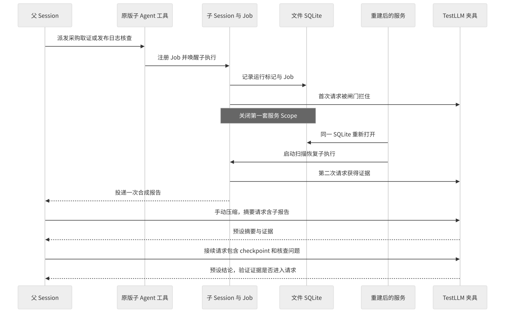

### 课堂任务与验收

| 场景 | 子 Agent 负责 | 主 Agent 看到的验收证据 | 课堂预设结果 |
|---|---|---|---|
| ISO 9001 商务核查 | 定位证书页、持有人和有效期 | `P12` 提供同名持有人和 2027-06-30 的有效期，早期材料给出投标截止 2026-11-25 | 符合 |
| 发布回归核查 | 查找回归命令的最终退出码 | `LOG-42` 提供日志定位，也明确说缺少最终退出码 | 待复核 |

两个案例共用同一套原版执行机制。课堂的角色回复、摘要和结论由 `TestLLM` 提供。实际验收的是**证据在派发、恢复、回传和压缩后是否到达接续请求**。这两项结论用于检查控制流，不能作为原版模型判断能力的评测。

### 五个观察点

1. **派发返回，子任务仍运行。** 课堂脚本通过原版工具注册表调用 `subagent`，父 Session 已有材料。子 Runner 首次请求被测试闸门挂起。此时文件 SQLite 里已有子执行认领及运行中的 Job 行，父会话报告数是 0。[真实的子 Agent 工具](https://github.com/anomalyco/opencode/blob/ee5fe34e136488a1839ac73bcca8321c51a31b75/packages/core/src/tool/plugin/subagent.ts#L170-L216) · [上游中断夹具](https://github.com/anomalyco/opencode/blob/ee5fe34e136488a1839ac73bcca8321c51a31b75/packages/core/test/subagent-idle-e2e.test.ts#L679-L723)
2. **关掉第一套服务，重开同一个库。** 在首个模型回复发布前关闭服务 Scope。第二套服务打开同一个文件 SQLite，仍读到同一子 Session 的 claim 和 running Job。原版恢复扫描重新推进已认领的工作。第二次模型调用属于同一子 Session。[重开与启动扫描的上游断言](https://github.com/anomalyco/opencode/blob/ee5fe34e136488a1839ac73bcca8321c51a31b75/packages/core/test/subagent-idle-e2e.test.ts#L720-L748)
3. **只收到一份可用报告。** 子任务结算后，带证据定位的合成消息进入父历史。测试再次执行恢复扫描，核对父历史仍只有一条报告。第一次模型请求已经启动，第二次恢复请求仍然可能发生。通知的去重范围和模型请求的重跑范围不同。[父会话报告投递](https://github.com/anomalyco/opencode/blob/ee5fe34e136488a1839ac73bcca8321c51a31b75/packages/core/src/session/execution/subagent-report.ts#L75-L130) · [稳定通知 ID](https://github.com/anomalyco/opencode/blob/ee5fe34e136488a1839ac73bcca8321c51a31b75/packages/core/src/session/subagent-completion.ts#L57-L86)
4. **父会话的压缩模型读取了子报告。** 课堂显式提交压缩项。原版摘要请求中可见子报告的证据文本。原版会话保存完成的压缩检查点。两组案例的摘要回复都特意保存了证据定位，借此查看后续请求会怎样携带它。[手动压缩输入](https://github.com/anomalyco/opencode/blob/ee5fe34e136488a1839ac73bcca8321c51a31b75/packages/core/src/session/session.ts#L260-L277) · [摘要执行与换入](https://github.com/anomalyco/opencode/blob/ee5fe34e136488a1839ac73bcca8321c51a31b75/packages/core/src/session/compaction.ts#L299-L335)
5. **接续请求里仍然能看见可核查信息。** 给父会话追加最终核查问题。探针检查真实模型请求中出现了 `<summary>` 和对应证据，随后核对会话里确实写下了预设结论。此时子模型请求总数仍是 2。[模型消息中的检查点](https://github.com/anomalyco/opencode/blob/ee5fe34e136488a1839ac73bcca8321c51a31b75/packages/core/src/session/runner/to-llm-message.ts#L292-L308)

### 用同一套问题设计自己的 Agent

| 设计问题 | 针对轻量业务的判断方法 |
|---|---|
| 一项任务是否需要多个 Agent？ | 如果需要独立审阅、多个工具集或需要并行查互不依赖的材料，子会话能隔离上下文。只有几步只读查询时，先看一次受预算限制的工具循环能否覆盖实际需求。 |
| 用什么作为恢复锚点？ | 记录「是否接收」「是否执行中」「是否完成待通知」三种事实。为通知使用稳定 ID。会产生外部副作用的工具还要能识别重复请求。 |
| 什么时候需要目标复核？ | 有明确可核验的目标、执行可能跨多次空闲边界时，才适合继续审核。简单核查可以用证据字段、结构化结果与缺证据待复核来收尾。 |
| 哪些东西应该放进摘要？ | 摘要适合保存目标、进度、约束和可重新获取的证据定位。精确条款、日期、金额和退出码最好带原文或可回查的稳定引用。 |
| 怎么知道自建方案有收益？ | 用相同任务样本比较证据正确率、工具调用数、模型调用数、输入输出 Token 和端到端耗时。先找第一次偏离预期的步骤，再判断是否需要更复杂的框架机制。 |

**自测。** 如果子任务确实核对了证书，但摘要遗漏证书持有人，且后续请求没有原文，你会根据什么要求主 Agent 再查一次？如果模型发起了一次服务重试，你会怎样确认报告只有一份，同时不把这个事实套用到外部工具的执行次数上？

[打开 Jupyter 实验](notebooks/18-capstone.ipynb) · [两条原版综合轨迹](fixtures/capstone-observations.json)

## 附录 · LangChain 对照

学完 OpenCode 主课后，可以用同一组资料核查、周报摘要和订单排查样本，观察简单 Agent 需要保留哪些运行机制。本册样章提供这一阅读索引。后续对照实践按消息与工具回传、证据校验、调用预算、固定样本评测展开。

对照时关注两套系统实际交给模型的消息、工具结果、停止条件、耗时和 token。已有的 DeepSeek Flash ISO 9001 实验属于独立练习。原版 OpenCode 的行为以固定提交中的源码和本册标注的回放为依据。

附 [独立 Python 实验](appendix/iso9001-langchain.py) 与 [此前 DeepSeek Flash 实测轨迹](appendix/iso9001-langchain-trace.jsonl)。轨迹记录 5 次模型请求、7 次只读工具调用，最终判定「符合」。如需联网重跑，在终端中通过环境变量提供 `DEEPSEEK_API_KEY`，再执行 `uv run --script appendix/iso9001-langchain.py`。Notebook 的默认实验可以离线运行。

## 图源与资料

- [01-architecture · Mermaid](diagrams/01-architecture.mmd) · [SVG](diagrams/01-architecture.svg)
- [02-tools · Mermaid](diagrams/02-tools.mmd) · [SVG](diagrams/02-tools.svg)
- [03-prompts · Mermaid](diagrams/03-prompts.mmd) · [SVG](diagrams/03-prompts.svg)
- [04-message · Mermaid](diagrams/04-message.mmd) · [SVG](diagrams/04-message.svg)
- [05-boundaries · Mermaid](diagrams/05-boundaries.mmd) · [SVG](diagrams/05-boundaries.svg)
- [06-subagent-dispatch · Mermaid](diagrams/06-subagent-dispatch.mmd) · [SVG](diagrams/06-subagent-dispatch.svg)
- [07-background-report · Mermaid](diagrams/07-background-report.mmd) · [SVG](diagrams/07-background-report.svg)
- [08-job-states · Mermaid](diagrams/08-job-states.mmd) · [SVG](diagrams/08-job-states.svg)
- [09-goal · Mermaid](diagrams/09-goal.mmd) · [SVG](diagrams/09-goal.svg)
- [10-event-commit · Mermaid](diagrams/10-event-commit.mmd) · [SVG](diagrams/10-event-commit.svg)
- [11-storage-map · Mermaid](diagrams/11-storage-map.mmd) · [SVG](diagrams/11-storage-map.svg)
- [12-inbox-projection · Mermaid](diagrams/12-inbox-projection.mmd) · [SVG](diagrams/12-inbox-projection.svg)
- [13-restart-recovery · Mermaid](diagrams/13-restart-recovery.mmd) · [SVG](diagrams/13-restart-recovery.svg)
- [14-crash-boundaries · Mermaid](diagrams/14-crash-boundaries.mmd) · [SVG](diagrams/14-crash-boundaries.svg)
- [15-context-assembly · Mermaid](diagrams/15-context-assembly.mmd) · [SVG](diagrams/15-context-assembly.svg)
- [16-token-decisions · Mermaid](diagrams/16-token-decisions.mmd) · [SVG](diagrams/16-token-decisions.svg)
- [17-compaction-flow · Mermaid](diagrams/17-compaction-flow.mmd) · [SVG](diagrams/17-compaction-flow.svg)
- [18-model-visible · Mermaid](diagrams/18-model-visible.mmd) · [SVG](diagrams/18-model-visible.svg)
- [19-extension-loading · Mermaid](diagrams/19-extension-loading.mmd) · [SVG](diagrams/19-extension-loading.svg)
- [20-hooks-mcp · Mermaid](diagrams/20-hooks-mcp.mmd) · [SVG](diagrams/20-hooks-mcp.svg)
- [21-client-transport · Mermaid](diagrams/21-client-transport.mmd) · [SVG](diagrams/21-client-transport.svg)
- [22-ci-release · Mermaid](diagrams/22-ci-release.mmd) · [SVG](diagrams/22-ci-release.svg)
- [23-capstone · Mermaid](diagrams/23-capstone.mmd) · [SVG](diagrams/23-capstone.svg)

- [样章打开方式](README.md)
- [随附原版文件及许可](fixtures/upstream/README.md)
